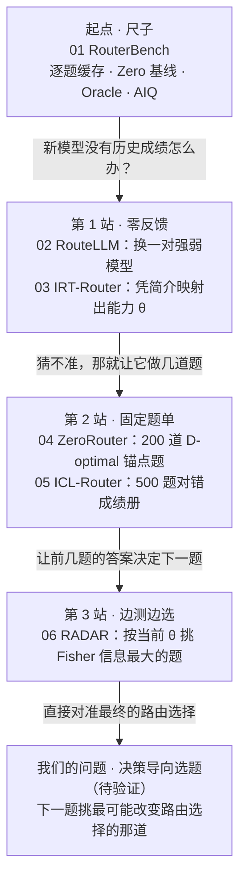

# LLM 路由六篇综述：来一个 query 怎样选模型，新模型怎样接入

## 两条主线

六篇论文可以沿两条线来读，两条线共用同一条路由链路（见下一节[统一记号](#统一记号)）。

- **主线 A：来一个 query，怎样选到最合适的模型？** 这是每篇论文自己的主问题：怎样预测各模型的质量、怎样估成本、怎样按偏好权衡。读懂 A，就读懂了整个路由领域。
- **主线 B：一个新模型上线，要测多少题、测哪些题，才能把它接进路由池？** 它只改 A 链路上的一环（模型表示），但我们的研究问题在这条线上。

从领域看，B 是路由研究中的一个子问题：它只涉及 A 链路上的“模型表示”这一环。从我们的研究看，重点放在 B：A 决定路由器怎样为请求选模型，在比较选题方法时作为固定条件；B 研究如何用有限测试让新模型接入。若希望按接入后的路由收益来选测试题，就要看测完这道题后，路由器能不能更准确地判断哪些请求该交给新模型、哪些继续交给已有模型。

ZeroRouter（表 2）和 RADAR（表 20）都做了“同样题数、只换选题方法”的对照，但各用自己的路由器：前者比较了 D-optimal、随机、难度、区分度和任务感知难度选题，后者比较 Fisher 自适应与随机选题。（*）IRT-Router 和 ICL-Router 没有单独检验选题方法的贡献；这六篇中，也没有把 D-optimal、Fisher 自适应和固定分层题单放在同一个路由器下比较。比如 ICL-Router 加入新模型后准确率上升，说明它能利用新增模型，但不能分清收益来自接入模型本身就强，还是因为测试题选得好。要研究“怎样选题更有效”，应固定候选模型、路由器、成本口径和偏好，让新模型分别回答不同选题方法选出的等量题目，再比较接入后的路由效果。

（*）zero-router只按难度选题，三项都低于随机；只按区分度选题，也没有稳定优势。任务感知难度三项都超过随机，D-optimal 则进一步提高。准确率优先时，D-optimal 比随机高 0.12，比任务感知难度高 0.07。论文将其相对其他四种选题方法的差异均标为统计显著。
//“Fisher 比随机好”和“接入后比原来好”要分开看。100 题时，Fisher 在 GPQA 上基本维持接入前表现；在 AIME、FRAMES 上虽然超过随机，仍低于接入前。到 5000 题时，它相对随机的优势已不普遍。

（所有条件的限定：确定要限定什么条件，再做什么方法的改变；比如radar加了思维预算以及成本的计算；加一些条件，是别人没有研究过的---找一个好的问题，在这个方向上找一个具体限定的问题）
（问题（背景（特别清楚），限定（后续窄化-两条主线现在的研究研究到什么程度）比如radar提供了什么条件要得到什么结论）--基于背景和限定来提问题 -- 问题（我要提什么条件，有什么不一样，具体的技术问题）-- 方法（进行1.基于什么理论 2.别人在类似问题上方法论上用的什么方法，可不可以借鉴 ） -- 实证（验证方法是否合理，明确确定baselien；benchmark） -- 做出来结果（需要考虑改进，说服评委这个方法是有依据的））

| 论文 | 主线 A：收到一道题后，怎样选模型？ | 主线 B：新模型接入前，要准备什么？ |
|---|---|---|
| [01 RouterBench](01_RouterBench_精读核验.md)（2024.03） | 用各模型在旧题上的成绩预测新题表现，再结合费用选模型；主要贡献是提供统一的数据和评测方法，检查路由是否真的更划算。 | **未研究新模型接入。** 它提供的逐题成绩和费用记录，可用于后续方法的离线实验。 |
| [02 RouteLLM](02_RouteLLM_精读核验.md)（2024.06） | 只在一个强模型和一个弱模型之间选。预测强模型的回答更受偏好的概率，达到设定门槛就选强模型，否则选弱模型。 | **0 题**：无需让新模型先做测试，也不重训路由器。论文验证的是把原来的强弱模型换成另一对，仍然二选一。 |
| [03 IRT-Router](03_IRT-Router_精读核验.md)（2025.06） | 从模型简介估计能力，从题目文字估计难度等信息，预测各模型能答得多好，再结合费用选择。 | **0 题**：提供一段新模型的简介，由训练好的网络估计它的能力，无需先收集新模型的答题成绩。 |
| [04 ZeroRouter](04_ZeroRouter_精读核验.md)（2026.01） | 同时预测各模型答得怎样、花多少钱、要等多久，再按用户对质量、费用和速度的重视程度选择。 | **200 题**：提前选好一组尽量提供互补能力信息的题（D-optimal），用新模型的答题成绩估计能力；题单不随它的回答改变。 |
| [05 ICL-Router](05_ICL-Router_精读核验.md)（2025.10） | 用一个专门训练的语言模型充当路由器。它读取新题和某个候选模型的历史答题记录，预测该候选答对新题的概率。同一个路由器对所有候选分别预测，再把新题交给预测答对概率最高的候选模型作答；选择时不考虑费用。 | **500 题**：让新模型回答同一套固定题，把题目及每题答对或答错的记录组成“成绩册”；无需重训路由器。 |
| [06 RADAR](06_RADAR_精读核验.md)（2025.09）（*） | 同时决定用哪个模型、让它思考多少（推理预算），在预计回答质量和费用之间折中。 | **边测边选**：每答完一道题就更新能力估计，再按当前估计挑下一道信息量最大的题（Fisher 信息选题）。主实验每个“模型＋推理预算”配置测 **5000 题**，另比较了 100、500 题。 |

表中的题数是论文实验中新模型接入时的测试预算；“0 题”只指接入时无需额外测试，前期训练仍需要数据。

（*）两篇在主线 A 上的共同流程都是：
预测各候选能答得多好 → 估计费用 → 根据用户偏好选择。
RADAR 改动了这条流程中的几个环节。下表比较的是两篇各自的原始方法。
| 环节 | IRT-Router | RADAR |
|---|---|---|
| **选择对象** | 主要在不同模型之间选择，也包含加 CoT 等配置。（指通过提示，让模型先分步骤推理，再给出答案） | 系统地把“模型＋思考预算”作为候选，同一个模型可以有多个预算档位。 |
| **怎样预测答题表现** | 从模型简介得到多维能力向量，再结合题目参数预测表现。 | 从实际答题成绩学习每个配置的能力；每个配置用**一个能力数值**表示，再结合题目难度、区分度预测表现。 |
| **怎样估计费用** | 用模型的输出 token 单价代表成本。 | 用该配置历史上平均消耗的“思考＋回答”token 数乘单价。这样能区分同一模型不同预算的费用。 |
| **怎样权衡质量和费用** | 线性加权：质量加分，费用扣分。 | 除线性加权外，还使用切比雪夫规则，寻找更多质量与费用之间的折中配置。 |

其中，最核心的问题变化是增加了“思考预算”这个选择维度。
例如，一道题可能有这些方案：
- 小模型，短推理；
- 小模型，长推理；
- 大模型，短推理；
- 大模型，长推理。

RADAR 要判断哪一种方案已经足够解决这道题，是否值得继续增加模型规模或思考预算。所以它把研究集中到推理模型，同时在这个范围内细化了可选方案。
至于 IRT 本身，RADAR 采用的一维能力表示是一种简化：参数更少，也更容易排列配置的能力高低；但表达不同领域的能力差异会受到限制。不能仅凭它的整体实验结果，就说“一维 IRT 比多维 IRT 更好”。
这里还有一个影响结果解读的细节：RADAR 实验中的 IRT-Router 基线经过改造，使用了与 RADAR 相同的 2PL 参数形式和题目编码器，但各模型使用固定的最大推理预算。因而主表比较的是整套方案，收益可能同时来自预算选择、决策规则等变化，不能全部归因于 IRT 预测器。RADAR 附录 D.3
前面问的 Fisher 自适应选题，则属于主线 B：它解决新配置加入时怎样测量能力。主线 A 的重点仍是：已有这些配置后，每道题应该用哪个模型、给多少思考预算。

## 统一记号

每个路由器都在回答生成之前做同一件事：看到问题 $q$，给池里每个候选 $m$ 估一个质量和一个成本，按偏好合成一个分数，选最高的那个。六篇只是在这条链路的不同环节做修改：

**问题表示 → 模型表示 → 质量预测 → 成本估计 → 决策规则 → 评测**

| 记号 | 含义 |
|---|---|
| $\widehat P(q,m)$ | 候选 $m$ 在问题 $q$ 上的预期表现，0 到 1 |
| $y_{qm}$ | 实测的表现（训练标签） |
| $\widehat C(q,m)$ | 成本估计；只依赖模型、不随题目变时写成 $\widehat C(m)$ |
| $z_m$ | 模型表示：路由器“认识”一个模型靠的东西（模型简历、能力参数、成绩册……） |
| $\theta_m$；$a_q$、$b_q$ | IRT 中模型的能力；题目的区分度、难度 |
| $B$ | 新模型接入时愿意付出的测试反馈条数 |

（补充：`z_m`。m 指某一个候选模型，z_m 就是**路由器拿来描述这个模型的那份信息**。
可以拿招聘打个比方。一个岗位来了（一道题），要从几个候选人（几个模型）里挑一个去做。挑人之前，你手里对每个候选人得有点“资料”：可能只是一个名字，可能是一份简历，也可能是他做过的笔试成绩单。这份资料就是 z_m。路由器预测“这个模型做这道题会怎样”，靠的就是题目本身加上这份资料。

六篇论文的区别，很大一部分就在于这份资料是什么：

| 论文 | 路由器手里关于每个模型的“资料” | 打个比方 |
|---|---|---|
| RouterBench | 这个模型在历史题上的成绩 | 过往工作记录 |
| RouteLLM | 只知道它属于“强”还是“弱” | 只知道是资深还是新人 |
| IRT-Router | 由一段模型简介算出的能力向量 | 看简历估能力 |
| ZeroRouter | 做 200 道指定题后估出的能力向量 | 做一套固定笔试，算出能力分 |
| ICL-Router | 500 道题每题答对还是答错的原始记录 | 直接看整张答题卡 |
| RADAR | 边做题边估出的一个能力分数 | 面试官根据前面的回答决定下一题 |

为什么要专门给它起个名字？因为**新模型接入的难点全在这一环**。新模型刚上线时，没有过往记录，路由器对它一无所知。所以主线 B 问的就是：这份资料从哪里来——写简介、做固定试卷，还是边考边问？要做多少题、哪些题，才能让资料靠谱到足以做出正确的路由选择？）

决策规则统一写成“质量减成本”：

$$
m^*(q)=\arg\max_m\left[w\,\widehat P(q,m)-(1-w)\,\widehat C(q,m)\right],\qquad 0\le w\le 1,
$$

$w$ 越大越看重质量。各篇原文的权重符号方向不一，读原文时对照这张表：

| 论文 | 原文写法 | 和 $w$ 的关系 |
|---|---|---|
| RouterBench | $\lambda\widehat P-\widehat c$，$\lambda$ = 愿付价 | $\lambda$ 越大越看重质量，同 $w$ |
| RouteLLM | $\widehat p\ge\alpha$ 就选强模型 | 没有成本项；$\alpha$ 越大越省钱，$\alpha$ 是调用强模型的门槛，取值在 0 到 1 之间，可以根据预算调整 |
| IRT-Router | $\alpha\widehat P-\beta C$，$\alpha+\beta=1$ | $\alpha$ 就是 $w$ |
| ZeroRouter | $w_p\widehat P-w_c\widehat C-w_t\widehat T$ | 多了延迟项 $\widehat T$ |
| ICL-Router | 只取 $\arg\max\widehat P$ | 没有成本项，相当于 $w=1$ |
| RADAR | 线性式同 $w$；另有切比雪夫式 | 切比雪夫式见主线 A ③ |

主线 A 关心这条链路的每一环怎样做得更好；主线 B 只关心其中一环：**模型表示 $z_m$ 从哪里来、要花多少条反馈。**

## 主线 A ①：RouterBench 先把尺子定好

[RouterBench](01_RouterBench_精读核验.md) 的结论是：kNN、MLP 这类最直接的预测式路由，并没有稳定超过“同预算下按固定概率混合几个模型”的静态基线。后面五篇都在这把尺子上量自己。

它做了三件后文反复用到的事：

1. **逐题缓存**（建立评测数据集）：11 个核心模型在 8 类数据集上的 405,467 条“模型—题目”记录，每条有质量和费用。路由策略（routerbench用得是knn和mlp）可以离线反复评，不必重新调用模型。这也是 8GB 单卡能做方法研究的前提。（实验的时候直接查表）
2. **两条参照线** （上下界,设置比较参照）：Zero 基线不看题目，按提前算好的能得到最优结果的比例随机选；Oracle 事后知道每题谁答得好，是达不到的上界。一个路由器的真实价值 = 它比 Zero 高出多少；Oracle 与它的差距只说明“理论上还有空间”。
3. **一条曲线代替一个点**(提供比较方法和指标)：改变 $w$ 得到一串成本—质量点，取上包络（NDCH），再用 AIQ 压成一个数，即共同成本区间内的平均质量高度。同一个路由器可以通过调整 $w$，选择更省钱或更重视回答质量。每种设置都会得到一个费用和质量的结果，把这些结果画出来，就能看到“花多少钱，能达到什么效果”。还可以让一部分请求使用省钱的设置，另一部分使用高质量的设置。考虑这些混合方式后，把每个费用水平下能达到的最好结果连起来，就是 NDCH 曲线。比较不同路由器时，我们选取相同的费用范围，用 AIQ 表示这段范围内的平均回答质量；AIQ 越高，说明它在这段预算范围内整体表现越好。（较不同路由方法的 AIQ，评估它们在相同费用范围内的平均回答质量。比较时还要使用相同的候选模型和测试题。）

RouterBench 里的模型表示 $z_m$ 最朴素：就是“这个模型在历史题上的成绩那一列”。kNN 找 $k$ 道相似旧题，取各模型在这些题上的平均分作 $\widehat P$。这意味着一个新模型若没有历史成绩，kNN 根本无从预测它。这是主线 B 的起点。

关键结果：在 MMLU 上，kNN 和 MLP 的 AIQ 分别为 0.773 和 0.769，略高于 Zero 的 0.763；但在 ARC-Challenge 和 MBPP 上，两者反而不如不看题目、按固定比例分配请求的 Zero。 Oracle 的结果表明，一个模型答错的题，另一个模型可能答对，因此逐题选对模型确实可以提高整体成绩。困难在于，实际路由器必须在模型作答之前仅根据题目预测该选谁。
这些实验说明，kNN 和 MLP 还不能稳定地做好这种预测，因此“分析题目再选模型”未必比固定比例分配更有效。

## 主线 A ②：质量预测怎么一步步变强

$\widehat P(q,m)$ 的做法从“查相似旧题的平均分” 到 “能力 × 难度的结构化模型”，再到 “让 LLM 直接读成绩册”。越往后表达力越强，但要的数据和算力也越多。

| 论文 | 具体怎么预测（$\widehat P$ 怎么来的） | 好处与限制 |
|---|---|---|
| [RouterBench](https://arxiv.org/html/2403.12031v2#S5.SS1) | **训练时**：准备旧题的数字表示，以及各模型在这些题上的成绩。kNN（k 近邻）保存这些记录，供之后查找，不需要训练预测网络；MLP（多层感知机，一种神经网络）则利用这些记录，学习从题目预测各模型的成绩。 **收到新题时**：kNN 找出最相似的 $k$ 道旧题，把各模型在这些题上的平均成绩作为预测值 $\widehat P$。例如，某模型在 5 道相似旧题中答对了 4 道，就预测为 0.8。MLP 则把新题的数字表示输入训练好的网络，直接得到各模型的预测成绩。 | 做法直接，适合作为比较其他方法的起点。它依赖历史答题记录；而且，文字相似的题，各模型的表现未必也相似。 |
| [RouteLLM](https://arxiv.org/html/2406.18665v4#S4.SS2) | **训练时**：收集“同一道题上，哪个模型的回答更受偏好”的比较记录。论文比较了几种预测器，以 MF（Matrix Factorization，矩阵分解）为例：它把题目和模型表示成一组数字，利用比较记录学习两者的匹配程度。 **新模型接入时**：论文试过把强、弱模型换成另一对，直接沿用训练好的路由器，无需重新训练。这里仍是在两个模型之间选择。 **收到新题时**：根据强、弱模型与题目的匹配分数，预测强模型回答更受偏好的概率 $\widehat p$。这个概率达到阈值 $\alpha$ 就调用强模型，否则调用弱模型。 | MF 不需要使用大语言模型充当路由器，也能学习如何选择。不过，原方法处理的是强弱二选一；预测“用户更喜欢谁的回答”，也不等于预测“谁一定答对”。 |
| [IRT-Router](https://arxiv.org/html/2506.01048v2#S4) | 以论文的多维 IRT 版本为例。 **训练时**：利用旧模型的简介和答题成绩，学习模型简介、题目文字与实际成绩之间的关系。 **新模型接入时**：输入它的简介，例如类型和特点，网络便生成一组能力参数，用 25 个数字描述它的能力，不需要先让新模型做题。 **收到新题时**：用 BERT 文本编码器及后续网络估计题目的难度、区分度，再与各模型的能力参数一起代入 IRT 公式，得到 **0～1 的预测表现值 $\widehat P$**。如果训练成绩按“答对为 1、答错为 0”记录，这个值就表示预测的答对概率。 | 新模型只需提供简介，接入时可以省去测试费用。但预测依赖“简介能否反映真实能力”：文字描述相似的模型，实际表现可能差很多。这些能力数字是网络估计的，不是新模型经过测试得到的。 |
| [ZeroRouter](https://arxiv.org/html/2601.06220v1) | **训练时**：利用 200 个旧模型的答题记录 $(q,m,y_{qm})$，通过 IRT 估计模型能力，以及旧题的难度、区分度。再训练一个基于 DistilBERT 的预测器，让它学习从题目文字预测这些题目参数。 **新模型接入时**：让它做 200 道提前选好的题，根据实际成绩，估计一组由 20 个数字组成的能力参数。 **收到新题时**：用 DistilBERT 预测器估计题目的难度、区分度，再与各模型的能力参数一起代入 IRT 公式，得到 **0～1 的预测表现值 $\widehat P$**。如果训练成绩按“答对为 1、答错为 0”记录，这个值就表示预测的答对概率。 | 新模型的能力估计有实际答题成绩作为依据。完成测试后，只需估计新模型自己的能力参数，不必重训整个路由网络。但接入需要支付测试费用；前期也要准备旧模型的答题数据，并训练题目参数预测器。 |
| [ICL-Router](https://arxiv.org/html/2510.09719v3#S3) | **训练时**：训练一个 7B（约 70 亿参数）大语言模型充当路由器。先让它根据题目的数字表示还原原题，学会理解这种输入；再给它旧模型的答题记录，训练它预测这些模型能否答对另一道题。每份记录包含同一组 500 道题的数字表示，以及对应模型答对还是答错。 **新模型接入时**：让它做这 500 道固定题，整理出它自己的答题记录；路由器不需要重新训练。 **收到新题时**：把新题和某个候选模型的答题记录一起交给路由器，用它输出“Yes”的概率作为该模型的预测答对概率 $\widehat P$。对各模型分别预测后，选择概率最高的那个。 | 可以直接利用一整份答题记录判断模型表现。新模型只需补充记录即可接入。但路由器本身需要训练，使用时还要处理大量历史记录，因此有额外的计算开销。 |
| [RADAR](https://arxiv.org/html/2509.25426v3#S3.SS3) | **训练时**：把“模型＋允许思考的预算”看成一个候选配置，因此同一个模型少想一会儿、多想一会儿，会被当成不同候选。利用各配置的答题成绩，学习每个配置的能力，以及从题目文字估计难度、区分度的方法。每个配置只用一个数字表示能力。 **新模型接入时**：对它的每个新配置分别测试。每做完一道题，就根据已有成绩更新能力估计，再挑选下一道有助于判断能力的题，直到测试预算用完。这一步只估计新配置的能力，已有的题目参数保持不变。 **收到新题时**：先把题目转成数字表示，再通过训练好的线性变换估计难度和区分度；结合各配置的能力，代入 IRT 公式，得到预测答对概率 $\widehat P$。 | 每个候选需要估计的能力参数少。但用一个数描述能力，可能难以表达“数学强、代码弱”这样的差异；这是需要进一步实验检查的限制，不能直接断言它因此效果差。 |

上一张表按“训练时 → 新模型接入时 → 收到新题时”解释方法，下面沿这三个环节看实验：**训练设计有没有帮助？接入新模型后是否有效？最终选出的模型答得怎样、花费多少？** 每格都尽量写清实验条件、比较对象和结果。各论文的测试题、候选模型和指标不同，横向比较的是它们为每个环节提供了什么证据，不能直接按分数给六篇排序。ID 指与训练数据来自相同分布的测试题，不是训练原题。

| 论文 | 对应“训练时”：数据或预测方式的实验 | 对应“新模型接入时”：接入效果的实验 | 对应“收到新题时”：最终路由效果的实验 |
|---|---|---|---|
| [RouterBench](https://arxiv.org/html/2403.12031v2#S5.SS3) | **比较预测方式**：在相同任务和候选池中，比较查相似旧题的 kNN 与训练预测网络的 MLP。论文用右列的最终路由效果评价两种方式；训练一个预测网络并没有带来稳定优势。 | **未研究新模型接入**：没有测试“新模型只有少量答题记录时，怎样接入”。因此，这篇提供的是评测参照，不能用其结果判断接入方法好坏。 | **对比不看题目的 Zero**：MMLU 上，Zero 的 AIQ 为 0.763，kNN 为 0.773，MLP 为 0.769，分别高 0.010、0.006；但在 ARC-Challenge 和 MBPP 上，两者都低于 Zero。说明按题选模型带来的收益依赖任务，尚未稳定超过固定比例分配。（图 4） |
| [RouteLLM](https://arxiv.org/html/2406.18665v4#S5) | **固定预测器，比较训练数据**：在 MT Bench 上，同一个 MF 路由器只用 Arena 数据训练时，APGR 为 0.580；加入裁判标注数据后为 0.802，提高 0.222。这个对照更直接地支持“补充训练数据有帮助”。（表 1） | **不测题、不重训，换一对模型**：换成 Claude 3 Opus/Sonnet 后，MF 在 MT Bench 上的 APGR 为 0.762，随机分配为 0.493。说明已有路由规则可以迁移到这对模型；仍是强弱二选一，没有验证向多模型池中加入一个新模型。（表 4） | **固定训练数据，比较路由方法**：同样使用 Arena＋裁判标注数据，在 MT Bench 上，MF 的 APGR 为 0.802，BERT 为 0.751，随机分配约为 0.500。说明这个设置下 MF 的整体质量—调用比例权衡更好；不能据此认定 MF 在所有任务上最好。（表 1） |
| [IRT-Router](https://arxiv.org/html/2506.01048v2#S6) | **比较能力表示的维数**：论文改变多维 IRT 的能力维数，最终任务成绩随之波动，没有随维数增加而持续提高。说明把能力表示得更细，并不自动带来更好的路由效果。（附录 B，图 8） | **只凭简介认识新模型**：对新模型 Claude 3.5 Haiku，MIRT 判断其逐题表现对错的准确率（ACC）为 67%，RouterBench 对照为 34%。这里测的是“预测对错是否准确”，没有直接报告加入该模型后整体路由收益提高多少。（表 4） | **对比同实验中的 RouterBench**：在 ID、质量权重 $\alpha=0.8$ 下，MIRT 平均任务得分为 80.67%，对照为 80.01%，高 0.66 个百分点；测试集总调用费用为 0.42 美元，对照为 1.15 美元。说明这个设置下回答成绩略高，调用费用也更低。（表 1） |
| [ZeroRouter](https://arxiv.org/html/2601.06220v1) | **训练步骤的独立贡献尚不清楚**：论文先拟合 IRT，再训练题目参数预测器，但未见分别去掉或替换这两个步骤的单独消融。右侧结果支持整套方法及选题策略，不能据此确定每个训练步骤各贡献多少。 | **固定测试题数，比较选题方法**：新模型同样回答 200 道题，在较重视质量的 Max-Acc 设置下，D-optimal 选题的 Reward 为 0.39，随机选题为 0.27，高 0.12。这直接支持“同样测 200 题，选哪些题会影响接入效果”。D-optimal 选择的是能提供互补能力信息的一组题。（表 2） | **对比同实验中的 Model-SAT**：在 5 个小模型的候选池、ID 测试、Max-Acc 设置下，ZeroRouter 的 Reward 为 0.45，Model-SAT 为 0.43，高 0.02。这里比较的是质量、费用、延迟合成后的收益，不是答题正确率。（表 1） |
| [ICL-Router](https://arxiv.org/html/2510.09719v3#S4) | **比较是否保留第一阶段训练**：保留“根据向量还原题目”的训练时，ID 平均答题准确率为 76.30%；去掉后为 74.01%，相差 2.29 个百分点。说明先让路由器学会理解题目向量，在这个设置下确实有帮助。（表 4） | **补充成绩册，观察接入前后**：每个新模型回答 500 道固定题，路由器不重训；随着 5 个新模型陆续加入，ID 平均答题准确率从 76.3% 升到 79.9%。说明系统能利用新增模型，但候选池也变强了，不能把这 3.6 个百分点全归因于选题或成绩册设计。（图 2） | **对比同实验中的 EmbedLLM**：在原候选池的 ID 测试中，ICL-Router 的平均答题准确率为 76.30%，EmbedLLM 为 74.16%，高 2.14 个百分点。说明整体答题效果更好；这项比较没有同时衡量费用。（表 1） |
| [RADAR](https://arxiv.org/html/2509.25426v3#S4) | **比较题目参数预测器**：在 GPQA-Diamond 的 ID 测试中，使用线性变换时，Hypervolume 为 0.7513；换成两层 MLP 后为 0.7308。说明更复杂的题目参数预测器在这个设置下没有带来提升；这不是“一维能力优于多维能力”的单独验证。（附录 B.1，表 5） | **固定测试题数，比较选题方法**：接入 Qwen3-14B 的新配置，每个配置同样测试 100 题；在 GPQA-Diamond 的 ID 测试中，接入前的 Hypervolume 为 0.7513，Fisher 信息自适应选题接入后为 0.7511，基本不变；随机选题接入后降到 0.6171。因此，自适应选题在此主要避免了接入后的路由退化，并未带来相对接入前的提升；这提示新配置的能力估计不准，反而可能拖累路由。（附录 B.7，表 20） | **对比同实验中适配后的 IRT-Router**：在 GPQA-Diamond 的 ID 测试中，RADAR 的 Hypervolume 为 0.7513，IRT-Router 为 0.6942，高 0.0571。说明整套方法的成本—质量权衡更好，尚不能把收益单独归因于一维能力表示。（表 1） |

表中的指标需要分开读：

- **答题准确率／平均任务得分**：选中的模型最终答得怎样。**预测准确率 ACC** 则是在问路由器是否预测对了模型的表现，两者不是同一件事。
- **AIQ／Hypervolume**：都用成本—质量曲线概括一段预算范围内的整体效果，越高越好；具体计算和归一化不同，数值不能直接互比，也不等于某一个预算下的答题准确率。
- **APGR**：在不同强模型调用比例下，平均弥补了多少强、弱模型之间的成绩差距。例如 0.802 表示按该指标平均弥补了 80.2% 的差距，不是答对了 80.2% 的题。
- **ZeroRouter 的 Reward**：把回答质量、费用和延迟按权重合成的收益；这里的 Max-Acc 使用 $(0.8,0.1,0.1)$，较重视质量，但仍扣除费用与延迟。因此 0.39 不是 39% 的答题准确率。

另一个诊断结果是：IRT-Router 的 MIRT 版本在上述 ID、$\alpha=0.8$ 设置下，Top-1 只有 2.72%。它统计的是“是否选中论文评分规则下的逐题第一名”，不是答题正确率；因此把它与平均成绩、调用费用分开解释，见下面第二条观察。

两条贯穿六篇的观察：

- **路由器选得好不好，也取决于它学过哪些例子、能否识别题目的特点。** 如果训练数据缺少某类题目，单纯把路由器做大，未必能学会这类题该交给哪个模型。RouteLLM 的实验中，补充相关训练数据，比单纯使用更大的路由器更有效。ICL-Router 则发现，更换负责把题目转成向量的 embedding 模型后，最终答题准确率提高了约 2 个百分点。这说明，改进路由时，应同时检查训练数据和输入表示，不能只盯着路由器结构。

- **没有选中最优模型，不一定意味着损失很大。** 假设一道题上，最好的模型能得 90 分，路由器选中的模型得了 89 分：虽然没有选中第一名，但只损失了 1 分。IRT-Router 的一个实验中，选中逐题最优模型的比例（Top-1）只有 2.72%，但整体表现仍然较好；这个比例不是答题正确率。因此，评价路由器时，除了看平均成绩和选中第一名的比例，还要看每道题比最优选择少得了多少分，即“逐题后悔值”。它能帮助区分：路由器是经常只差一点，还是在少数题上选得特别差。

## 主线 A ③：成本和偏好怎么进入决策

上一节得到的是“每个候选模型预计能答得多好”。接下来还要决定：**为了提高回答质量，愿不愿意多花钱、多等一会儿？** 这就是这里的“偏好”：它决定路由器怎样权衡质量、费用和时间。

先把费用的三个概念分开。**单价**是每个 token 收多少钱，token 是模型处理文本的计量单位；**预计费用**是在模型尚未回答时，估计这一次调用会花多少钱；**实际费用**是在回答生成后，用真实输入、输出 token 数结账。按输入、输出分别计价时：

$$
\text{预计费用}
=
\text{输入 token 数}\times\text{输入单价}
+
\text{预计输出 token 数}\times\text{输出单价}.
$$

输入已经拿到，可以用模型的分词器统计长度；输出还没生成，长度需要预测。六篇的一个重要区别，就是有没有在选择之前估计这笔逐题费用。有的用单价或历史平均费用代替，有的只控制昂贵模型的调用次数，还有的只追求答题准确率。

| 论文 | 第一步：收到新题后，怎样估计费用 | 第二步：怎样结合质量和费用选模型 | 第三步：回答之后，怎样记账和评测 |
|---|---|---|---|
| [RouterBench](01_RouterBench_精读核验.md) | **预测式路由用每 token 单价代表成本。** 每个模型对应一个固定的成本数值，不预测这道题会生成多少 token。因此，同一模型回答短题和长题时，选择公式中的成本项相同。 | 对每个模型计算 $\lambda\widehat P-\widehat c$，选择分数最高的。$\widehat P$ 是预计回答质量，$\widehat c$ 是该模型的单价成本项；$\lambda$ 表示愿意为质量付出多少成本，越大越重视质量。 | 根据实际输入、输出 token 数计算调用费用。改变 $\lambda$，得到不同的“花费—质量”结果，再用 AIQ 比较共同费用范围内的整体表现。**选模型时用单价近似，评测时按真实长度记账，两者不同。** [原文 §5.1、附录 A.1](https://arxiv.org/html/2403.12031v2#S5.SS1) |
| [RouteLLM](02_RouteLLM_精读核验.md) | **不预测每道题的美元费用，用强模型调用比例代表开销。** 它假设强模型明显更贵，因此少调用强模型通常能省钱。 | 预测“强模型的回答更受偏好”的概率 $\widehat p$；达到阈值 $\alpha$ 才调用强模型。提高 $\alpha$，调用强模型的条件更严格，通常更省钱。$\alpha=0.8$ 表示胜率门槛为 0.8，不表示把 80% 的题交给强模型。 | 主评测统计“多少比例的请求用了强模型”，再结合回答质量计算 APGR、CPT 等指标。**调用比例不等于美元费用比例**，因为每题的输出长度可能不同。论文另估算了费用节省和路由器自身开销。[原文 §3、§5.4–5.5](https://arxiv.org/html/2406.18665v4#S3) |
| [IRT-Router](03_IRT-Router_精读核验.md) | **把每个模型的输出单价缩放到 0～1，作为固定成本。** 例如用该模型的输出单价除以池中最高输出单价。它没有根据新题预测输出长度，选择公式中也没有逐题输入费用。 | 对每个模型计算 $\alpha\widehat P-\beta C$，其中 $\alpha+\beta=1$，选择分数最高的。$\alpha$ 越大越重视质量，$\beta$ 越大越重视省钱。注意：这里的 $\alpha$ 是质量权重，与 RouteLLM 的胜率阈值含义不同。 | Total Cost 按每道题的实际输入、输出 token 数及各自单价计算，再汇总成美元费用；同时报告平均任务得分和综合 Reward。归一化的输出单价只用于决策近似，不能当成实际账单。[原文 §3.1、§5.4](https://arxiv.org/html/2506.01048v2#S3.SS1) |
| [ZeroRouter](04_ZeroRouter_精读核验.md) | **针对“这道题＋这个模型”估计费用和延迟。** 输入长度直接统计；输出长度根据题目难度，查这个模型在相近难度测试题上的平均输出长度。输入、输出长度分别乘单价后相加。延迟估为“首 token 等待时间＋预计输出长度×每个输出 token 的生成时间”。 | 用 $w_p\widehat P-w_c\widehat C-w_t\widehat T$ 打分，分别给质量加分、给费用和延迟扣分。若没有跨题约束，可以每题单独选最高分；若限制整批请求的总费用或总延迟，就要联合安排各题用哪个模型。 | 用最终回答质量、按 token 计的费用和端到端延迟计算 Reward。质量优先、费用优先、延迟优先对应不同权重；**Reward 是综合收益，既不是账单金额，也不是答题准确率。** [原文成本、延迟及评测定义](https://arxiv.org/html/2601.06220v1) |
| [ICL-Router](05_ICL-Router_精读核验.md) | **选择时不建立费用或延迟模型。** 它预测各候选模型答对的概率，不估计这次调用会花多少钱、等多久。 | 使用 $\arg\max_m\widehat P(q,m)$，意思是“比较所有候选的预测答对概率，选最大的”。即使某模型只预计多答对一点，只要概率最高，也不会因为更贵而被排除。 | 主实验比较最终答题准确率，没有同时用费用约束或质量—费用曲线评价路由收益。这不表示运行没有成本：题目编码、7B 路由器处理成绩册，以及被选中模型生成回答，都有开销。[原文 §3–4](https://arxiv.org/html/2510.09719v3#S3) |
| [RADAR](06_RADAR_精读核验.md) | **给每个“模型＋推理预算”配置一个历史平均成本。** 先统计该配置在训练题上平均生成多少思考 token 和回答 token，再乘输出单价并归一化。不同推理预算对应不同成本，但同一配置对所有新题使用相同的成本估计；该估计不含输入费用。 | 同时选择模型和思考预算。论文比较线性加权与加权切比雪夫，主实验使用后者：先算“离理想质量还差多少”和“费用有多高”，再选两项加权损失中较大值最小的配置。下文用例子展开。 | 用 Hypervolume 概括输出费用与回答质量的整体权衡；用 CPT(90%) 表示达到参考配置 o4-mini/high **九成成绩**所需的最低成本，占参考配置成本的比例。若参考正确率是 80%，目标就是 72%，不是 90% 正确率。[原文 §3.2、§3.4、§4](https://arxiv.org/html/2509.25426v3#S3.SS2) |

这里说“每个模型一个常数”，**固定的是选择公式里的成本估计，不是实际每次调用都收一样的钱**。单价便宜也不保证一整次回答便宜。例如，暂不算输入费用，A 每千 token 收 1 元、回答需要 3,000 token，共 3 元；B 每千 token 收 2 元、回答只需 1,000 token，共 2 元。这是自拟例子，说明输出长度可能改变费用排序。ZeroRouter 尝试在作答前预测这种差别，但“逐题估计”是否比固定成本更有用，还取决于它估得准不准。

再把表中的决策规则展开。线性加权可以写成：

$$
S(q,m)=w\widehat P(q,m)-(1-w)\widehat C(q,m),
$$

然后选 $S$ 最大的候选。前半项奖励回答质量，后半项惩罚费用。$w$ 越大，越愿意为了质量多花钱。这里的权重要结合成本单位和缩放方式理解：成本若从“元”改成“分”，却不相应调整权重，选择就可能改变。因此，不同论文用了同一个权重数字，也不一定表达了同一种付费偏好。

RADAR 的切比雪夫规则改为最小化：

$$
D(q,g)=\max\left\{w\bigl(1-\widehat P(q,g)\bigr),\ (1-w)\widehat C(g)\right\}.
$$

$g$ 是一个“模型＋推理预算”配置。理想状态是答对概率为 1、成本为 0；$1-\widehat P$ 表示距离理想质量的差距，$\widehat C$ 表示距离零成本的差距。**先给两项差距加权，取其中较大的一项，再选这个值最小的配置。** 这就是“尽量减小最突出的问题”。

下面是自拟例子，令 $w=0.5$，三个配置的预测值如下。成本已经归一化，0 表示这个标度下的最低成本，不表示免费。

| 配置 | 预测答对概率 | 归一化成本 | 线性得分 $S$：越大越好 | 切比雪夫损失 $D$：越小越好 |
|---|---|---|---|---|
| A：便宜、质量较低 | 0.60 | 0.00 | $0.5\times0.60-0.5\times0=0.300$ | $\max(0.200,0)=0.200$ |
| B：费用和质量居中 | 0.75 | 0.30 | $0.5\times0.75-0.5\times0.30=0.225$ | $\max(0.125,0.150)=0.150$ |
| C：贵、质量较高 | 0.95 | 0.60 | $0.5\times0.95-0.5\times0.60=0.175$ | $\max(0.025,0.300)=0.300$ |

线性规则选 A：它在这个权重下省下的费用足以补偿质量损失。切比雪夫选 B：A 的主要问题是质量，C 的主要问题是费用，B 最突出的那项损失更小。这个例子中，即使把线性规则的 $w$ 从 0 调到 1，最优选择也只会从 A 换到 C，B 始终不会胜出；切比雪夫则能选到 B。这解释了它为什么可以找到线性加权遗漏的折中方案，但不证明它在所有实测任务上都更好；论文的 OOD 消融中，LSAT 的 Hypervolume 就是线性 0.9165、切比雪夫 0.9146。[RADAR 决策公式](https://arxiv.org/html/2509.25426v3#S3.SS2) · [标量化消融表 18](translations/06_RADAR_中文译文.md#table-18)

**预算限制的是每一题，还是一批题的平均费用，也会改变上述比较。** 沿用这个例子，若允许对同类请求以各一半的概率选 A、C，平均成本为 0.30，期望答对概率为 0.775，比始终选 B 的 0.75 更高。但若要求每次所选配置的成本都不超过 0.30，C 就不能用。RouterBench 的 Zero 基线允许这种概率混合，约束的是期望或长期平均成本；ZeroRouter 则可显式约束一批请求的预计总费用。两者都不能直接解释为“每条请求的实际费用一定不超标”。

最后，**固定一种偏好得到的是一个结果点，改变偏好才得到一条权衡曲线**。AIQ 和 Hypervolume 概括费用—质量曲线；APGR 概括强模型调用比例—质量提升曲线，横轴并非美元费用。Reward 和平均答题准确率则是在某个具体设置下的结果。CPT 从曲线上回答“达到目标成绩至少要多少成本”，但 RouteLLM 的 CPT 用强模型调用比例，RADAR 的 CPT 用相对参考配置的成本比例，两者也不能直接互比。

## 主线 A 留下的问题

这些问题单独做成新路由器，增益往往很难做大；但它们决定了“路由器之后会怎么用一个模型”，所以会成为主线 B 研究的组成部分。下面都是从论文设定延伸出的待验证问题，不是作者已证明的缺陷。

| 问题 | 出处 | 可以怎么检验 |
|---|---|---|
| 平均分高，逐题却很少选对 | IRT-Router 的 Top-1 只有 2.72% | 算逐题后悔值，看损失是均匀的近似并列，还是集中在某类任务 |
| 偏好胜率与实际收益错位 | RouteLLM 的 $\widehat p$ 不含钱，也不是答对率 | 90% 概率只改善格式的题，与 60% 概率避免严重错误的题，比较付费优先级 |
| 常数成本与逐题成本 | RouterBench、IRT-Router、RADAR 选模型时都用常数 | 固定质量预测器，只换成本口径，看决策翻转比例和曲线 |
| 单条预算与批量预算 | Zero 基线和 ZeroRouter 的约束都是批量的 | 先定业务约束，再判断随机混合、凹部点是否适用 |
| 阈值随流量漂移 | RouteLLM 的阈值要在代表性流量上校准 | 按时间或领域切片，看同一阈值下强模型调用比例的变化 |

**接到主线 B：** 这些因素一变，决策边界就变；决策边界一变，“新模型该测哪些题”也随之改变。所以研究 B 时，必须先把 A 的这些设置固定下来并写清楚。

## 主线 B：新模型怎样接入

主线 A 里，路由器靠模型表示 $z_m$ 来“认识”每个候选。新模型上线时，难点就在这一环：它没有历史成绩，$z_m$ 从哪里来？要花多少条测试反馈 $B$，又该测哪些题？

六篇沿这个问题排成三站：完全不测（02、03），测一批固定的题（04、05），边测边选（06）。RouterBench（01）不处理接入，但它的逐题缓存、Zero 基线和 AIQ 是做接入实验的评测框架。

每一站都解决了上一站留下的问题，同时留下一个新问题；箭头旁就是那个问题。

## 主线 B · 第 1 站：零反馈，新模型一道题都不测

这一站的两篇都不让新模型做题，代价是对新模型的认识很粗。

**[RouteLLM](02_RouteLLM_精读核验.md)：干脆不认识具体模型。** 它把问题缩成二选一：这道题值不值得交给强模型？路由器只看问题，预测 $\widehat p$ = “强模型的回答更受偏好的概率”，$\widehat p\ge\alpha$ 就调强模型。$z_m$ 退化成“强/弱”两个类别，所以换成 Claude 3 Opus/Sonnet 或 Llama 3.1 70B/8B 这样的新模型对，不重训也能用，MT Bench 上 APGR 仍有 0.738–0.772（随机约 0.5）。

它留下两个问题：只能二选一，进不了多模型池；$\widehat p$ 是偏好胜率，不是答对率，也不含钱。它还给了一个重要提醒：只用 Arena 偏好数据时，BERT 路由器在 MT Bench 上 APGR 只有 0.391，低于随机；补上与评测领域相近的数据后才明显变好。**换更大的路由器，补不上训练数据覆盖的不足。**

**[IRT-Router](03_IRT-Router_精读核验.md)：用一段简介“猜”出新模型的能力。** 它把项目反应理论（IRT）搬进路由：题目编码成区分度 $a_q$ 和难度 $b_q$，模型编码成能力向量 $\theta_m$，$\widehat P=\sigma(a_q^\top\theta_m-b_q)$。关键在 $\theta_m$ 的来源：$\theta_m=W e_M$，$e_M$ 是模型简介（发布时间、机构、类型、特点）的文本向量。新模型只要写一段简介就能得到 $\theta$，零题接入。

代价也在这里：简介里的文字未必反映数学或代码能力。对新模型 Claude 3.5 Haiku，MIRT 的预测 AUC 为 0.62、ACC 为 0.67，比 RouterBench 式基线好，但离可靠还远；论文也没报告加入它之后路由曲线提升多少。

这一站之后，问题自然变成：**既然凭空猜不准，让新模型做几道题，再据此估 $\theta$，行不行？做哪几道？**

## 主线 B · 第 2 站：固定题单，测一批事先选好的题

这一站的两篇都让新模型做一套**提前定好**的题，题单不随新模型的答题情况改变。区别在于：拿到对错之后，一篇去估参数，一篇直接把成绩册交给路由器读。

**[ZeroRouter](04_ZeroRouter_精读核验.md)：200 道锚点题，估出能力参数。** 它沿用 IRT-Router 的思路，但 $\theta$ 不再从简介来。先用 200 个旧模型的历史成绩拟合一个 20 维共享能力空间，再训练一个“题目文本 → 题目参数（$\boldsymbol\alpha_q,\mathbf b_q$）”的预测器，让没成绩的新题也有坐标。新模型来了，就做 200 道锚点题，固定题目参数，用交叉熵拟合 $\theta_{\text{new}}$。

锚点怎么选是这条主线的第一个选题方法：D-optimal，挑使 $\log\det\left(\sum\boldsymbol\alpha_q\boldsymbol\alpha_q^\top\right)$ 最大的一组题，让题目在各个能力方向上信息互补。注意它从完整 Fisher 信息 $p(1-p)\,\boldsymbol\alpha\boldsymbol\alpha^\top$ 里**去掉了 $p(1-p)$**，因为 $p$ 依赖还不知道的新模型能力。于是题单能提前定死，但一道新模型几乎必对的题，区分度再高也会被选上。

同一批锚点调用还被用来估输出长度和延迟，所以 ZeroRouter 是六篇里唯一在选模型时就估计逐题成本 $\widehat C(q,m)$ 的；其余几篇选模型时要么不算成本，要么每个模型（或配置）一个常数。接入实验里，同为 200 题，D-optimal 的 Max-Acc Reward 为 0.39，随机选题 0.27：**选哪些题确实影响接入效果**。

**[ICL-Router](05_ICL-Router_精读核验.md)：500 道题的对错记录，不估参数。** 它不用 IRT，$z_m$ 就是一份成绩册：同一套 500 道题的题目向量 + 该模型 Yes/No。一个专门训练过的 7B 路由器读这份成绩册和当前问题，预测这个模型能否答对，选概率最高的。新模型只补一份成绩册，路由器不重训；陆续加入 5 个模型后，ID 平均准确率从 76.30% 升到 79.90%。

它的题单规则是手工的：在旧池 8 个模型中，恰好 1、2、3、4 个模型答对的题各取 125 道。档案长度消融里，500 题优于 100、300，也优于 1000。代价是训练和运行一个 7B 路由器，且决策里没有成本项。

两篇放在一起看，留下的问题是：**题单是死的。新模型前几题的表现，本可以告诉我们接下来该测什么。**

## 主线 B · 第 3 站：边测边选，RADAR 的自适应测验

[RADAR](06_RADAR_精读核验.md) 用的正是 ZeroRouter 省掉的那一项 $p(1-p)$（RADAR 发表更早，这里按逻辑而非时间讲）：新配置每答一道题，就更新一次能力估计，再按新估计挑下一道信息量最大的题。

它的 IRT 是最简单的一维版本：题目有标量区分度 $a_q$ 和难度 $b_q$（由冻结的 Qwen3-Embedding-8B 向量线性映射得到），每个候选一个标量能力 $\theta_g$，$\widehat P=\sigma(a_q(\theta_g-b_q))$。接入新配置时，固定题目参数，从 $\widehat\theta=0$ 开始循环：

$$
q_{\text{next}}=\arg\max_q\ a_q^2\,p_q(\widehat\theta)\,[1-p_q(\widehat\theta)],\qquad p_q(\theta)=\sigma\big(a_q(\theta-b_q)\big)
$$

作答 → 用已测的全部结果重估 $\widehat\theta$ → 再选下一题，直到预算用完。直观上，它偏爱当前看来答对率接近 50%、区分度又高的题，而不是一味挑最难的题。

和 ZeroRouter 的 D-optimal 对比，就是这条主线上选题方法的一次升级：

| | ZeroRouter D-optimal | RADAR Fisher 自适应 |
|---|---|---|
| 是否看新模型的答题结果 | 否，题单提前定死 | 是，每题后更新 |
| 选题目标 | 区分度矩阵的覆盖 | 当前估计下的 Fisher 信息 |
| 能力维度 | 20 维 | 1 维 |
| 论文里的接入预算 | 200 题 | 主实验约 5000 题/配置（另有 100、500 题对照） |

两点要记住。第一，自适应并非处处胜出：附录在 5000 题时 Fisher 与随机几乎持平（GPQA 同为 0.7535），作者强调的优势在小预算下。第二，两者优化的都是**能力估得多准**，而最终评价的是**路由选得多好**。一个又贵又弱、几乎不会被选中的模型，被测得再准也没用。

RADAR 的另外两部分属于主线 A（见主线 A ③）：候选从“模型”扩成“模型 × 推理预算”（5 个底座 → 35 个配置）；决策除线性加权外，主推切比雪夫标量化，能选到线性权重够不着的前沿凹部点。

## 六篇对照总表

按链路的环节横向对比；“—”表示该篇没有这一环。

| 环节 | [RouterBench](01_RouterBench_精读核验.md) | [RouteLLM](02_RouteLLM_精读核验.md) | [IRT-Router](03_IRT-Router_精读核验.md) | [ZeroRouter](04_ZeroRouter_精读核验.md) | [ICL-Router](05_ICL-Router_精读核验.md) | [RADAR](06_RADAR_精读核验.md) |
|---|---|---|---|---|---|---|
| 候选池 | 11 个核心模型 | 强弱 2 个 | 20 个模型/配置 | 两个 5 模型池 | 8 个，扩到 13 | 35 个“模型×预算” |
| 问题表示 | 句向量 | 文本嵌入 / BERT / LLM | BERT → $(a_q,b_q)$ | DistilBERT + 结构特征 → $(\boldsymbol\alpha_q,\mathbf b_q)$ | Qwen3-Emb-8B + 投影 | Qwen3-Emb-8B → $(a_q,b_q)$ |
| 模型表示 $z_m$ | 历史成绩列 | 强/弱类别 | 简介文本 → 25 维 $\theta$ | 锚点拟合 20 维 $\theta$ | 500 题对错档案 | 自适应拟合 1 维 $\theta$ |
| 质量预测 | kNN / MLP | 偏好胜率 | MIRT / NIRT | 多维 2PL | 7B LLM 判 Yes/No | 一维 2PL |
| 成本 | 每模型单价 | 只看强模型调用率 | 每模型输出单价 | 逐题长度 × 单价，另估延迟 | — | 每配置平均输出成本 |
| 决策 | $\lambda\widehat P-\widehat c$ | 阈值 $\alpha$ | $\alpha\widehat P-\beta C$ | 加权和，可加整批约束 | $\arg\max\widehat P$ | 线性 / 切比雪夫 |
| 新模型接入 | — | 换模型对，0 题 | 写简介，0 题 | 200 道 D-optimal 锚点 | 补 500 题档案 | Fisher 逐题自适应 |
| 主指标 | AIQ | APGR、CPT | Performance、Reward | Reward | 平均准确率 | Hypervolume、CPT(90%) |

## 研究问题：聚焦 B，A 作为固定条件

主线 B 三站走下来，选题目标从“不测”到“覆盖能力方向”再到“让能力估计最准”，但都还没有直接对准路由本身。我们要问的是：**给定接入预算 $B$，下一道题是否应该挑那道最可能改变最终路由选择的题？**

两个例子说明“估得准”和“选得好”为什么会分开：

- 新模型又贵又弱，在任何 $w$ 下都不会被选中。把它的 $\theta$ 估到小数点后三位，对路由毫无帮助，这时最好的策略是早停、拒绝接入。
- 新模型只在某类低成本题上恰好压过旧池的最优者。要紧的只是它在这条决策边界附近的能力，全局能力估不准也无妨。

**为什么离不开主线 A。** 要算“这道题会不会改变选择”，先得知道路由器怎样选：用什么 $\widehat P$、什么成本 $\widehat C$、什么偏好 $w$。同一个新模型，准确率优先时可能在难题上与旧池最强者争位，成本敏感时可能在简单题上与便宜模型争位，两种情况该测的题不同。成本用常数还是逐题估计，同样会移动这条边界。论点可以写成一句话：**一道测试题对新模型有多大价值，取决于路由器之后怎么用它。**

**相邻工作与新意。** 目前查到的相邻工作都没有做“部署前、有预算、按路由决策挑测试题”，但这只说明空白可能存在，还需要系统查新：

- [RouteProfile](https://arxiv.org/abs/2605.00180)（2026.05）：只用模型卡、公开榜单分数等公开信号给新模型建画像，不做测试，接入时不重训路由器。它是 IRT-Router“凭简介”这条路的加强版，可作零反馈的强基线。
- [StageRoute](https://arxiv.org/abs/2506.17254)：在线 bandit 设定，新模型靠真实流量探索，给出后悔界。它与“部署前用设计好的探测题”是不同设定，但后悔值的定义可以借鉴。
- 评测侧的 tinyBenchmarks、Fluid Benchmarking 也在挑少量题测模型，但目标是估准总分，不是服务路由决策。

**验证时要守住的几条：**

1. **同台比较**：同一份离线逐题缓存、同一模型池、同一预算 $B$，比较随机、D-optimal（ZeroRouter）、Fisher 自适应（RADAR）、固定分层题单（ICL-Router）和决策导向选题。
2. **看路由结果，不只看估计误差**：报告 Zero 基线之上的 AIQ 或路由后悔值 $U^*(q)-U_{\text{selected}}(q)$，$\theta$ 的 RMSE 只作辅助。
3. **画预算曲线**：$B$ 取 16、32、64、200 等多个点，看收益随预算怎么变。
4. **先诊断再加方法**：先查清错选来自哪里（能力估计、成本近似，还是题目参数），再试最简单的决策导向规则；只有稳定超过随机和 Fisher，才值得做复杂版本。
5. **防信息泄漏**：选题算法只能读已“购买”的反馈，测试标签只用于事后记分。
6. **别把池变大当成方法好**：加入新模型本身就会抬高上限，比较时要固定候选池。

**先做一个两到四周的小实验，再决定后续。** 在 RouterBench 或类似的逐题响应矩阵上，轮流留出一个模型当“新模型”；预算 $B$ 取 16、32、64、200；比较随机、D-optimal、Fisher 和一个最简单的决策导向规则；指标用接入后的路由后悔值。单卡 8GB 条件下，全部基于离线逐题响应矩阵做，不重新生成回答。增益在小预算下清楚且稳定，才值得投入写论文。

**论文路线：一些设想**

1. **会议论文**只做 B：一个路由目标、一两个数据集，证明决策导向选题在小预算下稳定优于 Fisher 和 D-optimal。
2. **期刊扩展**加入 A 的维度：多种路由目标（准确率优先、成本敏感、偏好）、逐题成本、更大的基准（如 LLMRouterBench）、在线到达设定和理论分析。这些正好对应“主线 A 留下的问题”那张表。扩展需要多少新内容，要看目标期刊的规定和导师的意见。

后续可以补看的内容，不精读，只看它们的选题或接入方法：

- [Universal Model Routing for Efficient LLM Inference](https://arxiv.org/abs/2502.08773)（Jitkrittum 等，ICLR 2026）：把未见过的模型表示为它在一组代表性提示上的预测特征，和 ICL-Router 的成绩册思路最接近，是直接的同类对照。
- [RouteProfile](https://arxiv.org/abs/2605.00180)（2026.05）：用公开信号给冷启动的新模型建图结构画像，零反馈一端的最新做法。
- [StageRoute / Keeping Up with the Models](https://arxiv.org/abs/2506.17254)：在线部署与路由的 bandit 方法，新模型靠真实流量探索。
- [tinyBenchmarks](https://arxiv.org/abs/2402.14992)（Polo 等，2024）：用 IRT 挑少量题估计新模型在整个基准上的表现，是“用多少题、哪些题能测准新模型”的评测侧代表作。
- [Fluid Language Model Benchmarking](https://arxiv.org/abs/2509.11106)（AI2，2025）：把 IRT 自适应测试用在语言模型评测上，可与 RADAR 的 Fisher 选题对照。
- [LLMRouterBench](https://aclanthology.org/2026.findings-acl.1881/)（2026，与 RouterBench 是两篇不同论文）：比 RouterBench 更大的评测基准，它报告的“模型召回失败”（只有某个模型能答对的题，路由器却没选它）可直接用来诊断错选，但不能未经实验就归因于 profiling 选题不当。

另外，ZeroRouter 和 ICL-Router 都拿 MODEL-SAT 作动态接入基线，做实验时值得把它列入对照。
