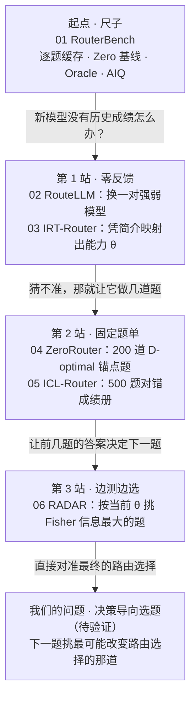

# LLM 路由六篇综述：来一个 query 怎样选模型，新模型怎样接入

> **怎么读这个文件夹：笔记按论文读，综述按问题读。**
> 想了解某一篇，看 01–06 的精读笔记，每篇里同时讲它在两条主线上做了什么。想看六篇之间的关系、整个领域和我们的研究问题，看这篇综述：它按问题组织，把六篇放在同一张表里横向比较。综述里的论文名都可以点到对应笔记。

## 两条主线

六篇论文可以沿两条线来读，两条线共用同一条路由链路（见下一节[统一记号](#统一记号)）。

- **主线 A：来一个 query，怎样选到最合适的模型？** 这是每篇论文自己的主问题：怎样预测各模型的质量、怎样估成本、怎样按偏好权衡。读懂 A，就读懂了整个路由领域。
- **主线 B：一个新模型上线，要测多少题、测哪些题，才能把它接进路由池？** 它只改 A 链路上的一环（模型表示），但我们的研究问题在它的尽头。

两条线的关系是：**B 为主、A 为骨架。** B 要回答“哪道测试题最值得测”，必须先知道路由器之后怎么用这个新模型，而那正是 A 的内容。

大多数论文两条线都做了。分开看不是把论文拆开，而是为了分清一个结果的功劳该记在哪一环。比如 ICL-Router 加入新模型后准确率上升，有多少来自“成绩册这种接入方式好”（B），有多少来自“7B 路由器读得准”（A），又有多少只是池子变强了？我们的研究要回答“选题方法本身好不好”，就必须把两者分开评。

文件按 01–06 编号，两条线都按编号顺读，只是读同一篇时关心的问题不同：

| 论文 | 在主线 A 上：它改进了选模型的哪一环 | 在主线 B 上：新模型要多少反馈 |
|---|---|---|
| [01 RouterBench](01_RouterBench_精读核验.md)（2024.03） | 定好尺子：逐题缓存、Zero 基线、Oracle、AIQ；最朴素的 kNN/MLP 预测 | 不涉及；提供评测框架 |
| [02 RouteLLM](02_RouteLLM_精读核验.md)（2024.06） | 缩成强弱二选一；用偏好数据和阈值做决策 | 0 题：直接换一对强弱模型 |
| [03 IRT-Router](03_IRT-Router_精读核验.md)（2025.06） | 多模型 + 可解释的质量预测（能力 × 难度） | 0 题：凭一段模型简介 |
| [04 ZeroRouter](04_ZeroRouter_精读核验.md)（2026.01） | 逐题估计成本和延迟，三目标权衡 | 200 道 D-optimal 锚点题 |
| [05 ICL-Router](05_ICL-Router_精读核验.md)（2025.10） | 最强的质量预测器（LLM 读成绩册），但只看准确率 | 500 道固定题的对错记录 |
| [06 RADAR](06_RADAR_精读核验.md)（2025.09） | 候选扩成“模型 × 推理预算”；切比雪夫权衡 | Fisher 信息自适应逐题选题 |

顺序按逻辑排，不按发表时间：ICL-Router 和 RADAR 都早于 ZeroRouter。把 RADAR 放最后，在主线 A 上它是候选和决策规则最复杂的一篇，在主线 B 上能让“固定选题 → 自适应选题 → 决策导向选题”连成一条线。

## 统一记号

每个路由器都在回答生成之前做同一件事：看到问题 $q$，给池里每个候选 $m$ 估一个质量和一个成本，按偏好合成一个分数，选最高的那个。六篇只是在这条链路的不同环节动了手：

**问题表示 → 模型表示 → 质量预测 → 成本估计 → 决策规则 → 评测**

| 记号 | 含义 |
|---|---|
| $\widehat P(q,m)$ | 候选 $m$ 在问题 $q$ 上的预期表现，0 到 1 |
| $y_{qm}$ | 实测的表现（训练标签） |
| $\widehat C(q,m)$ | 成本估计；只依赖模型、不随题目变时写成 $\widehat C(m)$ |
| $z_m$ | 模型表示：路由器“认识”一个模型靠的东西（编号、能力参数、成绩册……） |
| $\theta_m$；$a_q$、$b_q$ | IRT 中模型的能力；题目的区分度、难度 |
| $B$ | 新模型接入时愿意付出的测试反馈条数 |

决策规则统一写成“质量减成本”：

$$
m^*(q)=\arg\max_m\left[w\,\widehat P(q,m)-(1-w)\,\widehat C(q,m)\right],\qquad 0\le w\le 1,
$$

$w$ 越大越看重质量。各篇原文的权重符号方向不一，读原文时对照这张表：

| 论文 | 原文写法 | 和 $w$ 的关系 |
|---|---|---|
| RouterBench | $\lambda\widehat P-\widehat c$，$\lambda$ = 愿付价 | $\lambda$ 越大越看重质量，同 $w$ |
| RouteLLM | $\widehat p\ge\alpha$ 就选强模型 | 没有成本项；$\alpha$ 越大越省钱 |
| IRT-Router | $\alpha\widehat P-\beta C$，$\alpha+\beta=1$ | $\alpha$ 就是 $w$ |
| ZeroRouter | $w_p\widehat P-w_c\widehat C-w_t\widehat T$ | 多了延迟项 $\widehat T$ |
| ICL-Router | 只取 $\arg\max\widehat P$ | 没有成本项，相当于 $w=1$ |
| RADAR | 线性式同 $w$；另有切比雪夫式 | 切比雪夫式见主线 A ③ |

主线 A 关心这条链路的每一环怎样做得更好；主线 B 只关心其中一环：**模型表示 $z_m$ 从哪里来、要花多少条反馈。**

## 主线 A ①：RouterBench 先把尺子定好

[RouterBench](01_RouterBench_精读核验.md) 的结论是：kNN、MLP 这类最直接的预测式路由，并没有稳定超过“同预算下按固定概率混合几个模型”的静态基线。后面五篇都在这把尺子上量自己。

它做了三件后文反复用到的事：

1. **逐题缓存**：11 个核心模型在 8 类数据集上的 405,467 条“模型—题目”记录，每条有质量和费用。路由策略可以离线反复评，不必重新调用模型。这也是 8GB 单卡能做方法研究的前提。
2. **两条参照线**：Zero 基线只用各模型的平均质量和平均价格，按预算做最优固定混合，不看题目；Oracle 事后知道每题谁答得好，是达不到的上界。一个路由器的真实价值 = 它比 Zero 高出多少；Oracle 与它的差距只说明“理论上还有空间”。
3. **一条曲线代替一个点**：改变 $w$ 得到一串成本—质量点，取上包络（NDCH），再用 AIQ 压成一个数，即共同成本区间内的平均质量高度。

RouterBench 里的模型表示 $z_m$ 最朴素：就是“这个模型在历史题上的成绩那一列”。kNN 找 $k$ 道相似旧题，取各模型在这些题上的平均分作 $\widehat P$。这意味着一个新模型若没有历史成绩，kNN 根本无从预测它。这是主线 B 的起点。

关键结果：MMLU 上 kNN/MLP 的 AIQ 为 0.773/0.769，Zero 为 0.763；ARC-Challenge 和 MBPP 上两者都低于 Zero。Oracle 显示模型之间确有逐题互补的空间，但从题目文本里把它学出来并不容易。

## 主线 A ②：质量预测怎么一步步变强

$\widehat P(q,m)$ 的做法从“查相似旧题的平均分”走到“能力 × 难度的结构化模型”，再走到“让 LLM 直接读成绩册”。越往后表达力越强，但要的数据和算力也越多。

| 论文 | $\widehat P$ 怎么来 | 得到了什么 | 代价 |
|---|---|---|---|
| [RouterBench](01_RouterBench_精读核验.md) | kNN：最近 $k$ 道旧题上的平均分；或 MLP | 最简单，可直接复现 | 没有稳定赢过 Zero 基线 |
| [RouteLLM](02_RouteLLM_精读核验.md) | 偏好胜率：强模型回答更受偏好的概率；MF 最好 | 数据覆盖到位时，MT Bench 上 APGR 0.802 | 只能二选一；只用 Arena 数据时 BERT 为 0.391，低于随机 |
| [IRT-Router](03_IRT-Router_精读核验.md) | $\sigma(a_q^\top\theta_m-b_q)$：题目难度、区分度 × 模型能力 | 可解释；ID 80.67%，略高于 RouterBench 式的 80.01% | Top-1 只有 2.72%，很少选中最优那个 |
| [ZeroRouter](04_ZeroRouter_精读核验.md) | 多维 2PL，另训“题目文本 → 题目参数”预测器 | 新题无历史成绩也有坐标 | 前期要拟合 200 个旧模型的坐标系 |
| [ICL-Router](05_ICL-Router_精读核验.md) | 训练过的 7B LLM 读“题目向量 + 对错”成绩册，判 Yes/No | 平均准确率最高：ID 76.30%，比 EmbedLLM 高 2.14 个百分点 | 要训 7B 路由器，推理时处理长上下文 |
| [RADAR](06_RADAR_精读核验.md) | 一维 2PL：$\sigma(a_q(\theta_g-b_q))$ | 参数最少；GPQA-Diamond 上 Hypervolume 0.7513 对 IRT 基线 0.6942 | 一条能力轴可能表达不了领域互补 |

两条贯穿六篇的观察：

- **数据和输入表示往往比路由器结构更关键。** RouteLLM 换更大的路由器补不上数据覆盖，ICL-Router 换更好的嵌入模型就涨约 2 个百分点。
- **平均分高 ≠ 逐题选对。** IRT-Router 平均性能领先，Top-1 却只有 2.72%。许多候选得分接近时，选错未必损失大，但要用逐题后悔值 $U^*(q)-U_{\text{selected}}(q)$ 去量，而不是只看平均分。

## 主线 A ③：成本和偏好怎么进入决策

六篇在成本上分成三档：不算成本、每个模型一个常数、逐题估计。只有 ZeroRouter 在选模型时就逐题估费用。

| 论文 | 选模型时用的成本 | 评测时记的成本 | 决策规则 |
|---|---|---|---|
| [RouterBench](01_RouterBench_精读核验.md) | 每 token 定价，每模型常数 | 逐题实际 token 费用 | $\lambda\widehat P-\widehat c$ |
| [RouteLLM](02_RouteLLM_精读核验.md) | 不算 | 强模型调用比例 | 阈值：$\widehat p\ge\alpha$ 选强模型 |
| [IRT-Router](03_IRT-Router_精读核验.md) | 归一化输出单价，每模型常数 | 逐题实际输入、输出费用 | $\alpha\widehat P-\beta C$ |
| [ZeroRouter](04_ZeroRouter_精读核验.md) | 逐题：预测输出长度 × 单价；另估延迟 | Reward（三组权重） | 整批加权效用，可加总成本、总延迟约束 |
| [ICL-Router](05_ICL-Router_精读核验.md) | 不算 | 不算 | $\arg\max\widehat P$ |
| [RADAR](06_RADAR_精读核验.md) | 每配置在训练题上的平均输出成本（含思考 token，不含输入） | Hypervolume、CPT(90%) | 线性，或加权切比雪夫 |

决策规则上有两处值得单独记：

- **切比雪夫能选到线性够不着的点。** 线性加权只能落在成本—质量前沿的凸包上；RADAR 的切比雪夫式看“离理想点最远的那一维”，能选到前沿凹部的配置。但在附录里它并非处处更好，例如 LSAT 上 0.9146 对线性的 0.9165。
- **单条预算和批量预算不是一回事。** RouterBench 的 Zero 基线允许按概率混合模型，满足的是批量平均预算；ZeroRouter 的整批约束也是批量的。若业务要求每条请求都不超预算，结论可能不同。

评测也分两类：AIQ、Hypervolume、APGR 是对整条成本—质量曲线打分；Reward、平均准确率是在某一组偏好下的单点。比较方法时，单点只能说明“在这组偏好下”谁更好。

## 主线 A 留下的问题

这些问题单独做成新路由器，增益往往很难做大；但它们决定了“路由器之后会怎么用一个模型”，所以会成为主线 B 研究的组成部分。下面都是从论文设定延伸出的待验证问题，不是作者已证明的缺陷。

| 问题 | 出处 | 可以怎么检验 |
|---|---|---|
| 平均分高，逐题却很少选对 | IRT-Router 的 Top-1 只有 2.72% | 算逐题后悔值，看损失是均匀的近似并列，还是集中在某类任务 |
| 偏好胜率与实际收益错位 | RouteLLM 的 $\widehat p$ 不含钱，也不是答对率 | 90% 概率只改善格式的题，与 60% 概率避免严重错误的题，比较付费优先级 |
| 常数成本与逐题成本 | RouterBench、IRT-Router、RADAR 选模型时都用常数 | 固定质量预测器，只换成本口径，看决策翻转比例和曲线 |
| 单条预算与批量预算 | Zero 基线和 ZeroRouter 的约束都是批量的 | 先定业务约束，再判断随机混合、凹部点是否适用 |
| 阈值随流量漂移 | RouteLLM 的阈值要在代表性流量上校准 | 按时间或领域切片，看同一阈值下强模型调用比例的变化 |

**接到主线 B：** 这些因素一变，决策边界就变；决策边界一变，“新模型该测哪些题”也随之改变。这就是“B 为主、A 为骨架”的意思。

## 主线 B：新模型怎样接入

主线 A 里，路由器靠模型表示 $z_m$ 来“认识”每个候选。新模型上线时，难点就在这一环：它没有历史成绩，$z_m$ 从哪里来？要花多少条测试反馈 $B$，又该测哪些题？

六篇沿这个问题排成三站：完全不测（02、03），测一批固定的题（04、05），边测边选（06）。RouterBench（01）不处理接入，但它的逐题缓存、Zero 基线和 AIQ 是做接入实验的评测框架。

每一站都解决了上一站留下的问题，同时留下一个新问题；箭头旁就是那个问题。

## 主线 B · 第 1 站：零反馈，新模型一道题都不测

这一站的两篇都不让新模型做题，代价是对新模型的认识很粗。

**[RouteLLM](02_RouteLLM_精读核验.md)：干脆不认识具体模型。** 它把问题缩成二选一：这道题值不值得交给强模型？路由器只看问题，预测 $\widehat p$ = “强模型的回答更受偏好的概率”，$\widehat p\ge\alpha$ 就调强模型。$z_m$ 退化成“强/弱”两个类别，所以换成 Claude 3 Opus/Sonnet 或 Llama 3.1 70B/8B 这样的新模型对，不重训也能用，MT Bench 上 APGR 仍有 0.738–0.772（随机约 0.5）。

它留下两个问题：只能二选一，进不了多模型池；$\widehat p$ 是偏好胜率，不是答对率，也不含钱。它还给了一个重要提醒：只用 Arena 偏好数据时，BERT 路由器在 MT Bench 上 APGR 只有 0.391，低于随机；补上与评测领域相近的数据后才明显变好。**换更大的路由器，补不上训练数据覆盖的不足。**

**[IRT-Router](03_IRT-Router_精读核验.md)：用一段简介“猜”出新模型的能力。** 它把项目反应理论（IRT）搬进路由：题目编码成区分度 $a_q$ 和难度 $b_q$，模型编码成能力向量 $\theta_m$，$\widehat P=\sigma(a_q^\top\theta_m-b_q)$。关键在 $\theta_m$ 的来源：$\theta_m=W e_M$，$e_M$ 是模型简介（发布时间、机构、类型、特点）的文本向量。新模型只要写一段简介就能得到 $\theta$，零题接入。

代价也在这里：简介里的文字未必反映数学或代码能力。对新模型 Claude 3.5 Haiku，MIRT 的预测 AUC 为 0.62、ACC 为 0.67，比 RouterBench 式基线好，但离可靠还远；论文也没报告加入它之后路由曲线提升多少。

这一站之后，问题自然变成：**既然凭空猜不准，让新模型做几道题，再据此估 $\theta$，行不行？做哪几道？**

## 主线 B · 第 2 站：固定题单，测一批事先选好的题

这一站的两篇都让新模型做一套**提前定好**的题，题单不随新模型的答题情况改变。区别在于：拿到对错之后，一篇去估参数，一篇直接把成绩册交给路由器读。

**[ZeroRouter](04_ZeroRouter_精读核验.md)：200 道锚点题，估出能力参数。** 它沿用 IRT-Router 的思路，但 $\theta$ 不再从简介来。先用 200 个旧模型的历史成绩拟合一个 20 维共享能力空间，再训练一个“题目文本 → 题目参数（$\boldsymbol\alpha_q,\mathbf b_q$）”的预测器，让没成绩的新题也有坐标。新模型来了，就做 200 道锚点题，固定题目参数，用交叉熵拟合 $\theta_{\text{new}}$。

锚点怎么选是这条主线的第一个选题方法：D-optimal，挑使 $\log\det\left(\sum\boldsymbol\alpha_q\boldsymbol\alpha_q^\top\right)$ 最大的一组题，让题目在各个能力方向上信息互补。注意它从完整 Fisher 信息 $p(1-p)\,\boldsymbol\alpha\boldsymbol\alpha^\top$ 里**去掉了 $p(1-p)$**，因为 $p$ 依赖还不知道的新模型能力。于是题单能提前定死，但一道新模型几乎必对的题，区分度再高也会被选上。

同一批锚点调用还被用来估输出长度和延迟，所以 ZeroRouter 是六篇里唯一在选模型时就估计逐题成本 $\widehat C(q,m)$ 的；其余几篇选模型时要么不算成本，要么每个模型（或配置）一个常数。接入实验里，同为 200 题，D-optimal 的 Max-Acc Reward 为 0.39，随机选题 0.27：**选哪些题确实影响接入效果**。

**[ICL-Router](05_ICL-Router_精读核验.md)：500 道题的对错记录，不估参数。** 它不用 IRT，$z_m$ 就是一份成绩册：同一套 500 道题的题目向量 + 该模型 Yes/No。一个专门训练过的 7B 路由器读这份成绩册和当前问题，预测这个模型能否答对，选概率最高的。新模型只补一份成绩册，路由器不重训；陆续加入 5 个模型后，ID 平均准确率从 76.30% 升到 79.90%。

它的题单规则是手工的：在旧池 8 个模型中，恰好 1、2、3、4 个模型答对的题各取 125 道。档案长度消融里，500 题优于 100、300，也优于 1000。代价是训练和运行一个 7B 路由器，且决策里没有成本项。

两篇放在一起看，留下的问题是：**题单是死的。新模型前几题的表现，本可以告诉我们接下来该测什么。**

## 主线 B · 第 3 站：边测边选，RADAR 的自适应测验

[RADAR](06_RADAR_精读核验.md) 用的正是 ZeroRouter 省掉的那一项 $p(1-p)$（RADAR 发表更早，这里按逻辑而非时间讲）：新配置每答一道题，就更新一次能力估计，再按新估计挑下一道信息量最大的题。

它的 IRT 是最简单的一维版本：题目有标量区分度 $a_q$ 和难度 $b_q$（由冻结的 Qwen3-Embedding-8B 向量线性映射得到），每个候选一个标量能力 $\theta_g$，$\widehat P=\sigma(a_q(\theta_g-b_q))$。接入新配置时，固定题目参数，从 $\widehat\theta=0$ 开始循环：

$$
q_{\text{next}}=\arg\max_q\ a_q^2\,p_q(\widehat\theta)\,[1-p_q(\widehat\theta)],\qquad p_q(\theta)=\sigma\big(a_q(\theta-b_q)\big)
$$

作答 → 用已测的全部结果重估 $\widehat\theta$ → 再选下一题，直到预算用完。直观上，它偏爱当前看来答对率接近 50%、区分度又高的题，而不是一味挑最难的题。

和 ZeroRouter 的 D-optimal 对比，就是这条主线上选题方法的一次升级：

| | ZeroRouter D-optimal | RADAR Fisher 自适应 |
|---|---|---|
| 是否看新模型的答题结果 | 否，题单提前定死 | 是，每题后更新 |
| 选题目标 | 区分度矩阵的覆盖 | 当前估计下的 Fisher 信息 |
| 能力维度 | 20 维 | 1 维 |
| 论文里的接入预算 | 200 题 | 主实验约 5000 题/配置（另有 100、500 题对照） |

两点要记住。第一，自适应并非处处胜出：附录在 5000 题时 Fisher 与随机几乎持平（GPQA 同为 0.7535），作者强调的优势在小预算下。第二，两者优化的都是**能力估得多准**，而最终评价的是**路由选得多好**。一个又贵又弱、几乎不会被选中的模型，被测得再准也没用。

RADAR 的另外两部分属于主线 A（见主线 A ③）：候选从“模型”扩成“模型 × 推理预算”（5 个底座 → 35 个配置）；决策除线性加权外，主推切比雪夫标量化，能选到线性权重够不着的前沿凹部点。

## 六篇对照总表

按链路的环节横向对比；“—”表示该篇没有这一环。

| 环节 | [RouterBench](01_RouterBench_精读核验.md) | [RouteLLM](02_RouteLLM_精读核验.md) | [IRT-Router](03_IRT-Router_精读核验.md) | [ZeroRouter](04_ZeroRouter_精读核验.md) | [ICL-Router](05_ICL-Router_精读核验.md) | [RADAR](06_RADAR_精读核验.md) |
|---|---|---|---|---|---|---|
| 候选池 | 11 个核心模型 | 强弱 2 个 | 20 个模型/配置 | 两个 5 模型池 | 8 个，扩到 13 | 35 个“模型×预算” |
| 问题表示 | 句向量 | 文本嵌入 / BERT / LLM | BERT → $(a_q,b_q)$ | DistilBERT + 结构特征 → $(\boldsymbol\alpha_q,\mathbf b_q)$ | Qwen3-Emb-8B + 投影 | Qwen3-Emb-8B → $(a_q,b_q)$ |
| 模型表示 $z_m$ | 历史成绩列 | 强/弱类别 | 简介文本 → 25 维 $\theta$ | 锚点拟合 20 维 $\theta$ | 500 题对错档案 | 自适应拟合 1 维 $\theta$ |
| 质量预测 | kNN / MLP | 偏好胜率 | MIRT / NIRT | 多维 2PL | 7B LLM 判 Yes/No | 一维 2PL |
| 成本 | 每模型单价 | 只看强模型调用率 | 每模型输出单价 | 逐题长度 × 单价，另估延迟 | — | 每配置平均输出成本 |
| 决策 | $\lambda\widehat P-\widehat c$ | 阈值 $\alpha$ | $\alpha\widehat P-\beta C$ | 加权和，可加整批约束 | $\arg\max\widehat P$ | 线性 / 切比雪夫 |
| 新模型接入 | — | 换模型对，0 题 | 写简介，0 题 | 200 道 D-optimal 锚点 | 补 500 题档案 | Fisher 逐题自适应 |
| 主指标 | AIQ | APGR、CPT | Performance、Reward | Reward | 平均准确率 | Hypervolume、CPT(90%) |

## 研究问题：B 为主、A 为骨架

主线 B 三站走下来，选题目标从“不测”到“覆盖能力方向”再到“让能力估计最准”，但都还没有直接对准路由本身。我们要问的是：**给定接入预算 $B$，下一道题是否应该挑那道最可能改变最终路由选择的题？**

两个例子说明“估得准”和“选得好”为什么会分开：

- 新模型又贵又弱，在任何 $w$ 下都不会被选中。把它的 $\theta$ 估到小数点后三位，对路由毫无帮助，这时最好的策略是早停、拒绝接入。
- 新模型只在某类低成本题上恰好压过旧池的最优者。要紧的只是它在这条决策边界附近的能力，全局能力估不准也无妨。

**为什么离不开主线 A。** 要算“这道题会不会改变选择”，先得知道路由器怎样选：用什么 $\widehat P$、什么成本 $\widehat C$、什么偏好 $w$。同一个新模型，准确率优先时可能在难题上与旧池最强者争位，成本敏感时可能在简单题上与便宜模型争位，两种情况该测的题不同。成本用常数还是逐题估计，同样会移动这条边界。论点可以写成一句话：**一道测试题对新模型有多大价值，取决于路由器之后怎么用它。**

**相邻工作与新意。** 目前查到的相邻工作都没有做“部署前、有预算、按路由决策挑测试题”，但这只说明空白可能存在，还需要系统查新：

- [RouteProfile](https://arxiv.org/abs/2605.00180)（2026.05）：只用模型卡、公开榜单分数等公开信号给新模型建画像，不做测试，接入时不重训路由器。它是 IRT-Router“凭简介”这条路的加强版，可作零反馈的强基线。
- [StageRoute](https://arxiv.org/abs/2506.17254)：在线 bandit 设定，新模型靠真实流量探索，给出后悔界。它与“部署前用设计好的探测题”是不同设定，但后悔值的定义可以借鉴。
- 评测侧的 tinyBenchmarks、Fluid Benchmarking 也在挑少量题测模型，但目标是估准总分，不是服务路由决策。

**验证时要守住的几条：**

1. **同台比较**：同一份离线逐题缓存、同一模型池、同一预算 $B$，比较随机、D-optimal（ZeroRouter）、Fisher 自适应（RADAR）、固定分层题单（ICL-Router）和决策导向选题。
2. **看路由结果，不只看估计误差**：报告 Zero 基线之上的 AIQ 或路由后悔值 $U^*(q)-U_{\text{selected}}(q)$，$\theta$ 的 RMSE 只作辅助。
3. **画预算曲线**：$B$ 取 16、32、64、200 等多个点，看收益随预算怎么变。
4. **先诊断再加方法**：先查清错选来自哪里（能力估计、成本近似，还是题目参数），再试最简单的决策导向规则；只有稳定超过随机和 Fisher，才值得做复杂版本。
5. **防信息泄漏**：选题算法只能读已“购买”的反馈，测试标签只用于事后记分。
6. **别把池变大当成方法好**：加入新模型本身就会抬高上限，比较时要固定候选池。

**先做一个两到四周的小实验，再决定写不写。** 在 RouterBench 或类似的逐题响应矩阵上，轮流留出一个模型当“新模型”；预算 $B$ 取 16、32、64、200；比较随机、D-optimal、Fisher 和一个最简单的决策导向规则；指标用接入后的路由后悔值。单卡 8GB 条件下，全部基于离线逐题响应矩阵做，不重新生成回答。增益在小预算下清楚且稳定，才值得投入写论文。

**论文路线：先会议，再期刊。**

1. **会议论文**只做 B：一个路由目标、一两个数据集，证明决策导向选题在小预算下稳定优于 Fisher 和 D-optimal。
2. **期刊扩展**加入 A 的维度：多种路由目标（准确率优先、成本敏感、偏好）、逐题成本、更大的基准（如 LLMRouterBench）、在线到达设定和理论分析。这些正好对应“主线 A 留下的问题”那张表。扩展需要多少新内容，要看目标期刊的规定和导师的意见。

一开始就按期刊写，范围容易铺得太开，最后没有一个结论够硬。

## 数字怎么读

六篇的指标各不相同，**跨论文的数字不能直接比大小**，只能在同一张表、同一场景内比。最常被误读的几个：

| 数字 | 实际含义 | 不是 |
|---|---|---|
| RouterBench AIQ | 共同成本区间内质量曲线的平均高度 | 某个点的准确率 |
| RouteLLM APGR = 0.802 | MT Bench 上恢复强弱质量差的平均比例（Arena + 裁判数据，MF） | 80.2% 准确率 |
| RouteLLM CPT(50%) = 13.40% | 恢复一半质量差所需的强模型调用比例 | 美元成本比例 |
| IRT-Router 80.67% / 87.12% | $\alpha=0.8$、MIRT 的 ID / OOD Performance | 同一测试集上的两个数 |
| ZeroRouter 0.39 | 接入实验 Max-Acc 权重下的 Reward | 39% 准确率 |
| ICL-Router 76.30% | 五个 ID 基准的平均准确率 | 质量—成本曲线 |
| RADAR 0.7513 | GPQA-Diamond ID 的 Hypervolume | 准确率 |
| RADAR 1.31% | MATH-500 上达到 o4-mini/high 九成质量所需的成本比例 | 绝对准确率 |

另两条通用提醒：Oracle 只是事后上界，不是可部署的效果；新模型接入后准确率上升，可能只是池子变强了，不一定是接入方法更好。RADAR 还有一处表号疑点（主表 1 与附录表 20 的 ID 数值不一致），见 [06 第 6 节](06_RADAR_精读核验.md#6-容易读错的地方)。

## 两条线各自可以略读的部分，以及补充阅读

同一篇论文，在两条线上的重点不同：

| 论文 | 读主线 A 时重点看 | 读主线 B 时重点看 | 两条线都可略读 |
|---|---|---|---|
| [RouterBench](01_RouterBench_精读核验.md) | 预测式路由、Zero 基线、AIQ | 逐题缓存与评测协议 | 级联与 RAG 实验 |
| [RouteLLM](02_RouteLLM_精读核验.md) | 偏好数据、阈值、数据增强、成本口径 | 换模型对的迁移实验（作二元基线） | 四种预测器的实现细节 |
| [IRT-Router](03_IRT-Router_精读核验.md) | MIRT/NIRT、成本两种口径、Top-k | 凭简介预测新模型 | 查询预热 |
| [ZeroRouter](04_ZeroRouter_精读核验.md) | 逐题成本与延迟、三目标权衡 | D-optimal 锚点、能力拟合 | 文本→题目参数预测器的结构 |
| [ICL-Router](05_ICL-Router_精读核验.md) | LLM 读成绩册的质量预测 | 500 题分层题单、成绩册长度消融 | 查询重构训练（QRT） |
| [RADAR](06_RADAR_精读核验.md) | 模型 × 推理预算、切比雪夫权衡 | 自适应测验 | 预算执行细节 |

建议补看，不必精读，只看它们的选题或接入方法：

- [Universal Model Routing for Efficient LLM Inference](https://arxiv.org/abs/2502.08773)（Jitkrittum 等，ICLR 2026）：把未见过的模型表示为它在一组代表性提示上的预测特征，和 ICL-Router 的成绩册思路最接近，是直接的同类对照。
- [RouteProfile](https://arxiv.org/abs/2605.00180)（2026.05）：用公开信号给冷启动的新模型建图结构画像，零反馈一端的最新做法。
- [StageRoute / Keeping Up with the Models](https://arxiv.org/abs/2506.17254)：在线部署与路由的 bandit 方法，新模型靠真实流量探索。
- [tinyBenchmarks](https://arxiv.org/abs/2402.14992)（Polo 等，2024）：用 IRT 挑少量题估计新模型在整个基准上的表现，是“用多少题、哪些题能测准新模型”的评测侧代表作。
- [Fluid Language Model Benchmarking](https://arxiv.org/abs/2509.11106)（AI2，2025）：把 IRT 自适应测试用在语言模型评测上，可与 RADAR 的 Fisher 选题对照。
- [LLMRouterBench](https://aclanthology.org/2026.findings-acl.1881/)（2026，与 RouterBench 是两篇不同论文）：比 RouterBench 更大的评测基准，它报告的“模型召回失败”（只有某个模型能答对的题，路由器却没选它）可直接用来诊断错选，但不能未经实验就归因于 profiling 选题不当。

另外，ZeroRouter 和 ICL-Router 都拿 MODEL-SAT 作动态接入基线，做实验时值得把它列入对照。
