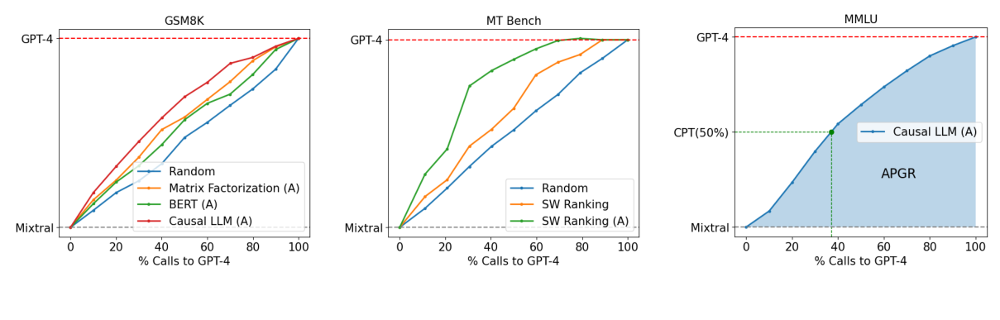

# 02 RouteLLM：不认识具体模型，只判断“这题要不要强模型”

> **在两条主线上的位置**（两条主线见 [综述](00_综述.md#两条主线)）
>
> - **主线 A（来一个 query，怎样选模型）· 第 2 篇：把问题缩成二选一。** [RouterBench](01_RouterBench_精读核验.md) 的多选一预测很难赢过静态基线。RouteLLM 只问“这道题值不值得交给强模型”：用人类偏好数据预测强模型胜出的概率，再用阈值决定调用谁。它最重要的发现是：**换更大的路由器，补不上训练数据覆盖的不足。** 它留下的问题是偏好胜率不等于答对率，也不含钱。
> - **主线 B（新模型怎样接入）· 第 1 站（零反馈）之一。** 路由器不认识具体模型，所以换一对没见过的强弱模型，**一道题都不测**也能直接用。代价是只能二选一，也说不清新模型擅长什么。下一篇 [IRT-Router](03_IRT-Router_精读核验.md) 开始给每个模型一个“能力”表示。
>
> 原论文：Ong 等，*RouteLLM: Learning to Route LLMs with Preference Data*，ICLR 2025，[arXiv:2406.18665v4](https://arxiv.org/abs/2406.18665v4)（会议版题名作 *from Preference Data*，同一研究）· [中文译文](translations/02_RouteLLM_中文译文.md) · [中文 PDF](pdfs/zh/RouteLLM_Chinese_Full.pdf)（附录为英文）· [官方仓库](https://github.com/lm-sys/RouteLLM)
> 全仓库统一记号见[综述](00_综述.md#统一记号)。

## 链路速查

| 环节 | RouteLLM 的做法 |
|---|---|
| 候选池 | 强、弱各 1 个（原实验 `gpt-4-1106-preview` / Mixtral-8x7B） |
| 问题表示 | `text-embedding-3-small`（SW、MF），或 BERT / Llama 3 8B 直接读文本 |
| 模型表示 $z_m$ | 只有“强 / 弱”两类 |
| 质量预测 | 偏好胜率 $\widehat p(q)$：强模型回答更受偏好的概率 |
| 成本 | 决策里没有；评测时用强模型调用比例代理 |
| 决策 | $\widehat p(q)\ge\alpha$ 选强模型；$\alpha$ 越大越省钱 |
| 新模型接入 | 直接换一对强弱模型，不测题、不重训 |
| 主指标 | PGR、APGR、CPT |

## 1. 最后一步：一个概率和一个阈值

路由器只看用户问题，预测

$$
\widehat p(q)=P_\theta(\mathrm{win}_s\mid q),
$$

即强模型的回答胜过弱模型的概率。训练标签有强胜、平局、弱胜三种。注意它是**偏好胜率**而不是答对率：两份回答都对，用户也可能更喜欢解释更清楚的那份。[中文定义](translations/02_RouteLLM_中文译文.md#s3-1)

决策规则：

$$
\operatorname{choose}(q)=
\begin{cases}
M_w,&\widehat p(q)<\alpha,\\
M_s,&\widehat p(q)\ge\alpha.
\end{cases}
$$

例：某题 $\widehat p=0.76$，阈值 0.60 时选强模型，调到 0.85 就选弱模型（自拟例子）。[阈值公式](translations/02_RouteLLM_中文译文.md#eq-2)

阈值和预算之间还隔着一步：想让 20% 的请求进强模型，要在有代表性的流量上校准阈值，直接设 $\alpha=0.8$ 并不保证 20%。[官方阈值校准工具](https://github.com/lm-sys/RouteLLM#threshold-calibration)可做这一步；流量分布变了，阈值也要重校。

## 2. 训练数据：偏好记录加两类增强

- **Chatbot Arena**：约 8 万场对战，留出 5000 条验证，删去短于 16 字符的问题后约 6.5 万条成对比较，涉及 64 个模型。任意两个具体模型直接对战的占比平均不到 0.1%，所以作者按排行榜得分把模型分成 10 层，前两层算强、第三层算弱。训练只保留问题和胜者标签，不用回答文本。[数据规模与清洗](translations/02_RouteLLM_中文译文.md#s5-p1) · [模型分层](translations/02_RouteLLM_中文译文.md#s4-1-p2)
- **MMLU 验证题**：约 1500 道，用标准答案判断强弱回答的相对表现。
- **GPT-4 裁判数据**：取 Nectar 中已有的 GPT-4 回答，再生成 Mixtral 回答，让 GPT-4 成对裁判，约 12 万条，成本约 700 美元。[数据增强](translations/02_RouteLLM_中文译文.md#s4-1-1)

“只看问题”指的是预测器的输入；制作标签时当然用到了两个模型的回答。

## 3. 四种预测器（可互相替换，不是串联的四步）

| 方法 | 怎么得到 $\widehat p(q)$ | 要点 |
|---|---|---|
| 相似度加权排序 SW | 找相似历史问题，按 $10^{1+S(q,q')}$ 加权，每次推理时现解加权 Bradley–Terry | 无需预训练，但推理时计算最重 |
| 矩阵分解 MF | $\delta(M,q)=\mathbf w_2^\top[\mathbf v_M\odot(W_1^\top\mathbf v_q+\mathbf b)]$，$\widehat p=\sigma(\delta(M_s,q)-\delta(M_w,q))$ | 推荐系统式的“模型—题目匹配”，8GB GPU 可训 |
| BERT 分类器 | `[CLS]` 表示接逻辑回归头，全参数微调 | 两张 L4 24GB |
| 因果 LLM 分类器 | Llama 3 8B，把比较标签加进词表，读标签 token 概率 | 八张 A100 80GB |

MF 里的 $\delta$ 是从偏好学出的潜变量，没有 IRT 里能力、难度那样的明确含义；这正是下一篇 IRT-Router 要补的。[SW](translations/02_RouteLLM_中文译文.md#method-sw) · [MF](translations/02_RouteLLM_中文译文.md#method-mf) · [BERT 与因果 LLM](translations/02_RouteLLM_中文译文.md#method-bert) · [训练配置](translations/02_RouteLLM_中文译文.md#s4-2)

## 4. 实验：训练数据覆盖到哪里，效果就好到哪里

评测集：MT Bench 160 道开放题、5-shot MMLU 14,042 道、8-shot GSM8K 1000 多道，并检查了训练与评测的语义污染。[实验设置](translations/02_RouteLLM_中文译文.md#s5-p2)

先看指标。设强模型、弱模型、路由系统的平均质量为 $r_s,r_w,r_R$：

$$
\mathrm{PGR}=\frac{r_R-r_w}{r_s-r_w}.
$$

PGR 是“恢复了多少强弱差距”（强 90、弱 70、路由 80 → PGR 0.5，不是 50% 准确率）。CPT(50%) 是恢复一半差距所需的强模型调用比例，越低越好；APGR 是不同调用比例下 PGR 的平均（10 个点近似积分），越高越好。[指标定义](translations/02_RouteLLM_中文译文.md#s3-2)

横轴是 GPT-4 调用比例，绿色标记对应 CPT，蓝色面积对应 APGR。[图 1 与中文图注](translations/02_RouteLLM_中文译文.md#fig-1)

MT Bench 结果：[完整表 1](translations/02_RouteLLM_中文译文.md#table-1)

| 训练数据与路由器 | CPT(50%) | CPT(80%) | APGR |
|---|---:|---:|---:|
| 随机基线 | 49.03% | 78.08% | 0.500 |
| 仅 Arena，BERT | 78.09% | 87.64% | 0.391 |
| 仅 Arena，MF | 25.32% | 74.26% | 0.580 |
| Arena + 裁判数据，BERT | 19.58% | 34.02% | 0.751 |
| Arena + 裁判数据，MF | **13.40%** | 31.31% | **0.802** |
| Arena + 裁判数据，SW | 23.21% | 36.04% | 0.759 |

最好的设置下，MF 只把 13.40% 的题交给 GPT-4 就恢复了一半差距（随机要 49.03%）；这个点约 8.8 分，GPT-4 为 9.3 分，即保留约 95% 的 GPT-4 评分。两种说法分母不同，并不矛盾。

更值得记住的是反面：**只用 Arena 数据时，BERT 的 APGR 只有 0.391，低于随机。** MMLU 和 GSM8K 上也一样——GSM8K 上四种 Arena-only 路由器都低于随机；补入相近领域数据后，MMLU 上 SW 达到 0.603（CPT(50%) 35.40%），GSM8K 上因果 LLM 达到 0.622（CPT(50%) 33.64%）。换更大的路由器补不上数据覆盖的不足。[MMLU 表 2](translations/02_RouteLLM_中文译文.md#table-2) · [GSM8K 表 3](translations/02_RouteLLM_中文译文.md#table-3)

作者还量了训练题与评测题的相似度：MT Bench 与 Arena 为 0.6078，高于 MMLU 的 0.4823 和 GSM8K 的 0.4926；补入数据后相似度和表现一起上升。这支持“数据覆盖影响迁移”，但相关不等于因果。[相似度结果](translations/02_RouteLLM_中文译文.md#table-5)

## 5. 换一对新模型：零反馈接入的极限形态

保留训练好的路由器，直接把底下的模型对换成训练数据里没有的组合：[迁移实验与表 4](translations/02_RouteLLM_中文译文.md#s5-2)

| 新模型对 | 路由器 | CPT(50%) | CPT(80%) | APGR |
|---|---|---:|---:|---:|
| Claude 3 Opus / Sonnet | 随机 | 49.89% | 72.27% | 0.493 |
| Claude 3 Opus / Sonnet | MF | 31.86% | 36.43% | 0.762 |
| Claude 3 Opus / Sonnet | SW | 23.27% | 51.85% | 0.772 |
| Llama 3.1 70B / 8B | 随机 | 47.52% | 76.26% | 0.512 |
| Llama 3.1 70B / 8B | MF | 25.83% | 37.30% | 0.738 |
| Llama 3.1 70B / 8B | SW | 21.18% | 29.39% | 0.767 |

这说明“从问题判断需不需要更强模型”的规则可以迁移到这两对模型。但它迁移的是**问题难度的判断**，不是对新模型的认识：没有给新模型建能力档案，也没验证“八个旧模型加一个新模型”的多路选择。对能力接近或领域互补很强的模型对是否有效，要另外测。

这就是它与后面四篇的距离：IRT-Router 从简介外推能力，ZeroRouter 做固定锚点题，ICL-Router 建固定成绩册，RADAR 自适应测验。RouteLLM 一步都没做，所以在主线 B 里它是**二元路由基线**，不能替代多模型接入方法的直接对照。

## 6. 成本与部署开销

- 论文用强模型调用比例代理成本：当时 GPT-4 约每百万 token 24.7 美元，Mixtral 约 0.24 美元，相差约 103 倍。但每题 token 数不同，调用比例不等于美元比例。
- 表 6 的口径有疑问：表题说“相对于 GPT-4”的节省，正文说的是相对随机基线的调用率比值。验算：$49.03/13.40\approx3.66$、$78.08/31.31\approx2.49$，正好是表 6 的 3.66 倍和 2.49 倍；若相对“全用 GPT-4”则是 $100/13.40\approx7.46$。复现时应按逐题 token 费用统一口径。[成本段与表 6](translations/02_RouteLLM_中文译文.md#s5-4)
- 路由器自身开销（Google Cloud，GPU 方法用 L4，SW 用 CPU）：SW、MF、BERT、因果 LLM 的吞吐为 2.90、155.16、69.62、42.46 请求/秒，每百万请求成本 39.26、3.32、3.19、5.23 美元（已含嵌入费用）。[开销表 7](translations/02_RouteLLM_中文译文.md#table-7)

## 7. 容易读错的地方

- 训练数据涉及 64 个模型，在线仍是二选一；64 不是候选池大小。
- $\widehat p=0.76$ 是相对偏好，不是 76% 答对率；APGR = 0.802 不是 80.2% 准确率；CPT 是调用比例，不是美元比例。
- 强弱模型平均质量很接近时，PGR 分母很小，波动会被放大；路由若整体超过强模型，PGR 可以大于 1。
- 二元预测头怎样处理平局、MF 的模型向量如何对应模型类别，需要核对官方实现。

## 8. 对研究的用处

**对主线 A：**

- **一条教训**：路由器容量增大，不会自动弥补训练数据覆盖的不足。比较路由器时，评测数据与训练数据的领域距离要单独报告。
- **胜率与实际收益可能错位**（研究建议）：90% 概率只改善格式的题，未必比 60% 概率避免严重错误的题更值得付费。这是 综述“主线 A 留下的问题”中的一项。
- **阈值漂移**：流量分布变了，同一阈值对应的强模型调用比例也会变，可按时间或领域切片检查。

**对主线 B：**

- **作为基线**：冻结旧池、新模型只有 $B$ 条反馈的设定下，它是一条“零反馈”的二元参照线。
- **轻量校准**（研究建议）：保留通用路由器，用 0、16、32、64 条成对反馈做校准，能否识别特定模型对的领域例外？

**复现：**

- **8GB 复现**：MF 最合适（论文用 8GB GPU、约 10 个 epoch）。可先用公开权重和缓存评测；把 OpenAI 嵌入换成本地嵌入是可以研究的改动，但要与原配置区分。本笔记没有独立运行训练。[作者的结论与局限](translations/02_RouteLLM_中文译文.md#s6)

**接着读：** [03 IRT-Router](03_IRT-Router_精读核验.md)。

- 主线 A：回到多模型选择，并给质量预测加上“能力 × 难度”的可解释结构，同时把成本放进决策。
- 主线 B：不再把模型压成“强/弱”，而是给每个模型一个能力向量，并尝试只凭一段简介推出新模型的能力。
