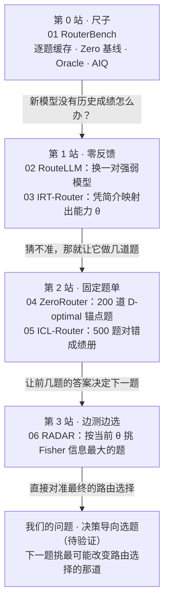

# LLM 路由六篇：新模型要测多少题、测哪些题，才能进入路由池

六篇论文回答的是同一个问题的不同阶段：**一个新模型上线时，路由器需要从它身上拿到多少反馈、拿哪些反馈，才能把它正确地放进路由池？**

先用 RouterBench 定好评价尺子，再看反馈从“零”到“固定一批题”再到“边测边选”的三站，最后停在我们的研究问题：选测试题时，是否应该看它会不会改变最终的路由选择。



## 阅读顺序

文件已按这条主线编号。顺序按逻辑而非发表时间：ICL-Router 和 RADAR 都早于 ZeroRouter，但把 RADAR 放最后，能让“固定选题 → 自适应选题 → 决策导向选题”连成一条线。

| 站 | 笔记 | 新模型需要的反馈 | 这一篇要记住的一件事 | 中文材料 | PDF |
|---|---|---|---|---|---|
| 0 尺子 | [01 RouterBench](01_RouterBench_精读核验.md)（2024.03） | 不涉及（离线缓存） | 路由要和同预算的静态混合比，不是和单个模型比 | [精读材料](translations/01_RouterBench_中文精读材料.md)（非全文） | — |
| 1 零反馈 | [02 RouteLLM](02_RouteLLM_精读核验.md)（2024.06） | 0 题：直接换一对强弱模型 | 只学“这题要不要强模型”，不认识具体模型 | [译文](translations/02_RouteLLM_中文译文.md) | [下载](pdfs/zh/RouteLLM_Chinese_Full.pdf) |
| 1 零反馈 | [03 IRT-Router](03_IRT-Router_精读核验.md)（2025.06） | 0 题：凭一段模型简介 | 引入 IRT：题目有难度、区分度，模型有能力 | [译文](translations/03_IRT-Router_中文译文.md) | [下载](pdfs/zh/IRT-Router_Chinese.pdf) |
| 2 固定题单 | [04 ZeroRouter](04_ZeroRouter_精读核验.md)（2026.01） | 200 道事先选好的锚点题 | 选题看信息覆盖（D-optimal），但不看答对答错 | [译文](translations/04_ZeroRouter_中文译文.md) | [下载](pdfs/zh/ZeroRouter_Chinese.pdf) |
| 2 固定题单 | [05 ICL-Router](05_ICL-Router_精读核验.md)（2025.10） | 500 道固定题的对错记录 | 不估参数，让训练过的 LLM 直接读成绩册 | [译文](translations/05_ICL-Router_中文译文.md) | [下载](pdfs/zh/ICL-Router_Chinese.pdf) |
| 3 边测边选 | [06 RADAR](06_RADAR_精读核验.md)（2025.09） | 自适应逐题，主实验约 5,000 题/配置 | 下一题由当前能力估计决定（Fisher 信息） | [译文](translations/06_RADAR_中文译文.md) | [下载](pdfs/zh/RADAR_Chinese_Body.pdf) |

每篇笔记的开头都有一段“在主线上的位置”（上一篇留下了什么问题、这一篇改了哪一环、留给下一篇什么问题），接着是一张“链路速查”表，结尾是“容易读错的地方”和“对主线研究的用处”。笔记中的中文链接会跳到对应译文的段落、公式或图表。

## 统一记号

每个路由器都在回答生成之前做同一件事：看到问题 $q$，给池里每个候选 $m$ 估一个质量和一个成本，按偏好合成一个分数，选最高的那个。六篇只是在这条链路的不同环节动了手：

**问题表示 → 模型表示 → 质量预测 → 成本估计 → 决策规则 → 评测**

| 记号 | 含义 |
|---|---|
| $\widehat P(q,m)$ | 候选 $m$ 在问题 $q$ 上的预期表现，0 到 1 |
| $y_{qm}$ | 实测的表现（训练标签） |
| $\widehat C(q,m)$ | 成本估计；只依赖模型时写成 $\widehat C(m)$ |
| $z_m$ | 模型表示：路由器“认识”一个模型靠的东西 |
| $\theta_m$；$a_q$、$b_q$ | IRT 中模型的能力；题目的区分度、难度 |
| $B$ | 新模型接入时愿意付出的测试反馈条数 |

决策规则统一写成

$$
m^*(q)=\arg\max_m\left[w\,\widehat P(q,m)-(1-w)\,\widehat C(q,m)\right],\qquad 0\le w\le 1,
$$

$w$ 越大越看重质量。各篇原文的权重符号方向不一：

| 论文 | 原文写法 | 和 $w$ 的关系 |
|---|---|---|
| RouterBench | $\lambda\widehat P-\widehat c$，$\lambda$ = 愿付价 | $\lambda$ 越大越看重质量，同 $w$ |
| RouteLLM | $\widehat p\ge\alpha$ 选强模型 | 没有成本项；$\alpha$ 越大越省钱 |
| IRT-Router | $\alpha\widehat P-\beta C$，$\alpha+\beta=1$ | $\alpha$ 就是 $w$ |
| ZeroRouter | $w_p\widehat P-w_c\widehat C-w_t\widehat T$ | 多了延迟项 $\widehat T$ |
| ICL-Router | $\arg\max\widehat P$ | 没有成本项，相当于 $w=1$ |
| RADAR | 线性式同 $w$；另有切比雪夫式 | 见 06 第 3 节 |

**“新模型接入”只改链路上的一环：模型表示 $z_m$。** 三站的差别，归根到底是 $z_m$ 从哪里来、要花多少条反馈。

## 六篇对照

| 环节 | RouterBench | RouteLLM | IRT-Router | ZeroRouter | ICL-Router | RADAR |
|---|---|---|---|---|---|---|
| 候选池 | 11 个核心模型 | 强弱 2 个 | 20 个模型/配置 | 两个 5 模型池 | 8 个，扩到 13 | 35 个“模型×预算” |
| 问题表示 | 句向量 | 文本嵌入 / BERT / LLM | BERT → $(a_q,b_q)$ | DistilBERT + 结构特征 → $(\boldsymbol\alpha_q,\mathbf b_q)$ | Qwen3-Emb-8B + 投影 | Qwen3-Emb-8B → $(a_q,b_q)$ |
| 模型表示 $z_m$ | 历史成绩列 | 强/弱类别 | 简介文本 → 25 维 $\theta$ | 锚点拟合 20 维 $\theta$ | 500 题对错档案 | 自适应拟合 1 维 $\theta$ |
| 质量预测 | kNN / MLP | 偏好胜率 | MIRT / NIRT | 多维 2PL | 7B LLM 判 Yes/No | 一维 2PL |
| 成本 | 每模型单价 | 只看强模型调用率 | 每模型输出单价 | 逐题长度 × 单价，另估延迟 | — | 每配置平均输出成本 |
| 决策 | $\lambda\widehat P-\widehat c$ | 阈值 $\alpha$ | $\alpha\widehat P-\beta C$ | 加权和，可加整批约束 | $\arg\max\widehat P$ | 线性 / 切比雪夫 |
| 新模型接入 | — | 换模型对，0 题 | 写简介，0 题 | 200 道 D-optimal 锚点 | 补 500 题档案 | Fisher 逐题自适应 |
| 主指标 | AIQ | APGR、CPT | Performance、Reward | Reward | 平均准确率 | Hypervolume、CPT(90%) |

## 主线尽头的研究问题

三站走下来，选题目标从“不测”到“覆盖能力方向”再到“让能力估计最准”，但都没有直接对准路由本身。我们要问的是：**给定接入预算 $B$，下一道题是否应该挑那道最可能改变最终路由选择的题？**

“估得准”和“选得好”为什么会分开：

- 新模型又贵又弱，在任何 $w$ 下都不会被选中。把它的 $\theta$ 估得再准也没用，最好的策略是早停、拒绝接入。
- 新模型只在某类低成本题上恰好压过旧池的最优者。要紧的只是它在这条决策边界附近的能力。

这还是待验证的假说。验证时要守住：

1. **同台比较**：同一份离线逐题缓存、同一模型池、同一预算 $B$，比较随机、D-optimal（04）、固定分层题单（05）、Fisher 自适应（06）和决策导向选题。
2. **看路由结果**：报告 Zero 基线之上的 AIQ 或路由后悔值 $U^*(q)-U_{\text{selected}}(q)$，$\theta$ 的 RMSE 只作辅助。
3. **画预算曲线**：$B$ 取 16、32、64、200 等多个点。
4. **先诊断再加方法**：先查错选来自能力估计、成本近似还是题目参数，再试最简单的决策导向规则；只有稳定超过随机和 Fisher，才值得做复杂版本。
5. **防信息泄漏**：选题算法只能读已“购买”的反馈，测试标签只用于事后记分。
6. **固定候选池**：加入新模型本身会抬高上限，准确率上升不能单独证明接入方法更好。

单卡 8GB 条件下，优先基于离线逐题响应和评分矩阵做方法对照。这样算力集中在路由与选题方法上，但它与从头部署全部模型、重新生成回答是不同的实验范围。

## 数字怎么读

跨论文的数字不能直接比大小，只能在同一张表、同一场景内比。

| 数字 | 实际含义 | 不是 |
|---|---|---|
| RouterBench AIQ | 共同成本区间内质量曲线的平均高度 | 某个点的准确率 |
| RouteLLM APGR = 0.802 | MT Bench 上恢复强弱质量差的平均比例（Arena + 裁判数据，MF） | 80.2% 准确率 |
| RouteLLM CPT(50%) = 13.40% | 恢复一半质量差所需的强模型调用比例 | 美元成本比例 |
| IRT-Router 80.67% / 87.12% | $\alpha=0.8$、MIRT 的 ID / OOD Performance | 同一测试集上的两个数 |
| ZeroRouter 0.39 | 接入实验 Max-Acc 权重下的 Reward | 39% 准确率 |
| ICL-Router 76.30% | 五个 ID 基准的平均准确率 | 质量—成本曲线 |
| RADAR 0.7513 | GPQA-Diamond ID 的 Hypervolume | 准确率 |
| RADAR 1.31% | MATH-500 ID 达到 o4-mini/high 九成质量所需的参考成本比例 | 绝对准确率 |

Oracle 只表示事后理想参照，不能当作可部署算法的效果。RADAR 还有一处表号疑点（主表 1 与附录表 20 的 ID 数值不一致），见 [06 第 6 节](06_RADAR_精读核验.md#6-容易读错的地方)。

## 与主线关系较弱的部分

- **RouteLLM 整篇**：二选一、不认识具体模型。保留它是作为二元路由基线，以及“路由器容量补不上数据覆盖”这条教训。
- **RADAR 的“模型 × 推理预算”和切比雪夫标量化**：扩大候选空间、改决策规则，与接入无关。
- **RouterBench 的级联路由和 RAG 实验**：级联要先生成再判断，与“生成前选模型”是两种设定。
- **ICL-Router 的查询重构训练（QRT）**：让 7B 路由器读懂向量的工程步骤。

## 补充阅读（只看它们的选题或接入方法即可）

- [Universal Model Routing for Efficient LLM Inference](https://arxiv.org/abs/2502.08773)（ICLR 2026）：把未见过的模型表示为它在一组代表性提示上的预测特征，与 ICL-Router 的成绩册思路最接近。
- [tinyBenchmarks](https://arxiv.org/abs/2402.14992)（2024）：用 IRT 挑少量题估计模型在整个基准上的表现，是“用哪些题测准新模型”的评测侧代表。
- [Fluid Language Model Benchmarking](https://arxiv.org/abs/2509.11106)（2025）：把 IRT 自适应测试用在语言模型评测上，可与 RADAR 的 Fisher 选题对照。
- [LLMRouterBench](https://aclanthology.org/2026.findings-acl.1881/)（2026，与 RouterBench 是两篇不同论文）：400K+ 实例、21 个数据集、33 个模型、10 个路由基线。它报告的“模型召回失败”（某些题只有一个候选能答对，路由器却没选它）可用于诊断错选，但不能未经实验就归因于 profiling 选题不当。
- ZeroRouter 和 ICL-Router 都以 MODEL-SAT 作为动态接入基线，做实验时值得列入对照。

## 仓库结构

```
papers/llm-routing/
├── README.md                 ← 本页：主线、记号、对照
├── 01_RouterBench_精读核验.md … 06_RADAR_精读核验.md   ← 按主线编号的精读笔记
├── translations/             ← 中文译文（编号与笔记一致）
├── pdfs/zh/                  ← 中文 PDF
└── assets/                   ← 笔记与译文用到的图表
```
