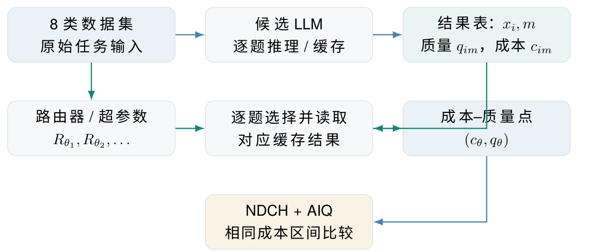
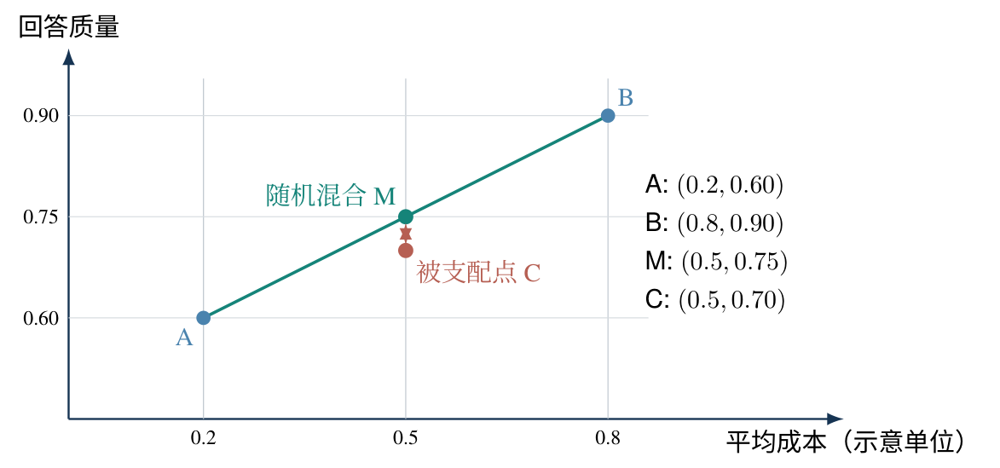
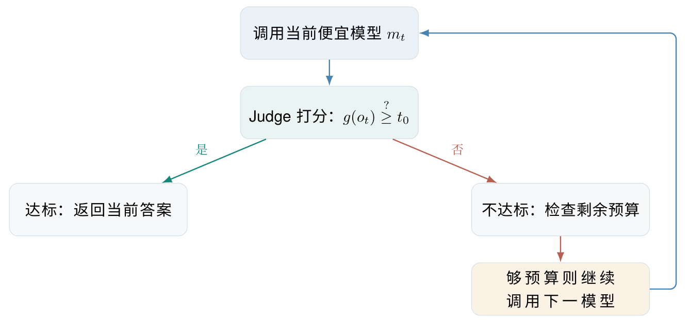
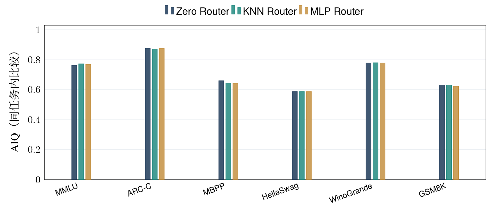
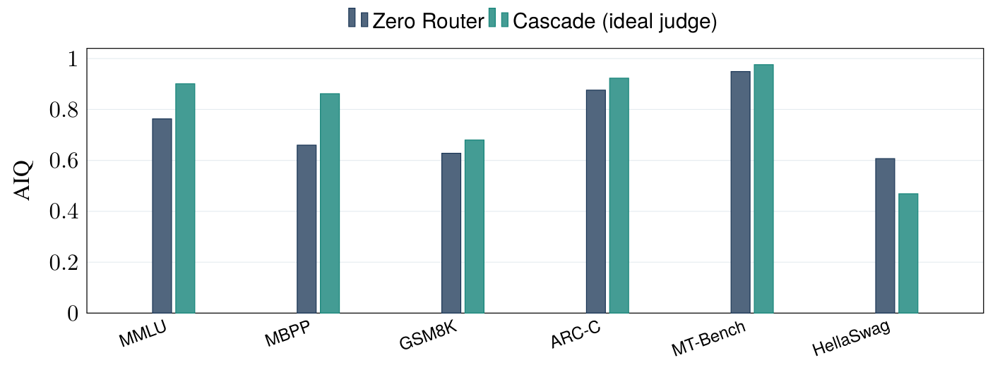

# RouterBench 中文精读材料（非全文译本）

这份 Markdown 转写自用户已有的《RouterBench 评测框架、指标与基线精读》（RouterBench_Research_Reading_Notes.pdf，2026 年 10 月整理）。它是结构化中文阅读笔记，不是原论文全文翻译，也不是官方译文。正文保留原材料的内容、五幅图、全部表格与九个整理公式；公式编号和图表编号沿用中文材料，不等同于英文论文编号。文末“补充核验”来自已有精读核验稿及原文局部复核，与 PDF 转写正文分开。

原论文：Qitian Jason Hu 等，*RouterBench: A Benchmark for Multi-LLM Routing System*，2024，arXiv:2403.12031 v2。[原论文](https://arxiv.org/abs/2403.12031v2)

原材料用途：讲清离线多模型路由评测的研究对象、成本—质量曲线、非递减凸包、AIQ、Zero / Oracle 与 KNN / MLP / Cascade；用于开题答辩、选定评测协议及建立公平的有限反馈模型接入对照。

## 摘要

RouterBench（2024）提出面向多 LLM 路由的离线基准与统一成本—质量评价框架。其核心思想是：缓存多模型逐题回答及对应费用与质量，利用不同路由策略产生的 (cost, quality) 点，通过随机混合及非递减凸包得到公平的性能前沿，再用 AIQ 指标比较指定成本区间内的整体表现。原中文材料以论文 §3–5、附录 A、B 为依据，重写符号并保留公式逻辑，重绘原论文图 4、图 5、图 6 的关键 AIQ 数值，说明单模型、Zero Router、Oracle Router 及三类方法的假设、优势与局限。

RouterBench 的主要贡献是如何公平评价路由器，没有解决新模型少量反馈接入。论文中的 KNN / MLP 在多任务上的 AIQ 没有稳定超过 Zero Router；理想化 Judge 下级联路由的强结果，不能直接解释为现实可部署性能。

阅读导航：[研究对象](#rb-sec-1) · [离线评价流程](#rb-sec-2) · [数学形式化](#rb-sec-3) · [三项基线](#rb-sec-4) · [路由方法](#rb-sec-5) · [实验结果](#rb-sec-6) · [局限与研究关系](#rb-sec-7) · [答辩问答](#rb-sec-8) · [补充核验](#rb-supplement)

## 1 研究对象与原始基准规模

### 1.1 RouterBench 解决了什么问题

若模型 A 质量好但价格高，模型 B 便宜但较弱，仅比较质量就无法衡量路由是否合适。RouterBench 将不同方法统一投影到成本—质量平面，并允许在相同成本范围内比较它们能够实现的最优质量。

| 属性 | 原论文事实 |
|---|---|
| 论文 | Qitian Jason Hu 等，RouterBench: A Benchmark for Multi-LLM Routing System，2024，arXiv:2403.12031 v2 |
| 离线推理结果 | 405,467 条模型—题目推理记录，不是 405,467 个独立问题 |
| 数据来源 | 8 类任务集合，共 64 个细分任务；涵盖知识、常识、数学、编程、对话及 RAG |
| 常规模型池 | 11 个模型；另有 3 种用于检索增强实验的在线服务，总共涉及 14 种 |
| 主要框架 | 成本—质量平面、随机线性混合、非递减凸包（NDCH）、平均质量改进指标（AIQ） |
| 核心基线 | 固定单模型、Zero Router、Oracle Router |
| 示例方法 | KNN Router、MLP Router、Cascading Router |
| 价格语义 | 专有模型按 API 价格；开放权重模型参照 Together AI 价格；RAG 参考相关检索服务定价 |

资料依据：原论文 §3–5、附录 A.1–A.5，以及官方数据集简介。表中的“总共涉及 14 种”不表示每项实验都在同一个 14 模型池中选择；具体名单见[候选模型补注](#rb-supplement-models)。

### 1.2 八类数据及判分协议

表 1：RouterBench 的八类任务。注意与 MATH-500、GPQA、MMLU-Pro 等基准区分。

| 任务 | 推理设置 | 评价方式与用途 |
|---|---|---|
| MMLU | 5-shot | Exact Match；57 类学科知识 |
| HellaSwag | 5-shot | Exact Match；常识情景选择 |
| WinoGrande | 5-shot | Exact Match；指代与常识 |
| ARC-Challenge | 5-shot | Exact Match；科学问答 |
| GSM8K | 5-shot | Exact Match；小学数学文字题 |
| MBPP | 0-shot | GPT-4 Judge；代码任务 |
| MT-Bench | 0-shot | GPT-4 Judge；多轮对话任务 |
| 自建 RAG | 0-shot | GPT-4 Judge；约 800 个真实用户查询 |

资料依据：原论文 §4.2、附录 A.2 与 A.4。作者将布尔得分映射为 0/1，并将评分型输出归一化到 [0, 1]。

版本边界：原始 RouterBench 未评测 MATH-500、GPQA-Diamond、MMLU-Pro、FRAMES、AIME 等后来在路由实验中常见的数据集，也不能与独立的 LLMRouterBench（2026）混为一谈。

## 2 从离线模型输出到路由器评价

图 1：从中文精读 PDF 提取的离线比较流程图，原材料根据论文重绘。它不表示模型推理在部署时可以免费完成。

一条数据不仅是题目，还必须包含对应模型的输出、真实标签或参考回答、已计算的质量与成本。若单看某模型的榜单总分，就无法知道它在哪些具体问题上能替代更昂贵的模型。

| 字段（概念名） | 使用价值 |
|---|---|
| sample id / eval name | 锁定数据源、任务、划分、题目 ID；检查重叠和泄漏 |
| prompt / model response | 输入表征及实际生成内容；复核预处理与评分 |
| model name | 某条输出来自哪个候选模型 |
| performance / true label | 逐题性能及其判分参考 |
| cost | 逐题调用成本；需保留原始价格语义 |

资料依据：原论文附录 A.3。这是论文给出的字段含义；文件内部结构应下载后核验。

## 3 数学形式化：质量、成本、随机混合与 AIQ

### 3.1 先定义量，再比较路由器

设候选模型集合为 $\mathcal M=\{1,\ldots,M\}$，样本分布为 $D$；路由器 $R_\theta(x)$ 给输入 $x$ 选择模型。令 $o_m(x)$ 为模型 $m$ 的生成结果，$q(o_m(x))$ 为质量，$c(o_m(x))$ 为成本。

$$
C(R_\theta;D)=\mathbb E_{x\sim D}\left[c\left(o_{R_\theta(x)}(x)\right)\right]. \tag{1}
$$

$$
Q(R_\theta;D)=\mathbb E_{x\sim D}\left[q\left(o_{R_\theta(x)}(x)\right)\right]. \tag{2}
$$

两个指标越接近实际用户关注的经济成本与回答质量，所得曲线就越有部署参考意义。原论文图中多以评价集合的 Total Cost（美元）作横坐标，式 (1) 则是期望每题成本；不能跨题量混用而不换算。

### 3.2 随机插值：连接两个已有策略

若对每个输入独立掷硬币，以概率 $t$ 使用 $R_1$，以概率 $1-t$ 使用 $R_2$，则

$$
R_t(x)=\begin{cases}
R_1(x), & \text{以概率 }t,\\
R_2(x), & \text{以概率 }1-t,
\end{cases}
\qquad 0\le t\le1. \tag{3}
$$

由期望的线性性，得到

$$
\begin{aligned}
C(R_t)&=tC(R_1)+(1-t)C(R_2),\\
Q(R_t)&=tQ(R_1)+(1-t)Q(R_2).
\end{aligned} \tag{4}
$$

所以，两个策略在成本—质量平面中的连线可以通过随机混合达到，但达到的是期望表现。这种混合仍没有根据具体题目决定交给哪个模型。

### 3.3 为什么需要非递减凸包

对于某个成本预算，如果另一个策略以不更高的成本取得不更低的质量，前者就被支配，应从前沿中排除。概率混合还可以构造更强的中间点；非递减凸包（NDCH）取这些可实现点的非递减上包络。原文允许外推成本域，方便不同路由器共享比较区间。依据：原论文 §3.1–3.3。

图 2：混合路由导致的可行成本—质量前沿。此图使用纯解释性自拟数据，不是 RouterBench 原论文实验图。A 为 (0.2, 0.60)，B 为 (0.8, 0.90)；等概率混合得到 M=(0.5, 0.75)，在同为 0.5 的成本下，优于 C=(0.5, 0.70)。

### 3.4 AIQ：把一条曲线压缩成可比较的标量

记 $\widetilde Q_{R_\theta}(c)$ 为非递减凸包处理后、在成本 $c$ 下可实现的质量。取对所有待比较路由器相同的 $[c_{\min},c_{\max}]$，则

$$
\operatorname{AIQ}(R_\theta)=\frac{1}{c_{\max}-c_{\min}}
\int_{c_{\min}}^{c_{\max}}\widetilde Q_{R_\theta}(c)\,dc,
\qquad c_{\max}>c_{\min}. \tag{5}
$$

该式与原论文 §3.3 的 AIQ 定义等价。原文把凸包写成 $\widetilde R_\theta$；中文材料显式标出自变量 $c$，以免混淆函数与积分变量。

AIQ 不是“比 Zero 提升多少个百分点”。公式没有减去基线；它是单位成本区间上的平均质量。如果两次实验的 $[c_{\min},c_{\max}]$ 不同，绝对 AIQ 就不能不加说明地直接比较。名称 Average Improvement in Quality 中的 Improvement，也不意味着相对改善百分比。

## 4 三项关键基线：Fixed、Zero 与 Oracle

| 基线 | 策略定义 | 论文中的意义 |
|---|---|---|
| Single LLM | 所有输入选择同一模型 $m$，即 $R(x)=m$ | 单模型性能与价格参考点 |
| Zero Router | 根据所有单模型的平均质量—成本点构造 NDCH；针对给定预算在模型间按概率混合，不读取当前题目的逐题难度 | 检查逐题预测是否真的超越简单的全局随机混合 |
| Oracle Router | 查看已缓存的每道题全部模型真实质量，选最高质量的模型；同分时选成本最低者 | 理想化事后参照，现实部署无法事先获得 |

资料依据：原论文 §3.2、§4.4。Oracle 是原论文给出的定义，不必然是任意固定成本约束下的完整最优策略。

Zero Router 虽然不做逐题预测，却已经利用了所有候选模型的总体成本—质量信息，通过混合得到固定模型池的全局效率前沿。超过它，才说明根据当前题目选模型在这套评价中带来了额外收益，足以抵消学习和估计误差。

名称提醒：这里的 Zero Router 是 RouterBench 2024 定义的模型混合基线，不是后来的 ZeroRouter（AAAI 2026）算法论文。写作时应带上作者、年份或文献编号。

## 5 路由方法：KNN、MLP 与 Cascading

### 5.1 预测式路由：WTP 权衡与质量预测

论文 §5.1 的最终选择可整理为

$$
m^*(x)=\arg\max_{m\in\mathcal M}\left[\lambda\widehat P_m(x)-\widehat c_m\right]. \tag{6}
$$

$\widehat P_m(x)$ 是模型在当前题目上的预测质量，$\widehat c_m$ 是估计调用成本；$\lambda$ 是 willingness to pay（WTP），越大越偏重质量。此处 $\lambda$ 乘在质量前面，与另一种常见写法 $Q-\lambda C$ 的含义不同，超参数数值不能照搬。

### 5.2 KNN：从相似题的经验质量推断当前题

先将文本输入编码为向量，依据余弦相似度找到最邻近的 $k$ 个历史问题，再对每个候选模型求它在这些邻居上的质量均值：

$$
\widehat P_m(x)=\frac{1}{k}\sum_{j\in N_k(x;D_{\mathrm{train}})}q_{jm}. \tag{7}
$$

其中 $q_{jm}$ 是第 $j$ 个历史题中模型 $m$ 的观测质量。式 (7) 将原论文的邻域估计公式整理为明确的题目与模型下标，语义与原文一致。

| 项目 | RouterBench 试验设置 |
|---|---|
| 特征嵌入 | SentenceTransformers：all-MiniLM-L12-v2、all-mpnet-base-v2、all-distilroberta-v1 |
| 距离 / 超参数 | 余弦相似度；$k\in\{5,10,40\}$ |
| 最佳设置（作者报告） | $k=40$，all-MiniLM-L12-v2 |
| 典型假设 | 文本表示近的题目，对不同模型具有相近错误模式 |

资料依据：原论文附录 B。这里的“典型假设”是中文材料对 KNN 设计的解释。

### 5.3 MLP：学习文本表示与模型质量的映射

MLP 将输入向量映射到各模型的预测质量：

$$
\widehat P_m(x)=f_m\bigl(e(x);\phi_m\bigr). \tag{8}
$$

这里 $e(x)$ 是题目嵌入，$f_m$ 是相应的回归预测器。作者尝试一层或两层隐藏层、每层 100 个神经元、ReLU 激活函数、0.001 的学习率；报告的最佳 MLP 为两层、每层 100，使用 all-MiniLM-L12-v2。依据：原论文附录 B。

这两种预测式路由都有需要检验的假设：KNN 假设文本相似度能迁移模型表现；MLP 假设有限监督能学到从题目特征到各模型质量的稳定映射。两者即使把平均能力估得不错，也可能仍不足以正确判断逐题模型排序。

### 5.4 Cascading：生成后判别

Cascading 先调用较便宜的模型，再由 Judge 判断回答是否达到质量阈值。如果未达标且剩余预算允许，就继续调用后续模型。成本应累计已经调用的多个模型，不能只计算最后返回答案的那个模型。

图 3：从中文精读 PDF 提取的 Cascading 机制示意图，原材料依据论文 §5.2 重绘。Judge 错误和多次模型调用带来的额外延迟都会影响实用性。

论文对理想 Judge 的输出 $g(o)\in[0,1]$ 引入模拟扰动：

$$
g_\varepsilon(o)=\begin{cases}
1-g(o), & \text{以概率 }\varepsilon,\\
g(o), & \text{以概率 }1-\varepsilon.
\end{cases} \tag{9}
$$

其中 $\varepsilon\in\{0,0.01,0.05,0.1,0.2,0.4\}$。这是人为翻转评分的模拟，不是现实 Judge 的真实测量误差分布；$\varepsilon=0$ 也不能被解释为免费、完美的可部署审核器。依据：原论文 §5.2。

## 6 原论文实验结果

### 6.1 KNN 与 MLP 是否明显胜过 Zero

表 2：原论文 Figure 4 的 AIQ 值，不是本材料重新训练的结果。最后一列为 $\max(\mathrm{KNN},\mathrm{MLP})-\mathrm{Zero}$，是中文材料据原数值计算的差值。

| 任务 | Zero | KNN | MLP | 相对 Zero 最好的差值 |
|---|---:|---:|---:|---:|
| MMLU | 0.763 | 0.773 | 0.769 | +0.010 |
| ARC-Challenge | 0.877 | 0.871 | 0.875 | -0.002 |
| MBPP | 0.660 | 0.644 | 0.642 | -0.016 |
| HellaSwag | 0.588 | 0.588 | 0.588 | 0.000 |
| WinoGrande | 0.778 | 0.780 | 0.778 | +0.002 |
| GSM8K | 0.632 | 0.632 | 0.623 | 0.000 |

图 4：中文精读 PDF 按原论文 Figure 4 数字重绘的 AIQ 柱状图。不同任务的统计分布和成本积分区间不同，图中主要用于同一任务内的比较。

简单预测式路由难以取得稳定的大幅优势，但这张表不能证明唯一原因。合理的诊断方向包括质量预测误差、输入表示无法捕捉模型特异性错误模式，或者总体互补性虽然存在，却无法从输入稳定预测。确定原因还需要专项误差分析。

### 6.2 Cascade：理想化 Judge 的收益与失效

表 3：Cascade 的零错误 Judge 结果。前三行出自原论文 Figure 5，后三行出自附录 Figure 8。

| 任务 | Zero AIQ | Cascade AIQ（$\varepsilon=0$） | 差值 |
|---|---:|---:|---:|
| MMLU | 0.763 | 0.901 | +0.138 |
| MBPP | 0.660 | 0.862 | +0.202 |
| GSM8K | 0.628 | 0.680 | +0.052 |
| ARC-Challenge | 0.876 | 0.923 | +0.047 |
| MT-Bench | 0.949 | 0.976 | +0.027 |
| HellaSwag | 0.607 | 0.469 | -0.138 |

GSM8K 与 HellaSwag 的 Zero AIQ 与原论文 Figure 4 有不同数值；这是不同图表报告的设置，不能混成同一个基准点。

图 5：中文精读 PDF 按原论文 Figure 5 与附录 Figure 8 重绘。$\varepsilon=0$ 是理想化 Judge 模拟；HellaSwag 在这一设置下的 Cascade 反而更差。

论文还发现，当 Judge 错误率升高时，Cascade 性能可能迅速退化，$\varepsilon>0.2$ 时尤其需要谨慎。模型调用顺序、累计成本与真实 Judge 的可行性均是部署障碍。依据：原论文 §5.3。

### 6.3 RAG：能力差异还可能来自工具系统

表 4：原论文 Figure 6 在 RAG 数据上的 AIQ。

| 方法 | AIQ |
|---|---:|
| Zero Router | 0.632 |
| Cascade（$\varepsilon=0.2$） | 0.657 |
| MLP Router | 0.675 |
| KNN Router | 0.695 |

资料依据：原论文 §5.4 / Figure 6。RAG 中包含在线检索服务与基础模型，两者的能力配置不同。

作者观察到，算法可以依据查询是否涉及新近事件作选择，倾向于为时效性强的问题调用有搜索能力的服务。但如果研究对象仅是 LLM 选择，就需要固定检索增强系统与工具可用性。

## 7 局限、复现核对与研究关系

### 7.1 与“旧池加新模型有限反馈接入”的区别

以下“当前拟研究方向”是原中文材料中的研究设想，不是 RouterBench 原论文已经完成的工作。

| 维度 | RouterBench 原设定 | 当前拟研究方向 |
|---|---|---|
| 模型池 | 相对固定的候选模型 | 旧模型池冻结，新模型按时间接入 |
| 新模型监督 | 离线已生成大量逐题结果 | 新模型只有预算 $B$ 条质量反馈 |
| 主要研究问题 | 如何公正比较路由器与不同预算点 | 测哪些题、何时停止、如何用少量反馈更新最终路由 |
| 重要对照 | Single LLM、Zero、Oracle、KNN、MLP、Cascade | 还需补充静态与主动 profiling 方法 |
| 核心评价 | 相同成本域的 AIQ / NDCH | 冻结的部署效用、反馈预算、负面接入事件分析 |
| 可复用内容 | 离线样本级质量、成本与原框架 | 将其改造成严谨的时间接入与预算模拟协议 |

复用 RouterBench 不等于已经解决新模型接入实验。不能让选题算法读取尚未购买反馈的 $(x,m_{\mathrm{new}})$ 真实质量，也不能把原论文的任务级 70/30 随机划分直接当作新模型接入协议。

### 7.2 实际复现前的最小核验清单

1. 固定官方仓库 commit、0-shot / 5-shot 文件与数据子集，核查 sample ID 和完整模型覆盖。
2. 记录模型原版本、响应、质量评分实现及缺失值处理；理解 GPT-4 Judge 评分的偏差。
3. 区分每请求成本、评价集合总成本和模型调用价格；当前价格不能冒充 2024 年原实验价格。
4. 比较 AIQ 时，固定相同成本上下界与凸包规则，同时报告曲线、积分区间和数值。
5. 选择 $B$ 条新模型反馈时执行信息屏蔽；最终测试标签只允许离线记分读取。
6. 以模型接入事件、数据来源和反馈重采样为层级检查稳定性，不把共享同一批题的实验格误当独立测试集。

## 8 导师追问：八个简短回答

| 问题 | 建议回答 |
|---|---|
| RouterBench 的主要贡献是什么？ | 离线路由数据、统一成本—质量评价框架、Zero 基线及不同路由类别的实证比较。 |
| 为什么不能只比较准确率？ | 质量随成本变化；部署路由关注质量与经济成本的权衡。 |
| NDCH 为什么要用凸包？ | 混合策略能在线段上实现期望点，被支配点不能代表最优前沿。 |
| AIQ 是相对提升吗？ | 不是。它是共同成本区间内归一化的前沿曲线面积；公式没有减去基线。 |
| Zero Router 比随机选模型强在哪里？ | 它利用各模型的已知平均质量与成本，建立全局最优混合前沿。 |
| Oracle 可以部署吗？ | 不可以。它使用逐题真实标签事后选模，仅作为理想参照。 |
| Cascade 的理想收益真实吗？ | 依赖完美或很低误差的 Judge；还需考虑判别成本、累计推理开销与真实误差。 |
| 为何它不能直接做拟研究方向的主前作？ | 它主要解决评测问题，没有专门研究新模型接入后的有限反馈获取与主动 profiling。 |

## 开题口述稿

RouterBench 是面向多大模型路由的统一评测框架。它预先收集多个模型在标准任务上的逐题质量与调用成本，将各路由策略投影到成本—质量平面，通过允许随机混合并取非递减凸包构造可比前沿，再用 AIQ 衡量固定成本区间内的平均质量。论文把单模型、Zero Router 和事后 Oracle 作为主要参照，并比较 KNN、MLP 与级联路由。实验说明，简单预测式路由未能稳定明显超过 Zero；低错误率 Judge 支持下的级联在部分任务上有较大潜力，但这不是现实中免费可用的结果。对原中文材料提出的研究方向，它更适合作为评测与数据资源：新增模型只有有限反馈时，如何选择 profiling 题并改善最终部署决策，需要在离线缓存基础上重新设计接入协议。

## 原论文与开放资源

[1] Hu, Q. J. 等（2024），RouterBench: A Benchmark for Multi-LLM Routing System，arXiv:2403.12031 v2。公式与 AIQ 结果依据原文 §3–5、附录 A、B；书目链接见文首。

[2] [withmartian/routerbench 代码与说明](https://github.com/withmartian/routerbench)。

[3] [withmartian/routerbench 数据集](https://huggingface.co/datasets/withmartian/routerbench)，提供 0-shot / 5-shot 推理缓存等资源；版本与列结构须按实际文件核对。

图表出处：图 2 使用解释性自拟数值；图 1、图 3 是中文材料根据论文绘制的流程示意图；图 4 的数值取自原论文 Figure 4；图 5 的数值取自 Figure 5 与附录 Figure 8；表 4 的 RAG 结果取自 Figure 6。这里保留的是已有中文 PDF 的图，不把重绘图称为原论文原图。

## 补充核验

本节不是中文 PDF 正文，也不是原论文附录翻译。它承接已有精读核验稿中的必要细节，让讲解中的链接能落到可直接阅读的中文说明；精确附录标题和关键词仅随相关说明保留，不另设英文位置索引。

### 候选模型与实验划分

核心池的六个开放权重模型是 Llama-70B-chat、Mixtral-8×7B-chat、Yi-34B-chat、Code Llama-34B、Mistral-7B-chat、WizardLM-13B；五个专有模型是 GPT-4、GPT-3.5-turbo、Claude-instant-v1、Claude-v1、Claude-v2。You.com API、Perplexity 的 sonar-small-online 与 sonar-medium-online 另用于 RAG。原文 §4.3 及脚注 3 区分了这两部分；Figure 6 实际列出五个 RAG 候选，不能把十四种模型或服务理解成每项实验的共同池。

预测式主实验在任务内随机划分 70% 训练、30% 测试；MT-Bench 因样本太少，未参加这一同任务内的预测式主对比。RAG 也使用 70/30 划分。依据是原文 §5.3 的 Predictive Router 段与 §5.4。此范围限定不表示论文完全没有在 MT-Bench 上测过预测式路由，附录 E 另有跨任务实验。

### 附录补注：选模成本与评价成本

在预测式路由的选择阶段，原文 §5.1 使用模型的每 token 定价近似成本；评价阶段则读取逐题费用。附录 A.1 “Model Details & Cost Estimation”说明专有模型按输入与输出的 API 定价计算，开放权重模型使用 Together AI 结果与参考费用；附录 A.3 “More Details on Dataset Construction”的 cost 字段段落给出逐条记录的费用含义。这是记录和估算口径，没有核过真实账单的含义。原论文 §4.1 与 §6 还讨论了未来扩展延迟、吞吐等指标的可能性；当前核心评价仍是美元成本与质量。

### 附录补注：编码器与超参数

附录 B “Extended Experimental Settings”给出正文未展开的 KNN / MLP 设置。具体数值已保留在[特征设置表](#rb-table-knn)与[MLP 说明](#rb-sec-5-3)，因此“论文没有交代 embedding”是不准确的。

### 附录补注：补充实验的边界

附录 D “Full Cascading Routers Results”及 Figure 8 给出 ARC-Challenge、MT-Bench、HellaSwag 的级联结果，中文数值见[表 3](#rb-table-3)。附录 E “Training Data Distribution”及 Figure 9 测的是用其他任务训练、在 MT-Bench、MBPP、GSM8K 上评价的跨任务泛化。它没有构成“新模型按时间到达、仅购买少量反馈”的接入协议。后一个判断是对实验范围的核验，不是作者关于必须全量重训的结论。

### 这篇论文在已有路由研究中的位置

原文 §2 的 Routing 部分已讨论 FrugalGPT 等前序工作。因此，“RouterBench 最早证明路由有价值”不准确；将它概括为统一评测与强基线工作，更符合论文的贡献范围。这是文献定位的归纳，不是新增实验结论。
