# IRT-Router：基于项目反应理论的高效且可解释的多大语言模型路由

IRT-Router: Effective and Interpretable Multi-LLM Routing via Item Response Theory

Wei Song¹、Zhenya Huang¹˒²˒*、Cheng Cheng¹、Weibo Gao¹、Bihan Xu¹、Guanhao Zhao¹、Fei Wang³、Runze Wu⁴

¹ 中国科学技术大学认知智能国家重点实验室；² 合肥综合性国家科学中心人工智能研究院；³ 新加坡国立大学计算机学院；⁴ 网易伏羲人工智能实验室。* 通讯作者。

[原论文 arXiv:2506.01048v2](https://arxiv.org/abs/2506.01048v2)，2025 年 6 月 21 日。[代码](https://github.com/Mercidaiha/IRT-Router)。

此版将已有中文 PDF 正文完整转为可检索 Markdown，公式与英文原文核对，图表保留。正文段落、公式和图表均有固定锚点；参考文献与英文附录材料另列。

## 摘要

大语言模型（Large Language Models，LLMs）已经在广泛的自然语言任务中展现出卓越的性能。然而，为用户查询选择最优的大语言模型，往往需要在性能与成本之间进行精细的权衡。虽然能力强大的模型能够提供更好的结果，但其成本也更高；相比之下，规模较小的模型虽然更具成本效益，但能力相对有限。为了解决这一权衡问题，我们提出了IRT-Router，一种多大语言模型路由框架，能够高效地将用户查询路由至最合适的大语言模型。受到项目反应理论（Item Response Theory，IRT）的启发，IRT-Router 显式建模了大语言模型能力与用户查询属性之间的关系。IRT 是一种心理测量方法。这一建模方式不仅能够准确预测模型的回答性能，还能够提供具有可解释性的分析结果，例如大语言模型的能力和查询的难度。此外，我们设计了一种基于语义相似性的在线查询预热技术（Online Query Warm-Up），进一步增强了IRT-Router 在在线环境中的泛化能力。我们在20 个大语言模型和12 个数据集上进行了广泛实验。实验结果表明，IRT-Router 在有效性和可解释性方面优于大多数基线方法。该方法在冷启动场景中的优越表现进一步证实了IRT-Router 在真实应用中的可靠性和实用性。

原 PDF 译稿说明：第1–7 章为中文译文，原论文图1–7 按原图嵌入，表1–4 用中文重排；公式（1）–（12）遵循原文的数学定义与记号。参考文献和附录保留英文原版，便于以后查证原始实验配置与数据。

## 1 引言（Introduction）

近年来，大语言模型（Large Language Models，LLMs）在广泛的自然语言任务中展现出了卓越的能力（Liu et al., 2024a; Yang et al., 2024; Liu et al., 2024b; Zhao et al., 2024; Xue et al., 2024），并迅速成为自然语言处理领域的主导力量。基于大语言模型的生成式应用，例如ChatGPT，因其出色的易用性而受到各行各业的广泛使用。用户可以直接使用自然语言输入查询并获得回答，而无须准备专门的数据或编写代码。

随着用户需求变得日益复杂，新的大语言模型几乎每天都在发布。这些模型在推理能力、性能、计算资源需求和成本等方面存在显著差异，如图1 所示。通常而言，规模较大的模型往往能够提供更强的性能，但也伴随着更高的计算成本；而规模较小的模型虽然更加经济实惠，其性能通常相对较弱。

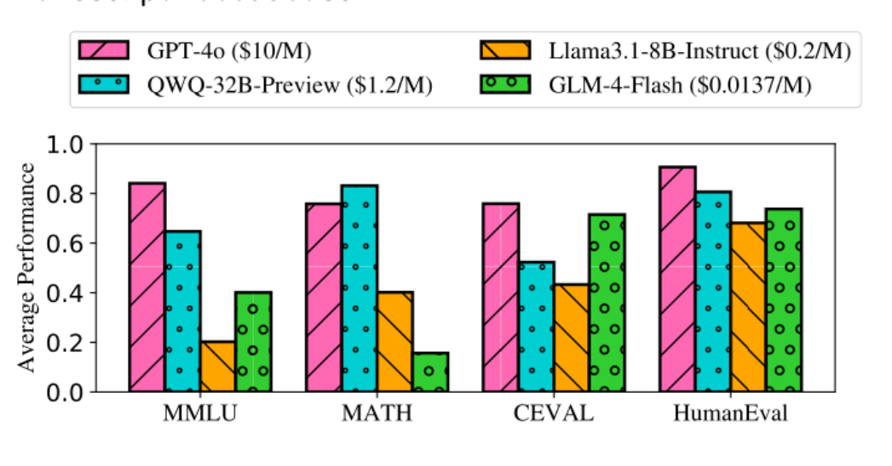

图1: 四个代表性大语言模型的输出定价及其在四个不同数据集上的性能。纵轴为平均性能（Average Performance）；横轴为MMLU、MATH、CEVAL、HumanEval。图例中的输出价格分别为GPT-4o（\$10/M）、QWQ-32B-Preview（\$1.2/M）、Llama3.1-8B-Instruct（\$0.2/M）和GLM-4-Flash（\$0.0137/M）。

这种多样化的大语言模型生态系统给实际应用带来了一个难题：如何有效地将用户查询路由至最合适的大语言模型？虽然将所有查询都路由到规模最大、能力最强的模型能够确保较高质量的结果，但这种方式成本高昂，而且并非必要。对于较为简单的查询，规模较小的模型通常就已经足够，能够提供成本更低、速度更快的解决方案。另一方面，使用诸如o1 这样的大型模型，或者通过复杂策略增强大语言模型，可能会导致“过度思考”（Overthinking）（Chen et al., 2024b），从而造成严重的资源浪费，甚至降低回答质量（Jeong et al., 2024; Xu et al., 2024; Ma et al., 2025）。因此，如何在回答质量与成本之间找到最优平衡，已经成为大语言模型实际应用中的一项关键挑战。

大语言模型路由器（LLM Router）通过自定义路由器将每个用户查询分配给最合适的大语言模型，为上述问题提供了一种高效的解决方案（见图2）。这种方法旨在成本约束下最大化回答性能，或者在维持目标质量的同时最小化成本。早期的大语言模型路由器采用静态策略，将查询依次路由至成本逐渐增加的模型，直到达到预期的回答质量（Chen et al., 2023）。然而，这种方式会因无效请求而造成资源浪费。近年来，数据驱动的路由方法在接收到查询后，利用预先训练好的回答性能预测器，预测各个大语言模型的回答质量，并将查询路由至最优模型（Ding et al., 2024; Hu et al., 2024）。由于这类方法具有较低的路由成本和较高的效率，数据驱动的路由已经成为大语言模型路由研究的主流方法。

然而，现有的数据驱动路由方法在有效性（Effectiveness）和可解释性（Interpretability）方面仍然存在局限。

（1）在有效性方面：现有方法通常依赖BERT 等已有模型来预测大语言模型的回答质量。然而，这些方法缺乏专门针对大语言模型路由领域设计的系统性、合理的建模框架，从而限制了它们充分挖掘大语言模型与查询之间潜在关系的能力。此外，用户查询具有随机性和开放性，导致在线环境中的查询与训练阶段使用的查询之间存在差异。这会产生冷启动（Cold-Start）问题，进一步限制大语言模型路由器的有效性。

（2）在可解释性方面：现有方法通常只输出大语言模型回答的性能分数，而不提供预测结果背后的理由。如果能够给出清晰的解释，例如“将这道数学问题路由至QwQ-32B-Preview，因为它在数学问题上表现更好”（如图1 所示），就能够显著增强预测结果的可信度。透明的解释不仅能够帮助用户理解模型的决策过程，还能够提升用户对模型的信任和接受程度。

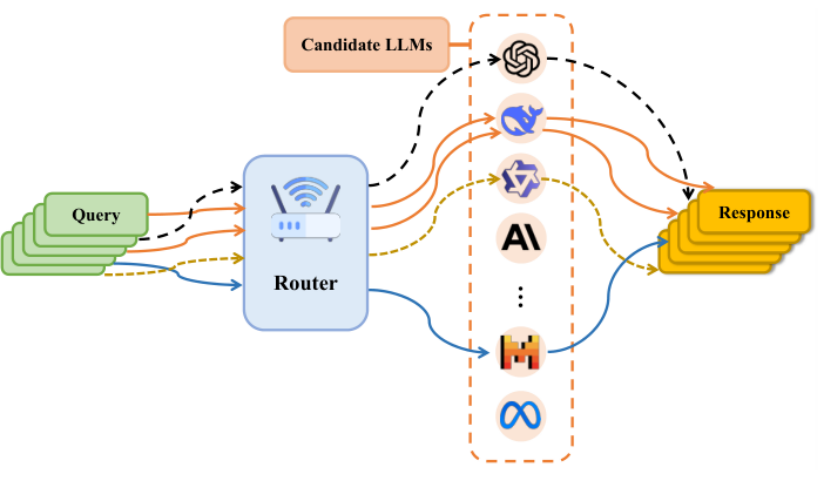

图2: 大语言模型路由器（LLM Router）。通过训练好的路由器，将查询分配给不同的大语言模型以生成回答。图中Query 为查询，Router 为路由器，Candidate LLMs 为候选模型，Response 为回答。

为了解决这些挑战，我们提出了IRT-Router，一种基于项目反应理论（Item Response Theory，IRT）的多大语言模型路由框架。IRT 是一种广泛用于测量人类受试者能力的心理学理论。该理论假设，受试者具有回答问题的“潜在能力”（Latent Ability），而问题本身则具有“潜在难度”（Latent Difficulty）等属性。通过建模受试者正确回答问题的概率，IRT 能够显式捕捉人类能力与测试题目属性之间的隐含关系。

在我们的研究场景中，每个大语言模型都被视为一名“受试者”（Test-taker），具有用于回答用户查询的潜在多维能力；而每个查询都被视为一道“试题”（Question），具有相应的潜在属性。基于IRT，我们显式建模大语言模型的多维能力与查询属性（例如回答难度）之间的关系，从而预测每个大语言模型在特定查询上的表现。结合成本优化目标（例如输出定价），IRT-Router 能够选择最合适的大语言模型来生成回答。

与现有方法相比，IRT-Router 是专门针对这一领域设计的，并以心理测量理论为基础，因此其建模过程具有更明确的理论依据。此外，IRT-Router 还能量化大语言模型的潜在能力、查询的回答难度等属性，为路由决策提供可解释的依据。为了缓解在线部署后新查询的冷启动问题，我们利用语义相似的已有查询对新查询进行预热。具体而言，我们基于IRT 模型家族中的两种实现来设计模型：基于多维项目反应理论（Multidimensional IRT，MIRT）的MIRT-Router（Reckase, 2009），以及基于神经认知诊断模型（NCDM）的NIRT-Router（Wang et al., 2020）。大量实验验证了我们所提出方法的有效性和可解释性。

本文的主要贡献总结如下：

- 我们创新性地将心理测量理论应用于大语言模型路由领域，探索了一种将数据挖掘技术与大语言模型路由任务相结合的合理方法。

- IRT-Router 是一种专门针对大语言模型路由设计的新型框架。它能够显式建立查询属性与大语言模型能力之间的关系，从而同时保证有效性和可解释性。

- 在20 个大语言模型和12 个数据集上进行的大量实验表明，IRT-Router 在有效性和可解释性方面优于大多数基线方法。该方法在冷启动场景下的优越表现证实，相较于其他方法，IRT-Router更适合真实应用场景，并具有更高的可靠性。

## 2 相关工作（Related Work）

项目反应理论（Item Response Theory）

项目反应理论（IRT）（Woodruff and Hanson, 1996）是一种广泛用于测量人类受试者能力的心理学理论。该理论假设，受试者具有回答问题的“潜在能力”，而问题本身具有“潜在难度”等属性。通过建模受试者正确回答问题的概率，IRT 能够显式捕捉人类能力与问题属性之间的隐含关系。特别地，IRT 依赖于心理学中的单调性假设（Monotonicity Assumption）。这一假设认为，受试者正确回答某道题目的概率与其对该题目所涉及技能的熟练程度成正比，从而保证模型的可解释性。

在机器学习领域，研究者已经通过多种方式实现了IRT，并通过建模作答数据来诊断人类能力（Gao et al., 2021, 2023; Li et al., 2025; Zhang et al., 2023, 2024; Liu et al., 2019）。例如，IRT 和MIRT模型（Woodruff and Hanson, 1996; Reckase, 2009）分别使用类似Logistic 的函数来建模学习者的单维能力和多维能力。与此同时，NCDM 模型（Wang et al., 2020）利用神经网络捕捉学习者与测试题目之间的高阶交互，从而实现对多维能力的评估。

近年来，由于IRT 在人类能力测量方面具有有效性和可解释性，它也被应用于评估机器学习模型（Liu et al., 2024c; Martínez-Plumed et al., 2019）、评估样本难度（Martínez-Plumed et al., 2022）、增强推荐系统（Liu et al., 2023）、对排行榜进行排序（Rodriguez et al., 2021），以及评估大语言模型的能力（Guinet et al., 2024; Gor et al., 2024; Liu et al., 2024e）。我们希望以IRT 为基础，对大语言模型与查询之间的关系进行建模，从而增强大语言模型路由器的有效性和可解释性。

大语言模型路由（LLM Router）

大语言模型路由领域目前仍处于探索阶段（Šakota et al., 2024; Liu et al., 2024d; Ramírez et al., 2024; Hari and Thomson, 2023; Mohammadshahi et al., 2024; Dai et al., 2024; Stojkovic et al., 2024）。与需要将所有专家参数加载到单台机器上的混合专家模型（Mixture of Experts，MoE）（Cai et al., 2024），或者需要获取全部候选模型输出的大语言模型集成方法（LLM Ensembling）不同，大语言模型路由器只需要将查询分配给最合适的模型，从而在提高性能的同时降低成本。

较早的方法，例如FrugalGPT 和AutoMix（Chen et al., 2023; Aggarwal et al., 2023），按照成本顺序依次调用不同模型，直到获得被认为足够好的回答。其他方法则使用数据驱动技术训练轻量级路由器，以实现最优的大语言模型分配。HybridLLM（Ding et al., 2024）使用基于BERT 的路由器，而RouteLLM（Ong et al., 2024）引入了SW-ranking、矩阵分解（Matrix Factorization，MF）以及BERT分类器等路由方法，主要关注二元路由（即在大模型和小模型之间进行选择）。

Zooter（Lu et al., 2023）和RouterDC（Chen et al., 2024a）利用较小的模型，并结合奖励机制或对比学习，实现了与较大模型相近的性能。GraphRouter（Feng et al., 2024）使用基于图神经网络（Graph Neural Network，GNN）的路由器，但该方法需要预先具备任务相关知识，而这在真实应用中可能较难获得。RouterBench（Hu et al., 2024）以及Shnitzer et al.（2023）提出了基于K 近邻（K-Nearest Neighbors，KNN）的路由方法。

大语言模型路由器在降低大语言模型应用成本的商业系统中也具有重要作用，例如Martian（https://withmartian.com）和Neutrino AI（https://neutrinoapp.com）。Martian 声称，通过动态模型路由，其方法能够“在性能上超越GPT-4，并将成本降低20%–97%”。OpenRouter（https://openrouter.ai）等大语言模型API 服务提供商也提供类似的功能。

## 3 预备知识（Preliminary）

### 3.1 问题定义（Problem Definition）

给定一个大语言模型（LLMs）集合$\mathcal M=\{M_1,M_2,\ldots,M_n\}$，以及一个查询集合$Q=\{q_1,q_2,\ldots,q_m\}$，我们的目标是将每个查询$q_i\in Q$ 分配给最合适的大语言模型$M_j\in\mathcal M$，从而实现更高的性能和更低的成本。对于每个查询$q_i$，我们定义一个评分函数：

$$
S(q_i,M_j)=\alpha\,\widehat P(q_i,M_j)-\beta\,C(M_j).\tag{1}
$$

其中，$\widehat P$ 表示模型$M_j$ 在查询$q_i$ 上的预测性能，由训练好的模型得到；$C(M_j)$ 表示使用大语言模型$M_j$ 的固定成本。为了统一度量，我们将其定义为大语言模型输出定价（见原文表5）到区间[0, 1]的线性映射（见脚注 1）。

这里，为了简化问题，我们将$C(M_j)$ 近似设定为固定成本。这是成本最基本的一种表示形式。实际上，$C(M_j)$ 可以根据用户自定义的设置进行调整。例如，如果用户拥有充足的计算资源，那么对于自行部署的开源大语言模型，其成本甚至可以设置为0。

α 和β 是预先定义的权衡参数，用于控制性能和成本之间的相对重要性，并满足$\alpha+\beta=1$。较大的α 表示更加重视性能，而较大的β 则表示更加重视成本效率。通过选择能够使评分最大化的模型，确定最优的模型分配方案：

$$
M^*(q_i)=\arg\max_{M_j\in\mathcal M}S(q_i,M_j).\tag{2}
$$

因此，关键挑战在于如何准确学习性能预测函数$\widehat P(q_i,M_j)$，从而确保查询路由的有效性。

### 3.2 项目反应理论（Item Response Theory）

项目反应理论（Item Response Theory，IRT）是一种心理测量理论，通过人类受试者对测试题目的作答情况来衡量其能力（Woodruff and Hanson, 1996）。在我们的研究场景中，大语言模型充当受试者，而查询则代表测试题目。对于给定的查询$q_i$ 和大语言模型$M_j$，模型$M_j$ 在查询$q_i$ 上的预测性能可以建模为：

$$
\widehat P(q_i,M_j)=\operatorname{IRT}(\theta_{M_j};b_i,a_i,\ldots).\tag{3}
$$

其中，IRT(·) 是一种通用形式，具有多种不同的具体实现方式，例如IRT 模型和MIRT 模型中的Logistic 函数（Woodruff and Hanson, 1996; Reckase, 2009），以及NCDM 模型中的神经网络（Wang et al., 2020）。对于大语言模型建模而言，关键参数是$\theta_{M_j}$，它表示模型的能力。对于查询建模而言，则包含更多的参数。例如，$b_i$ 是难度参数（Difficulty Parameter），用于刻画查询$q_i$ 的内在难度；$a_i$是区分度参数（Discrimination Parameter），用于控制随着$\theta_{M_j}$ 增大，预测性能发生变化的陡峭程度。

特别地，IRT 依赖于心理学中的单调性假设（Monotonicity Assumption）。该假设认为，随着大语言模型的能力$\theta_{M_j}$ 增强，其在查询上的预测性能也会提高。这一假设符合直观认识，即能力更强的大语言模型更有可能在难度较高的查询上取得良好表现，从而保证了大语言模型路由器的可解释性。

脚注 1：例如，候选大语言模型中价格最高的GPT-4o，其输出定价为每百万token 10 美元，因此C(GPT-4o) = 10/10 = 1，而C(DeepSeek-Chat) = 0.28/10 = 0.028。

## 4 方法（Methods）

如图3 所示，本文提出的IRT-Router 框架按照以下流程运行：首先，获取查询和候选大语言模型的嵌入表示（Embeddings）；接下来，使用基于IRT 的模型预测每个大语言模型的性能；然后，将这些性能预测结果与大语言模型的固定成本相结合，计算排序分数；最后，将查询路由至得分最高的大语言模型，由该模型生成回答。图3 中的示例查询为：一张纸在阳光下呈现蓝色。现在仅使用经过绿色滤光片的红光照射这张纸。在这种照明条件下，这张纸会呈现什么颜色？选项为A. 蓝色；B. 绿色；C. 红色；D. 黑色。图中模型档案示例写道：GPT-4o 由OpenAI 于2024 年5 月13 日发布，是一款能够处理文本、图像和音频输入的旗舰级多模态语言模型（图中后续描述省略）。

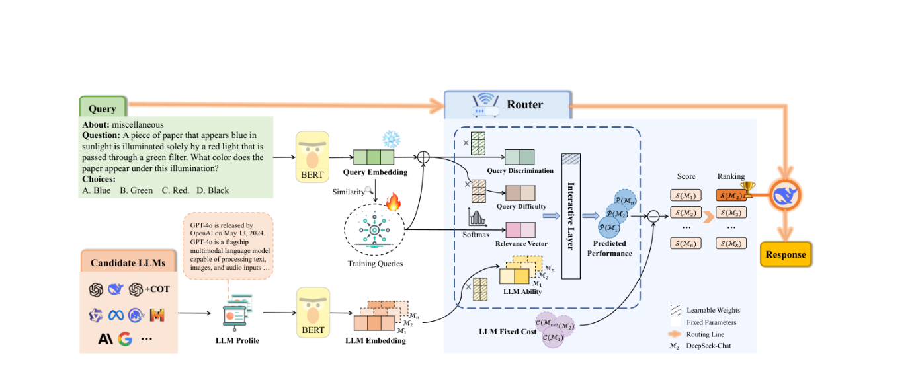

图3: IRT-Router 的整体框架。左侧表示查询和大语言模型的嵌入表示，中间部分执行基于IRT 的预测，右侧输出路由决策。原图中Query Discrimination 为查询区分度、Query Difficulty 为查询难度、Relevance Vector为相关性向量、LLM Ability 为模型能力、Predicted Performance 为预测性能、LLM Fixed Cost 为固定成本。

### 4.1 查询与大语言模型嵌入（Query and LLM Embeddings）

首先，使用一个预训练的嵌入模型（例如BERT），将每个查询$q_i$ 转换为查询嵌入$e_{q_i}\in\mathbb R^{d_q}$。该嵌入表示能够捕捉查询的语义信息。类似地，每个大语言模型$M_j$（例如GPT-4o）都由一个相应的嵌入表示$e_{M_j}\in\mathbb R^{d_M}$ ，这一嵌入表示来源于该大语言模型的档案（Profile）。模型档案包含元数据信息，例如模型的发布日期、开发者、类型、主要特征以及简要描述（见原文表10）。随后，对这些档案信息进行编码，形成大语言模型的嵌入表示。

### 4.2 基于IRT 的预测（IRT-based Prediction）

我们已经在公式(3) 中提到，IRT 存在多种不同的实现形式。在这里，我们将首先介绍一种轻量级版本，即多维IRT 路由器（Multidimensional IRT-Router），随后介绍一种具有更强可解释性的版本，即神经IRT 路由器（Neural IRT-Router）。

#### 4.2.1 MIRT-Router

受到多维项目反应理论（Multidimensional Item Response Theory）（Reckase, 2009）的启发，MIRT-Router 使用Logistic 函数建模查询与大语言模型之间的交互关系。其中，每个大语言模型都通过一个多维潜在能力向量$\theta_{M_j}\in\mathbb R^N$ 来描述，而每个查询则由区分度$a_i\in\mathbb R^N$ 和难度$b_i\in\mathbb R$ 刻画。所有这些参数均通过变换层获得：

$$
\theta_{M_j}=\mathbf W_\theta e_{M_j},\qquad a_i=\mathbf W_a e_{q_i},\qquad b_i=\mathbf W_b e_{q_i}.\tag{4}
$$

其中，$\mathbf W_\theta$、$\mathbf W_a$ 和$\mathbf W_b$ 均为可学习权重。

交互函数（Interactive Function）大语言模型$M_j$ 在查询$q_i$ 上的预测性能遵循以下Logistic 函数：

$$
\widehat P(q_i,M_j)=\frac{1}{1+\exp\!\left(-a_i^\top\theta_{M_j}+b_i\right)}.\tag{5}
$$

训练（Training）我们使用训练数据集$\mathcal D_{\mathrm{train}}$ 来训练MIRT-Router，该数据集由三元组($q_i$, $M_j$, $y_{ij}$)构成，其中$y_{ij}$ 表示大语言模型$M_j$ 在查询$q_i$ 上的经验性能分数。该分数通过将大语言模型的回答与真实答案（Ground Truth）进行比较来计算。为了学习模型权重，我们最小化二元交叉熵损失（Binary Cross-Entropy Loss）：

$$
\mathcal L=-\sum_{(q_i,M_j,y_{ij})\in\mathcal D_{\mathrm{train}}}\left[y_{ij}\log\widehat P(q_i,M_j)+(1-y_{ij})\log\!\left(1-\widehat P(q_i,M_j)\right)\right].\tag{6}
$$

#### 4.2.2 NIRT-Router

MIRT-Router 主要关注潜在能力，而NIRT-Router 在此基础上进一步引入了一个显式的相关性向量（Relevance Vector）$r_{q_i}$，该向量将每个维度与一项预先定义的具体能力关联起来（见附录C.1）。

相关性向量（Relevance Vector）相关性向量$r_{q_i}\in\mathbb R^N$ 表示查询$q_i$ 与不同能力维度之间的关联程度。

对于训练查询集$Q_{\mathrm{train}}$：为了定义相关性向量$r_{q_i}$，首先对查询的嵌入表示进行聚类。具体而言，先使用UMAP（McInnes et al., 2018）进行降维，然后使用HDBSCAN（McInnes et al., 2017）进行聚类。HDBSCAN 能够通过密度分析自适应地识别不同的聚类。每个聚类都代表一组具有相似能力需求的问题。对于每个聚类，我们通过考察该聚类内num(= 5) 道样本问题所需的能力，识别与该聚类相关的能力。为了方便，这项工作由一个大语言模型完成（见附录C.2）。随后，对于给定的查询$q_i$，通过为每个能力维度赋值1 或0 来构建其相关性向量$r_{q_i}$，以表示该能力是否与当前查询相关。

对于测试查询集$Q_{\mathrm{test}}$：由于无法获得真实的相关性向量，我们利用嵌入空间中5 个最近邻（5-Nearest Neighbors，5-NN）的相关性向量均值，对$r_{q_i}$ 进行近似估计。这样可以确保未见过的查询仍然能够获得合理的相关性估计。

交互函数（Interactive Function）为了预测模型$M_j$ 在查询$q_i$ 上的性能，NIRT-Router 使用一个神经交互层：

$$
x_{ij}=r_{q_i}\odot(\theta_{M_j}-b_i)\times a_i,\tag{7}
$$

$$
\widehat P(q_i,M_j)=\sigma\!\left(\phi\!\left(\mathbf W_1x_{ij}^{\top}+\mathbf b_1\right)\right),\tag{8}
$$

其中，

$$
\begin{aligned}\theta_{M_j}&=\sigma(\mathbf W_\theta e_{M_j})\in\mathbb R^N,\\a_i&=\mathbf W_a e_{q_i}\in\mathbb R,\\b_i&=\sigma(\mathbf W_b e_{q_i})\in\mathbb R^N,\\r_{q_i}&=\operatorname{softmax}(r_{q_i})\in\mathbb R^N.\end{aligned}\tag{9}
$$

其中，$\sigma(\cdot)$ 是Sigmoid 函数，$\mathbf W_1$、$\mathbf W_\theta$、$\mathbf W_a$ 和$\mathbf W_b$ 均为可学习权重。（公式(9) 的相关性向量在归一化前后使用同一符号，此处严格沿用原论文写法。）

训练（Training）我们使用数据集$\mathcal D^{\prime}_{\mathrm{train}}$ 训练NIRT-Router，该数据集包含四元组($q_i$, $M_j$, $r_{q_i}$, $y_{ij}$)，其中$r_{q_i}$ 是查询的相关性向量。损失函数与MIRT-Router 中使用的损失函数相同，即公式(6) 所定义的二元交叉熵损失。

### 4.3 路由决策（Routing Decision）

在得到预测性能$\widehat P(q_i,M_j)$ 后，我们利用评分函数（公式(1)），将其与大语言模型的固定成本$C(M_j)$ 相结合。得分最高的大语言模型即为查询最终被路由到的模型。

### 4.4 查询冷启动预热（Warm-Up for Query Cold-Start）

在真实应用场景中，测试查询通常在训练过程中从未出现过，因此会产生冷启动问题。虽然基于文本的语义嵌入能够在一定程度上缓解这一问题，但我们通过引入语义相似的已知查询信息来进一步优化查询向量，从而实现进一步改进。具体而言，对于给定的测试查询，我们按照以下方式更新其向量：

$$
e_{q_i}=(1-\lambda)e_{q_i}+\lambda e_{q_i}^{\mathrm{warm}}.\tag{10}
$$

其中，$e_{q_i}^{\mathrm{warm}}$是一个调整向量。该调整向量通过对训练集中k 个最近邻查询的嵌入表示取平均得到。这些最近邻查询是通过在查询嵌入空间中进行相似性搜索确定的。

## 5 实验设置（Experimental Setup）

本节将详细介绍数据构建过程和实验设置。如第4.2.1 节所述，训练集定义为

$$
\mathcal D_{\mathrm{train}}=\{(q_i,M_j,y_{ij})\mid q_i\in Q_{\mathrm{train}},\ M_j\in\mathcal M,\ y_{ij}\in[0,1]\}.
$$

测试集采用类似的结构。具体而言，我们构建了12 种不同类型的数据集与20 个不同大语言模型之间的交互数据。对于每个查询，我们使用全部20 个大语言模型生成回答。随后，使用原文表7 所描述的相应评价指标，将生成的回答与真实答案（Ground Truth）进行比较，以评估回答质量，从而得到模型$M_j$ 在查询$q_i$ 上的性能分数$y_{ij}$。

### 5.1 数据集（Datasets）

分布内（In-distribution，ID）在这一场景中，我们使用了8 个数据集。对于每个数据集，我们随机将其划分为训练集（70%）和测试集（30%）。所有数据集的训练部分被合并，形成整体训练查询集$Q_{\mathrm{train}}$，用于训练路由器。类似地，所有数据集的测试部分被合并，形成整体测试查询集$Q_{\mathrm{test}}$，用于评估路由器在分布内场景下的表现。由于训练查询集和测试查询集是在与大语言模型进行交互之前划分的，因此测试集中的所有查询都是此前未见过的。

这8 个数据集分别为：

1. MMLU（Hendrycks et al., 2021a）：包含来自不同领域的57 项任务的基准测试。

2. CMMLU（Li et al., 2024）：一个中文多任务评估基准，涵盖67 项任务。

3. ACLUE（Zhang and Li, 2023）：一个古汉语语言理解基准。

4. ARC_C（Clark et al., 2018）：一个旨在衡量高级推理能力的数据集。

5. Hotpot_QA（Yang et al., 2018）：一个要求跨文档进行多跳推理的数据集。

6. SQUAD（Rajpurkar et al., 2018）：一个阅读理解数据集，由众包工作者提出的问题构成。

7. MATH（Hendrycks et al., 2021b）：一个包含大量具有挑战性的竞赛数学问题的数据集。

8. MBPP（Austin et al., 2021）：一个由编程任务构成的数据集。

分布外（Out-of-distribution，OOD）我们还在4 个分布外数据集上评估训练好的路由器，具体包括：

1. CEVAL（Huang et al., 2024）：一个涵盖52 个学科的中文数据集。

2. Commonsense_QA（Talmor et al., 2018）：用于测试常识推理能力。

3. GSM8K（Cobbe et al., 2021）：包含小学数学应用题。

4. HumanEval：用于评估代码生成能力。

### 5.2 候选大语言模型（Candidate LLMs）

正如第1 节所述，目前存在多种类型的大语言模型。在这里，我们选择了20 个具有代表性的模型（列于原文表5）作为候选大语言模型。

### 5.3 基线方法（Baselines）

我们将提出的两种方法（MIRT-Router 和NIRT-Router）与Small LLM（即Ministral-8B-Instruct-2410）和Large LLM（即GPT-4o）进行比较。这两种基线分别始终将查询路由至小模型和大模型。此外，还与近期一些具有代表性的工作进行比较。

HybridLLM（Ding et al., 2024）和RouteLLM（Ong et al., 2024）分别使用DeBERTa-v3（He et al., 2023）和矩阵分解（Matrix Factorization，MF）作为二元分类器，在一对大模型和小模型之间选择表现更好的模型。对于这两种方法，我们都将小模型设为Ministral-8B-Instruct-2410，将大模型设为GPT-4o。

RouterBench（Hu et al., 2024）设计了多种路由策略，用于响应用户查询，并从一组候选模型中选择最优的大语言模型。在我们的实现中，采用其中的Predictive Router（预测式路由器）策略。原因在于，其他策略需要事先获取每个候选大语言模型的回答，这会带来更高的成本。

### 5.4 评价指标（Metrics）

遵循GraphRouter（Feng et al., 2024）的做法，我们使用以下三个指标来评估所有路由方法。

性能（Performance）所有测试查询的平均回答性能。该指标通过将模型回答与真实答案进行比较来评估（见第5 节和原文表7）。

总成本（Total Cost）所有测试查询产生的总支出，以美元（USD）为单位，其计算方式如下：

$$
\sum_{q\in Q_{\mathrm{test}}}\left[\operatorname{input\_pricing}(M^*(q))\operatorname{input\_tokens}(q)+\operatorname{output\_pricing}(M^*(q))\operatorname{output\_tokens}(q,M^*(q))\right].\tag{11}
$$

奖励（Reward）为了统一度量，我们采用第3.1 节中的归一化方法，将总成本（Total Cost）线性映射到区间[0, 1]。缩放系数由观测到的最大总成本确定。最终的奖励函数在性能和成本之间进行权衡：

$$
\operatorname{Reward}=\alpha\operatorname{Performance}-\beta\operatorname{linear}(\operatorname{TotalCost}).\tag{12}
$$

### 5.5 实现细节（Implementation Details）

我们使用bert-base-uncased 作为查询和大语言模型的嵌入模型。预热机制中的k 设置为5。MIRT-Router 和NIRT-Router 的维度N 均设置为25。路由器使用Adam 优化器进行训练，学习率为0.002，批大小（Batch Size）为512。所有实验均在1 张NVIDIA A100 40GB GPU 上运行。

## 6 实验结果（Experimental Results）

### 6.1 主要结果（Main Results）

表1: 分布内（ID）场景下的测试结果。Performance（性能，越高越好）、Total Cost（总成本，美元，越低越好）、Reward（奖励，×10−2，越高越好）为第5.4 节定义的指标。α 越大，表示对性能的要求越高。

| 权衡参数 | 方法 | 性能 ↑ | 总成本 ↓ | 奖励 ↑ |
| --- | --- | --- | --- | --- |
| α = 0.8, β = 0.2 | Small LLM | 48.70% | **0.31** | 38.48 |
| α = 0.8, β = 0.2 | Large LLM | 77.53% | 12.93 | 42.02 |
| α = 0.8, β = 0.2 | HybridLLM | 54.37% | 1.98 | 40.43 |
| α = 0.8, β = 0.2 | RouteLLM | 77.25% | 12.80 | 42.00 |
| α = 0.8, β = 0.2 | RouterBench | 80.01% | 1.15 | 62.23 |
| α = 0.8, β = 0.2 | MIRT-Router | 80.67% | 0.42 | **63.89** |
| α = 0.8, β = 0.2 | NIRT-Router | **80.69%** | 0.55 | 63.70 |
| α = 0.5, β = 0.5 | Small LLM | 48.70% | **0.31** | 23.14 |
| α = 0.5, β = 0.5 | Large LLM | 77.53% | 12.93 | -11.24 |
| α = 0.5, β = 0.5 | HybridLLM | 52.42% | 1.54 | 20.27 |
| α = 0.5, β = 0.5 | RouteLLM | 73.59% | 11.15 | -6.32 |
| α = 0.5, β = 0.5 | RouterBench | 79.48% | 0.53 | 37.67 |
| α = 0.5, β = 0.5 | MIRT-Router | **80.65%** | 0.42 | **38.69** |
| α = 0.5, β = 0.5 | NIRT-Router | 80.41% | 0.43 | 38.53 |
| α = 0.2, β = 0.8 | Small LLM | 48.70% | **0.31** | 7.81 |
| α = 0.2, β = 0.8 | Large LLM | 77.53% | 12.93 | -64.49 |
| α = 0.2, β = 0.8 | HybridLLM | 56.65% | 2.78 | -5.84 |
| α = 0.2, β = 0.8 | RouteLLM | 66.24% | 7.51 | -33.17 |
| α = 0.2, β = 0.8 | RouterBench | 78.36% | 0.37 | 13.35 |
| α = 0.2, β = 0.8 | MIRT-Router | **80.03%** | 0.39 | **13.59** |
| α = 0.2, β = 0.8 | NIRT-Router | 79.37% | 0.41 | 13.37 |

表2: 分布外（OOD）场景下的测试结果。指标与权衡参数设置与表1 相同。

| 权衡参数 | 方法 | 性能 ↑ | 总成本 ↓ | 奖励 ↑ |
| --- | --- | --- | --- | --- |
| α = 0.8, β = 0.2 | Small LLM | 59.83% | **0.11** | 45.67 |
| α = 0.8, β = 0.2 | Large LLM | 84.90% | 5.30 | 47.92 |
| α = 0.8, β = 0.2 | HybridLLM | 63.34% | 0.73 | 47.93 |
| α = 0.8, β = 0.2 | RouteLLM | 84.39% | 5.25 | 47.70 |
| α = 0.8, β = 0.2 | RouterBench | 85.50% | 0.26 | 67.42 |
| α = 0.8, β = 0.2 | MIRT-Router | 87.12% | 0.14 | 69.17 |
| α = 0.8, β = 0.2 | NIRT-Router | **87.37%** | 0.15 | **69.32** |
| α = 0.5, β = 0.5 | Small LLM | 59.83% | **0.11** | 28.88 |
| α = 0.5, β = 0.5 | Large LLM | 84.90% | 5.30 | -7.55 |
| α = 0.5, β = 0.5 | HybridLLM | 62.08% | 0.41 | 27.19 |
| α = 0.5, β = 0.5 | RouteLLM | 79.90% | 4.74 | -4.83 |
| α = 0.5, β = 0.5 | RouterBench | 85.75% | 0.16 | 41.37 |
| α = 0.5, β = 0.5 | MIRT-Router | 87.12% | 0.14 | 42.25 |
| α = 0.5, β = 0.5 | NIRT-Router | **87.24%** | 0.14 | **42.30** |
| α = 0.2, β = 0.8 | Small LLM | 59.83% | **0.11** | 10.31 |
| α = 0.2, β = 0.8 | Large LLM | 84.90% | 5.30 | -63.02 |
| α = 0.2, β = 0.8 | HybridLLM | 63.79% | 0.65 | 2.98 |
| α = 0.2, β = 0.8 | RouteLLM | 75.06% | 3.48 | -37.58 |
| α = 0.2, β = 0.8 | RouterBench | 84.62% | 0.12 | 15.09 |
| α = 0.2, β = 0.8 | MIRT-Router | 87.18% | 0.13 | 15.45 |
| α = 0.2, β = 0.8 | NIRT-Router | **87.46%** | 0.13 | **15.50** |

分布内结果（In-Distribution Results）从表1 可以观察到，在三种不同的参数设置下，我们的IRT-Router 均取得了最高的性能。其平均回答准确率比单独使用GPT-4o 高出3%，但总成本仅为GPT-4o 的1/30。与仅使用小模型相比，我们的方法在总成本相近的情况下，将Performance 提高了32%。此外，在所有兼顾性能与成本的设置下（即Reward 指标），IRT-Router 同样取得了最优结果。通过将IRT-Router 和RouterBench 与其他仅使用两个候选大语言模型的基线方法进行比较，可以清楚地看到，多大语言模型路由显著优于二元大语言模型路由。这表明，二元大语言模型路由未能充分利用不同大语言模型之间的互补能力。

我们还观察到，尽管IRT-Router 的表现优于RouterBench，尤其是在α = 0.8（优先考虑性能）的情况下，它不仅提供了更好的性能，而且成本仅约为RouterBench 的一半，但RouterBench 对α的变化表现出更严格的响应。我们认为，这与大语言模型固定成本$C(M_j)$ 的度量方式或定义有关。最后，我们发现MIRT-Router 与NIRT-Router 的性能非常接近，其中MIRT-Router 在ID 场景下略优于NIRT-Router。

分布外结果（Out-of-Distribution Results）在OOD 场景下，IRT-Router 同样展现出较强的性能，并取得了最高的Reward。其Performance 比表现最好的基线方法高出2%。值得注意的是，在这一场景下，NIRT-Router 的表现优于MIRT-Router，这表明NIRT-Router 可能具有略强的泛化能力。我们认为，这可能是由于NIRT-Router 采用了更加复杂的网络结构。

### 6.2 IRT-Router 的可解释性（Interpretability of IRT-Router）

大语言模型能力（LLM Ability）我们选择了两组来自相同模型系列的模型进行能力比较：Llama3.1-8B-Instruct 与Llama3.1-70B-Instruct，以及GPT-4o Mini 与GPT-4o Mini+COT。如图4所示，所有四个模型的能力值均由训练完成的MIRT-Router 获得。可以看到，在每个能力维度上，Llama3.1-70B-Instruct 的能力值均不低于Llama3.1-8B-Instruct。这符合我们对同一系列中较大模型和较小模型之间能力关系的预期，也与它们在ID 测试集上的平均表现一致（分别为71% 和32%）。另一组模型涉及经过思维链（Chain-of-Thought，COT）增强的版本和未经增强的版本。显然，GPT-4o Mini+COT 的平均能力值高于GPT-4o Mini。

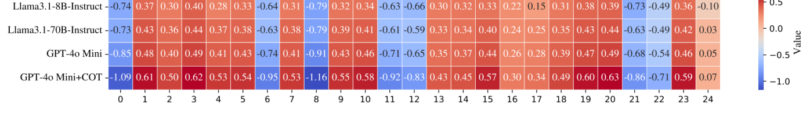

图4: 四个大语言模型在25 个维度上的能力值。从上到下，四个模型的平均能力值分别为0.0257、0.0763、0.0841 和0.0971。数值越高，表示能力越强。横轴为维度0–24；右侧色条为Value（能力值）。原图保留全部4 × 25 个数值。

查询难度（Query Difficulty）我们从MATH 数据集中随机选择了两个查询，每个查询都具有相应的题目等级（Level）标签。如图5 所示，MIRT-Router 得到的查询难度与题目等级标签相一致。左侧问题：找出满足0 ≤n ≤5 的整数n，使其满足n ≡12345 (mod 6)。右侧问题：在从1 到100的所有整数列表中，数字6 总共出现了多少次？

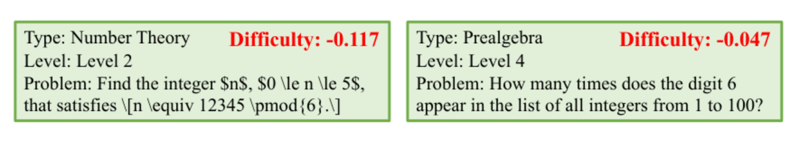

图5: 来自MATH 数据集的两个查询。Level 和Difficulty 的数值越高，表示查询越具有挑战性。左侧为数论（Level 2，Difficulty = −0.117），右侧为初等代数（Level 4，Difficulty = −0.047）。

路由分析（Routing Analysis）我们对MIRT-Router 得到的20 个大语言模型的能力值进行排序，排名前10 的模型分别为DeepSeek-Chat（81%）、DeepSeek-Coder（81%）、Gemini-1.5-Flash（73%）、GLM-4-Plus（79%）、GPT-4o（78%）、GPT-4o Mini（71%）、GPT-4o Mini+COT（72%）、Llama3.1-405B-Instruct（78%）、Qwen2.5-32B-Instruct-GPTQ-Int4（78%）、Qwen2.5-72B-Instruct（80%）。其中，括号中的百分比表示这些模型在ID 训练集上的平均性能。

事实上，这10 个模型所表现出来的能力并没有显著差异，但它们与QwQ-32B-Preview（60%）和Llama3.1-8B-Instruct（32%）等模型之间存在较大差距。在排名前10 的模型中，成本最低的模型是DeepSeek-Chat（\$0.28/M）、DeepSeek-Coder（\$0.28/M）和Qwen2.5-32B-Instruct-GPTQ-Int4（\$0.2/M）。

我们根据查询难度（由MIRT-Router 获得），对ID 测试集中的所有查询进行排序，并选取难度最高的前30% 和难度最低的后30% 的查询。随后，我们观察在α = 0.8 设置下，这些查询的实际路由分配情况。我们发现，在难度最高的前30% 查询中，80% 的查询被路由至DeepSeek-Chat；而在难度最低的后30% 查询中，99% 的查询被路由至Qwen2.5-32B-Instruct-GPTQ-Int4。这表明，难度较高的查询倾向于被路由至能力更强的模型，而难度较低的查询则被路由至能力稍弱、但已经足以完成任务且更具成本效益的模型。这一结果证明了IRT-Router 的有效性和合理性。

路由准确率（Routing Accuracy）为了进一步评估IRT-Router 的有效性，我们额外考察了MIRT-Router 能够在多大程度上将未见过的查询准确路由至Top-k 个最优大语言模型。表3 报告了分布内与分布外两种场景下的路由准确率，其中候选大语言模型总数为20，且α = 0.8。尽管Top-1 准确率相对较低，但这主要由两个因素造成。首先，路由目标同时考虑性能和成本。当存在大量候选大语言模型时，其中一些模型（例如DeepSeek-Coder 和DeepSeek-Chat）的表现非常接近。即使是规模较小和规模较大的模型，也可能得到相近的分数，因此仅关注Top-1 模型的意义相对有限。其次，当前IRT-Router 被有意设计为轻量级模型，其可训练参数数量非常少。我们预计，未来随着更多高质量训练数据的引入，以及更加精细的约束条件的加入，IRT-Router 将能够不断演化并进行持续训练，从而进一步提高其准确率。

表3: MIRT-Router 的Top-k 路由准确率。

| 场景 | Top-1 | Top-2 | Top-3 | Top-4 | Top-5 |
| --- | --- | --- | --- | --- | --- |
| ID | 2.72% | 9.88% | 32.51% | 38.78% | 47.85% |
| OOD | 2.15% | 7.50% | 27.29% | 31.94% | 39.47% |

### 6.3 泛化能力（Generalization Ability）

新大语言模型（New LLM）我们还针对一个新的大语言模型Claude 3.5 Haiku 20241022 开展了实验。在这里，我们重点评估不同路由器在ID 测试集上预测这个新大语言模型回答质量的表现。我们选择了四个评价指标：回归指标包括MAE（Mean Absolute Error，平均绝对误差）和RMSE（Root Mean Square Error，均方根误差）；分类指标包括AUC（Area Under the Curve，曲线下面积）和ACC（Accuracy，准确率）。如表4 所示，RouterBench 的预测准确率非常低，几乎相当于随机预测，而MIRT-Router 和NIRT-Router 的表现则好得多。尽管如此，当前的IRT-Router 对未见过的大语言模型的泛化能力仍然有限，其ACC 为0.67，表明仍然存在较大的改进空间。我们认为，提升这一方面的能力也是未来一个重要的研究方向，例如利用少样本学习（Few-shot Learning）或者相似性来对大语言模型的冷启动进行预热。

表4: 当α = 0.8 时，ID 场景下新LLM 的预测结果。

| 方法 | RMSE ↓ | MAE ↓ | AUC ↑ | ACC ↑ |
| --- | --- | --- | --- | --- |
| RouterBench | 0.62 | 0.55 | 0.50 | 0.34 |
| MIRT-Router | **0.45** | 0.43 | **0.62** | 0.67 |
| NIRT-Router | **0.45** | **0.42** | **0.62** | **0.68** |

查询冷启动预热（Warm up Query Cold-Start）我们开展了实验，以研究预热机制对于查询冷启动问题的有效性。图6 和图7 展示了在α = 0.8、α = 0.5 和α = 0.2 三种设置下，MIRT-Router 和NIRT-Router 在OOD 测试集上的Reward，分别比较了使用预热机制和不使用预热机制时的结果。

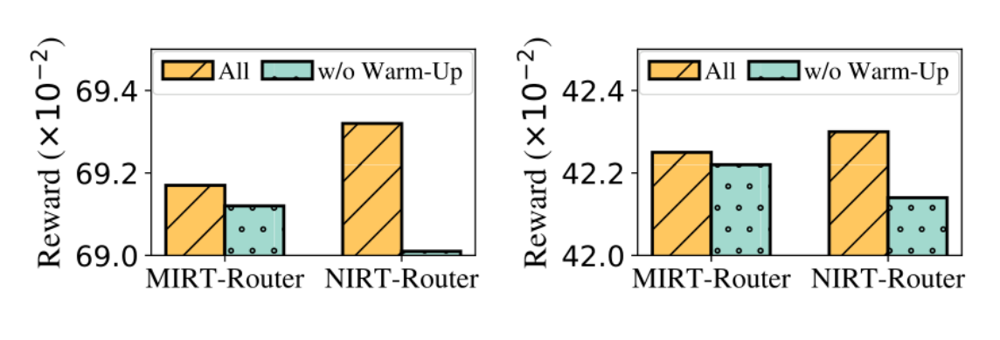

图6: 当α = 0.8（左）和α = 0.5（右）时，IRT-Router 使用全部组件（All）和移除预热模块（w/o Warm-Up）时的Reward。纵轴为Reward（×10−2）。

我们发现，当移除预热模块时，所有Reward 均有所下降，而且这种影响在NIRT-Router 上更加明显。这表明，预热机制对于提升NIRT-Router 的性能具有更为显著的作用。

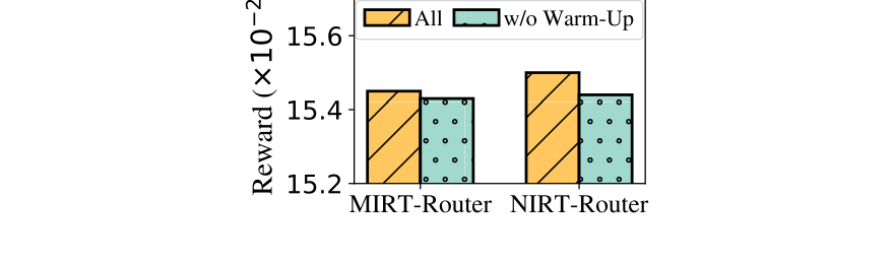

图7: 当α = 0.2 时，IRT-Router 使用全部组件（All）和移除预热模块（w/o Warm-Up）时的Reward。纵轴为Reward（×10−2）。原文将该图排版于附录开始的第13 页。

## 7 结论（Conclusion）

在本文中，我们提出了IRT-Router，一种基于项目反应理论（Item Response Theory，IRT）的、具有可解释性且高效的大语言模型路由器。我们的方法通过为给定查询选择最合适的大语言模型，有效实现了更高的性能和更低的成本。通过在20 个大语言模型和12 个数据集上开展广泛实验，我们发现IRT-Router 的表现优于多种基线方法，证明了我们方法的优越性。此外，我们针对查询冷启动问题设计的预热机制（Warm-Up Mechanism），增强了模型对未见过的查询的泛化能力。

## 局限性（Limitations）

目前使用的数据集主要是具有真实答案标签（Ground Truth Labels）的常见基准测试数据集。然而，这些数据集中的查询相对较短，并不能覆盖真实应用场景中遇到的各种各样的查询。我们认识到，这是大语言模型路由领域普遍面临的一项挑战。展望未来，持续收集基于人类偏好（Human Preferences）的动态数据将具有重要价值（Zheng et al., 2023; Chiang et al., 2024），因为这些数据能够更好地反映真实世界中的查询分布。

此外，我们的路由器对于权衡参数α 的变化似乎不够敏感，这表明需要采用更加精细的度量方法，例如增大大语言模型固定成本$C(M_j)$ 的数值。另外，我们尚未对查询属性与大语言模型能力之间的关系施加额外约束。例如，如果我们假设规模较大的模型通常具有比规模较小的模型更高的平均能力水平，那么就可以在训练过程中，对模型学习得到的能力向量的平均值引入排序约束（Ordering Constraint）。这一约束能够指导优化过程、加快收敛速度，并使训练结果更加合理和准确。

## 致谢（Acknowledgments）

本研究得到了国家科技重大专项（项目编号：2022ZD0117103）、国家自然科学基金（项目编号：62477044）、中央高校基本科研业务费专项资金（项目编号：WK2150110038）和CCF-网易雷火创新研究基金（项目编号：CCF-Netease 202306）的部分资助。黄振亚（Zhenya Huang）特别感谢中国科学技术协会青年人才托举工程（Young Elite Scientists Sponsorship Program by CAST）的支持（项目编号：2024QNRC001）。

## 参考文献与原文附录（保留英文）

为方便检索原论文引用和复现实验细节，后附原PDF 第10–16 页，内容为完整的英文参考文献以及附录A、B、C。根据先前的翻译要求，附录不另作中文逐段翻译。英文原页中的表5–10、图8–10、数据集规模、模型档案与完整Prompt 均予以保留。

## References（保留英文）

Pranjal Aggarwal, Aman Madaan, Ankit Anand, Srividya Pranavi Potharaju, Swaroop Mishra, Pei Zhou, Aditya Gupta, Dheeraj Rajagopal, Karthik Kappaganthu, Yiming Yang, et al. 2023. Automix: Automatically mixing language models. arXiv preprint arXiv:2310.12963.

Jacob Austin, Augustus Odena, Maxwell Nye, Maarten Bosma, Henryk Michalewski, David Dohan, Ellen Jiang, Carrie Cai, Michael Terry, Quoc Le, et al. 2021. Program synthesis with large language models. arXiv preprint arXiv:2108.07732.

Weilin Cai, Juyong Jiang, Fan Wang, Jing Tang, Sunghun Kim, and Jiayi Huang. 2024. A survey on mixture of experts. arXiv preprint arXiv:2407.06204.

Lingjiao Chen, Matei Zaharia, and James Zou. 2023. Frugalgpt: How to use large language models while reducing cost and improving performance. arXiv preprint arXiv:2305.05176.

Shuhao Chen, Weisen Jiang, Baijiong Lin, James T Kwok, and Yu Zhang. 2024a. Routerdc: Querybased router by dual contrastive learning for assembling large language models. arXiv preprint arXiv:2409.19886.

Xingyu Chen, Jiahao Xu, Tian Liang, Zhiwei He, Jianhui Pang, Dian Yu, Linfeng Song, Qiuzhi Liu, Mengfei Zhou, Zhuosheng Zhang, Rui Wang, Zhaopeng Tu, Haitao Mi, and Dong Yu. 2024b. Do not think that much for 2+3=? on the overthinking of o1-like llms. Preprint, arXiv:2412.21187.

Wei-Lin Chiang, Lianmin Zheng, Ying Sheng, Anastasios Nikolas Angelopoulos, Tianle Li, Dacheng Li, Hao Zhang, Banghua Zhu, Michael Jordan, Joseph E Gonzalez, et al. 2024. Chatbot arena: An open platform for evaluating llms by human preference, 2024. URL https://arxiv. org/abs/2403.04132, 2(10).

Peter Clark, Isaac Cowhey, Oren Etzioni, Tushar Khot, Ashish Sabharwal, Carissa Schoenick, and Oyvind Tafjord. 2018. Think you have solved question answering? try arc, the ai2 reasoning challenge. arXiv preprint arXiv:1803.05457.

Karl Cobbe, Vineet Kosaraju, Mohammad Bavarian, Mark Chen, Heewoo Jun, Lukasz Kaiser, Matthias Plappert, Jerry Tworek, Jacob Hilton, Reiichiro Nakano, et al. 2021. Training verifiers to solve math word problems. arXiv preprint arXiv:2110.14168.

Xiangxiang Dai, Jin Li, Xutong Liu, Anqi Yu, and John Lui. 2024. Cost-effective online multi-llm selection with versatile reward models. arXiv preprint arXiv:2405.16587.

Dujian Ding, Ankur Mallick, Chi Wang, Robert Sim, Subhabrata Mukherjee, Victor Ruhle, Laks VS Lakshmanan, and Ahmed Hassan Awadallah. 2024. Hybrid llm: Cost-efficient and quality-aware query routing. arXiv preprint arXiv:2404.14618.

Tao Feng, Yanzhen Shen, and Jiaxuan You. 2024. Graphrouter: A graph-based router for llm selections. arXiv preprint arXiv:2410.03834.

Weibo Gao, Qi Liu, Zhenya Huang, Yu Yin, Haoyang Bi, Mu-Chun Wang, Jianhui Ma, Shijin Wang, and Yu Su. 2021. Rcd: Relation map driven cognitive diagnosis for intelligent education systems. In Proceedings of the 44th international ACM SIGIR conference on research and development in information retrieval, pages 501–510.

Weibo Gao, Hao Wang, Qi Liu, Fei Wang, Xin Lin, Linan Yue, Zheng Zhang, Rui Lv, and Shijin Wang. 2023. Leveraging transferable knowledge concept graph embedding for cold-start cognitive diagnosis. In Proceedings of the 46th international ACM SIGIR conference on research and development in information retrieval, pages 983–992.

Maharshi Gor, Hal Daumé III, Tianyi Zhou, and Jordan Boyd-Graber. 2024. Do great minds think alike? investigating human-ai complementarity in question answering with caimira. arXiv preprint arXiv:2410.06524.

Gauthier Guinet, Behrooz Omidvar-Tehrani, Anoop Deoras, and Laurent Callot. 2024. Automated evaluation of retrieval-augmented language models with task-specific exam generation. arXiv preprint arXiv:2405.13622.

Surya Narayanan Hari and Matt Thomson. 2023. Tryage: Real-time, intelligent routing of user prompts to large language model. arXiv preprint arXiv:2308.11601.

Pengcheng He, Jianfeng Gao, and Weizhu Chen. 2023.

Debertav3: Improving deberta using electra-style pretraining with gradient-disentangled embedding sharing. Preprint, arXiv:2111.09543.

Dan Hendrycks, Collin Burns, Steven Basart, Andy Zou, Mantas Mazeika, Dawn Song, and Jacob Steinhardt. 2021a. Measuring massive multitask language understanding. Preprint, arXiv:2009.03300.

Dan Hendrycks, Collin Burns, Saurav Kadavath, Akul Arora, Steven Basart, Eric Tang, Dawn Song, and Jacob Steinhardt. 2021b. Measuring mathematical problem solving with the math dataset. arXiv preprint arXiv:2103.03874.

Qitian Jason Hu, Jacob Bieker, Xiuyu Li, Nan Jiang, Benjamin Keigwin, Gaurav Ranganath, Kurt Keutzer, and Shriyash Kaustubh Upadhyay. 2024. Routerbench: A benchmark for multi-llm routing system. arXiv preprint arXiv:2403.12031.

Yuzhen Huang, Yuzhuo Bai, Zhihao Zhu, Junlei Zhang, Jinghan Zhang, Tangjun Su, Junteng Liu, Chuancheng Lv, Yikai Zhang, Yao Fu, et al. 2024. C-eval: A multi-level multi-discipline chinese evaluation suite for foundation models. Advances in Neural Information Processing Systems, 36.

Soyeong Jeong, Jinheon Baek, Sukmin Cho, Sung Ju Hwang, and Jong C Park. 2024. Adaptive-rag: Learning to adapt retrieval-augmented large language models through question complexity. arXiv preprint arXiv:2403.14403.

Haonan Li, Yixuan Zhang, Fajri Koto, Yifei Yang, Hai Zhao, Yeyun Gong, Nan Duan, and Timothy Baldwin. 2024. Cmmlu: Measuring massive multitask language understanding in chinese. Preprint, arXiv:2306.09212.

Mingjia Li, Hong Qian, Jinglan Lv, Mengliang He, Wei Zhang, and Aimin Zhou. 2025. Foundation model enhanced derivative-free cognitive diagnosis. Frontiers of Computer Science, 19(1):191318.

Aixin Liu, Bei Feng, Bing Xue, Bingxuan Wang, Bochao Wu, Chengda Lu, Chenggang Zhao, Chengqi Deng, Chenyu Zhang, Chong Ruan, et al. 2024a. Deepseek-v3 technical report. arXiv preprint arXiv:2412.19437.

Jiayu Liu, Zhenya Huang, Tong Xiao, Jing Sha, Jinze Wu, Qi Liu, Shijin Wang, and Enhong Chen. 2024b. Socraticlm: Exploring socratic personalized teaching with large language models. Advances in Neural Information Processing Systems, 37:85693–85721.

Qi Liu, Zheng Gong, Zhenya Huang, Chuanren Liu, Hengshu Zhu, Zhi Li, Enhong Chen, and Hui Xiong. 2024c. Multi-dimensional ability diagnosis for machine learning algorithms. Science China Information Sciences, 67(12):1–2.

Qi Liu, Zhenya Huang, Yu Yin, Enhong Chen, Hui Xiong, Yu Su, and Guoping Hu. 2019. Ekt: Exerciseaware knowledge tracing for student performance prediction. IEEE Transactions on Knowledge and Data Engineering, 33(1):100–115.

Yang Liu, Alan Medlar, and Dorota Glowacka. 2023. What we evaluate when we evaluate recommender systems: Understanding recommender systems’ performance using item response theory. In Proceedings of the 17th ACM Conference on Recommender Systems, pages 658–670.

Yueyue Liu, Hongyu Zhang, Yuantian Miao, Van-Hoang Le, and Zhiqiang Li. 2024d. Optllm: Optimal assignment of queries to large language models. arXiv preprint arXiv:2405.15130.

Yunting Liu, Shreya Bhandari, and Zachary A Pardos. 2024e. Leveraging llm-respondents for item evaluation: a psychometric analysis. arXiv preprint arXiv:2407.10899.

Keming Lu, Hongyi Yuan, Runji Lin, Junyang Lin, Zheng Yuan, Chang Zhou, and Jingren Zhou. 2023. Routing to the expert: Efficient reward-guided ensemble of large language models. arXiv preprint arXiv:2311.08692.

Jie Ma, Zhitao Gao, Qi Chai, Wangchun Sun, Pinghui Wang, Hongbin Pei, Jing Tao, Lingyun Song, Jun Liu, Chen Zhang, et al. 2025. Debate on graph: a flexible and reliable reasoning framework for large language models. In Proceedings of the AAAI Conference on Artificial Intelligence, volume 39, pages 24768– 24776.

Fernando Martínez-Plumed, David Castellano, Carlos Monserrat-Aranda, and José Hernández-Orallo. 2022. When ai difficulty is easy: The explanatory power of predicting irt difficulty. In Proceedings of the AAAI Conference on Artificial Intelligence, volume 36, pages 7719–7727.

Fernando Martínez-Plumed, Ricardo BC Prudêncio, Adolfo Martínez-Usó, and José Hernández-Orallo. 2019. Item response theory in ai: Analysing machine learning classifiers at the instance level. Artificial intelligence, 271:18–42.

Leland McInnes, John Healy, Steve Astels, et al. 2017. hdbscan: Hierarchical density based clustering. J. Open Source Softw., 2(11):205.

Leland McInnes, John Healy, and James Melville. 2018. Umap: Uniform manifold approximation and projection for dimension reduction. arXiv preprint arXiv:1802.03426.

Alireza Mohammadshahi, Arshad Rafiq Shaikh, and Majid Yazdani. 2024. Routoo: Learning to route to large language models effectively. Preprint, arXiv:2401.13979.

Isaac Ong, Amjad Almahairi, Vincent Wu, Wei-Lin Chiang, Tianhao Wu, Joseph E Gonzalez, M Waleed Kadous, and Ion Stoica. 2024. Routellm: Learning to route llms with preference data. arXiv preprint arXiv:2406.18665.

Pranav Rajpurkar, Robin Jia, and Percy Liang. 2018. Know what you don’t know: Unanswerable questions for squad. arXiv preprint arXiv:1806.03822.

Guillem Ramírez, Alexandra Birch, and Ivan Titov. 2024. Optimising calls to large language models with uncertainty-based two-tier selection. arXiv preprint arXiv:2405.02134.

Mark D Reckase. 2009. Multidimensional item response theory models. In Multidimensional item response theory, pages 79–112. Springer.

Pedro Rodriguez, Joe Barrow, Alexander Miserlis Hoyle, John P Lalor, Robin Jia, and Jordan Boyd- Graber. 2021. Evaluation examples are not equally informative: How should that change nlp leaderboards? In Proceedings of the 59th Annual Meeting of the Association for Computational Linguistics and the 11th International Joint Conference on Natural Language Processing (Volume 1: Long Papers), pages 4486– 4503.

Marija Šakota, Maxime Peyrard, and Robert West. 2024. Fly-swat or cannon? cost-effective language model choice via meta-modeling. In Proceedings of the 17th ACM International Conference on Web Search and Data Mining, pages 606–615.

Tal Shnitzer, Anthony Ou, Mírian Silva, Kate Soule, Yuekai Sun, Justin Solomon, Neil Thompson, and Mikhail Yurochkin. 2023. Large language model routing with benchmark datasets. arXiv preprint arXiv:2309.15789.

Jovan Stojkovic, Chaojie Zhang, Íñigo Goiri, Josep Torrellas, and Esha Choukse. 2024. Dynamollm: Designing llm inference clusters for performance and energy efficiency. arXiv preprint arXiv:2408.00741.

Alon Talmor, Jonathan Herzig, Nicholas Lourie, and Jonathan Berant. 2018. Commonsenseqa: A question answering challenge targeting commonsense knowledge. arXiv preprint arXiv:1811.00937.

Fei Wang, Qi Liu, Enhong Chen, Zhenya Huang, Yuying Chen, Yu Yin, Zai Huang, and Shijin Wang. 2020. Neural cognitive diagnosis for intelligent education systems. In Proceedings of the AAAI conference on artificial intelligence, volume 34, pages 6153–6161.

David J Woodruff and Bradley A Hanson. 1996. Estimation of item response models using the em algorithm for finite mixtures.

Mayi Xu, Yongqi Li, Ke Sun, and Tieyun Qian. 2024. Adaption-of-thought: Learning question difficulty improves large language models for reasoning. In Proceedings of the 2024 Conference on Empirical Methods in Natural Language Processing, pages 5468–5495.

Shangzi Xue, Zhenya Huang, Jiayu Liu, Xin Lin, Yuting Ning, Binbin Jin, Xin Li, and Qi Liu. 2024. Decompose, analyze and rethink: Solving intricate problems with human-like reasoning cycle. Advances in Neural Information Processing Systems, 37:357–385.

An Yang, Baosong Yang, Beichen Zhang, Binyuan Hui, Bo Zheng, Bowen Yu, Chengyuan Li, Dayiheng Liu, Fei Huang, Haoran Wei, et al. 2024. Qwen2. 5 technical report. arXiv preprint arXiv:2412.15115.

Zhilin Yang, Peng Qi, Saizheng Zhang, Yoshua Bengio, William W Cohen, Ruslan Salakhutdinov, and Christopher D Manning. 2018. Hotpotqa: A dataset for diverse, explainable multi-hop question answering. arXiv preprint arXiv:1809.09600.

Yixuan Zhang and Haonan Li. 2023. Can large language model comprehend ancient chinese? a preliminary test on aclue. Preprint, arXiv:2310.09550.

Zheng Zhang, Qi Liu, Hao Jiang, Fei Wang, Yan Zhuang, Le Wu, Weibo Gao, and Enhong Chen. 2023. Fairlisa: fair user modeling with limited sensitive attributes information. In Proceedings of the 37th International Conference on Neural Information Processing Systems, pages 41432–41450.

Zheng Zhang, Wei Song, Qi Liu, Qingyang Mao, Yiyan Wang, Weibo Gao, Zhenya Huang, Shijin Wang, and Enhong Chen. 2024. Towards accurate and fair cognitive diagnosis via monotonic data augmentation. Advances in Neural Information Processing Systems, 37:47767–47789.

Hongke Zhao, Likang Wu, Yuqing Shan, Zonghan Jin, Yuanpei Sui, Zipeng Liu, Nan Feng, Minqiang Li, and Wei Zhang. 2024. A comprehensive survey of large language models in management: Applications, challenges, and opportunities. Challenges, and Opportunities (August 14, 2024).

Lianmin Zheng, Wei-Lin Chiang, Ying Sheng, Siyuan Zhuang, Zhanghao Wu, Yonghao Zhuang, Zi Lin, Zhuohan Li, Dacheng Li, Eric Xing, et al. 2023. Judging llm-as-a-judge with mt-bench and chatbot arena. Advances in Neural Information Processing Systems, 36:46595–46623.

## 英文附录：原文内容与定位

以下为原论文 Appendix A–C 的英文段落、表格与定位条目，未作中文翻译。中文 PDF 附页对应原论文第 13–16 页。正文中的中文译文到“致谢”为止。

### A Experimental details

Appendix A contains LLM profiles, candidate models and pricing, and dataset details.

#### A.1 LLM Profile

Table 10 presents the profiles used for LLM embeddings. Here, we obtained each LLM’s profile by utilizing ChatGPT’s web search mode with prompts. Of course, the final results were manually corrected.

#### A.2 Cadidate LLMs and their Pricing

Cadidate LLMs are categorized into four groups (exists overlapping):

• API-based Models: Large models accessible via API calls. For closed-source models (e.g., GPT-4o), pricing is based on official API rates, while for open-source models (e.g., Llama3.1- 405B-Instruct), we refer to pricing from Together AI 3.

• Deployable Models: Smaller models, such as 7B, 8B, or quantized versions(e.g., Ministral-8B- Instruct-2410, Qwen2.5-32B-Instruct-GPTQ-Int4), which can be deployed locally. We standardize inference on a single A100 40GB GPU, with pricing set at $0.2 per million output tokens, following Together AI.

• Specialized Models: Models tailored for specific proprietary tasks (e.g., QwQ-32B-Preview, DeepSeek-Coder).

• Enhanced Models: Models such as GPT-4o Mini with Chain-of-Thought (CoT) prompting. It shares the same pricing as GPT-4o Mini but differs in prompting strategies. The first 20 LLMs in Table 5 are used in the main experiments, and the last LLM is for validating the generalization of IRT-Router on new LLMs.

#### A.3 Datasets Details

Table 7 shows the details of datasets. So the overall size of Qtrain is 24430. And the size of Dtrain for traning the router is 24430 × 20 = 488600.

#### Table 5

Table 5: Cadidate LLMs and their pricing. In practice, the pricing can be adjusted as needed at any time.

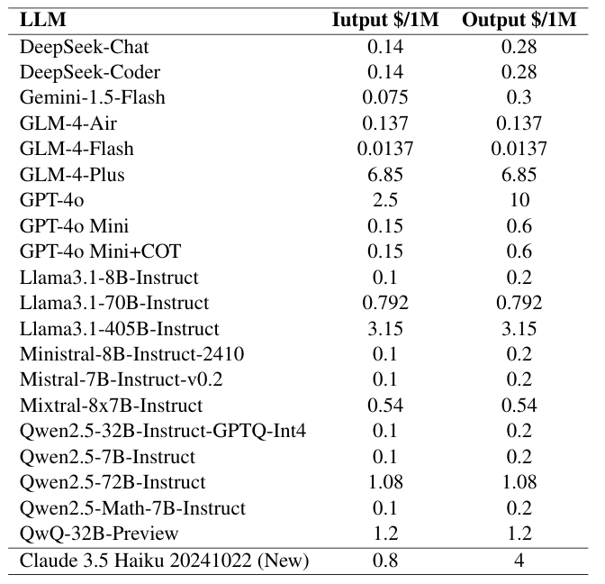

#### Table 6

Table 6: Embedding Models.

Embedding-model dimensions and prices; original PDF page 13, right column.

| Embedding model | Dimension | Pricing |
| --- | --- | --- |
| bge-m3 | 1536 | free |
| text-embedding-3-small | 1024 | \$0.02 / 1M |
| bert-base-uncased | 768 | free |
| zhipu-embedding-3 | 512 | \$0.0685 / 1M |

#### Table 7

Table 7: Datasets Details.

Dataset task types, evaluation metrics, train size and test size; original PDF page 14, top.

| Split | Dataset | Type | Evaluation metric | Train size | Test size |
| --- | --- | --- | --- | --- | --- |
| ID | ACLUE | Ancient Chinese | accuracy | 1400 | 600 |
| ID | ARC_C | Reasoning | accuracy | 1400 | 600 |
| ID | CMMLU | Chinese Multitask | accuracy | 7000 | 3000 |
| ID | Hotpot_QA | Multi-Hop | EM | 1400 | 600 |
| ID | MATH | Math | accuracy | 1400 | 600 |
| ID | MBPP | Code | pass@1 | 630 | 270 |
| ID | MMLU | Multitask | accuracy | 9800 | 4200 |
| ID | SQUAD | Reading Comprehension | f1 | 1400 | 600 |
| OOD | CEVAL | Chinese Multitask | accuracy | - | 1000 |
| OOD | Commonsense_QA | Commonsense Reasoning | accuracy | - | 1000 |
| OOD | GSM8K | Math | accuracy | - | 1000 |
| OOD | HumanEval | Code | pass@1 | - | 160 |

#### Table 8

Table 8: Results of MIRT-Router on ID test set when α = 0.8.

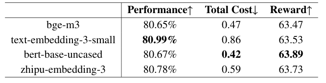

#### Table 9

Table 9: Impact of cold-start parameter λ on MIRT- Router under ID and OOD scenarios.

Cold-start λ ablation for ID and OOD; original PDF page 14, right column.

| λ | ID Perf. ↑ | ID Total Cost ↓ | ID Reward ↑ | OOD Perf. ↑ | OOD Total Cost ↓ | OOD Reward ↑ |
| --- | --- | --- | --- | --- | --- | --- |
| 0 | 80.66 | 0.42 | 63.88 | 87.05 | 0.14 | 69.12 |
| 0.1 | 80.66 | 0.42 | 63.88 | 87.08 | 0.14 | 69.14 |
| 0.2 | 80.67 | 0.42 | 63.89 | 87.08 | 0.14 | 69.14 |
| 0.3 | 80.67 | 0.42 | 63.89 | 87.12 | 0.14 | 69.17 |
| 0.4 | 80.64 | 0.42 | 63.86 | 87.12 | 0.14 | 69.17 |

#### Table 10

Table 10: LLMs’ profiles. The first 20 LLMs are used in the main experiments, and the last LLM is for validating the generalization of IRT-Router on new LLMs.

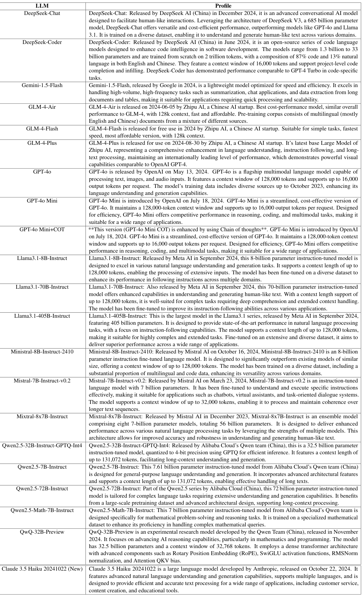

### B Sensitivity Analysis

Embedding Models In the previous experiments, we use the bert-base-uncased as embedding model for both queries and LLMs. However, there are now many available embedding models, each with different dimensions and pricing. We cannot guarantee that BERT is the optimal choice for every scene. Therefore, we conducted experiments to evaluate the impact of four commonly used embedding models (listed in Table 6) on the router. We select four common embedding models: two are provided by large model vendors and require a fee (OpenAI’s text-embedding-3-small and Zhipu AI’s embedding-3), while the other two are widely used pre-trained language models that can be deployed independently (bge-m3 and bert-baseuncased). The embedding output dimensions for these models are also shown in the Table 6. For models that are not free, we also included the embedding cost in the Total Cost calculation. Our findings reveal that while paid embedding models generally offer higher performance, their associated costs are also higher. When considering the trade-off between performance and cost, BERT strikes a favorable balance, yielding rela- tively higher rewards in our experimental setup.

#### Dimension N

Dimension N The dimension N represents the number of dimensions used for modeling the abilities. A larger N indicates a finer granularity in the ability modeling. But how does N affect the router’s performance? We experiment with five different values of N and obtain the corresponding results. Figure 8 shows that the Performance fluctuates with changes in N, with no consistent upward or downward trend. On the other hand, the Total Cost tends to be higher when N is either very small or very large, and it reaches its minimum when N = 25.

#### Cold-Start Parameter λ

Cold-Start Parameter λ We also conduct ablation studies on the cold-start parameter λ under both ID and OOD scenarios. As shown in Table 9, we vary λ from 0 to 0.4 and report the performance, total cost, and reward. For the ID scenario, different λ values yield very similar results, with λ = 0.2 or 0.3 achieving slightly higher reward. In contrast, for the OOD scenario, where cold-start issues are more pronounced, larger λ values (e.g., 0.3 or 0.4) consistently improve reward. This aligns with intu- ition, as cold-start issues are more severe in OOD settings.

### C Interpretability of NIRT-Router

Sections C.1–C.3 define the ability dimensions, relevance-vector prompt and learned ability visualization.

#### C.1 Predefined Abilities

We first predefine the actual meanings corresponding to the N dimensions of the ability vector θMj ∈RN in NIRT-Router. In our experiments, N = 25. Therefore, we refer to both LLM evaluation and human comment to define the 25 specific abilities corresponding to these 25 dimensions of θMj. Notably, these definitions can be adjusted as needed. The 25 predefined specific ability are as follows: • 0: Reasoning • 1: Understanding • 2: Generation • 3: Information retrieval • 4: Multidisciplinary knowledge • 5: Emotion understanding and expression • 6: Adaptability and robustness • 7: Interactivity • 8: Ethical and moral consideration • 9: Mathematical calculation • 10: Data analysis • 11: Symbolic processing • 12: Geometric and spatial reasoning • 13: Programming and algorithms • 14: Scientific knowledge application • 15: Technical documentation understanding • 16: Current affairs and common knowledge • 17: Cultural understanding • 18: Language conversion • 19: Music and art understanding • 20: Editing and proofreading • 21: Prediction and hypothesis testing • 22: Inference • 23: Decision support • 24: Content summarization

#### C.2 Prompt for Getting Relevance Vector

In Section 4.2.2, we have mentioned that we use a LLM to identify the relevant abilities by considering the abilities required by 5 sample questions within the cluster. Specifically, we use GPT-4o Mini to complete the simple task. And the prompt is shown in Figure 9.

#### Figure 9: Prompt for getting relevance vector.

You will be provided with the following query: {query} Identify which of the following abilities it requires from the LLM: {', '.join(abilities)}. Output the abilities as a comma-separated list.

#### C.3 LLM Ability Visualization

Figure 10 shows four LLMs’ ability values across 25 dimensions obtained from the trained NIRT- Router. From the comparison between Llama3.1- 8B-Instruct and 70B, the larger model outperforms the smaller one in almost every dimension. The gap is even more pronounced when comparing DeepSeek-Chat and Ministral-8B-Instruct-2410, especially in dimensions 0: Reasoning, 1: Understanding, 9: Mathematical calculation and 11: Symbolic processing, where the larger model significantly surpasses the smaller one. However, in dimension 8: Ethical and moral consideration, the larger model unexpectedly under-performs the smaller one. We speculate that this could be due to insufficient training data in this specific aspect, leading to inadequate learning. Another possible explanation is that the larger model’s broader knowledge base makes it more prone to generating unbounded content.

#### Figure 8

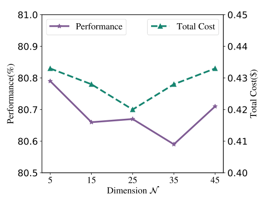

Figure 8: Results of MIRT-Router on ID test set when α = 0.8 with different dimension N.

#### Figure 10

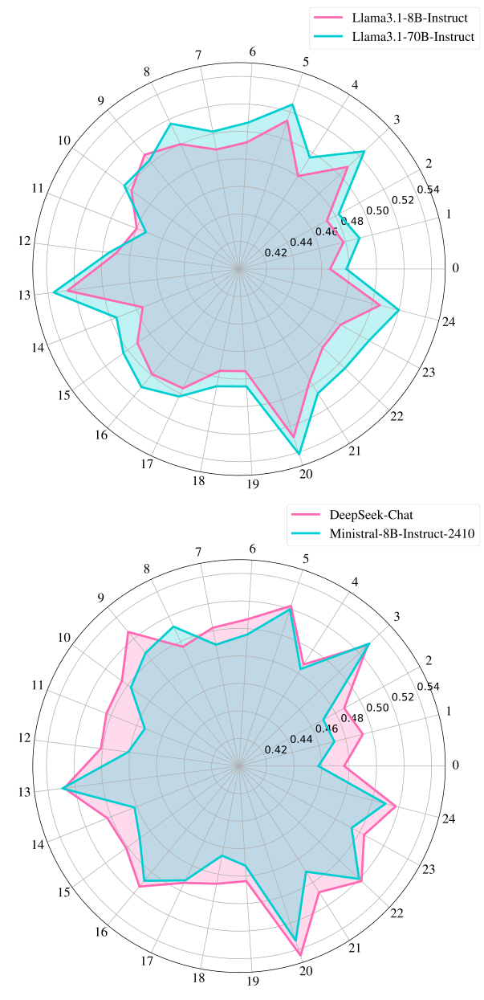

Figure 10: Four LLMs’ ability values across 25 dimensions obtained from the trained NIRT-Router.
