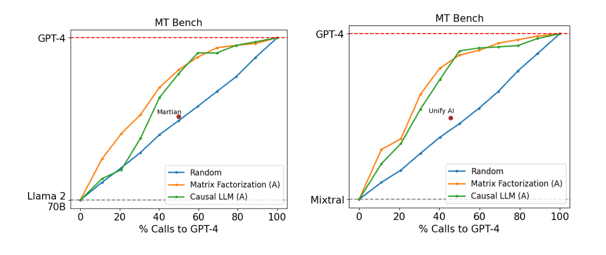
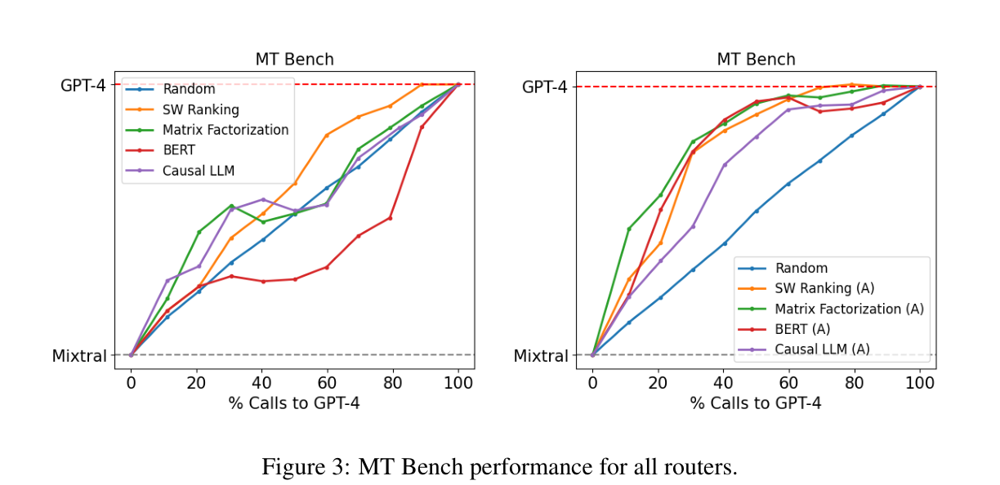
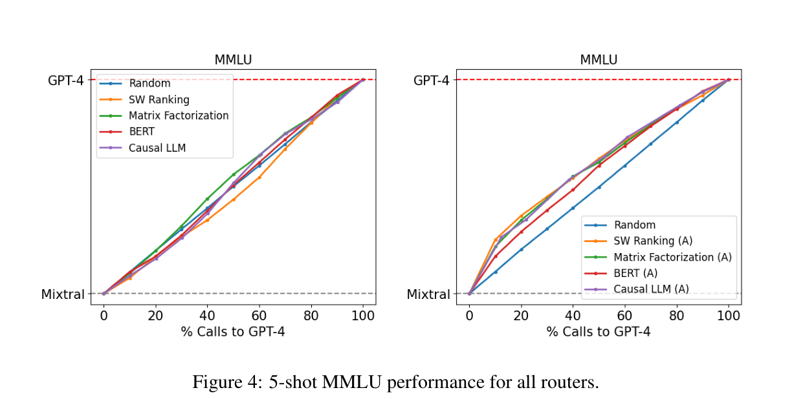
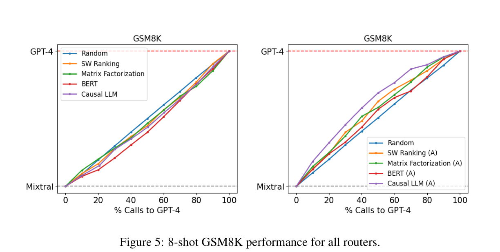

# RouteLLM：基于偏好数据学习大语言模型路由

Isaac Ong、Amjad Almahairi、Vincent Wu、Wei-Lin Chiang、Tianhao Wu、Joseph E. Gonzalez、M Waleed Kadous、Ion Stoica · ICLR 2025

本文从已完成的[《RouteLLM 中文完整译文（含图表与公式）》](../pdfs/zh/RouteLLM_Chinese_Full.pdf)转换，保留摘要、正文、致谢、公式（1）—（13）、图 1 和表 1—7。只整理 PDF 换行、数学排版和链接，不把正文改写成摘要。原论文版本为 arXiv:2406.18665v4。

[引言](#s1) · [相关工作](#s2) · [路由问题与指标](#s3) · [数据与四种路由器](#s4) · [实验](#s5) · [结论](#s6) · [附录](#appendices)

## 摘要

大语言模型（large language models, LLMs）在广泛的任务上表现出色，但选择合适的模型通常需要权衡性能与成本。能力更强的模型能够提供更好的结果，但费用高昂；较小的模型更具成本效益，却通常能力较弱。为解决这一权衡问题，我们提出一种训练框架，在推理过程中学习高效的路由器模型，动态选择能力较强或较弱的 LLM。该框架利用人类偏好数据，并采用数据增强技术提升性能。在公开基准上的评估表明，我们的方法能够在不牺牲回答质量的情况下，将成本降低超过两倍。此外，我们的路由器具有较强的泛化能力：即便在训练期间未出现过的 LLM 之间执行路由，也能保持性能。这说明该框架有望提供兼具成本效益与高性能的 LLM 解决方案。

## 1 引言

近年来，大语言模型（LLM）的发展表明，它们能够胜任广泛的自然语言任务。从开放式对话、问答，到文本摘要和代码生成，LLM 都展现出令人瞩目的语言流畅性与理解能力（Achiam et al., 2023; Bubeck et al., 2023）。这些快速进展既得益于 Transformer 架构等模型架构创新（Vaswani et al., 2017），也依赖于数据与训练基础设施规模的扩大（Brown et al., 2020; Radford et al., 2019）。

然而，并非所有 LLM 都具有相同能力。不同 LLM 的规模差异很大，因而其部署和提供服务所需的资源也不同。不同模型采用的训练数据也不一样，进一步造成它们在优势、弱点及能力方面的差异。总体而言，规模更大的模型通常能力更强，但成本也更高；规模较小的模型通常能力较弱，却更便宜。

这种异构模型格局给 LLM 的实际部署带来了两难选择。将所有用户查询交由规模最大、能力最强的模型处理，虽然可以保证高质量结果，却会产生难以承受的费用。反之，将查询路由到较小模型虽然能够节省成本，节省幅度甚至可超过 50 倍（例如 Claude-3 Haiku 与 Opus 的对比[^1]），但可能导致回答质量下降，因为小模型不一定能够有效处理复杂问题。

LLM 路由（LLM routing；Ding et al., 2024; Hu et al., 2024）提供了一种有效解决途径：先用路由器处理每条用户查询，再决定最适合回答该查询的 LLM。路由器可把较简单的问题交给较小模型，把复杂问题交给较大模型，以平衡回答质量和成本效率。

实现最优 LLM 路由，即在给定成本约束下最大化质量，或在目标质量下最小化成本，并非易事。理想的 LLM 路由器需要：（1）在每条查询只调用一个 LLM 的前提下优化回答质量，与调用多个 LLM 的方法相比尽量降低成本和时延；（2）能够泛化到分布外（out-of-domain, OOD）查询，而无需为不同领域分别训练路由器；（3）不经重新训练即可在广泛的 LLM 上工作，以适应不断演变的模型生态。

图 1 GPT-4 与 Mixtral-8x7B 之间的路由性能–成本权衡。（左）在分布外评测 GSM8K 上，多种路由器的效果优于随机基线。（中）在 MT Bench 上，通过数据增强得到的路由性能提升以（A）标记。（右）本文使用的主要指标：调用–性能阈值 CPT（绿色）和平均性能差距恢复率 APGR（蓝色阴影区域）。图像沿用原文图 1；此处从原始 PDF 重新提取，补全现有中文 PDF 中被截掉的右侧子图和横轴。

本文提出一种利用偏好数据学习 LLM 路由器的系统性框架。我们在两类模型之间进行路由：（1）强模型，以较高成本提供高质量回答（如 GPT-4）；（2）弱模型，以较低成本提供相对较低质量的回答（如 Mixtral-8x7B）。目标是通过将简单查询智能地分配给弱模型、仅将复杂查询分配给强模型，在达到特定性能目标（例如强模型性能的 90%）的同时尽量降低成本。我们使用这一框架训练多种路由器，并在 MMLU（Hendrycks et al., 2020）、MT Bench（Zheng et al., 2023）等公认基准上评估。结果表明，这些路由器在基本不损害质量的情况下可将成本降低超过两倍；而且，不同强／弱模型对之间也能维持良好表现，无需重新训练。

综上，本文的贡献如下：

- 提出一种利用人类偏好数据和数据增强技术的路由器学习框架，在常见基准上将成本降低超过两倍，同时将回答质量损失控制在很小范围内。

- 证明该方法训练出的路由器能够泛化到未见数据，并可在多个不同 LLM 之间保持良好表现，使同一个已训练路由器适用于多种使用场景。

- 开源用于训练、部署服务和评估 LLM 路由器的框架，方便用户训练自己的路由器并在不同基准之间比较性能。

## 2 相关工作

奖励建模（reward modeling；Ouyang et al., 2022）与 LLM 路由存在一个关键区别：奖励模型是在 LLM 已经生成回答之后评价回答质量，而路由是在生成回答之前选择合适的 LLM。因此，路由需要深入理解查询的复杂程度，以及各候选模型的具体能力。

近期也有多项工作研究不同 LLM 之间的成本–性能权衡。LLM-Blender（Jiang et al., 2023）采用集成框架，在推理时调用多个 LLM，然后选出最佳回答。Frugal-GPT（Chen et al., 2023）采用级联方式，依次查询 LLM，直至得到可靠回答。AutoMix（Aggarwal et al., 2024）让较小模型先自行验证回答，然后才可能将查询交给更大模型。这些方法依赖多次 LLM 调用，可能增加时延。相比之下，我们的方法让每条查询只调用一个 LLM，以满足理想路由器对时延的要求。

Hybrid-LLM（Ding et al., 2024）与本文框架有相似之处，但存在若干关键差别：它基于 MixInstruct 数据集（Jiang et al., 2023），利用 BARTScore（Yuan et al., 2021）生成合成偏好标签，并且只采用一种基于 BERT 的路由器。相较而言，我们利用 Chatbot Arena（Chiang et al., 2024）的人类偏好标签，探索多种路由器架构，并展示数据增强能够显著提升所有架构的性能。此外，Hybrid-LLM 仅在 MixInstruct 测试集上评估，尚未提供分布外泛化的证据；本文则通过多个经过数据污染剔除的公开基准开展评估，以展示这一能力。

最后，Zooter（Lu et al., 2023）使用 QwenRM 奖励模型（Bai et al., 2023）生成路由标签，而奖励模型可能继承训练数据的偏差，从而影响路由决策的可靠性。相比之下，我们主要依赖人类偏好数据。与 Hybrid-LLM 一样，Zooter 也只研究 BERT 风格的路由器。此外，其训练信号依赖固定的一组 LLM，限制了对其他 LLM 的适应性。本文则表明，即使面对训练数据中未包含的 LLM，我们的方法也能保持较强性能。

## 3 LLM 路由

### 3.1 问题形式化

考虑一组 LLM 模型 M。其中每个模型 M : Q →A 都可以看成一个函数，将查询 q ∈Q 映射为回答 a = M(q) ∈A。本文聚焦在两类模型之间的路由：（1）强模型$\mathcal M_{\mathrm{strong}}$，能够生成高质量回答，但代价高昂，例如 GPT-4 等先进闭源模型（OpenAI, 2023）；（2）弱模型$\mathcal M_{\mathrm{weak}}$，以较低成本提供相对较低质量的回答，例如 Mixtral-8x7B（Jiang et al., 2024）。在实践中，这种二元路由问题十分常见，尤其是在用户试图从闭源模型转向开源模型，并优化质量与成本的权衡时。此外，解决二元路由问题也为扩展到更复杂的 N 路路由奠定基础。

假设我们拥有偏好数据$\mathcal D_{\mathrm{pref}}=\{(q,l_{s,w})\mid q\in\mathcal Q,l_{s,w}\in\mathcal L\}$，其中$l_{s,w}$ 是某一查询 q 上强模型$M_s$ ∈$\mathcal M_{\mathrm{strong}}$ 与弱模型$M_w$ ∈$\mathcal M_{\mathrm{weak}}$ 的回答比较结果，标签取自$\mathcal L=\{\mathrm{win}_s,\mathrm{tie},\mathrm{win}_w\}$。我们提出一种从偏好数据学习二元路由函数$R^\alpha:\mathcal Q\to\{\mathcal M_{\mathrm{weak}},\mathcal M_{\mathrm{strong}}\}$ 的系统性框架。函数$R^\alpha$ 由两个关键部分定义。

1）胜出概率预测模型（win prediction model）。模型估计：对于查询 q，强模型类$\mathcal M_{\mathrm{strong}}$ 中的模型优于弱模型类$\mathcal M_{\mathrm{weak}}$ 中模型的概率，记为$P_\theta(\mathrm{win}_s\mid q)$；θ 表示模型参数。通过最大化观测偏好数据的对数似然学习这些参数：

$$
\max_{\theta}\sum_{(q,l_{s,w})\in\mathcal D_{\mathrm{pref}}}\log P_\theta(l_{s,w}\mid q).\tag{1}
$$

优化这一似然可以让模型捕捉不同查询类型上两类模型的相对优势与弱点。第 4.2 节将讨论多种胜出概率预测模型的参数化方法。

2）成本阈值$\alpha\in[0,1]$。该阈值将预测的胜出概率转化为在弱模型类和强模型类之间的路由决策。对于查询 q，路由规则定义为

$$
R^\alpha(q)=\begin{cases}\mathcal M_{\mathrm{weak}}, & P(\mathrm{win}_s\mid q)<\alpha,\\\mathcal M_{\mathrm{strong}}, & P(\mathrm{win}_s\mid q)\ge\alpha.\end{cases}\tag{2}
$$

阈值α 控制质量与成本之间的权衡：α 越高，越倾向将查询交由弱模型，以实施更严格的成本约束；α 越低，则越偏向质量更高但也更昂贵的强模型。最后，给定路由函数$R^\alpha$ 以及两个模型$M_s$ ∈$\mathcal M_{\mathrm{strong}}$、$M_w$ ∈$\mathcal M_{\mathrm{weak}}$，定义路由后的模型$M_{R^\alpha}$ :Q × $\mathcal M_{\mathrm{strong}}$ × $\mathcal M_{\mathrm{weak}}$ →A，其对查询 q 的回答为[^2]

$$
M_{R^\alpha}(q,M_s,M_w)=\begin{cases}M_s(q), & R^\alpha(q)=\mathcal M_{\mathrm{strong}},\\M_w(q), & R^\alpha(q)=\mathcal M_{\mathrm{weak}}.\end{cases}\tag{3}
$$

### 3.2 评估指标

本节定义用于刻画 LLM 路由质量–成本权衡的评估指标。首先介绍分别衡量路由器模型$M_{R^\alpha}$ 在$M_s$ ∈$\mathcal M_{\mathrm{strong}}$ 与$M_w$ ∈$\mathcal M_{\mathrm{weak}}$ 之间路由时的成本效率和性能的指标，然后定义实验中使用的两个综合指标。

我们通过调用强模型的百分比衡量$M_{R^\alpha}$ 的成本效率：

$$
c(M_{R^\alpha})=\frac{1}{|\mathcal Q|}\sum_{q\in\mathcal Q}\mathbb I\{R^\alpha(q)=\mathcal M_{\mathrm{strong}}\},\tag{4}
$$

因为强模型比弱模型昂贵得多。

对于性能，计算平均回答质量：

$$
r(M_{R^\alpha})=\frac{1}{|\mathcal Q|}\sum_{q\in\mathcal Q}s(M_{R^\alpha}(q)),\tag{5}
$$

其中，s($M_{R^\alpha}$(q)) 表示单条回答的质量评分，例如在具有标准答案的数据集（如 MMLU）上是否正确，或者数值评分（如 1–5 分或 1–10 分）；分值越高表示质量越好。类似地，可以定义强模型和弱模型的 r($M_s$) 与 r($M_w$)。

由于路由模型的性能介于弱模型与强模型之间，我们用二者的性能差距衡量它的相对表现。定义路由器的性能差距恢复率（performance gap recovered, PGR）：

$$
\mathrm{PGR}(M_{R^\alpha})=\frac{r(M_{R^\alpha})-r(M_w)}{r(M_s)-r(M_w)}.\tag{6}
$$

它度量路由器恢复了多少强模型与弱模型之间的性能差距。

仅使用上述任一指标都不足以刻画路由的质量–成本权衡。例如，一个始终将查询交给强模型的简单路由器可达到 PGR = 1，却完全没有节省成本。为此，我们通过调整阈值α 绘制路由器$M_{R^\alpha}$ 的调用比例–性能曲线（call-performance graph），并定义平均性能差距恢复率（average performance gap recovered, APGR），用于衡量在不同成本约束下恢复性能差距的整体能力：

$$
\mathrm{APGR}(M_{R^\alpha})=\int_0^1\mathrm{PGR}(M_{R^\alpha})\,\mathrm d\bigl(c(M_{R^\alpha})\bigr).\tag{7}
$$

在图 1 右图中，APGR 对应路由器性能曲线与弱模型性能曲线之间的面积。实际计算时，作者将强模型调用比例的区间[0%, 100%] 离散为$\{c_i\}_{i\in[10]}$。对每个$c_i$，选取满足成本约束的阈值$\alpha_i$，并近似计算：

$$
\mathrm{APGR}(M_{R^\alpha})\approx\frac1{10}\sum_{i=1}^{10}\mathrm{PGR}(M_{R^{\alpha_i}}).\tag{8}
$$

在许多实际应用中，还必须量化达到给定性能水平所需的成本。为此，作者引入第二个指标调用–性能阈值（call-performance threshold, CPT）。若期望路由器达到 x% 的 PGR，则 CPT(x%) 表示实现该性能目标所需调用强模型的最低比例。图 1 右图中，绿色虚线给出了 CPT(50%)，表示需要有多少比例的查询发送给 GPT-4 才能恢复 50% 的性能差距。该图中 CPT(50%) ≈37%。

## 4 方法

### 4.1 Chatbot Arena 数据

偏好数据的主要来源是在线平台 Chatbot Arena（Chiang et al., 2024）的 8 万场模型对战。在该平台上，用户提交提示词，并获得两个匿名模型的回答；阅读两个回答后，用户投票选出获胜者，或者宣布平局。这形成数据集$\mathcal D_{\mathrm{arena}}$，包含用户查询、模型回答，以及基于人类判断的成对比较标签。

原始 Chatbot Arena 数据面临的重要挑战是标签稀疏：任意两个模型之间的比较标签占比平均低于 0.1%。为此，作者按照 Chatbot Arena 排行榜[^3]得分，使用动态规划将数据中的模型划分为 10 个层级（tiers，见附录 A），并尽量降低层级内部的差异。作者使用前两个层级的模型代表强模型类$\mathcal M_{\mathrm{strong}}$，使用第三个层级的模型代表弱模型类$\mathcal M_{\mathrm{weak}}$。关键的是，训练时剔除模型回答本身，只保留获胜方身份。最终数据集表示为$\mathcal D_{\mathrm{arena}}=\{(q,l_{s,w})\mid q\in\mathcal Q,l_{s,w}\in\mathcal L\}$。

#### 4.1.1 数据增强

虽然模型已被划分为不同层级，但不同模型类之间的人类偏好信号仍然稀疏。第 5.1 节将说明，这种稀疏性可能限制泛化性能，对参数量较多的路由器尤其如此。为解决该问题，本文考察两种数据增强方法。

具有标准答案的数据集（golden-labeled datasets）。用具有标准答案的数据扩充训练集，其形式为$\mathcal D_{\mathrm{gold}}=\{(q,l_g,l_{s,w})\mid q\in\mathcal Q,l_g\in\mathbb R,l_{s,w}\in\mathcal L\}$。其中$l_g$ 是已知的正确答案，例如选择题的标准答案。具体而言，作者使用 MMLU 多项选择基准的验证集（Hendrycks et al., 2020），约 1500 道题目，并通过将强模型与弱模型的回答分别同标准答案比较，直接得到偏好比较标签$l_{s,w}$。

LLM 评审标注的数据集（LLM-judge-labeled datasets）。对于开放式对话领域，作者尝试使用 LLM 评审（LLM judge；Zheng et al., 2023）获取偏好标签，因为已有研究发现，LLM 评审与人类判断高度相关（Dubois et al., 2024; Jiang et al., 2023）。给定一组用户查询，先由强模型$M_s$ ∈$\mathcal M_{\mathrm{strong}}$ 和弱模型$M_w$ ∈$\mathcal M_{\mathrm{weak}}$ 分别生成回答，再使用 GPT-4 作为评审产生两两比较标签。这一方法的主要困难，是大量收集 GPT-4 回答及其成对比较结果的成本很高。

幸运的是，Nectar 数据集（Zhu et al., 2023）包含种类丰富的查询及其对应模型回答。作者挑选其中已有 GPT-4 回答的查询（将 GPT-4 作为$M_s$），再针对这些查询生成 Mixtral-8x7B 回答（作为$M_w$），最后请 GPT-4 评审形成两两比较标签[^4]。最终得到约 12 万条样本的偏好数据集$\mathcal D_{\mathrm{judge}}$，总成本约为 700 美元。

### 4.2 路由方法

下面讨论如何定义公式（1）中的胜出概率预测模型$P_\theta(\mathrm{win}_s\mid q)$。

#### 相似度加权排序（similarity-weighted ranking, SW）

作者采用 Bradley–Terry（BT）模型（Bradley & Terry, 1952），思路类似于 Chiang et al.（2024）。对于用户查询 q，计算它与训练集各个查询 q′ 的余弦相似度，并按数据集中 q′ 与其他查询的最大余弦相似度进行缩放：

$$
S(q,q')=\frac{\epsilon\cdot\epsilon'}{\|\epsilon\|\|\epsilon'\|\cdot\max_{1\le s\le|\mathcal D_{\mathrm{pref}}|}\frac{\epsilon'\cdot\epsilon_s}{\|\epsilon'\|\|\epsilon_s\|}}.\tag{9}
$$

其中ϵ 和ϵ′ 分别表示查询 q 与 q′ 的文本嵌入。用这一相似度为每条训练查询计算标量权重ω′ =$\gamma^{1+S(q,q')}$[^5]。通过求解下式，学习强模型和弱模型的 BT 系数$\xi_s$ 与$\xi_w$：

$$
\operatorname*{argmin}_{\xi_s,\xi_w}\sum_{(q,l_{s,w})\in\mathcal D_{\mathrm{pref}}}\left[\omega'\cdot\ell\left(l_{s,w},\frac1{1+e^{\xi_s-\xi_w}}\right)\right].\tag{10}
$$

这里ℓ是二元交叉熵损失。利用这些系数即可估计胜出概率$P_\theta(\mathrm{win}_s\mid q)$ = $1/(1+e^{\xi_s-\xi_w})$。这一方法不需要预先训练：上述求解在推理阶段进行。

#### 矩阵分解（matrix factorization）

受推荐系统中利用矩阵分解刻画用户–物品交互低秩结构的启发（Koren et al., 2009; Töscher et al., 2009），作者将该方法用于学习偏好数据。目标是发现一个隐含评分函数δ : M × Q →R，其中δ(M, q) 代表模型 M 对查询 q 的回答质量。若在某一查询 q 上模型 M 优于 M′，就应有δ(M, q) > δ(M′, q)。作者通过 sigmoid 函数σ 对胜出概率建模以实现这一要求：

$$
P_\theta(\mathrm{win}_s\mid q)=\sigma\bigl(\delta(M,q)-\delta(M',q)\bigr).\tag{11}
$$

上述概率利用偏好数据优化。评分函数δ 被建模为模型嵌入与查询嵌入的双线性函数。将模型 M 嵌入为$d_m$ 维向量$v_m$，将查询 q 嵌入为$d_q$ 维向量$v_q$：

$$
\delta(M,q)=w_2^\top\bigl(v_m\odot(W_1^\top v_q+b)\bigr).\tag{12}
$$

其中⊙表示 Hadamard 积（逐元素乘法）。$W_1\in\mathbb R^{d_q\times d_m}$ 和$b\in\mathbb R^{d_m}$ 是投影层的参数，用于将$v_q$ 的维度映射到$v_m$ 的维度；$w_2\in\mathbb R^{d_m}$ 是产生最终标量的线性回归层。该方法本质上是学习查询–模型集合 Q × M 上评分矩阵的矩阵分解。训练使用一块 8GB GPU，约 10 个 epoch，batch size 为 64，Adam 优化器（Kingma & Ba, 2017），学习率$3\times10^{-4}$，权重衰减$1\times10^{-5}$。

#### BERT 分类器（BERT classifier）

作者还研究参数量比前述方法更多的标准文本分类方案。采用 BERT$_{\mathrm{BASE}}$ 架构（Devlin et al., 2018），为用户查询生成包含上下文信息的嵌入，并定义胜出概率：

$$
P_\theta(\mathrm{win}_s\mid q)=\sigma(Wh_{\mathrm{CLS}}+b).\tag{13}
$$

其中$h_{\mathrm{CLS}}$ 是特殊分类 token（CLS）对应的嵌入，用于汇总输入查询 q；W 和 b 为逻辑回归预测头的参数；σ 是 sigmoid 函数。在$\mathcal D_{\mathrm{pref}}$ 上进行全参数微调。训练使用两张 NVIDIA L4 24GB GPU，约 2000 步，batch size 为 16，最大序列长度为 512，学习率$1\times10^{-5}$，权重衰减 0.01。

#### 因果 LLM 分类器（causal LLM classifier）

最后，作者使用 Llama 3 8B（AI@Meta, 2024b）扩展路由器的模型容量。该方法采用指令遵循范式（Wei et al., 2021），输入为包含用户查询的指令提示词，利用下一个 token 的预测来输出胜出概率，而不是使用独立的分类预测头。特别地，作者将比较标签作为额外 token 加入词表，并对标签集合 L 进行 softmax，以计算胜出概率。训练使用八张 NVIDIA A100 80GB GPU，约 2000 步，batch size 为 8，最大序列长度为 2048，学习率$1\times10^{-6}$。

## 5 实验

训练数据。如第 4.1 节所述，主要训练数据是 Chatbot Arena 的 8 万条数据$\mathcal D_{\mathrm{arena}}$，其中留出 5000 条作为验证集。作者删去所有少于 16 个字符的提示词样本，得到来自 64 个不同模型的约 6.5 万条成对比较。数据包含 100 多种语言的对话，主要语言为英语（81%），其次是中文（3.1%）和俄语（2.2%）。为降低比较标签的稀疏性，作者将模型划分为 10 个类别。如第 4.1.1 节所述，训练数据还可通过以下两种方式之一增强：（1）来自 MMLU 验证集、具有标准答案的数据$\mathcal D_{\mathrm{gold}}$；或（2）通过 GPT-4 评审得到的标注数据$\mathcal D_{\mathrm{judge}}$。

评估基准。路由器在三个常用学术基准上评估：MMLU（Hendrycks et al., 2020），包含 57 个学科的 14,042 道题；MT Bench（Zheng et al., 2023），包含 160 道开放式问题，并采用 LLM 评审；以及 GSM8K（Cobbe et al., 2021），包含超过 1000 道小学数学应用题。作者还检查评估数据与训练数据之间是否交叉污染，以下报告的结果均是在剔除污染后得到的结果。使用公开基准评估，是为了理解路由器的分布外泛化能力。

路由器。矩阵分解路由器与 SW 排序路由器都使用 OpenAI 的嵌入模型 text-embedding-3-small 来编码输入查询。BERT 和因果 LLM 均进行全参数微调，且使用验证集进行模型选择。

具体评估路由性能时，选用 gpt-4-1106-preview（OpenAI, 2023）作为强模型$M_s$ ∈$\mathcal M_{\mathrm{strong}}$，Mixtral 8x7B（Jiang et al., 2024）作为弱模型$M_w$ ∈$\mathcal M_{\mathrm{weak}}$。基线是随机路由器（random router）：在满足给定成本约束的条件下，随机决定查询的去向。

### 5.1 结果

| 训练数据 | 方法 | CPT(50%) | CPT(80%) | APGR | 相对提升 |
| --- | --- | --- | --- | --- | --- |
|  | 随机（95% CI） | 49.03(±4)% | 78.08(±3)% | 0.500(±0.02) | (+0%) |
| $\mathcal D_{\mathrm{arena}}$ | BERT | 78.09% | 87.64% | 0.391 | (-21.8%) |
|  | 因果 LLM | 28.82% | 77.53% | 0.573 | (+14.6%) |
|  | 矩阵分解 | 25.32% | 74.26% | 0.580 | (+16%) |
|  | SW 排序 | 37.85% | 58.99% | 0.610 | (+22.1%) |
| $\mathcal D_{\mathrm{arena}}+\mathcal D_{\mathrm{judge}}$ | BERT | 19.58% | 34.02% | 0.751 | (+50.2%) |
|  | 因果 LLM | 31.50% | 48.75% | 0.679 | (+35.8%) |
|  | 矩阵分解 | 13.40% | 31.31% | 0.802 | (+60.4%) |
|  | SW 排序 | 23.21% | 36.04% | 0.759 | (+51.8%) |

[查看译本中的原表图片](../assets/routellm/table-1.png)

表 1 MT Bench 结果。请注意，在 CPT(50%) 时 MT Bench 得分为 8.8，达到 GPT-4 得分 9.3 的 95%。仅在$\mathcal D_{\mathrm{arena}}$ 上训练的路由器已具有较好性能；加入$\mathcal D_{\mathrm{judge}}$ 后进一步改善，相比随机路由器最多可降低 75% 的成本。原文表 1。

表 1 展示了 MT Bench 上的路由器性能。使用 Arena 数据集训练时，矩阵分解和相似度加权排序都取得了良好表现，在所有指标上均明显优于随机路由器。尤其是，要达到 50% 的 PGR，矩阵分解路由器所需的 GPT-4 调用次数只有随机路由器的一半。相比之下，只用 Arena 数据训练的 BERT 分类器和因果 LLM 分类器性能接近随机路由器；作者将其归因于高容量方法在数据较少的条件下表现更差。

使用 GPT-4 评审得到的偏好数据进行增强，使所有路由器均得到显著改进。BERT 与因果 LLM 路由器明显优于随机基线，其中 BERT 分类器的 APGR 相对随机方法提高超过 50%。在加入该增强数据集后，矩阵分解是表现最好的路由器，其 CPT(80%) 接近减半，并且比随机路由器少调用约 50%的 GPT-4。

作者还在附录 E 中，将这些路由器在 MT Bench 上的表现与现有商业路由系统比较，说明本文路由器相比其他可用系统取得了较大改善。

| 训练数据 | 方法 | CPT(50%) | CPT(80%) | APGR | 相对提升 |
| --- | --- | --- | --- | --- | --- |
|  | 随机（95% CI） | 50.07(±0)% | 79.93(±0)% | 0.500(±0) | (+0%) |
| $\mathcal D_{\mathrm{arena}}$ | BERT | 49.43% | 77.80% | 0.502 | (+0.5%) |
|  | 因果 LLM | 48.88% | 77.93% | 0.499 | (-0.2%) |
|  | 矩阵分解 | 45.00% | 76.86% | 0.524 | (+4.9%) |
|  | SW 排序 | 55.82% | 80.25% | 0.473 | (-5.4%) |
| $\mathcal D_{\mathrm{arena}}+\mathcal D_{\mathrm{gold}}$ | BERT | 41.30% | 72.20% | 0.572 | (+14.4%) |
|  | 因果 LLM | 35.49% | 70.31% | 0.600 | (+19.9%) |
|  | 矩阵分解 | 35.46% | 71.40% | 0.597 | (+19.5%) |
|  | SW 排序 | 35.40% | 71.55% | 0.603 | (+20.7%) |

[查看译本中的原表图片](../assets/routellm/table-2.png)

表 2 5-shot MMLU 结果。在 CPT(50%) 时，MMLU 得分为 75，达到 GPT-4 得分 81 的 92%。由于多数 MMLU 题目属于分布外样本，只用$\mathcal D_{\mathrm{arena}}$ 训练的路由器表现不佳；使用少量$\mathcal D_{\mathrm{gold}}$ 数据增强则显著提升路由性能。原文表 2。

在 MMLU 上（表 2），只用 Arena 数据训练时，所有路由器的表现都较差，大致处于随机路由器水平。作者认为，这是因为大多数 MMLU 题目都不属于训练数据分布（见第 5.3 节）。但是，利用 MMLU 验证集中具有标准答案的数据增强训练集后，所有路由器在 MMLU 上都明显提升：在达到 50% PGR 的要求下，它们所需的 GPT-4 调用比例比随机路由器约少 20%。值得注意的是，额外加入的有标准答案的数据仅约 1500 条，占整个训练数据不足 2%；这说明即使增强样本数量很小，数据增强仍然有效。

| 训练数据 | 方法 | CPT(50%) | CPT(80%) | APGR | 相对提升 |
| --- | --- | --- | --- | --- | --- |
|  | 随机（95% CI） | 50.00(±2)% | 80.08(±1)% | 0.497(±0.01) | (+0%) |
| $\mathcal D_{\mathrm{arena}}$ | BERT | 58.78% | 83.84% | 0.438 | (-11.8%) |
|  | 因果 LLM | 56.09% | 83.56% | 0.461 | (-7.3%) |
|  | 矩阵分解 | 53.59% | 85.24% | 0.4746 | (-4.5%) |
|  | SW 排序 | 54.43% | 82.11% | 0.4753 | (-4.3%) |
| $\mathcal D_{\mathrm{arena}}+\mathcal D_{\mathrm{judge}}$ | BERT | 44.76% | 79.09% | 0.531 | (+6.9%) |
|  | 因果 LLM | 33.64% | 63.26% | 0.622 | (+25.3%) |
|  | 矩阵分解 | 38.82% | 72.62% | 0.565 | (+13.8%) |
|  | SW 排序 | 41.21% | 72.20% | 0.568 | (+14.3%) |

[查看译本中的原表图片](../assets/routellm/table-3.png)

表 3 8-shot GSM8K 结果。在 CPT(50%) 时，GSM8K 得分为 75，相当于 GPT-4 得分 86 的 87%。仅用$\mathcal D_{\mathrm{arena}}$训练的路由器再次因分布外题目表现不佳；加入$\mathcal D_{\mathrm{judge}}$ 则显著改善性能。原文表 3。

最后，在 GSM8K 上（表 3），可以观察到与 MMLU 相似的情况：只用 Arena 数据训练时，所有路由器的表现均接近随机路由器。相比之下，加入由 LLM 评审生成的合成数据后，路由性能显著提高：所有路由器的 APGR 都从低于随机路由器提升到高于随机路由器。在这一增强数据集上，因果 LLM 分类器效果最好；要达到 CPT(50%) 与 CPT(80%) 所对应的性能水平，需要的 GPT-4 调用比例比随机路由器少 17%。

### 5.2 跨模型适应性

上述实验分别选用 gpt-4-1106-preview 和 Mixtral 8x7B 作为强模型$M_s$ 与弱模型$M_w$。为了证明路由器能够适应新的 LLM，作者在表 4 中报告了将其应用于另外两组模型对时的 MT Bench 结果：（1）$M_s$ = Claude 3 Opus、$M_w$ = Claude 3 Sonnet（Anthropic, 2024）；（2）$M_s$ = Llama 3.1 70B、$M_w$ = Llama 3.1 8B（AI@Meta, 2024a）。重要的是，作者没有重新训练路由器，而是直接复用前面相同的路由器，仅更换其负责选择的强模型和弱模型。这几款 LLM 也都不包含在训练数据中。

| 模型对（$M_s/M_w$） | 方法 | CPT(50%) | CPT(80%) | APGR | 相对提升 |
| --- | --- | --- | --- | --- | --- |
| Claude 3 Opus / Claude 3 Sonnet | 随机（95% CI） | 49.89(±3)% | 72.27(±4)% | 0.493(±0.033) | (+0%) |
|  | BERT | 34.85% | 39.04% | 0.682 | (+38.3%) |
|  | 因果 LLM | 28.12% | 50.00% | 0.656 | (+33.1%) |
|  | 矩阵分解 | 31.86% | 36.43% | 0.762 | (+54.6%) |
|  | SW 排序 | 23.27% | 51.85% | 0.772 | (+56.6%) |
| Llama 3.1 70B / Llama 3.1 8B | 随机（95% CI） | 47.52(±3)% | 76.26(±2)% | 0.512(±0.017) | (+0%) |
|  | BERT | 30.15% | 38.91% | 0.673 | (+31.4%) |
|  | 因果 LLM | 34.05% | 45.96% | 0.689 | (+34.6%) |
|  | 矩阵分解 | 25.83% | 37.30% | 0.738 | (+44.1%) |
|  | SW 排序 | 21.18% | 29.39% | 0.767 | (+49.8%) |

[查看译本中的原表图片](../assets/routellm/table-4.png)

表 4 使用不同模型对进行路由时，本文路由器在 MT Bench 上的结果。这里复用在$\mathcal D_{\mathrm{arena}}$ + $\mathcal D_{\mathrm{judge}}$ 上训练的完全相同的路由器，没有进行任何重新训练。结果显示，路由器可以很好地泛化到不同模型对。原文表 4。

如表 4 所示，即使替换被路由的模型对，现有所有路由器在 MT Bench 上仍然取得了较强结果，表现与原始模型对相近。这些结果继续显著优于随机路由器。无论对 Claude 3 系列还是 Llama 3.1 系列进行路由，为达到 80% 的 PGR，本文表现最好的路由器所需的强模型调用比例约为随机路由器的一半。作者据此认为，路由器学习到了不同查询的共同特征，能够据此区分强模型和弱模型，从而在推理阶段无需额外训练即可泛化到新模型。

### 5.3 量化数据集与基准之间的相似度

作者将同一训练数据集训练出的路由器在不同评估基准上性能不同的现象，归因于训练数据与评估数据的分布差异。对每一组基准–数据集组合，作者计算一个基准–数据集相似度分数（benchmark-dataset similarity score），以衡量评估样本在训练数据中的代表程度，具体定义见附录 C。表 5 给出了这些结果。

| 评估基准 | Arena | 由 $\mathcal D_{\mathrm{judge}}$ 增强的 Arena | 由 $\mathcal D_{\mathrm{gold}}$ 增强的 Arena |
| --- | --- | --- | --- |
| MT Bench | 0.6078 | 0.6525 | -- |
| MMLU | 0.4823 | -- | 0.5678 |
| GSM8K | 0.4926 | 0.5335 | -- |

[查看译本中的原表图片](../assets/routellm/table-5.png)

表 5 基准–数据集相似度分数。该分数与对应基准上的路由器性能具有较强相关性，可用于定量指导路由性能改进。原文表 5。

如第 5.1 节所示，较高的基准–数据集相似度分数通常与使用相应数据集训练后在该基准上取得更高性能相关。无论使用标准答案标签还是 LLM 评审标签，数据增强都会使整体偏好数据分布更接近目标评估基准，从而提高这一相似度分数，并转化为更好的路由性能。

这一相似度分数也有助于理解不同基准之间的相对表现。使用$\mathcal D_{\mathrm{arena}}$ 时，MT Bench 与训练数据的相似度显著高于其他基准；作者认为这解释了为何路由器在 MT Bench 上的表现比 GSM8K 和 MMLU 更好。若已知实际使用场景中的查询分布，基准–数据集相似度分数可能是一条系统性提升真实场景路由性能的有前景途径。

### 5.4 成本分析

| 基准 | CPT(50%) 时的节省倍数 | CPT(80%) 时的节省倍数 |
| --- | --- | --- |
| MT Bench | 3.66（GPT-4 质量的 95%） | 2.49 |
| MMLU | 1.41（GPT-4 质量的 92%） | 1.14 |
| GSM8K | 1.49（GPT-4 质量的 87%） | 1.27 |

[查看译本中的原表图片](../assets/routellm/table-6.png)

表 6 表现最佳的路由器相对于直接使用 GPT-4 的成本节省倍数。路由器在维持回答质量的同时显著节省成本。原文表 6。

作者估算，GPT-4 和 Mixtral 8x7B 的平均成本分别为每百万 token 24.7 美元和 0.24 美元（详细计算见附录 D）。在此基础上，表 6 量化本文方法实现的成本节省。具体而言，作者取表现最好的路由器相对于随机基线的 GPT-4 调用比例之比的倒数，作为节省倍数，因为 GPT-4 的费用是成本分析中的主导部分。结果显示，路由器最多可将成本降低至原来的 1/3.66，即实现高达 3.66 倍的成本节省，同时维持回答质量。这说明路由能够有效节省成本。

### 5.5 路由开销

| 路由器方法 | 每百万请求成本 | 每秒请求数 | 虚拟机每小时成本 |
| --- | --- | --- | --- |
| SW 排序 | \$39.26 | 2.9 | \$0.39 |
| 矩阵分解 | \$3.32 | 155.16 | \$0.80 |
| BERT | \$3.19 | 69.62 | \$0.80 |
| 因果 LLM | \$5.23 | 42.46 | \$0.80 |

[查看译本中的原表图片](../assets/routellm/table-7.png)

表 7 不同路由器的成本与推理开销。与 LLM 生成回答的成本相比，部署路由器的成本很小，而且这些路由器能够支持真实工作负载。原文表 7。

LLM 路由的一项顾虑，是相对于直接使用单个模型，路由步骤引入了额外开销。为此，作者使用从 Chatbot Arena 随机抽样的对话，测量并在表 7 中报告各路由器的开销。作者先测量每个路由器能够处理请求的速率，再结合虚拟机每小时的价格计算开销；对于需要嵌入的路由器，还按照训练集的平均输入长度计入生成嵌入的费用。

对需要 GPU 的路由器，即矩阵分解方法和各类分类器，作者使用 Google Cloud 的 g2-standard-4 虚拟机，内含一张 NVIDIA L4 GPU；对相似度加权排序，作者使用仅配备 CPU 的 n2-standard-8 虚拟机。

目前，基于 GPU 的路由器比基于 CPU 的路由器高效得多，不过作者也指出，这些路由器仍有大量进一步优化的空间。根据表中结果，即使是最昂贵的 SW 排序路由器，与 GPT-4 生成回答的费用相比，其额外成本也不超过 0.4%（详见附录 D），表明这些路由器具备成本效益。

## 6 结论

作者展示了所提出的路由器在多种基准上的良好表现，覆盖开放式问答、人文学科问题与数学问题等任务。通过在强模型和弱模型之间智能分配查询，路由器能够在不引入过高成本或时延开销的情况下，兼顾显著的成本节省与较高的回答质量。作者还表明，在多个强／弱模型对之间切换时，路由器无需重新训练仍能维持表现；如果缺少这一能力，路由器的实际用途将受到极大限制。

实验结果强调了数据增强在提高路由性能方面的有效性。仅在$\mathcal D_{\mathrm{arena}}$ 上训练时，路由器在 MMLU 和 GSM8K 上表现较差；但通过引入 LLM 评审生成的数据或领域内数据进行增强，所有基准上的路由器都能优于随机基线。训练数据与评估数据越接近，性能收益通常越大；基准–数据集相似度分数也体现了这一点。作者认为，这一框架为针对特定场景进一步改进路由性能提供了一条明确路径。

尽管本文取得了较强的实验结果，仍存在一些局限。首先，虽然实验包含多种评估基准，真实应用中的数据分布仍可能与这些基准差异很大。为应对该问题，作者展示了用户可以收集少量领域内数据并用于数据增强，以提高特定场景中的性能。其次，本文主要研究两个模型之间的路由，未来一个有前景的方向是扩展到多个模型。最后，并不存在适用于所有查询的唯一最佳路由器；应综合考虑时延、成本需求以及待处理的查询类型，决定使用哪种路由器。实验还发现，在相同数据集上训练的不同路由器，即使面对同一基准，其表现也可能有很大差异，而且尚缺乏明确解释。作者将对此的进一步研究留作未来工作。

## 致谢与资金披露

作者感谢 Kourosh Hakhamaneshi、Goku Mohandas、Arman Zharmagambetov 和 Anastasiia Razdaibiedina 在研究过程中提供的宝贵讨论与反馈。本工作部分得到以下机构赠款支持：Accenture、AMD、Anyscale、Google、IBM、Intel、Microsoft、Mohamed Bin Zayed University of Artificial Intelligence、Samsung SDS、SAP、Uber 和 VMware。

## 注释

[^1]: 按原文给出的每百万输出 token 价格：Haiku 为 1.25 美元，Opus 为 75 美元。
[^2]: 为简洁起见，原文后续将 $M_{R^\alpha}(q,M_s,M_w)$ 简记为 $M_{R^\alpha}(q)$。
[^3]: 原文列出的排行榜地址：https://leaderboard.lmsys.org。
[^4]: 原文说明：采用 Zheng et al.（2023）推荐的最佳实践来降低 GPT-4 评审偏差。
[^5]: 作者发现指数缩放在实践中表现最好，因此选择 $\gamma=10$。

## 参考文献与附录

以下保留现有中文译本中的参考文献与附录查阅说明。附录不另作逐句翻译；[完整中文 PDF](../pdfs/zh/RouteLLM_Chinese_Full.pdf)末尾保留了英文原件。[论文原始记录](https://arxiv.org/abs/2406.18665v4)。

参考文献位于原文第 11–13 页。论文引用了 LLM 路由、偏好学习、奖励建模、矩阵分解、基准与评测、基础模型等方面的文献。依此前约定，参考文献保留其英文原文，不逐条翻译。完整中文 PDF 末尾直接附上原 PDF 的第 11–13 页，以保持作者、题名、出版信息、链接等内容的原始准确性。

### 附录 A Arena 模型层级

附录 A 位于原文第 14 页，列出动态规划分层结果：Tier 0–9 共十个层级，各层级包含的具体模型和版本名称。若需要追查强／弱模型类别如何划分，请查附录 A 的模型表。

### 附录 B 数据污染检查

附录 B 位于原文第 14 页。使用 OpenAI `text-embedding-3-small` 为训练集和评估集生成嵌入，对每条评估数据在全部训练数据中执行相似度检索，阈值设为 0.95；剔除检测出的污染样本，报告未污染结果。

### 附录 C 基准与数据集相似度

附录 C 位于原文第 14 页，给出相似度的严格定义（原文公式（14））：对基准中每个查询，取其与偏好数据集中所有查询的最大余弦相似度，再对基准查询求平均，并解释为何使用最大值而非多个低相似度值。

### 附录 D 成本计算

附录 D 位于原文第 14–15 页，说明 GPT-4 的输入输出定价、平均 95 个输入 token 与 264 个输出 token 的假设，并推导每百万 token 约 24.7 美元的 GPT-4 成本与 Mixtral 8x7B 每百万 token 0.24 美元的估计。

### 附录 E 商业路由器比较

附录 E 位于原文第 15 页，包含图 2。在 MT Bench 上同 Unify AI、Martian 等商业路由系统比较；记录对比模型、参数与成本约束，以及矩阵分解和因果 LLM 路由器在相同性能下将 GPT-4 调用比例最多再降低约 40% 的结果。

### 附录 F 补充实验曲线

附录 F 位于原文第 15–16 页，包含图 3–5。提供第 5.1 节结果对应的完整性能–调用比例曲线，分别为 MT Bench、5-shot MMLU 与 8-shot GSM8K。图中可以直接对照随机、SW、矩阵分解、BERT 与因果 LLM 等路线。

完整中文 PDF 末尾附入了原文 6 页：原版第 11–13 页为英文参考文献，第 14–16 页为附录 A–F。附录内的模型表、公式（14）、图 2–5 以及所有英文图注均保留原样。这样既不对附录做冗余逐句翻译，也能按原页定位并核验任意细节。
