# RADAR：推理能力与难度感知的推理大语言模型路由

RADAR: Reasoning-Ability and Difficulty-Aware Routing for Reasoning LLMs

Nigel Fernandez¹*、Branislav Kveton²、Ryan A. Rossi²、Andrew S. Lan¹、Zichao Wang²

¹ University of Massachusetts Amherst；² Adobe Research。发表于 ICLR 2026。

[原论文 arXiv:2509.25426v3](https://arxiv.org/abs/2509.25426v3)，2026 年 3 月 10 日。

此版将已有中文 PDF 正文完整转为可检索 Markdown，公式与英文原文核对，图表保留。正文段落、公式和图表均有固定锚点；参考文献与英文附录材料另列。

原 PDF 中文译本说明：根据此前逐节译文整理，针对原论文正文第1—5 章排版；图1—3 使用原论文矢量图，表1—3 保留原数值，参考文献保留英文。附录A—E 未收录。本译本并非作者官方译稿。原论文公式（1）—（9）已逐式对照。

## 摘要（Abstract）

推理语言模型（Reasoning Language Models，RLMs）在数学、科学和编程等具有挑战性的任务上表现出卓越的性能。在实际部署中，选择合适的推理模型需要在两个关键层面权衡性能与成本：模型规模和推理预算（reasoning budget）。较大的模型和较高的推理预算通常带来更好的性能，却也产生更高的成本与延迟。本文从针对不同问题进行模型配置路由的角度研究这一权衡，并提出RADAR（Reasoning–Ability and Difficulty-Aware Routing），一种轻量级、可解释且可扩展的路由框架。受心理测量学启发，RADAR 根据不同模型在不同推理预算下对不同问题的回答结果，学习一个项目反应模型（item response model），其中包括问题难度和模型—预算配置能力等具有可解释性的参数。RADAR 随后将较难的问题路由到能力较强的模型—预算组合，将较易的问题路由到能力较弱的组合。我们在八个广泛使用的高难度推理基准上进行了大量实验，表明RADAR 相比先进模型路由方法具有更优的表现。RADAR 还展示了问题泛化能力，在所有基准的分布外问题上取得良好性能。此外，RADAR 可以动态选择少量评估问题来估计新增模型的能力，从而高效地将更多模型集成到配置池中。

* 第一作者的工作完成于Adobe Research 实习期间（原文脚注）。

## 1 引言（Introduction）

近年来，大语言模型（Large Language Models，LLMs）的发展利用强化学习（Reinforcement Learning，RL）（Shao et al., 2024），训练模型在生成最终输出之前先通过思维链（chain-of-thought）进行推理。这些推理语言模型（RLMs）（Yang et al., 2025; Guo et al., 2025; OpenAI & et al., 2024）已经在数学（MAA, 2024）、科学（Rein et al., 2024）、编程（Jimenez et al., 2024）、视觉感知（Lu et al., 2024）和工具使用（Yao et al., 2025）等多种高难度任务上表现出令人印象深刻的性能。这一发展催生了大量新的开源和专有RLM。例如，截至2026 年3 月8 日，Hugging Face 已列出4,492 个RLM。这些模型规模不同，专长领域各异，并提供多种配置（包括推理预算），以在性能与成本之间取得平衡。例如，OpenAI 推理模型（OpenAI & et al., 2024）提供了low、medium 和high 三档推理预算，以便开发者根据实际应用选择。

然而，对于每个问题，始终选择具有最高推理预算、最强且最昂贵的RLM 配置，并不一定是最合适的决策。对于较简单的问题，可能存在性能较弱、成本更低且推理预算较低甚至为零的配置，同样能够正确回答问题，从而在不牺牲性能的情况下显著节省成本。我们在图1 中的实验也观察到了同样的现象：MATH-500（Hendrycks et al., 2021c）中超过50% 的问题，仅使用Qwen3-0.6B 这样的小模型和极少的推理预算（以推理token 数衡量）就能解决。相反，某些高难度问题需要能力更强且推理预算更高的RLM。较强的RLM 还可能出现“过度思考”（over-thinking），即使面对简单问题也可能因此损害性能（Su et al., 2025; Hassid et al., 2025; Hong et al., 2025; Shojaee et al., 2025; Ghosal et al., 2025）。

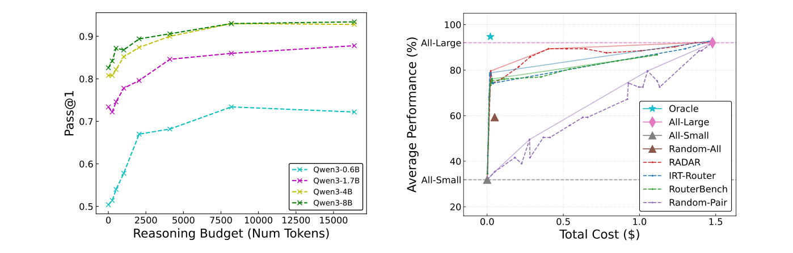

图1: 左：在MATH-500 上，不同（RLM，推理预算）配置的性能差异；最小模型仅用极少推理量即可解决超过50% 的问题。右：RADAR 联合估计问题难度与配置能力，将问题路由到能力足够的配置，使性能—成本权衡结果接近帕累托前沿。对于FRAMES 的分布外问题，RADAR 仅以o4-mini 高预算成本的10%达到其90% 的性能；次佳方法需要30% 成本。实线表示各曲线的凸包。图内英文坐标轴及图例保留原始论文内容。

这种性能—成本权衡为实际应用提出了一个挑战：如何选择能够正确回答给定问题、具有足够能力的RLM 及其配置（如推理预算），同时最大化性能并最小化成本？

本文提出RADAR（Reasoning-Ability and Difficulty-Aware Routing）框架，以解决上述挑战。给定一个由{RLM，推理预算} 构成的配置池、用户偏好的性能—成本权衡设定及一个新问题，RADAR会据此选出该问题的最优配置。RADAR 轻量且高效：它在问题级别实时完成决策，额外延迟约为7 毫秒；配置分配发生在RLM 接收问题之前，因而在生成过程中不需要切换模型，可避免级联路由器（Chen et al., 2023; Zhang et al., 2024）可能产生的重复调用以及KV-cache 重算。RADAR 也具有即插即用（plug-and-play）的特点：它将RLM 当作黑盒，无须微调，可直接通过标准API 使用。当新的RLM 可用时，RADAR 能够快速将其加入未来路由的候选配置池。

RADAR 的关键机制是定制的项目反应理论（Item Response Theory，IRT）模型。这一经典方法起源于心理测量学和教育评价（Rasch, 1960; Lord, 2012; van der Linden & Hambleton, 1997; DeMars, 2010）。我们使用IRT 联合估计可解释的问题难度，以及模型在不同推理预算下的能力。首先执行校准（calibration）：收集各个{RLM，推理预算} 配置对一组问题的评估结果；然后使用IRT 对响应矩阵建模，学习潜在的能力和难度参数。为了泛化到分布外（OOD）问题，我们通过一个可学习向量参数化问题难度，将其与预训练嵌入模型产生的问题向量相乘，得到难度值；每个模型配置则用一个可学习的标量能力值表示。加入新配置时，使用受教育评价中自适应测验（adaptive testing）启发的方法，动态选择少量问题估计其能力（Wainer et al., 2000; Hofmann et al., 2025）。这些设计使RADAR 能够实时处理新问题，并泛化到新模型配置。

我们还将模型配置选择表述为多目标优化（Multi-Objective Optimization，MOO），采用标量化方法在性能—成本帕累托前沿上搜索配置（Miettinen, 1999）。MOO 是成熟的多目标优化框架（Keeney& Raiffa, 1993; Emmerich & Deutz, 2018），已广泛应用于工程（Marler & Arora, 2004）、产品设计与制造（Wang et al., 2011）以及经济学（Ponsich et al., 2013）。本文首次在LLM 路由中使用超越线性标量化的MOO 技术。我们在八个公认的高难度推理基准上进行了大量实验，RADAR 显示出优于现有路由方法的性能。例如，在MATH-500 上，仅使用OpenAI o4-mini 高预算成本的1.31%，RADAR就能达到其90% 的性能。尽管主要在短问题上训练，RADAR 仍对长上下文多文档问答（Krishna et al., 2024）等OOD 问题表现出较强泛化能力，并能良好地扩展到新模型配置，进一步改善路由性能。

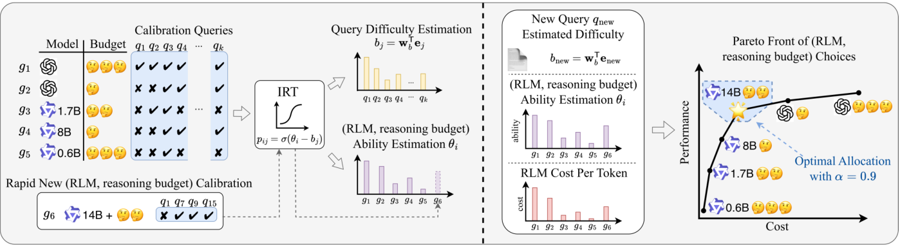

图2: RADAR 框架示意图。左：通过IRT 联合估计可解释的问题难度与模型配置能力（图示经过简化，完整细节见第3.3 节）；对于新增模型配置，借助自适应测验从少量动态选择的问题中估计其能力（第3.5 节）。右：将路由表述为MOO，将问题分配给能力足够的配置，使性能—成本权衡向帕累托前沿靠近（第3.2 节）。示意图使用原论文矢量内容，图内英文标签未改动。

本文的主要贡献总结如下：

[C1]将自适应推理表述为对离散化模型—预算配置的路由，并在黑盒环境下基于帕累托最优性能—成本目标选取配置。

[C2]将IRT 用于从数据中学习可解释的问题难度和配置能力，实现低延迟路由以及对未见问题的泛化。

[C3]通过自适应校准，从少量具有信息量的问题子集中估计能力，支持新推理模型的即插即用式集成。

[C4]在八个高难度推理基准中取得更优的性能—成本权衡及较强的OOD 泛化，包括长上下文文档问答。

## 2 相关工作（Related Work）

高效推理（Efficient Reasoning）日益增多的工作致力于提高推理模型本身的效率，参见Yue et al.（2025）的综述。L1（Aggarwal & Welleck, 2025）和S1（Muennighoff et al., 2025）等方法通过控制长度，鼓励产生能够给出正确答案的更短思维链。其他方法通过动态缩短或延长推理过程（Hou et al., 2025; Xu et al., 2025; Wang et al., 2025），或者自适应控制推理步骤（Huang et al., 2025）来修剪或调整推理，并分析何时额外推理有益、何时属于浪费（Su & Cardie, 2025; Su et al., 2025; Yu et al., 2025; Ghosal et al., 2025）。我们的方法与单模型效率优化互补：这些高效RLM 均可成为RADAR额外的路由候选配置。与需要访问模型权重的静态单模型调节不同，RADAR 在黑盒环境下利用异构模型间的互补优势，并根据用户应用动态调整性能—成本权衡。

基础模型路由（Routing for Foundation Models）近期模型路由研究（Ding et al., 2024; Ong et al., 2024; Chen et al., 2025; Hu et al., 2024; Zhang et al., 2025）主要关注使用黑盒预测器进行模型选择或采用模型级联（Chen et al., 2023）。与之不同，我们从模型—预算联合配置的角度研究RLM 自适应推理，将路由表述为MOO。与不透明的路由回归器（Chen et al., 2023; Ding et al., 2024; Ong et al., 2024）不同，RADAR 采用IRT 参数化，使潜在的问题难度和配置能力具有可解释性。相比同期基于IRT 的路由方法（Song et al., 2025），本研究：（1）将此前尚未探索的RLM 路由表述为MOO，从而采用切比雪夫标量化等更丰富的求解技术；（2）使用参数更少的IRT 表述，实现可解释的标量能力排序，可能降低训练数据需求；（3）提供评估帕累托前沿覆盖程度的新MOO 路由指标；（4）使用自适应测验快速泛化到新RLM。扩展讨论和详细比较见原论文附录A。

## 3 方法论（Methodology）

本节介绍通过路由RLM 配置实现自适应推理的RADAR 框架。我们首先将自适应推理形式化为MOO：对于指定的性能—成本权衡，路由器选取最优的{RLM，推理预算} 配置。在这一问题表述下，我们进一步介绍如何通过IRT 预测某个模型配置在给定问题上的性能，以及如何求解优化问题。

### 3.1 通过离散化实现基于路由的自适应推理

与传统模型路由（Ong et al., 2024; Ding et al., 2024）从不同基础模型中选择不同，实际部署RLM 时必须同时考虑基础模型和推理预算两个层面的性能—成本权衡。我们将每个RLM $m\in\mathcal M$按其可用预算$u\in\mathcal U_m$离散化，以统一这两个决策。例如，专有模型（如o4-mini）的预算可以为{low, medium, high}，开源模型的用户自定义预算集合可以为{0, 1$k$, 2$k$, 4$k$, 8$k$, 16$k$}。

对于开源RLM（如Qwen3），我们在生成期间统计思考token 数。一旦超过设定预算，就附加中断消息（如“output answer based on current thinking”）及模型的思考结束token（例如&lt;/think&gt;），结束思维链并提前进入最终答案生成。每个离散化组合称为一个模型配置$g=(m,u)\in\mathcal G$，其中候选配置集合满足：

$$
\mathcal G\subseteq\bigcup_{m\in\mathcal M}\ \bigcup_{u\in\mathcal U_m}\{(m,u)\}.
$$

离散化使模型路由能够在配置层面运行。本文使用更通用的“配置”一词，因为RADAR 除推理预算外，还可以选择附加RAG 流水线的参数设置或解码方式。

### 3.2 将RLM 路由表述为多目标优化问题

我们从MOO 的视角重新审视模型路由，从而使用相关文献中的成熟求解技术（Miettinen, 1999; Branke et al., 2008; Murata & Ishibuchi, 1995; Zhang & Golovin, 2020）。给定问题集合$\mathcal Q=\{q_1,\ldots,q_k\}$和候选配置集合$\mathcal G=\{g_1,\ldots,g_n\}$，目标是为每个$q_j\in\mathcal Q$选择最优配置$g_i\in\mathcal G$，使性能最大且成本最小。

对于单个问题$q$（为简洁起见略去索引），定义两个目标：性能预测函数$p_q:\mathcal G\to[0,1]$，表示配置$g$回答$q$的正确概率；成本预测函数$c_q:\mathcal G\to[0,1]$，表示归一化后的回答成本。我们将其表述为二维的先验多目标优化问题（a-priori MOO），使用标量化技术求解：

$$
g^*=\arg\max_{g\in\mathcal G} f(p_q(g),c_q(g)).\tag{1}
$$

其中$f$是标量化函数。标量化将MOO 的多个目标聚合为单目标优化问题（SOP），使SOP 的最优解成为MOO 的帕累托最优解。本文研究线性标量化与切比雪夫标量化两种技术。

#### 3.2.1 线性标量化（Linear Scalarization）

线性标量化（Murata & Ishibuchi, 1995）给每个目标赋予非负权重，并最大化奖励的加权和（等价地最小化成本加权和）。调整权重可以得到性能—成本帕累托前沿上的不同点。对于$\mathbf w\in\mathbb R^2_{\ge0}$，相应的线性标量化问题为：

$$
\arg\max_{g\in\mathcal G}\left[w_1p_q(g)+w_2(-c_q(g))\right].\tag{2}
$$

由于权重可以提取乘法常数，我们约束其和为1。对于二维MOO，可设$w_2=1-w_1$，于是：

$$
\operatorname{LSP}_q^{w_1}=\arg\max_{g\in\mathcal G}\left[w_1p_q(g)-(1-w_1)c_q(g)\right].\tag{3}
$$

需要指出，式（3）恢复了已有路由方法（Hu et al., 2024; Song et al., 2025; Zhang et al., 2025）使用的路由形式，但这是从MOO 视角得到的。

#### 3.2.2 切比雪夫标量化（Chebyshev Scalarization）

通常，当帕累托前沿非凸时，前沿上的某些点不可能作为任何权重参数化LSP 的最优解。因此，我们也研究切比雪夫标量化（Zhang & Golovin, 2020），通过到理想参考点的加权切比雪夫距离，找到前沿凹陷部分的点。本文理想参考点对应性能为1、成本为0。该方法旨在最小化所有维度上、相对于理想参考点的权重缩放后的最大惩罚。对于$\mathbf w\in\mathbb R^2_{\ge0}$，相应问题为：

$$
\operatorname{CSP}_q^{w_1}=\arg\min_{g\in\mathcal G}\max\left\{w_1\lvert1-p_q(g)\rvert,(1-w_1)c_q(g)\right\}.\tag{4}
$$

权重$w_1$ 控制性能与成本的权衡：较大值更重视性能，从而更频繁地选用能力较强的配置；较小值更重视成本效益，从而更倾向于较弱但更经济的配置。给定权重$w_1$ 和问题$q$，RADAR 选择$g=\operatorname{LSP}^{w_1}_q$或$g=\operatorname{CSP}^{w_1}_q$，以最大化性能并最小化成本。

### 3.3 基于IRT 的推理能力与问题难度校准

准确参数化性能预测函数$p_q(g)$ 是求解式（1）的关键。我们使用常用于学生作答建模的项目反应理论（IRT）（Rasch, 1960; Lord, 2012; van der Linden & Hambleton, 1997; DeMars, 2010），具体采用双参数逻辑模型（two-parameter logistic，2PL）（Lord, 1951; Birnbaum, 1968）。IRT 假设单调性，即随着配置能力增加，其正确回答某个问题的概率也随之增大。2PL 考虑问题的两个属性：难度和区分度。直观地说，回答某个问题正确后，配置能力估计受到的影响取决于问题难度；区分度则描述正确概率随着配置能力增加而上升的速率差异。

在RADAR 中，我们通过冻结参数的嵌入模型，将问题$q_j$映射为$d_q$维向量$e_j$。借助嵌入表示的问题内容，RADAR 可泛化到OOD 问题，包括长上下文多文档问答，即使训练数据主要是短问题。我们通过线性变换获得标量难度$b_j\in\mathbb R$与区分度$a_j\in\mathbb R$：

$$
a_j=\mathbf w_a^\top e_j,\qquad b_j=\mathbf w_b^\top e_j,
$$

其中$\mathbf w_a,\mathbf w_b\in\mathbb R^{d_q}$为可学习的向量。采用简单线性变换和冻结嵌入模型有助于降低路由延迟，详见第4.3 节与原文附录B.1。对于模型配置$g_i$，使用标量能力参数$\theta_i\in\mathbb R$。在2PL 模型下，配置$g_i$正确回答问题$q_j$的概率为：

$$
p_{ij}=\sigma\!\left(a_j(\theta_i-b_j)\right),
$$

其中$\sigma$(⋅) 为sigmoid 函数。

同期基于IRT 的模型路由方法（Song et al., 2025）使用多维IRT 模型（MIRT）（Reckase, 2009）参数化性能函数。不同的是，我们使用标量配置能力，使能力数值能够提供可解释的模型排序。2PL的参数数量较少，因而所需训练数据更少。此外，Song et al.（2025）采用定性模型画像嵌入进行新模型泛化；我们采用自适应测验快速估计新增配置的标量能力，从而将其快速加入后续路由池（见第3.5 节）。

为了训练IRT，构建二值评估矩阵$Y\in\{0,1\}^{n\times k}$，记录$n$种RLM 配置在$k$个训练问题上的回答结果。最小化全部$nk$个观测结果的平均负对数似然（即二元交叉熵）：

$$
\mathcal L_{\mathrm{2PL}}=-\frac{1}{nk}\sum_{i=1}^{n}\sum_{j=1}^{k}\left[y_{ij}\log p_{ij}+(1-y_{ij})\log(1-p_{ij})\right].\tag{5}
$$

其中$p_{ij}=\sigma(a_j(\theta_i-b_j))$ 表示2PL IRT 估计的正确回答概率。

### 3.4 成本预测（Cost Prediction）

除性能预测函数外，求解路由MOO（式（1））还需要成本预测函数$c_q(g)$。遵循Hu et al.（2024）及Song et al.（2025），我们采用启发式方法：计算配置$g$在问题$q$上产生的推理token 数$n_g^{\mathrm{rsn}}(q)$ 与答案token 数$n_g^{\mathrm{cmp}}(q)$ 之和，乘以该基础RLM 的每token 成本$t_g$，然后对全部训练问题求平均：

$$
c_q(g)=\frac{1}{|\mathcal Q|}\sum_{q\in\mathcal Q}\left(n_g^{\mathrm{rsn}}(q)+n_g^{\mathrm{cmp}}(q)\right)t_g.\tag{6}
$$

专有模型（如o4-mini）的每token 美元成本从官方网站获取；开源模型（如Qwen3）的价格来自云服务提供商（见脚注 1）。使用最小—最大归一化将配置成本$c_q(g)$ 缩放到[0, 1]，保证预测成本与预测性能处于相同尺度。更复杂的成本预测方法留待未来研究。

### 3.5 通过自适应测验扩展RLM 配置池

为RADAR 加入新的模型配置$g_i$，需要准确估计其标量能力$\widehat\theta_i\in\mathbb R$。给定拟合后的2PL 模型以及学得的问题参数$\{a_j,b_j\}_{j=1}^{|\mathcal Q|}$，可以通过观察该配置对问题子集$S\subseteq\mathcal Q$的回答，估计$\widehat\theta_i$。相应的负对数似然定义为：

$$
\mathcal L_{\mathrm{2PL}}(\theta;S,g_i)=-\sum_{j\in S}\left[y_{ij}\log\sigma(a_j(\theta-b_j))+(1-y_{ij})\log\!\left(1-\sigma(a_j(\theta-b_j))\right)\right].\tag{7}
$$

脚注 1：原文价格来源：https://www.together.ai/pricing。

其中$y_{ij}\in\{0,1\}$ 表示新配置$g_i$对$q_j$的回答结果。能力估计为$\widehat\theta_i=\arg\min_\theta\mathcal L_{\mathrm{2PL}}(\theta;S,g_i)$。完整评估对应$S=\mathcal Q$，即$\widehat\theta_i=\arg\min_\theta\mathcal L_{\mathrm{2PL}}(\theta;\mathcal Q,g_i)$；但评估所有问题的计算成本较高。

为降低成本，我们采用受到计算机化自适应测验（computerized adaptive testing）（Wainer et al., 2000）启发的自适应问题选择策略。对于新配置$g_i$，逐步构造评估子集$S_t$，下文省略配置索引$i$。初始化$S_0=\varnothing,\ \widehat\theta_0=0$。对于$t\ge1$，受到Hofmann et al.（2025）启发，选择在当前能力估计附近具有最大费舍尔信息量（Fisher information）的未评估问题：

$$
j_t=\arg\max_{j\in\mathcal Q\setminus S_{t-1}}I(\widehat\theta_{t-1},a_j,b_j).\tag{8}
$$

2PL IRT 的费舍尔信息量为：

$$
I(\theta,a_j,b_j)=a_j^2\sigma(a_j(\theta-b_j))\left[1-\sigma(a_j(\theta-b_j))\right].\tag{9}
$$

随后将选中问题加入评估子集：$S_t=S_{t-1}\cup\{q_{j_t}\}$。观察新配置对该题的回答之后，更新能力估计$\widehat\theta_t=\arg\min_\theta\mathcal L_{\mathrm{2PL}}(\theta;S_t,g_i)$。重复这一过程，直至$|S_t|$ 达到预算$T$，返回$\widehat\theta_T$作为新增配置的能力估计值。

## 4 实验评估（Experimental Evaluation）

本节详细介绍用于全面评估RADAR 的实验设置，包括基准、评估指标和基线方法。

基准测试（Benchmarks）我们在八个推理基准上进行评估：AIME（MAA, 2024）、MATH（Hendrycks et al., 2021c）、GPQA（Rein et al., 2024）、LSAT（Wang et al., 2022; Zhong et al., 2021）、MMLU（Hendrycks et al., 2021b;a）、MMLU Redux（Gema et al., 2024）、MMLU Pro（Wang et al., 2024）以及FRAMES（Krishna et al., 2024）。这些基准涵盖竞赛数学、博士级科学问题、法律和通识知识，既有选择题也有开放式回答。特别地，FRAMES 检验RADAR 在多文档问答场景下对长上下文问题的泛化能力。以往路由研究很少包含长上下文评估；RouterBench（Hu et al., 2024）是一个例外，但它所用的是私有的分布内RAG 数据集。详细信息见原文附录C。

评估指标（Metrics）我们报告超体积（hypervolume）（Emmerich & Deutz, 2018），在本文设置下，它对应于不同$w_1$ 权重下性能—成本权衡曲线下的面积，数值越高越好。我们还采用成本—性能阈值（Cost–Performance Threshold，CPT），与Ong et al.（2024）的调用—性能阈值类似：相对于性能最强的配置o4-mini–high，$\operatorname{CPT}(x\%)$ 表示达到其$x\%$ 性能所需的最小成本，以o4-mini–high 的成本归一化。例如CPT(90%) = 0.1 表示以10% 的成本达到其90% 的性能。

基线方法（Baselines）与近期先进路由方法RouterBench（Hu et al., 2024; Chen et al., 2025）及IRT-Router（Song et al., 2025）进行比较。这些方法原生并不支持自适应推理或RLM 配置级路由，因此我们将其适配到当前实验场景；细节见原文附录D.3。还包括几种启发式基线：All-Large（o4-mini，高预算）；All-Small（Qwen3-0.6B，0 推理token）；Oracle（已知测试集性能，选取能够达到最佳表现的配置中最便宜的一项）；Random-All（在所有配置间均匀采样）；Random-Pair（以用户指定的性能—成本权重$w_1$ 的概率选取最大的配置）。

评估设置与实现细节（Evaluation Setup and Implementation Details）RADAR 使用切比雪夫标量化，同时进行分布内（ID）和分布外（OOD）评估。对于ID，将全部八个基准的训练划分合并，用来训练2PL IRT（见第3.3 节），再分别报告各基准测试划分上的性能；没有预定义测试集的基准按80%—20% 划分训练集与测试集。对于OOD，针对一个目标基准，将其他不重叠基准的训练划分合并成训练集，再于该目标基准的测试集上评估。例如对AIME 做OOD 评估时，会从训练集中排除AIME 以及与其重叠的MATH（因为MATH 含有AIME 的问题）。

表1: 八个基准的分布内（ID）Hypervolume 路由性能（越高越好）。RADAR 在多数基准上优于对照方法，使性能—成本权衡更接近帕累托前沿。OOD 结果见原文表13。原文最佳值加粗、次佳值下划线。

| 基准 | Random-Pair | RouterBench | IRT-Router | RADAR（本文） |
| --- | --- | --- | --- | --- |
| GPQA-Diamond | 0.5545 | 0.6866 | 0.6942 | **0.7513** |
| MMLU | 0.6905 | 0.8592 | 0.8604 | **0.8720** |
| MMLU-Redux | 0.7281 | 0.9053 | 0.9117 | **0.9230** |
| MMLU-Pro | 0.5589 | 0.7819 | 0.7812 | **0.7995** |
| LSAT | 0.6913 | 0.9125 | 0.9163 | **0.9188** |
| AIME | 0.5159 | 0.7680 | **0.7766** | 0.7760 |
| MATH-500 | 0.7433 | **0.9528** | 0.9420 | 0.9449 |
| FRAMES | 0.6589 | 0.8325 | 0.8501 | **0.8762** |

表2: 八个基准的分布内（ID）CPT(90%) 路由性能（越低越好）。CPT(90%) 是达到o4-mini 高预算配置90%性能所需成本占该配置成本的比例。OOD 结果见原文表14。原文最佳值加粗、次佳值下划线。

| 基准 | Random-Pair | RouterBench | IRT-Router | RADAR（本文） |
| --- | --- | --- | --- | --- |
| GPQA-Diamond | 80.36% | 57.13% | 53.99% | **13.21%** |
| MMLU | 76.30% | 2.71% | **2.66%** | 2.69% |
| MMLU-Redux | 75.06% | 2.59% | 2.80% | **2.42%** |
| MMLU-Pro | 83.57% | 5.19% | **3.83%** | 3.89% |
| LSAT | 80.14% | 2.02% | 1.93% | **1.82%** |
| AIME | 87.22% | 65.65% | 61.23% | **60.69%** |
| MATH-500 | 76.15% | 1.34% | 1.44% | **1.31%** |
| FRAMES | 77.90% | 43.50% | 31.53% | **13.11%** |

表3: 加入Qwen3-14B 的八种新配置之前（RADAR）与之后（RADAR++）的Hypervolume，对比ID 与OOD 场景（越高越好）。RADAR++ 通过自适应测验估计新配置能力以改善路由性能。每对结果中最佳值加粗，次佳值下划线。

| 基准 | ID：RADAR | ID：RADAR++ | OOD：RADAR | OOD：RADAR++ |
| --- | --- | --- | --- | --- |
| GPQA-Diamond | 0.7513 | **0.7535** | **0.7466** | 0.7463 |
| MMLU | 0.8720 | **0.8731** | 0.8609 | **0.8698** |
| MMLU-Redux | 0.9230 | **0.9238** | 0.9072 | **0.9091** |
| MMLU-Pro | 0.7995 | **0.8021** | 0.7858 | **0.7951** |
| LSAT | 0.9188 | **0.9233** | 0.9146 | **0.9255** |
| AIME | 0.7760 | **0.7828** | **0.7566** | **0.7566** |
| MATH-500 | 0.9449 | **0.9461** | **0.9368** | **0.9368** |
| FRAMES | 0.8762 | **0.8830** | 0.8865 | **0.8931** |

我们共路由35 种配置：OpenAI o4-mini（low、medium、high 三档推理预算）与Qwen3 的0.6B、1.7B、4B、8B 四个模型（各有0、256、512、1k、2k、4k、8k、16k 八种预算）（Yang et al., 2025; OpenAI, 2025）。使用标准提示词（见原文附录D.4），每种配置在每个训练问题上评估一次；AIME 的测试集较小，采用八次运行的平均值。结果与文献报告的RLM 性能相近（Yang et al., 2025; OpenAI, 2025）。在八个基准的训练和测试划分中，总计收集了50,139 个不重复问题、约175 万条二值回答结果。其他细节见原文附录D。

### 4.1 主要定量结果（Main Quantitative Results）

RADAR 优于先进路由方法表1 和表2 分别报告全部方法在八个基准ID 设定下的Hypervolume和CPT(90%)。额外阈值的CPT 结果见原文附录B.2。RADAR 在多数基准上优于全部基线方法，在其余基准上与最佳已有方法相当。RADAR 优于同期基于IRT 的IRT-Router（Song et al., 2025），这表明将RLM 路由表述为MOO、并使用切比雪夫标量化等技术，能够更好地恢复性能—成本帕累托前沿。例如，GPQA-Diamond 中RADAR 的Hypervolume 比次佳基线高约8%；对于MATH-500，其CPT(90%) 仅为1.31%，即用o4-mini 高预算成本的1.31% 达到其90% 的性能。其他基准也有类似提升。

问题泛化能力完整的OOD Hypervolume 与CPT(90%) 结果见原文附录B.3。图1 给出了FRAMES（Krishna et al., 2024）的OOD 帕累托权衡曲线。RADAR 在多数OOD 基准上优于先进方法。特别地，尽管训练问题主要较短，RADAR 仍在FRAMES 的高难度长上下文多文档推理问答上表现突出。当OOD 问题的难度显著高于训练期间所见（如AIME）时，RADAR 往往分配能力略低于最优水平的配置，导致性能小幅下降；如原文附录B.4 所示，训练时加入少量代表性问题可缓解这一弱点。

消融实验（Ablation Study）原文附录B.5 表明，在OOD 场景下，切比雪夫标量化优于既有路由工作（Song et al., 2025; Hu et al., 2024）采用的线性标量化，因为它能够探索帕累托前沿的凸区域与凹区域。在ID 场景下两者表现相近，线性标量化略优。将路由问题表述为MOO，为未来采用其他MOO 技术提供了可能。此外，针对训练矩阵规模的消融（原文附录B.6）发现，即使仅使用随机抽取的20% 训练问题，RADAR 仍能取得与全量训练集相近的性能。

### 4.2 模型可扩展性与泛化评估（Model Scalability and Generalization Evaluation）

为评估RADAR 对新RLM 的扩展能力，我们加入Qwen3-14B 提供的八种新配置。表3 显示，RADAR 通过自适应测验动态选取仅5,000 个训练问题（约为训练集的12%），即可准确估计新增配置的能力，从而改善路由性能。与均匀随机采样的比较见原文附录B.7；加入新配置后路由分配的变化见附录B.8。相比同期IRT 路由方法（Song et al., 2025），后者通过询问ChatGPT 获取新模型的定性画像并将其嵌入；以及已有模型对路由方法（Ding et al., 2024），后者假设新模型对具有相似的能力差异，RADAR 可以准确估计任意新增配置的能力。

### 4.3 可解释性与延迟分析（Interpretability and Latency Analysis）

可解释的问题难度与配置能力我们使用MATH-500（Hendrycks et al., 2021c）中的ID 问题进行案例研究，该数据集对每道题标注了五个递增难度等级。在图3 左侧，RADAR 估计的问题难度与五个真实等级之间的皮尔逊相关系数为0.509，呈中等相关。随着问题难度增加，模型预测能力较强的配置具有更高正确率；在所有配置和问题上的平均答案正确性预测准确率为84.42%。图3 右侧展示不同性能—成本权重下配置接收的路由调用比例：低权重优先成本效益高的Qwen3，高权重优先性能较强的o4-mini。

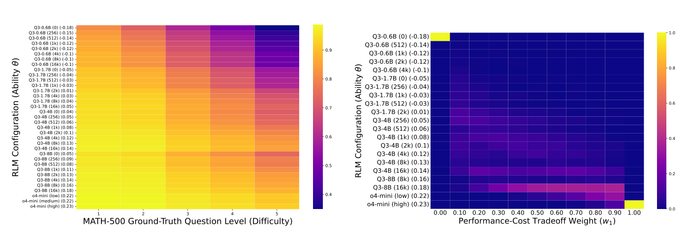

图3: RADAR 的可解释问题难度与配置能力估计。左：MATH-500 中五个真实难度等级的问题上，各配置的平均预测正确率；难度越高，能力更强的配置预测正确率越高。右：随性能—成本权重变化，不同RLM配置被路由调用的比例；低权重更偏向Qwen3（成本），高权重更偏向o4-mini（性能）。原论文Fig. 3 的英文坐标轴、模型排序、能力数值和色条均按原样保留。

极小的实时路由延迟我们测量RADAR 的延迟，并与回答问题的最小RLM 配置（Qwen3-0.6B、0推理预算）比较。在MATH-500 的500 道题上重复运行三次，RADAR 的每题平均额外路由延迟为6.89 ± 0.53 毫秒，而最小RLM 生成答案所需时间为869.56 ± 1.1 毫秒。相比之下，RADAR 的额外开销可以忽略。吞吐量分析见原文附录B.9。

## 5 结论与未来工作（Conclusions and Future Work）

我们提出了RADAR，一种推理能力与难度感知的路由框架：（1）将自适应推理形式化为MOO；（2）利用IRT 将问题自适应分配给不同的RLM 模型—预算配置。RADAR 实现了良好的成本—性能权衡，在八个高难度推理基准上持续优于以往路由方法，并能较好地泛化到OOD 问题。除效率外，RADAR 还通过呈现问题难度与模型能力提供可解释性，并通过自适应校准支持新RLM 配置的即插即用式集成。

未来有几个有前景的方向。首先，我们希望将RADAR 从文本扩展到多模态推理。其次，除推理预算外，纳入检索、工具使用和解码算法等额外配置，可以为超长上下文问答、深度研究等更广泛的应用提供细粒度路由决策。第三，可在其他约束场景中研究RADAR，例如一批问题共享总预算上限的情况。这些方向体现出RADAR 作为不断发展的RLM 生态中具有理论依据、可解释的自适应推理基础框架的潜力。

## 致谢（Acknowledgements）

作者感谢Tong Sun 和Jaewook Lee 提供的有益讨论，也感谢匿名审稿人提出的宝贵意见。

## 可复现性声明（Reproducibility Statement）

我们对论文及附录进行了结构化组织，以便研究结果能够独立重新实现与复现。问题设置、路由目标和IRT 建模细节见第3 节；数据来源、预处理以及ID/OOD 划分程序见原文附录C；基线、评估协议、指标与其他实现细节见第4 节及原文附录D。

## 伦理声明（Ethics Statement）

我们确认遵守ICLR 伦理准则。本研究只在公开推理基准上评估路由，不涉及人类受试者或个人身份信息；我们遵守数据集许可及署名要求，并在原文附录C 中给出详细预处理流程。需要注意的是，通过路由得到的回答会继承底层RLM 配置的属性，包括潜在社会偏见或安全问题。本文方法本身并不能缓解这些风险，因此，在没有针对具体应用领域的安全保障与偏见审计的情况下，应该谨慎部署。

## 参考文献（References，保留英文）

以下条目根据原论文第10—14 页的参考文献整理，保留英文及原有文献顺序。

Pranjal Aggarwal and Sean Welleck. L1: Controlling how long a reasoning model thinks with reinforcement learning. arXiv preprint arXiv:2503.04697, 2025.

Maria-Florina Balcan, Steve Hanneke, and Jennifer Wortman Vaughan. The true sample complexity of active learning. Machine learning, 80(2):111–139, 2010.

Allan Birnbaum. Some latent trait models and their use in inferring an examinee’s ability. Statistical theories of mental test scores, 1968.

Jorgen Branke, Kalyanmoy Deb, Kaisa Miettinen, and Roman Slowinski. Multiobjective Optimization: Interactive and Evolutionary Approaches. Springer Science & Business Media, 2008.

Lingjiao Chen, Matei Zaharia, and James Zou. Frugalgpt: How to use large language models while reducing cost and improving performance. arXiv preprint arXiv:2305.05176, 2023.

Zhou Chen, Zhiqiang Wei, Yuqi Bai, Xue Xiong, and Jianmin Wu. Tagrouter: Learning route to llms through tags for open-domain text generation tasks. arXiv preprint arXiv:2506.12473, 2025.

Christine DeMars. Item response theory. Oxford University Press, 2010.

Dujian Ding, Ankur Mallick, Chi Wang, Robert Sim, Subhabrata Mukherjee, Victor Ruhle, Laks VS Lakshmanan, and Ahmed Hassan Awadallah. Hybrid llm: Cost-efficient and quality-aware query routing. arXiv preprint arXiv:2404.14618, 2024.

Dheeru Dua, Yizhong Wang, Pradeep Dasigi, Gabriel Stanovsky, Sameer Singh, and Matt Gardner. Drop: A reading comprehension benchmark requiring discrete reasoning over paragraphs. arXiv preprint arXiv:1903.00161, 2019.

Michael TM Emmerich and André H Deutz. A tutorial on multiobjective optimization: fundamentals and evolutionary methods. Natural computing, 17(3):585–609, 2018.

Aryo Pradipta Gema, Joshua Ong Jun Leang, Giwon Hong, Alessio Devoto, Alberto Carlo Maria Mancino, Rohit Saxena, Xuanli He, Yu Zhao, Xiaotang Du, Mohammad Reza Ghasemi Madani, et al. Are we done with mmlu? arXiv preprint arXiv:2406.04127, 2024.

Soumya Suvra Ghosal, Souradip Chakraborty, Avinash Reddy, Yifu Lu, Mengdi Wang, Dinesh Manocha, Furong Huang, Mohammad Ghavamzadeh, and Amrit Singh Bedi. Does thinking more always help? understanding test-time scaling in reasoning models. arXiv preprint arXiv:2506.04210, 2025.

Maharshi Gor, Hal Daumé III, Tianyi Zhou, and Jordan Boyd-Graber. Do great minds think alike? investigating human-ai complementarity in question answering with caimira. arXiv preprint arXiv:2410.06524, 2024.

Daya Guo, Dejian Yang, Haowei Zhang, Junxiao Song, Ruoyu Zhang, Runxin Xu, Qihao Zhu, Shirong Ma, Peiyi Wang, Xiao Bi, et al. Deepseek-r1: Incentivizing reasoning capability in llms via reinforcement learning. arXiv preprint arXiv:2501.12948, 2025.

Steve Hanneke. Theory of active learning. Foundations and Trends in Machine Learning, 7(2-3), 2014.

Michael Hassid, Gabriel Synnaeve, Yossi Adi, and Roy Schwartz. Don’t overthink it. preferring shorter thinking chains for improved llm reasoning, 2025. URL https://arxiv.org/abs/ 2505.17813.

Dan Hendrycks, Collin Burns, Steven Basart, Andrew Critch, Jerry Li, Dawn Song, and Jacob Steinhardt. Aligning ai with shared human values. Proceedings of the International Conference on Learning Representations (ICLR), 2021a.

Dan Hendrycks, Collin Burns, Steven Basart, Andy Zou, Mantas Mazeika, Dawn Song, and Jacob Steinhardt. Measuring massive multitask language understanding. Proceedings of the International Conference on Learning Representations (ICLR), 2021b.

Dan Hendrycks, Collin Burns, Saurav Kadavath, Akul Arora, Steven Basart, Eric Tang, Dawn Song, and Jacob Steinhardt. Measuring mathematical problem solving with the math dataset. arXiv preprint arXiv:2103.03874, 2021c.

Valentin Hofmann, David Heineman, Ian Magnusson, Kyle Lo, Jesse Dodge, Maarten Sap, Pang Wei Koh, Chun Wang, Hannaneh Hajishirzi, and Noah A Smith. Fluid language model benchmarking. In Second Conference on Language Modeling, 2025.

Jialiang Hong, Taihang Zhen, Kai Chen, Jiaheng Liu, Wenpeng Zhu, Jing Huo, Yang Gao, Depeng Wang, Haitao Wan, Xi Yang, Boyan Wang, and Fanyu Meng. Reconsidering overthinking: Penalizing internal and external redundancy in cot reasoning, 2025. URL https://arxiv.org/abs/2508.02178.

Bairu Hou, Yang Zhang, Jiabao Ji, Yujian Liu, Kaizhi Qian, Jacob Andreas, and Shiyu Chang. Thinkprune: Pruning long chain-of-thought of llms via reinforcement learning. arXiv preprint arXiv:2504.01296, 2025.

Qitian Jason Hu, Jacob Bieker, Xiuyu Li, Nan Jiang, Benjamin Keigwin, Gaurav Ranganath, Kurt Keutzer, and Shriyash Kaustubh Upadhyay. Routerbench: A benchmark for multi-llm routing system. arXiv preprint arXiv:2403.12031, 2024.

Shijue Huang, Hongru Wang, Wanjun Zhong, Zhaochen Su, Jiazhan Feng, Bowen Cao, and Yi R Fung. Adactrl: Towards adaptive and controllable reasoning via difficulty-aware budgeting. arXiv preprint arXiv:2505.18822, 2025.

Carlos E Jimenez, John Yang, Alexander Wettig, Shunyu Yao, Kexin Pei, Ofir Press, and Karthik R Narasimhan. SWE-bench: Can language models resolve real-world github issues? In The Twelfth International Conference on Learning Representations, 2024. URL https://openreview.net/forum?id=VTF8yNQM66.

Ralph Keeney and Howard Raiffa. Decisions with Multiple Objectives: Preferences and Value Tradeoffs. Cambridge University Press, 1993.

Satyapriya Krishna, Kalpesh Krishna, Anhad Mohananey, Steven Schwarcz, Adam Stambler, Shyam Upadhyay, and Manaal Faruqui. Fact, fetch, and reason: A unified evaluation of retrievalaugmented generation. arXiv preprint arXiv:2409.12941, 2024.

Merve ¸Sahin Kür¸sad. The effects of different item selection methods on test information and test efficiency in computer adaptive testing. Journal of Measurement and Evaluation in Education and Psychology, 14(1):33–46, 2023.

Woosuk Kwon, Zhuohan Li, Siyuan Zhuang, Ying Sheng, Lianmin Zheng, Cody Hao Yu, Joseph E. Gonzalez, Hao Zhang, and Ion Stoica. Efficient memory management for large language model serving with pagedattention, 2023. URL https://arxiv.org/abs/2309.06180.

Celine Lee, Alexander M Rush, and Keyon Vafa. Critical thinking: Which kinds of complexity govern optimal reasoning length? arXiv preprint arXiv:2504.01935, 2025.

Frederic M Lord. A theory of test scores and their relation to the trait measured. ETS Research Bulletin Series, 1951(1):i–126, 1951.

Frederic M Lord. Applications of item response theory to practical testing problems. Routledge, 2012.

Pan Lu, Hritik Bansal, Tony Xia, Jiacheng Liu, Chunyuan Li, Hannaneh Hajishirzi, Hao Cheng, KaiWei Chang, Michel Galley, and Jianfeng Gao. Mathvista: Evaluating mathematical reasoning of foundation models in visual contexts. In International Conference on Learning Representations (ICLR), 2024.

MAA. MAA Invitational Competitions; Mathematical Association of America —maa.org. https://maa.org/maainvitational-competitions/, 2024. [Accessed 03-09-2025].

Timothy Marler and Jasbir Arora. Survey of multi-objective optimization methods for engineering. Structural and Multidisciplinary Optimization, 26(6):369–395, 2004.

Guangyu Meng, Qingkai Zeng, John P. Lalor, and Hong Yu. A psychology-based unified dynamic framework for curriculum learning, 2024. URL https://arxiv.org/abs/2408.05326.

Kaisa Miettinen. Nonlinear multiobjective optimization, volume 12. Springer Science & Business Media, 1999.

Niklas Muennighoff, Zitong Yang, Weijia Shi, Xiang Lisa Li, Li Fei-Fei, Hannaneh Hajishirzi, Luke Zettlemoyer, Percy Liang, Emmanuel Candès, and Tatsunori Hashimoto. s1: Simple test-time scaling. arXiv preprint arXiv:2501.19393, 2025.

Tadahiko Murata and Hisao Ishibuchi. MOGA: Multi-objective genetic algorithms. In Proceedings of 1995 IEEE International Conference on Evolutionary Computation, pp. 289–294, 1995.

Isaac Ong, Amjad Almahairi, Vincent Wu, Wei-Lin Chiang, Tianhao Wu, Joseph E Gonzalez, M Waleed Kadous, and Ion Stoica. Routellm: Learning to route llms with preference data. arXiv preprint arXiv:2406.18665, 2024.

OpenAI. Introducing openai o3 and o4-mini. https://openai.com/index/ introducing-o3-and-o4-mini/, April 2025. Accessed: 2025-09-24.

OpenAI and et al. Openai o1 system card, 2024. URL https://arxiv.org/abs/2412.16720.

Felipe Maia Polo, Lucas Weber, Leshem Choshen, Yuekai Sun, Gongjun Xu, and Mikhail Yurochkin. tinybenchmarks: evaluating llms with fewer examples. In Proceedings of the 41st International Conference on Machine Learning, ICML’24. JMLR.org, 2024.

Antonin Ponsich, Antonio Jaimes, and Carlos Coello. A survey on multiobjective evolutionary algorithms for the solution of the portfolio optimization problem and other finance and economics applications. IEEE Transactions on Evolutionary Computation, 17(3):321–344, 2013.

Georg Rasch. Studies in mathematical psychology: I. probabilistic models for some intelligence and attainment tests. 1960.

M.D. Reckase. Multidimensional Item Response Theory. Springer New York, 2009. ISBN 9780387899763. doi: 10.1007/978-0-387-89976-3. URL http://dx.doi.org/10.1007/ 978-0-387-89976-3.

David Rein, Betty Li Hou, Asa Cooper Stickland, Jackson Petty, Richard Yuanzhe Pang, Julien Dirani, Julian Michael, and Samuel R Bowman. Gpqa: A graduate-level google-proof q&a benchmark. In First Conference on Language Modeling, 2024.

Pedro Rodriguez, Joe Barrow, Alexander Miserlis Hoyle, John P. Lalor, Robin Jia, and Jordan Boyd-Graber. Evaluation examples are not equally informative: How should that change NLP leaderboards? In Chengqing Zong, Fei Xia, Wenjie Li, and Roberto Navigli (eds.), Proceedings of the 59th Annual Meeting of the Association for Computational Linguistics and the 11th International Joint Conference on Natural Language Processing (Volume 1: Long Papers), pp. 4486–4503, Online, August 2021. Association for Computational Linguistics. doi: 10.18653/v1/2021.acl-long.346. URL https://aclanthology.org/2021.acl-long.346/.

Marija Šakota, Maxime Peyrard, and Robert West. Fly-swat or cannon? cost-effective language model choice via meta-modeling. In Proceedings of the 17th ACM International Conference on Web Search and Data Mining, pp. 606–615, 2024.

Alexander Scarlatos, Nigel Fernandez, Christopher Ormerod, Susan Lottridge, and Andrew Lan. Smart: Simulated students aligned with item response theory for question difficulty prediction. arXiv preprint arXiv:2507.05129, 2025.

Zhihong Shao, Peiyi Wang, Qihao Zhu, Runxin Xu, Junxiao Song, Xiao Bi, Haowei Zhang, Mingchuan Zhang, YK Li, Yang Wu, et al. Deepseekmath: Pushing the limits of mathematical reasoning in open language models. arXiv preprint arXiv:2402.03300, 2024.

Parshin Shojaee, Iman Mirzadeh, Keivan Alizadeh, Maxwell Horton, Samy Bengio, and Mehrdad Farajtabar. The illusion of thinking: Understanding the strengths and limitations of reasoning models via the lens of problem complexity, 2025. URL https://arxiv.org/abs/2506. 06941.

Wei Song, Zhenya Huang, Cheng Cheng, Weibo Gao, Bihan Xu, GuanHao Zhao, Fei Wang, and Runze Wu. Irt-router: Effective and interpretable multi-llm routing via item response theory. arXiv preprint arXiv:2506.01048, 2025.

Jinyan Su and Claire Cardie. Thinking fast and right: Balancing accuracy and reasoning length with adaptive rewards. arXiv preprint arXiv:2505.18298, 2025.

Jinyan Su, Jennifer Healey, Preslav Nakov, and Claire Cardie. Between underthinking and overthinking: An empirical study of reasoning length and correctness in llms. arXiv preprint arXiv:2505.00127, 2025.

Wim J. van der Linden and Ronald K. Hambleton (eds.). Handbook of Modern Item Response Theory. Springer, New York, NY, 1997.

Howard Wainer, Neil J Dorans, Ronald Flaugher, Bert F Green, and Robert J Mislevy. Computerized adaptive testing: A primer. Routledge, 2000.

Lihui Wang, Amos Ng, and Kalyanmoy Deb. Multi-Objective Evolutionary Optimisation for Product Design and Manufacturing. Springer, 2011.

Siyuan Wang, Zhongkun Liu, Wanjun Zhong, Ming Zhou, Zhongyu Wei, Zhumin Chen, and Nan Duan. From lsat: The progress and challenges of complex reasoning. IEEE/ACM Transactions on Audio, Speech, and Language Processing, 2022.

Xiangqi Wang, Yue Huang, Yanbo Wang, Xiaonan Luo, Kehan Guo, Yujun Zhou, and Xiangliang Zhang. Adareasoner: Adaptive reasoning enables more flexible thinking. arXiv preprint arXiv:2505.17312, 2025.

Yubo Wang, Xueguang Ma, Ge Zhang, Yuansheng Ni, Abhranil Chandra, Shiguang Guo, Weiming Ren, Aaran Arulraj, Xuan He, Ziyan Jiang, et al. Mmlu-pro: A more robust and challenging multitask language understanding benchmark. Advances in Neural Information Processing Systems, 37:95266–95290, 2024.

Yuhui Xu, Hanze Dong, Lei Wang, Doyen Sahoo, Junnan Li, and Caiming Xiong. Scalable chain of thoughts via elastic reasoning. arXiv preprint arXiv:2505.05315, 2025.

An Yang, Anfeng Li, Baosong Yang, Beichen Zhang, Binyuan Hui, Bo Zheng, Bowen Yu, Chang Gao, Chengen Huang, Chenxu Lv, et al. Qwen3 technical report. arXiv preprint arXiv:2505.09388, 2025.

Shunyu Yao, Noah Shinn, Pedram Razavi, and Karthik R Narasimhan. 𝜏-bench: A benchmark for Tool-Agent-User interaction in real-world domains. In The Thirteenth International Conference on Learning Representations, 2025. URL https://openreview.net/forum?id=roNSXZpUDN.

Zishun Yu, Tengyu Xu, Di Jin, Karthik Abinav Sankararaman, Yun He, Wenxuan Zhou, Zhouhao Zeng, Eryk Helenowski, Chen Zhu, Sinong Wang, et al. Think smarter not harder: Adaptive reasoning with inference aware optimization. arXiv preprint arXiv:2501.17974, 2025.

Linan Yue, Yichao Du, Yizhi Wang, Weibo Gao, Fangzhou Yao, Li Wang, Ye Liu, Ziyu Xu, Qi Liu, Shimin Di, et al. Don’t overthink it: A survey of efficient r1-style large reasoning models. arXiv preprint arXiv:2508.02120, 2025.

Richard Zhang and Daniel Golovin. Random hypervolume scalarizations for provable multiobjective black box optimization. In Proceedings of the 37th International Conference on Machine Learning, 2020.

Xuechen Zhang, Zijian Huang, Ege Onur Taga, Carlee Joe-Wong, Samet Oymak, and Jiasi Chen. Efficient contextual llm cascades through budget-constrained policy learning. Advances in Neural Information Processing Systems, 37:91691–91722, 2024.

Yiqun Zhang, Hao Li, Jianhao Chen, Hangfan Zhang, Peng Ye, Lei Bai, and Shuyue Hu. Beyond gpt-5: Making llms cheaper and better via performance-efficiency optimized routing, 2025. URL https://arxiv.org/abs/2508.12631.

Wanjun Zhong, Siyuan Wang, Duyu Tang, Zenan Xu, Daya Guo, Jiahai Wang, Jian Yin, Ming Zhou, and Nan Duan. Ar-lsat: Investigating analytical reasoning of text, 2021.

Vilém Zouhar, Peng Cui, and Mrinmaya Sachan. How to select datapoints for efficient human evaluation of nlg models? arXiv preprint arXiv:2501.18251, 2025.

译本范围及公式核对说明

原 PDF 文件包含原论文摘要、第1—5 章、致谢、可复现性声明、伦理声明及英文参考文献。附录A—E未收录（它们包括更多结果表、附加图、数据集、硬件及实现细节），请参见原论文PDF。

公式核对：本译本依照原始PDF 对照复核九个带编号的公式（1）—（9），保留各式变量、上下标、求和范围、极值算子、权重和符号；图1—3 直接提取自原论文页面的矢量图；表1—3 根据原文逐格录入数值。需注意原文式（6）的记号$c_q(g)$ 虽含下标$q$，但右侧是在训练问题集$\mathcal Q$上求平均的表达式；本译本保留原样，不擅自修改符号。第3.1 节的配置集合表达式不带原文公式编号，亦按照正文原意排版。

原文来源：Nigel Fernandez, Branislav Kveton, Ryan A. Rossi, Andrew S. Lan, and Zichao Wang. RADAR: Reasoning-Ability and Difficulty-Aware Routing for Reasoning LLMs. ICLR 2026. arXiv:2509.25426v3(2026-03-10).

## 英文附录定位（未翻译）

中文 PDF 没有收录附录。以下单独保留英文原论文 Appendix A–E 的段落与图表定位，便于核对正文引用和研究笔记；这些内容不是中文译文。

### A Extended Related Work

Original PDF, 15, 16.

Efficient Reasoning. A rapidly growing literature seeks to make reasoning models themselves more efficient; see (Yue et al., 2025) for a broader overview of this direction. Methods such as L1 (Aggarwal & Welleck, 2025) and S1 (Muennighoff et al., 2025) provide length control, enabling reasoning models to trade off accuracy and cost by constraining chain-of-thought length. Others prune or adapt the reasoning process by dynamically shortening or extending reasoning (Hou et al., 2025; Xu et al., 2025; Wang et al., 2025); adaptively controlling inference steps (Huang et al., 2025); and analyzing when additional reasoning is beneficial or wasteful (Su & Cardie, 2025; Su et al., 2025; Yu et al., 2025; Ghosal et al., 2025). Theoretical perspectives further study optimal reasoning length (Lee et al., 2025). These works aim to make a single model more efficient. They also require access to model weights, which usually do not apply for closed-source or black-box settings. Our approach is complementary: RADAR treats any such efficient reasoning model as an additional candidate in its pool of (model, reasoning budget) configurations. This means advances in adaptive or efficient reasoning can be seamlessly integrated into our framework, while RADAR contributes orthogonally by providing per-query routing, interpretability through IRT, and Paretooptimal cost–performance control. In contrast to static single-model tuning, which requires weight access, RADAR operates in a black-box setting and leverages the complementary strengths of diverse RLMs. This enables RADAR to dynamically shift along performance–cost tradeoffs depending on application needs in a heterogeneous RLM landscape.

Routing for Foundation Models. Recent work studies cost–quality routing across multiple LLMs (Chen et al., 2023; Zhang et al., 2024; Ding et al., 2024; Ong et al., 2024; Hu et al., 2024; Šakota et al., 2024; Chen et al., 2025; Song et al., 2025). Most methods focus on model selection with black-box predictors or cascades (Chen et al., 2023; Ding et al., 2024; Ong et al., 2024; Šakota et al., 2024; Chen et al., 2025), though TREACLE additionally co-selects prompt types under budget constraints (Zhang et al., 2024). We instead study adaptive reasoning and cast this problem as routing over model–budget configurations, where the budget controls the number of thinking tokens, making reasoning cost an explicit decision dimension in addition to the model itself. Routers also differ in when they commit: cascaded approaches may re-query a model (Chen et al., 2023; Zhang et al., 2024), while others choose once per query (Ding et al., 2024). Our router makes a single assignment before generation, avoiding mid-turn switching (and KV-cache recomputation) or multiple re-querying while still retaining favorable cost–quality trade-offs. Finally, we emphasize interpretability and control. Unlike opaque regressors (Chen et al., 2023; Ding et al., 2024; Ong et al., 2024), we use an IRT parameterization to expose query difficulty and configuration ability.

Comparison with IRT-Router Compared to IRT-Router (Song et al., 2025), a concurrent and recently released work, RADAR makes the following contributions:

Item Response Theory in Machine Learning. Originally designed for assessment and other educational applications, IRT has emerged as a versatile tool for understanding and improving foundation models. It has been applied to evaluation and benchmarking such as jointly estimating model ability and item difficulty to build adaptive or efficient test suites (Rodriguez et al., 2021; Zouhar et al., 2025; Hofmann et al., 2025; Polo et al., 2024); to training and curriculum design, where IRTbased difficulty estimates guide data selection for faster and more effective learning (Meng et al., 2024; Scarlatos et al., 2025); and to the diagnostics and bias analysis, exposing strengths and weaknesses of models relative to humans or ideological leanings (Gor et al., 2024). Most relevant to our setting, IRT has recently been explored for multi-model routing, where it parameterizes query difficulty and model ability to guide cost–performance trade-offs with interpretability (Song et al., 2025). Our work extends this line by applying IRT not only to model selection but also to adaptive reasoning configurations (model-reasoning budget pairs), thereby contributing to the ongoing exploration of IRT for foundation models.

### B Additional Results

Original PDF, 16.

#### B.1 Ablation Study On Linear Transform For Query Difficulty

Original PDF, 16, 17.

To test the sufficiency of our linear transformation for query difficulty and discrimination, we perform an ablation study with a classic two-layer multilayer perceptron (MLP) model using a ReLU

non-linearity to obtain the difficulty and discrimination of queries. Our results reported in Table 5 and Table 6 show similar performance in both the ID and OOD experimental settings across benchmarks. These none to marginal gains, obtained at the cost of diminished interpretability and increased latency, further justify the simplicity of our design choices in RADAR.

#### B.2 Results On The Cpt Metric At Various Thresholds

Original PDF, 17.

In addition to 90%, we report results on the CPT metric at various thresholds, including 80% (Table 7 and Table 8), 85% (Table 9 and Table 10), and 95% (Table 11 and Table 12), on both ID and OOD experimental settings across benchmarks. We observe similar patterns: RADAR outperforms baselines on a majority of datasets in both ID and OOD experimental settings.

#### B.3 Results On Ood Queries

Original PDF, 19.

Table 13 and Table 14 report routing performance of all methods across 8 reasoning benchmarks evaluated in the OOD setting on the hypervolume and CPT (90%) metrics, respectively. RADAR exhibits strong query generalization capabilities.

#### B.4 Improving Ood Performance On Aime

Original PDF, 19, 20.

Our analysis reveals two special characteristics of AIME. First, AIME contains queries with the greatest average difficulty, significantly higher than other benchmarks as seen in Table 15. Second, performance on AIME consistently improves with increasing reasoning length and does not plateau, unlike other benchmarks. In the OOD setting, RADAR, which is not exposed to difficult math

problems, underestimates query difficulty, as shown in Table 16, and underperforms by allocating less capable models.

In real-world use, it is practical to assume some exposure to math problems during model training. We perform a partial OOD experiment by exposing RADAR to a fraction of the AIME and MATH queries in the training data. In Table 17, we see a significant increase in performance with just 5% of exposure, and a similar performance to the ID setting with 30% of exposure.

#### B.5 Ablation Study On Scalarization

Original PDF, 20.

See Table 18 for an ablation study which shows Chebyshev scalarization outperforms linear scalarization on OOD queries due to its ability to explore both convex and concave points on the Pareto front.

#### B.6 Ablation Study On Matrix Size

Original PDF, 20.

See Table 19 for an ablation study on the size of the training matrix of RADAR. Using just 20% of subsampled training queries, RADAR achieves a similar performance to using the entire training set.

#### B.7 Ablation Study On Adaptive Testing

Original PDF, 20, 21.

We conduct an ablation study comparing our Fisher information-based adaptive testing with uniform random sampling on routing performance. Similar to well-established findings in adaptive testing (Kür¸sad, 2023) and online learning (Hanneke, 2014; Balcan et al., 2010) literature, we find that our method performs better and with lower variance than uniform sampling, especially when the sample size is small, and both methods converge to perform similarly as the sample size increases. We report results on ID qeuries in Table 20 (hypervolume) and Table 21 (CPT), and on OOD queries in Table 22 (hypervolume) and Table 23 (CPT).

For example, with a small sample size of just 100 items, our method consistently outperforms uniform sampling by a wide margin on ID benchmarks and on AIME and MATH benchmarks for OOD. Further, uniform sampling exhibits high variance as seen in FRAMES in the ID setting, achieving 2.6% CPT(90%) with 100 items, which counterintuitively jumps to 22.2% with a larger set of 500 items. When uniform sampling marginally performs better, its high variance might indicate a itous estimate of ability rather than an accurate one. In contrast, our method provides a reliable and precise estimate of ability, which results in stable routing performance across sample sizes.

#### B.8 Model Scalability And Generalization Evaluation Of Radar

Original PDF, 21.

We evaluate the scalability of RADAR to new RLMs by adding 8 new model configurations from the Qwen3 14B RLM. Using adaptive testing, RADAR accurately estimates the abilities of these new configurations by dynamically selecting just 5k training queries ( 12% of the training set) for evaluation, resulting in improved routing performance. Figure 4 shows how routing shifts to new RLM configurations.

#### B.9 Throughput Analysis

Original PDF, 23.

For a throughput analysis, we compute the queries/second for the smallest (0.6B) and largest (8B) open-source Qwen3 models on the MATH-500 benchmark, averaged across three runs on a single Nvidia A100 80GB GPU, using vLLM for batched inference and embedding. We exclude OpenAI o4-mini models due to their variable API-based throughput. Qwen3-0.6B with zero reasoning budget processes queries at 1.1529 queries/sec, while Qwen3-8B with 16K reasoning budget processes queries at 0.2337 queries/sec. Adding RADAR’s routing overhead decreases throughput by 0.78% for Qwen3-0.6B with zero reasoning budget, to 1.1438 queries/sec, and by 0.15% for Qwen3-8B with a 16K reasoning budget, to 0.2237 queries/sec. Depending on the user-specified performance-cost tradeoff weight, RADAR routes queries to a convex combination of model configurations, with the throughput therefore bounded between 1.1438 queries/sec as the upper bound and 0.2237 queries/sec as the lower bound. Multi-GPU implementation and inference optimization methods can further improve RADAR’s throughput.

#### B.10 Performance Vs Reasoning Budget Curves

Original PDF, 23.

#### B.11 Performance-Cost Pareto Curves

Original PDF, 23.

We show Pareto performance-cost tradeoff curves for all methods on ID queries across all benchmarks in Figure 6, and on OOD queries across all benchmarks in Figure 7.

### C Dataset Description

Original PDF, 26.

The 9 benchmarks are: 1) AIME (MAA, 2024): A benchmark of competition math problems from American Invitational Mathematics Examination (AIME), which determines qualification for the United States Mathematical Olympiad, 2) MATH (Hendrycks et al., 2021c): A benchmark of math problems drawn from various math competitions, 3) GPQA (Rein et al., 2024): A benchmark of PhD-level science multiple-choice questions (MCQs) written by domain experts, 4) LSAT (Wang et al., 2022; Zhong et al., 2021): A benchmark of MCQs from the three tasks of the Law School Admission Test (LSAT), including analytical reasoning, logical reasoning and reading comprehension, 5) MMLU (Hendrycks et al., 2021b;a): A benchmark of MCQs from various branches of knowledge covering diverse domains, 6) MMLU Redux (Gema et al., 2024): A subset of MMLU with manually corrected MCQs to remove errors from the original benchmark, 7) MMLU Pro (Wang et al., 2024): An enhanced MMLU benchmark with a focus on reasoning questions with increased answer options from 4 to 10, 8) DROP (Dua et al., 2019): A benchmark of reading comprehension questions requiring discrete reasoning over the question’s associated paragraph, and 9) FRAMES (Krishna et al., 2024): A benchmark of long-context reasoning-based questions associated with multiple wikipedia articles. Table 4 shows the statistics of each dataset.

#### C.1 Preprocessing Details

Original PDF, 26, 27.

Across datasets, we standardize formatting; compute prompt token counts with the Qwen/Qwen3-0.6B tokenizer (no padding, truncation, or added special tokens); and discard items exceeding a configured token budget. To prevent leakage, we compute a content-based item key and apply deduplication when specified for a given dataset, with some datasets deferring duplicate handling to later analysis. Where applicable, we normalize available metadata and extract missing numeric answers. All datasets are mapped into a unified prompt–response format; detailed prompt templates are provided in Appendix D.4.

into a multiple-choice prompt with options A–E. Items exceeding the token budget are discarded. We preserve the original section and split labels, and record the gold answer both as an index and as a letter. Data are shuffled deterministically with a fixed seed.

### D Additional Experimental Details

Original PDF, 27.

#### D.1 Evaluation Setup And Implementation Details.

Original PDF, 27.

We conduct both in-distribution (ID) and out-of-distribution (OOD) evaluations. For ID experiments, we aggregate the training splits of all 8 benchmarks into a single training set for training the 2PL IRT model (see Section 3.3) and report performance on the test split of each benchmark separately. We use an 80% −20% train-test split for benchmarks without a predefined test set. For OOD, for each benchmark, we aggregate the training splits of the other remaining non-overlapping benchmarks into a single training set and report performance on the test split of this benchmark. For example, for the OOD experiment on AIME, the training split of AIME and of overlapping benchmarks (MATH since MATH includes questions from AIME), are held out from the training set. We route over 35 configurations comprising OpenAI o4-mini (budgets: low, medium, high) and Qwen3 models (0.6B/1.7B/4B/8B) with budgets 0, 256, 512, 1k, 2k, 4k, 8k, 16k (Yang et al., 2025; OpenAI, 2025). Each configuration is evaluated once per training query with standard prompts (Appx. D.4); for AIME’s small test set, we average over eight runs. In total, we collected 1.75 million binary responses over 50,139 unique questions across train/test splits of all eight benchmarks.

#### D.2 Hardware

Original PDF, 27.

For all open-source models, we use vLLM (Kwon et al., 2023) to host the model. All experiments involving open-source models are run on NVIDIA A100 80GB GPUs. Each model is hosted using a single such GPU.

#### D.3 Baselines

Original PDF, 28.

For RouterBench (Hu et al., 2024), we adopt its k-nearest neighbors (kNN) parameterization, which performs best (Chen et al., 2025). We adapt a concurrent IRT-based model routing work, IRT- Router (Song et al., 2025), by using the same 2PL IRT model parameterization and query embedder as RADAR, thereby improving its embedder to handle long-context queries for fairness. For both model routing methods, RouterBench and IRT-Router, we adapt them to RLMs by using all RLMs at their respective fixed maximum budgets, and use their performance-cost formulation similar to linear scalarization (see Equation 3). In addition, we include simple heuristic-based baselines: All-Large (o4-mini at high budget) and All-Small (Qwen3 0.6B at zero budget) as approximate upper and lower bounds on performance and cost, respectively. The Oracle router, provided with model configuration performance on test queries, serves as an idealized approximate upper bound of the performance-cost tradeoff by picking the cheapest best-performing configuration. Random-All serves as a diversity baseline, selecting a configuration at random to answer each query. Random- Pair selects the largest configuration (o4-mini at high budget) with probability w1, and the smallest configuration (Qwen3 0.6B at zero budget) with probability 1 −w1, where w1 is the user-defined performance-cost tradeoff weight.

#### D.4 Qa Prompts

Original PDF, 28.

For FRAMES, we assemble the prompt programmatically that includes the context of all documents relevant to the question:

#### D.5 Irt Implementation Details In Radar

Original PDF, 29.

We employ a two-parameter logistic (2PL) IRT model implemented as a custom PyTorch model class. Input queries are first processed into fixed embeddings by a frozen-weight Qwen/Qwen3-Embedding-8B; the dimension dq = 4096 for both the query embedding and the learnable weights wa, wb. Training runs for 100 epochs with learning rate 5 × 10−4, batch size 32 for both training and evaluation, gradient clipping at norm 1.0, and gradient accumulation of 1 step.

#### D.6 Metrics

Original PDF, 29.

Our formulation of adaptive reasoning as an MOO naturally lends the use of the hypervolume indicator metric (Emmerich & Deutz, 2018), which measures the size of the dominated space recovered by the MOO solution method, with a higher value indicating performance close to the Pareto front. In our two-dimensional routing MOO, hypervolume intuitively measures the area under the performance-cost tradeoff curve recovered by the routing method for various values of tradeoff weights w1. An advantage of hypervolume over similar area-based metrics defined in existing routing work (e.g., AIQ in Hu et al. (2024)) is its generalizability to measuring the performance of a multi-dimensional routing MOO. In future work, additional dimensions such as latency, bias, and carbon emissions can be added to the routing MOO. We also formulate a cost-performance threshold (CPT) metric, similar to the call-performance threshold metrics in Ong et al. (2024), a useful metric for real-world applications quantifying the cost required to reach a specified performance level. Given a performance threshold x%, CPT(x%) measures the minimum cost required to achieve x% of the performance of the largest configuration (OpenAI o4-mini with high reasoning budget). We normalize this cost to [0, 1] by dividing by the cost of running the largest configuration. Therefore, a CPT(90%) of 0.1 implies that the routing method can match 90% of the performance of o4-mini high at 10% of its cost.

### E The Use Of Llms For This Paper

Original PDF, 29.

LLM usage is limited to writing and editing suggestions, such as word and phrase choices, highlighting grammar issues in the authors’ draft, and polishing the writing. Other LLM usage includes LLM-augmented search engines to assist in identifying prior and concurrent related work.

#### Table 4

Table 4: Dataset statistics of prompt tokens across reasoning benchmarks used.

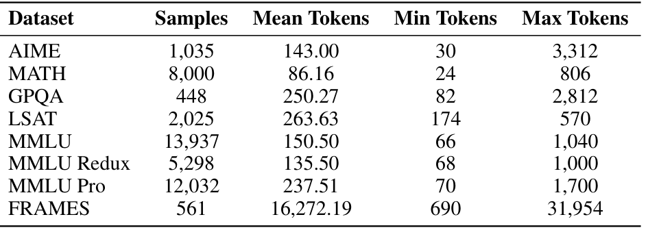

#### Table 5

Table 5: Ablation study on the linear transformation for query difficulty in RADAR. Linear transformation performs similarly to a classic two-layer multilayer perceptron (MLP) model using a ReLU non-linearity on ID queries.

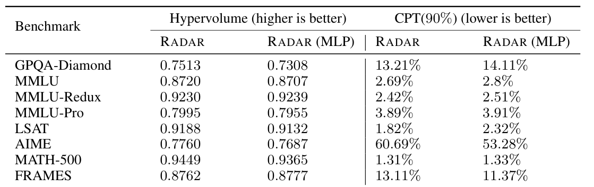

#### Table 6

Table 6: Ablation study on the linear transformation for query difficulty in RADAR. Linear transformation performs similarly to a classic two-layer multilayer perceptron (MLP) model using a ReLU non-linearity on OOD queries.

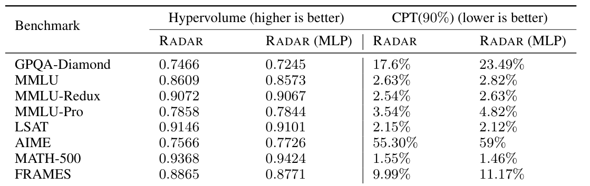

#### Table 7

Table 7: Routing performance on ID queries across benchmarks reported on the CPT (80%) metric (lower is better). CPT (80%) denotes the fraction of the cost of running OpenAI o4-mini with a high reasoning budget to match 80% of its performance. Best performance is in bold and second best is underlined.

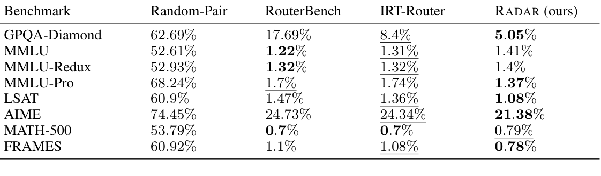

#### Table 8

Table 8: Routing performance on OOD queries across benchmarks reported on the CPT (80%) metric (lower is better). CPT (80%) denotes the fraction of the cost of running OpenAI o4-mini with a high reasoning budget to match 80% of its performance. Best performance is in bold and second best is underlined.

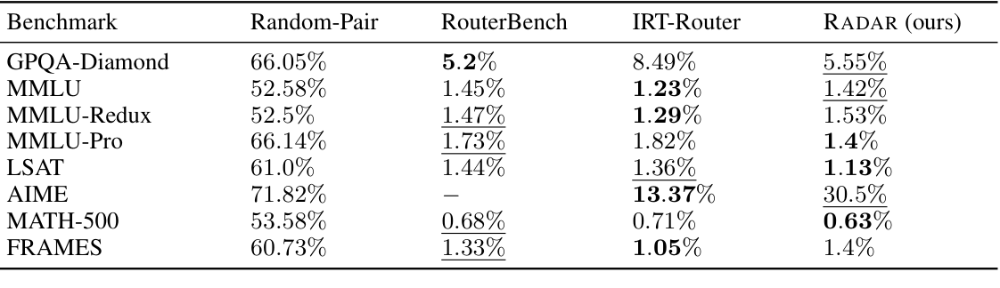

#### Table 9

Table 9: Routing performance on ID queries across benchmarks reported on the CPT (85%) metric (lower is better). CPT (85%) denotes the fraction of the cost of running OpenAI o4-mini with a high reasoning budget to match 85% of its performance. Best performance is in bold and second best is underlined.

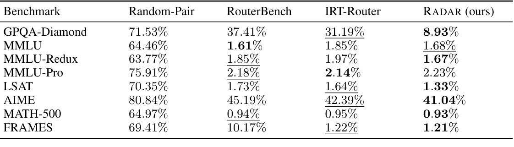

#### Table 10

Table 10: Routing performance on OOD queries across benchmarks reported on the CPT (85%) metric (lower is better). CPT (85%) denotes the fraction of the cost of running OpenAI o4-mini with a high reasoning budget to match 85% of its performance. Best performance is in bold and second best is underlined.

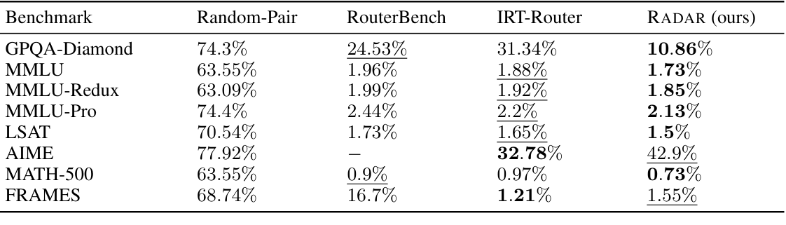

#### Table 11

Table 11: Routing performance on ID queries across benchmarks reported on the CPT (95%) metric (lower is better). CPT (95%) denotes the fraction of the cost of running OpenAI o4-mini with a high reasoning budget to match 95% of its performance. Best performance is in bold and second best is underlined.

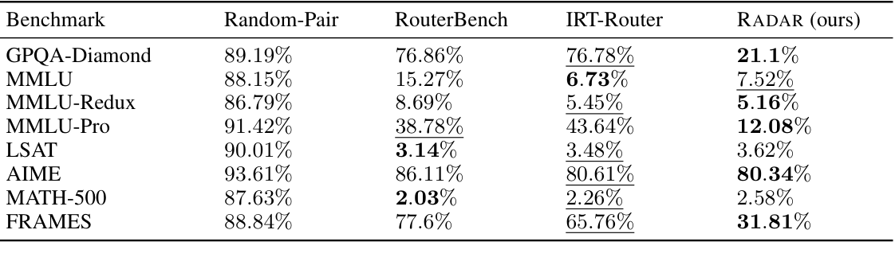

#### Table 12

Table 12: Routing performance on OOD queries across benchmarks reported on the CPT (95%) metric (lower is better). CPT (95%) denotes the fraction of the cost of running OpenAI o4-mini with a high reasoning budget to match 95% of its performance. Best performance is in bold and second best is underlined.

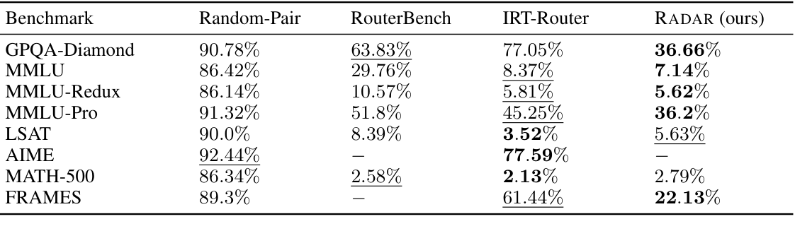

#### Table 13

Table 13: Routing performance on OOD queries across benchmarks reported on the hypervolume metric (higher is better). RADAR outperforms baselines, denoting better performance-cost tradeoffs towards the Pareto front. Best performance is in bold and second best is underlined.

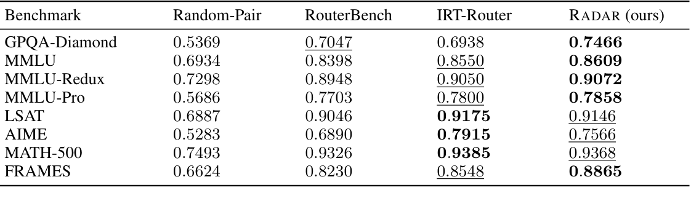

#### Table 14

Table 14: Routing performance on OOD queries across benchmarks reported on the CPT (90%) metric (lower is better). CPT (90%) denotes the fraction of the cost of running OpenAI o4-mini with a high reasoning budget to match 90% of its performance. Best performance is in bold and second best is underlined.

| Benchmark | Random-Pair | RouterBench | IRT-Router | RADAR |
| --- | --- | --- | --- | --- |
| GPQA-Diamond | 82.54% | 44.18% | 54.19% | 17.6% |
| MMLU | 74.53% | 2.94% | 2.61% | 2.63% |
| MMLU-Redux | 74.61% | 2.90% | 2.71% | 2.54% |
| MMLU-Pro | 82.65% | 7.67% | 4.02% | 3.54% |
| LSAT | 80.07% | 2.27% | 1.96% | 2.15% |
| AIME | 84.88% | − | 55.19% | 55.30 |
| MATH-500 | 74.94% | 1.4% | 1.29% | 1.55% |
| FRAMES | 78.61% | 48.52% | 29.49% | 9.99% |

#### Table 15

Table 15: Predicted query difficulty on ID test queries comparing AIME against the remaining benchmarks. IRT difficulty values usually lie in [−3, 3], with higher values indicating greater difficulty.

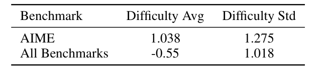

#### Table 16

Table 16: Predicted query difficulty on test queries comparing ID AIME queries to OOD AIME queries. IRT difficulty values usually lie in the range [-3, 3], with higher values indicating greater difficulty.

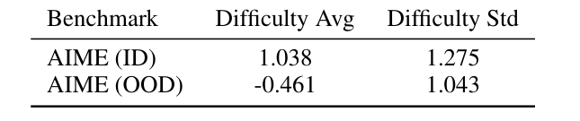

#### Table 17

Table 17: Partial OOD experimental setting showing that a small set of training queries can recover ID performance.

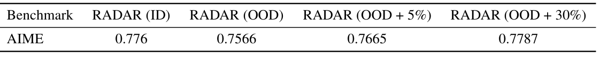

#### Table 18

Table 18: Ablation study showing Chebyshev scalarization outperforms linear scalarization on OOD queries due to its ability to explore both convex and concave points on the Pareto front.

| Benchmark | Hypervolume: LS | Hypervolume: CS | CPT(90%): LS | CPT(90%): CS |
| --- | --- | --- | --- | --- |
| GPQA-Diamond | 0.7280 | 0.7466 | 29.94% | 17.60% |
| MMLU | 0.8580 | 0.8609 | 2.50% | 2.63% |
| MMLU-Redux | 0.9049 | 0.9072 | 2.25% | 2.54% |
| MMLU-Pro | 0.7812 | 0.7858 | 3.81% | 3.54% |
| LSAT | 0.9165 | 0.9146 | 2.00% | 2.15% |
| AIME | 0.7464 | 0.7566 | 56.23% | 55.30% |
| MATH-500 | 0.9331 | 0.9368 | 1.41% | 1.55% |
| FRAMES | 0.8656 | 0.8865 | 21.56% | 9.99% |

#### Table 19

Table 19: Ablation study on the size of the training matrix of RADAR. Using just 20% of subsampled training queries, RADAR achieves a similar performance to using the entire training set.

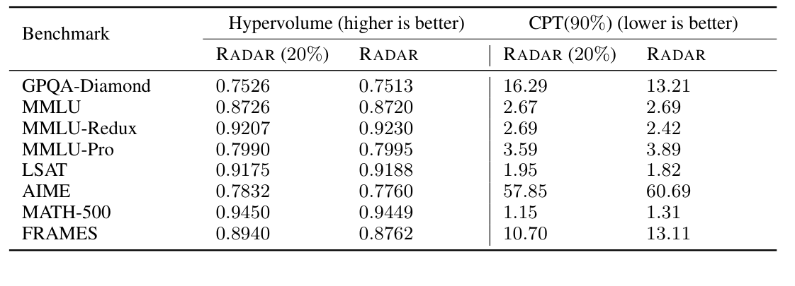

#### Table 20

Table 20: Routing performance on ID queries across benchmarks reported on the hypervolume metric (higher is better), before (RADAR) and after (RADAR++) adding new RLM configurations from Qwen3-14B. Rnd X denotes a set of X items selected with uniform random sampling, while Fshr X denotes a set of X items selected with our method of maximum Fisher information-based adaptive testing.

| Benchmark | RADAR | Rnd 100 | Fshr 100 | Rnd 500 | Fshr 500 | Rnd 5000 | Fshr 5000 |
| --- | --- | --- | --- | --- | --- | --- | --- |
| GPQA-Diamond | 0.7513 | 0.6171 | 0.7511 | 0.7017 | 0.7513 | 0.7535 | 0.7535 |
| MMLU | 0.8609 | 0.8591 | 0.8731 | 0.8682 | 0.8720 | 0.8745 | 0.8731 |
| MMLU-Redux | 0.9072 | 0.8929 | 0.9232 | 0.9168 | 0.9230 | 0.9228 | 0.9238 |
| MMLU-Pro | 0.7858 | 0.7764 | 0.8009 | 0.7941 | 0.7995 | 0.8038 | 0.8021 |
| LSAT | 0.9146 | 0.9270 | 0.9205 | 0.9283 | 0.9188 | 0.9259 | 0.9233 |
| AIME | 0.7760 | 0.6883 | 0.7636 | 0.7311 | 0.7760 | 0.7840 | 0.7828 |
| MATH-500 | 0.9449 | 0.9426 | 0.9456 | 0.9457 | 0.9449 | 0.9478 | 0.9461 |
| FRAMES | 0.8865 | 0.8629 | 0.8763 | 0.8587 | 0.8762 | 0.8897 | 0.8830 |

#### Table 21

Table 21: Routing performance on ID queries across benchmarks reported on the CPT (90%) metric (lower is better), before (RADAR) and after (RADAR++) adding new RLM configurations from Qwen3-14B. Rnd X denotes a set of X items selected with uniform random sampling, while Fshr X denotes a set of X items selected with our method of maximum Fisher information-based adaptive testing. NR denotes not reachable.

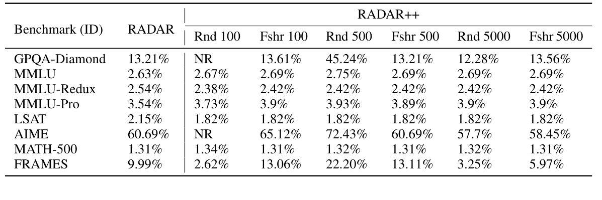

#### Table 22

Table 22: Routing performance on OOD queries across benchmarks reported on the hypervolume metric (higher is better), before (RADAR) and after (RADAR++) adding new RLM configurations from Qwen3-14B. Rnd X denotes a set of X items selected with uniform random sampling, while Fshr X denotes a set of X items selected with our method of maximum Fisher information-based adaptive testing.

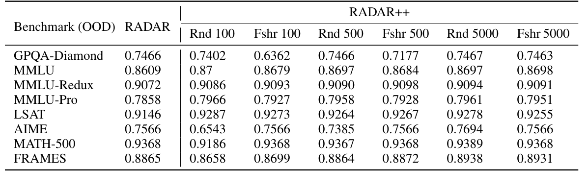

#### Table 23

Table 23: Routing performance on OOD queries across benchmarks reported on the CPT (90%) metric (lower is better), before (RADAR) and after (RADAR++) adding new RLM configurations from Qwen3-14B. Rnd X denotes a set of X items selected with uniform random sampling, while Fshr X denotes a set of X items selected with our method of maximum Fisher information-based adaptive testing. NR denotes not reachable.

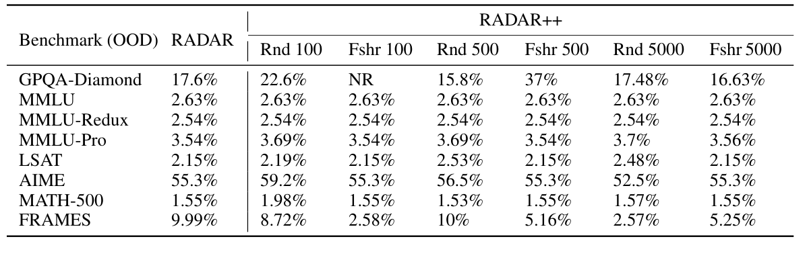

#### Figure 4

Figure 4: Fraction of routing calls on OOD queries from FRAMES spread across RLM configurations when varying the performance-cost tradeoff weight before (left) and after (right) adding new RLM configurations from Qwen3-14B. RADAR rapidly estimates the ability of Qwen3-14B at 16K reasoning budget to leverage it for improved performance.

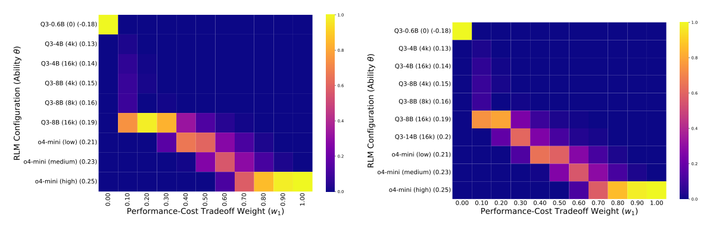

#### Figure 5

Figure 5: Left: Our pilot study on MATH-500 (Hendrycks et al., 2021c) shows a performance differential over (RLM, reasoning budget) configurations with the smallest RLM already solving over 50% of the queries with minimal reasoning. Right: Performance on AIME consistently increases with an increase in model size and reasoning budget.

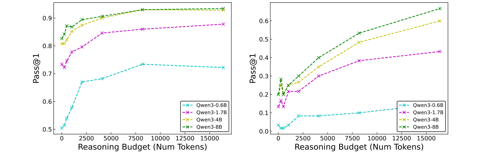

#### Figure 6

Figure 6: We show the Pareto performance-cost tradeoff curves for all methods on ID queries across benchmarks. RADAR outperforms baselines, denoting better performance-cost tradeoffs towards the Pareto front. Solid lines in the figure denote the convex hull corresponding to each curve.

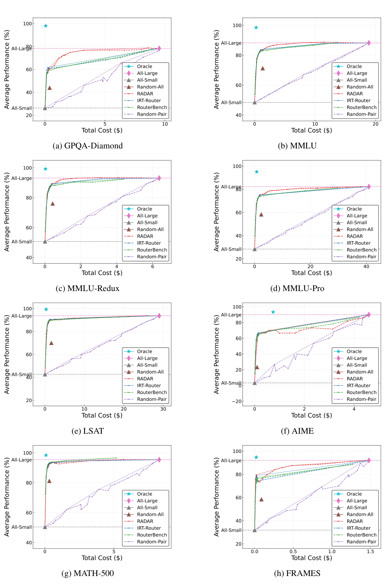

#### Figure 7

Figure 7: We show the Pareto performance-cost tradeoff curves for all methods on OOD queries across benchmarks. RADAR outperforms baselines, denoting better performance-cost tradeoffs towards the Pareto front. Solid lines in the figure denote the convex hull corresponding to each curve.

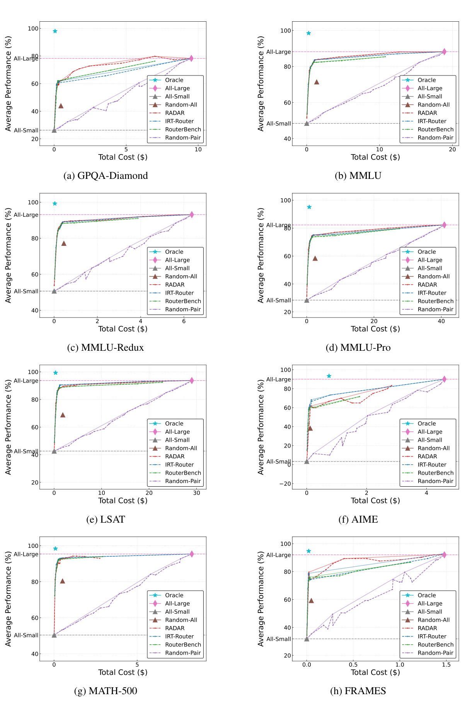