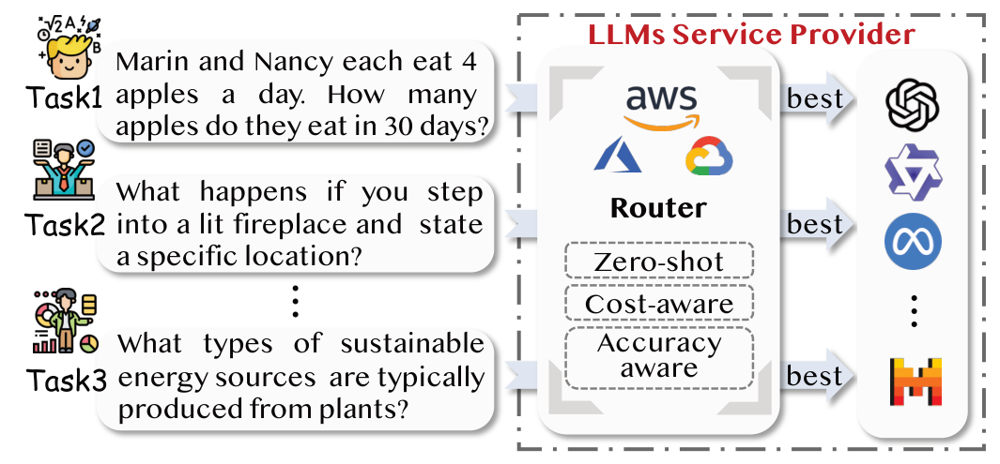
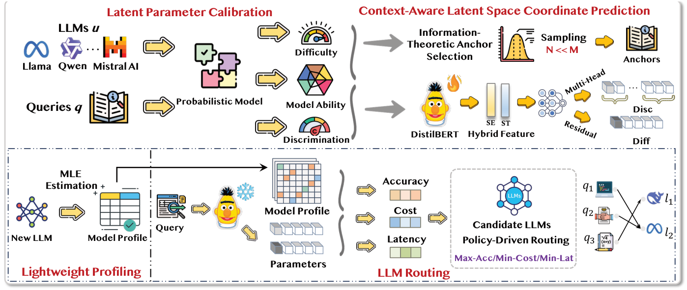
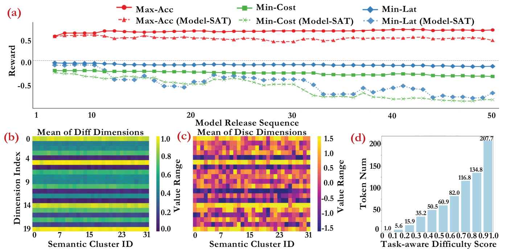

# 打破模型锁定：基于通用潜在空间的成本高效零样本大语言模型路由

本文保留现有 14 页中文译稿的全部正文、公式、图表、参考文献与译稿说明，重新排为可跳转的 Markdown。原译稿未包含附录，本文件亦未新增附录。

Breaking Model Lock-in: Cost-Efficient Zero-Shot LLM Routing via a Universal Latent Space

Cheng Yan$^{1}$，Wuyang Zhang$^{1,*}$，Zhiyuan Ning$^{1}$，Fan Xu$^{1}$，Ziyang Tao$^{1}$，Lu Zhang$^{2}$，Bing Yin$^{3}$，Yanyong Zhang$^{1,2,*}$

1 中国科学技术大学

2 合肥综合性国家科学中心人工智能研究院

3 科大讯飞股份有限公司研究部门

\* 通讯作者

原文：arXiv:2601.06220v1（2026-01-09）

代码：Codeffun3/ZeroRouter

## 摘要

大语言模型（Large Language Models，LLMs）的迅速涌现，导致了一个碎片化且低效的生态系统，形成了一种被称为“模型锁定”（model lock-in）的状态。在这种状态下，如何无缝集成新模型仍然是一个重要瓶颈。现有的路由框架需要进行全面且代价高昂的重新训练，从而阻碍了系统的可扩展性与适应性。本文提出ZeroRouter，一种旨在打破模型锁定的全新LLM 路由范式。我们的方法建立在通用潜在空间（universal latent space）之上。该空间以模型无关的方式表示查询的难度，从根本上将查询特征的刻画与模型能力的画像构建解耦。这使得系统能够在无需全面重新训练的情况下，以零样本方式接入新模型。ZeroRouter 包含一个上下文感知预测器，用于将查询映射到这一通用空间；同时还包含一个双模式优化器，用于平衡准确率、成本和延迟。我们的框架在实验中持续优于所有基线方法，在实现更高准确率的同时，降低了成本和延迟。

关键词：大语言模型路由；模型锁定；通用潜在空间；项目反应理论；零样本接入；成本与延迟优化

图1: 大语言模型路由机制示例。系统智能地将查询路由至服务提供商中最合适的大语言模型，以实现性能与成本的最优平衡。图中包含三个任务示例：两人吃苹果的数量计算、进入燃烧壁炉的情境问题，以及植物来源的可持续能源问题。原图标签包括Zero-shot（零样本）、Cost-aware（成本感知）与Accuracy-aware（准确率感知）。

## 1 引言（Introduction）

大语言模型（LLMs）的发展格局已不再是单一的。尽管超大规模模型能够提供顶尖的性能，但其计算成本使得它们在处理那些本可以由小型模型完成的常规任务时显得效率低下。如果将模型选择交由用户自行决定，这一过程通常是手动且缺乏系统性的，从而导致代价高昂的错误决策：一方面，对于简单查询过度依赖成本高昂、规模过大的模型；另一方面，未能充分利用效率更高的替代模型。因此，这里的核心挑战在于如何实现模型选择过程的自动化，构建能够动态权衡成本、延迟与质量的路由系统。

现有的LLM 路由框架主要采用两种范式，而这两种范式都存在固有的可扩展性限制。直接路由系统（Direct Routing Systems），例如HybridLLM（Ding et al., 2024）和RouteLLM（Ong et al., 2024），采用静态的模型-任务映射或级联工作流。这些方法需要在预先定义的模型集合上，对查询进行全面评估。由于其路由逻辑是针对固定模型集合硬编码的，因此如果不对系统架构进行大规模调整，就无法集成新模型。此外，随着模型池规模的增长，级联工作流会产生二次增长的评估成本。

另一类方法是无需推理的预测框架（Inference-free Predictive Frameworks），例如MixLLM（Wang et al., 2025）。MixLLM 使用上下文多臂老虎机（contextual-bandit）框架，动态平衡质量、成本和延迟，并持续适应用户反馈。然而，当引入新模型时，这些预测器无法捕捉对于泛化至关重要的任务-查询-LLM交互关系。

大多数现有LLM 路由系统的主要局限在于其静态设计。这造成了一种“模型锁定”（model lock-in）的状态，即路由器与一组固定模型绑定在一起。引入新的LLM 通常需要对系统进行全面且代价高昂的改造，包括使用新的偏好数据进行大规模重新训练。这些系统可能无法很好地泛化到分布外查询和新任务，因为它们未能掌握查询的内在属性，而是依赖表层启发式规则。此外，它们的性能往往受到模型置信度校准不准确等不可靠信号的影响，并且在运行时没有考虑模型推理过程的实时动态特征。

本文提出ZeroRouter，这是一个旨在从根本上重新构建LLM 路由机制、摆脱上述限制的框架。我们提出一种以通用的跨任务潜在空间（universal, cross-task latent space）为核心的新范式。这一潜在空间是一个多维映射，能够以模型无关的方式表示任意查询的内在特征。这一核心创新从根本上将查询特征刻画与模型能力画像构建这两项任务解耦。因此，对于新模型，只需使用少量锚点查询（anchor queries），就可以高效地将其性能能力映射到这一通用空间中，实现无缝集成，而无需代价高昂的全面重新训练。

随后，上下文感知预测器将原始文本直接映射到该潜在空间中的一个坐标，从而支持轻量级但高度智能的路由决策。通过将路由问题表述为一个多目标优化问题，ZeroRouter 提供了一种可扩展且具有适应性的解决方案，能够将每个查询分配给最具成本效益的模型。我们的框架在提供更高准确率的同时，持续实现更低的成本和延迟，优于所有基线方法。这一优势在未见过的数据集上尤为显著：ZeroRouter不仅能够达到更高的最大准确率，而且在最小化成本与延迟方面也显著优于所有竞争方法。

## 2 相关工作（Related Work）

### 2.1 大语言模型路由（LLM Routing）

现有的LLM 路由方法（Zhang, Zhan, and Ye, 2025；Wang et al., 2025；Aggarwal et al., 2024；Mohammadshahi, Shaikh, and Yazdani, 2024）在适应性与效率之间面临着关键的权衡。通过训练路由器实现模型选择的系统，例如HybridLLM（Ding et al., 2024）和RouteLLM（Ong et al., 2024），利用监督学习将查询映射到对应模型。然而，它们采用的转导式设计（transductive design）使系统被限制在预先定义的模型集合中。当引入新的LLM 时，必须对整个路由器重新训练。

当前该领域的前沿方向是无需推理的预测框架（inference-free predictive frameworks），例如FORC（Šakota, Peyrard, and West, 2024）。这类框架将性能预测与优化过程解耦。MixLLM（Wang et al., 2025）使用上下文多臂老虎机框架，动态平衡质量、成本和延迟，并持续根据用户反馈进行调整。尽管这些方法取得了显著进展，但它们仍然面临一些瓶颈，例如在接入新模型时必须进行能力画像构建（profiling），或者在处理未见过的查询时需要依赖启发式规则。

### 2.2 大语言模型的高效基准评测（Efficient Benchmarking of LLMs）

先前的研究通过策略性子采样（strategic sub-sampling）来降低LLM 评估成本。MixEval（Ni et al., 2024）选择数据子集来预测整体基准测试得分，而TinyBenchmarks（Polo et al., 2024）和MetaBench（Kipnis et al., 2024）则利用聚类或项目反应理论（Item Response Theory，IRT）（Rodriguez et al., 2021）识别具有诊断价值的测试样本。尽管这些方法能够实现轻量级的模型能力画像构建，但它们优先关注的是数据集层面评价指标的近似估计，无法泛化到未见过的提示（unseen prompts）。

近期的研究工作，例如How2Bench（Cao et al., 2025），为基准测试的开发以及针对细粒度能力构建专门测试集提供了全面的指导。然而，这造成了一个可扩展性悖论：随着基准测试的数量不断增加、评测标准日益严格，验证新模型所需的成本也随之上升，从而进一步强化了全面且缓慢的评估范式。我们的框架通过建立一个与具体模型无关的难度尺度，打破了这一循环，使得新模型可以在无需执行代价高昂且规模不断扩大的基准测试的情况下，完成轻量级能力画像构建。

## 3 方法（Methodology）

我们的框架通过在查询的内在属性与其性能表现之间建立上下文感知的联系，开创了一种零样本路由范式。与需要进行全面评估或完整重新训练的先前研究不同，ZeroRouter 通过以下三项关键创新，实现了可扩展的模型集成：

1. 一个通过信息论选择策略进行校准的通用跨任务潜在空间，用于将提示特征与模型能力解耦；

2. 一个上下文感知的潜在空间预测器，用于将查询的文本属性直接映射为其潜在参数；

3. 一个统一的策略驱动路由引擎，用于将用户在准确率、成本和延迟方面的高层次优先级转化为最优查询分配方案。

图2 展示了整个框架的总体结构。

图2: ZeroRouter 框架概览。三个核心模块包括：（1）潜在参数校准（Latent Parameter Calibration）：利用基于信息论的锚点选择建立通用潜在空间；（2）轻量级能力画像构建（Lightweight Profiling）：将新的LLM 高效映射到该空间；（3）策略驱动路由（Policy-Driven Routing）：预测查询的潜在坐标，并根据用户指定的准确率、成本和延迟约束将查询分配给最优模型。图中还显示上下文感知潜在空间坐标预测模块。

### 3.1 用于轻量级能力画像构建的通用潜在空间（Universal Latent Space for Lightweight Profiling）

该模块通过将提示的内在潜在参数（例如区分度和难度，这些参数与模型无关）与模型特定的能力画像分离，为新的LLM 提供轻量级的准确率、成本和延迟画像。这种分离使新模型的能力画像构建能够以极高的效率完成，仅需要在一小组锚点提示（anchor prompts）上的性能数据，就可以准确估计新模型的能力。

#### 3.1.1 模型推理准确率估计（Model Inference Accuracy Estimation）

**跨任务区分度与难度校准（Cross-Task Discrimination and Difficulty Calibration）。**为了建立统一的区分度与难度尺度，我们首先使用一种概率模型来刻画模型$u$与提示$i$之间的交互关系，例如多维双参数逻辑斯蒂克项目反应理论模型（multidimensional 2-Parameter Logistic IRT model，2PL IRT）（Rodriguez et al., 2021）。正确回答事件$X_{ui}$= 1 的概率定义为：

$$
P(X_{ui}=1\mid\theta_u,\alpha_i,\mathbf b_i)=\frac{1}{1+e^{-\alpha_i^{\top}(\theta_u-\mathbf b_i)}}.\tag{1}
$$

其中，$\theta_u$是模型的能力向量（ability vector），而$\alpha_i$和$\mathbf b_i$分别是提示的区分度向量（discrimination vector）和难度向量（difficulty vector）。所有这些向量均位于一个$D$维潜在空间中，即属于$\mathbb R^D$。我们为这些潜在变量定义了一个层次贝叶斯模型（hierarchical Bayesian model），其中包括$\theta_u\sim\mathcal{N}(\mu_\theta,u_\theta^{-1})$ 等先验分布。随后，通过随机变分推断（Stochastic Variational Inference，SVI）最大化证据下界（Evidence Lower Bound，ELBO），从而高效地进行后验推断。这里的关键创新在于，通过跨任务校准建立一个通用尺度，使得我们能够从中推导出一个最小化的锚点集合，用于高效评估新模型。

**基于信息论的锚点选择（Information-Theoretic Anchor Selection）。**为了选择一个规模最小但信息量很高的锚点集合$\mathcal A$⊂$\mathcal P$，其大小为$N$≪|$\mathcal P$|，并利用该集合有效估计模型能力，我们将这一任务形式化为一个最优实验设计（optimal experimental design）问题。目标是最小化模型能力参数$\theta_u$估计结果的不确定性。为此，我们采用D-最优性（D-optimality）原则，该原则旨在最大化Fisher 信息矩阵（Fisher Information Matrix）的行列式：

$$
\mathcal I_{\mathcal A}(\theta_u)=\sum_{i\in\mathcal A}P(X_{ui}=1)\bigl(1-P(X_{ui}=1)\bigr)\alpha_i\alpha_i^{\top}.\tag{2}
$$

由于公式（2）中的概率项依赖于未知的模型能力$\theta_u$，因此我们对目标函数进行简化，使其仅依赖于提示的区分度向量$\alpha_i$。这些区分度向量能够捕捉每个提示与模型无关的信息量。因此，目标转化为最大化累积区分度矩阵的对数行列式：

$$
\mathcal A^*=\underset{\mathcal A\subset\mathcal P,\ |\mathcal A|=N}{\arg\max}\ \log\det\!\left(\sum_{i\in\mathcal A}\alpha_i\alpha_i^{\top}\right).\tag{3}
$$

为了避免直接求解这一NP-hard 优化问题，我们使用贪心前向选择算法（greedy forward selection algorithm）来构建集合$\mathcal A$。算法从一个空集合$\mathcal A_0$ = ∅和一个用于保证数值稳定性的正则化矩阵$\mathcal I_0$ = $\epsilon I$开始。随后，在每一次迭代中，算法选择能够带来最大增益的提示$i_k^*$，并将其加入集合：

$$
i_k^*=\underset{i\in\mathcal P\setminus\mathcal A_{k-1}}{\arg\max}\ \log\det\!\left(\mathcal I_{k-1}+\alpha_i\alpha_i^{\top}\right).\tag{4}
$$

重复这一过程，直到|$\mathcal A_k$| = $N$。最终得到的锚点集合规模紧凑且具有很高的信息量，为成本高效的模型能力画像构建提供了坚实基础。

**新模型的轻量级能力画像构建（Lightweight Profiling for New Models）。**在通过信息论方法建立锚点集合$\mathcal A$后，我们可以通过最小化二元交叉熵损失（Binary Cross-Entropy，BCE），高效估计新模型的能力向量$\theta_{u_{\mathrm{new}}}$：

$$
\hat\theta_{u_{\mathrm{new}}}=\underset{\theta_{u_{\mathrm{new}}}}{\arg\min}\ \sum_{k\in\mathcal A}\operatorname{BCE}(y_k,P_k).\tag{5}
$$

其中，$y_k$∈[0, 1] 是锚点$k$∈$\mathcal A$的真实得分（ground-truth score），而$P_k$是使用新模型的能力参数$\theta_{u_{\mathrm{new}}}$，通过公式（1）预测得到的正确回答概率。其中，二元交叉熵定义为$\operatorname{BCE}(y,p)=-[y\ln(p)+(1-y)\ln(1-p)]$。

#### 3.1.2 模型推理成本估计（Model Inference Cost Estimation）

准确的成本估计是实现有效路由的先决条件。对于基于API 的LLM 服务，将查询$q$路由到模型$u$所产生的总推理成本，是其输入和输出token 长度的函数：

$$
C_{uq}=\lambda_u^{\mathrm{in}}\ell_{uq}^{\mathrm{in}}+\lambda_u^{\mathrm{out}}\ell_{uq}^{\mathrm{out}}.\tag{6}
$$

其中，$\lambda_u^{\mathrm{in}}$和$\lambda_u^{\mathrm{out}}$分别表示模型$u$的API 输入token 单价和输出token 单价；$\ell_{uq}^{\mathrm{in}}$和$\ell_{uq}^{\mathrm{out}}$分别表示输入与输出token 的长度。

**输入Token 长度估计（Input Token Estimation）。**输入token 长度$\ell^{\mathrm{in}}$ 的估计是确定性的。给定查询$q$和模型$u$，我们使用该模型专属的分词器$T_u(\cdot)$，获得准确的token 数量：

$$
\ell_{uq}^{\mathrm{in}}=|T_u(q)|.\tag{7}
$$

**输出Token 长度估计（Output Token Estimation）。**与确定性的输入长度不同，输出token 长度$\ell_{uq}^{\mathrm{out}}$的估计并非易事，因为它既取决于查询的复杂程度，也取决于特定模型生成回答时的冗长度。我们提出了一种新的估计方法，直接利用所构建的通用潜在空间，从而无需为这一任务构建复杂的、针对每个模型的独立回归预测头。首先，我们根据预测得到的IRT 潜在参数向量，定义任务感知难度（task-aware difficulty）$s_q$：

$$
s_q=\alpha_q^{\top}\mathbf b_q.\tag{8}
$$

在一次性的校准阶段，我们使用规模较小的锚点集合$\mathcal A$，将锚点样本中观测到的连续复杂度得分范围离散化为$K$个区间，$\mathcal B$= {$B_1$, … , $B_K$}。对于每个候选模型$u$∈$\mathcal M$和复杂度区间$B_k$，我们对复杂度得分落入该区间的锚点样本的真实输出长度取平均值，预先计算并存储平均输出token 长度$\bar\ell_{uk}^{\mathrm{out}}$：

$$
\bar\ell_{uk}^{\mathrm{out}}=\mathbb E_{q\in\mathcal A\mid s_q\in B_k}\left[\left|T_u\bigl(\operatorname{response}(q,u)\bigr)\right|\right].\tag{9}
$$

这一过程生成了一张轻量级查找表，将（模型，复杂度区间）二元组映射到预期输出长度，从而高效地构建每个模型在不同复杂度等级下的回答长度画像。

对于一个未见过的查询$q^\prime$，估计过程非常高效。首先，我们使用上下文感知预测器预测其潜在向量( $\hat\alpha_{q^\prime}$, $\hat{\mathbf b}_{q^\prime}$)。随后，计算其估计复杂度得分$\hat{s}_{q^\prime}=\hat{\alpha}_{q^\prime}^{\top}\hat{\mathbf b}_{q^\prime}$，确定满足$\hat s_{q^\prime}$ ∈$B_k$的对应区间$B_k$，然后直接查找目标模型$u$预先校准得到的平均输出长度：

$$
\hat\ell_{uq^\prime}^{\mathrm{out}}=\bar\ell_{uk}^{\mathrm{out}}.\tag{10}
$$

这种将潜在参数与模型执行过程解耦的方法支持零样本泛化，使得对任意新查询的输出长度估计都可以简化为一次无需执行模型推理的查表操作。

#### 3.1.3 模型推理延迟估计（Model Inference Latency Estimation）

我们通过两个预先校准的参数来对每个模型$u$的延迟进行建模：其首token 时间（Time to First Token，TTFT）$\tau_u^{\mathrm{TTFT}}$用于刻画初始处理开销；每个输出token 的生成时间（Time per Output Token，TPOT）$\tau_u^{\mathrm{TPOT}}$用于反映模型的生成速度。对于每个模型，这两个参数都可以利用锚点集合$\mathcal A$进行高效估计。对于查询$q$，其最终延迟预测值为：

$$
\hat\tau_{uq}=\tau_u^{\mathrm{TTFT}}+\hat\ell_{uq}^{\mathrm{out}}\cdot\tau_u^{\mathrm{TPOT}}.\tag{11}
$$

这一方法以LLM 推理的基本运行机制为基础，实现了高效的延迟估计。

### 3.2 上下文感知的潜在空间坐标预测（Context-Aware Latent Space Coordinate Prediction）

为了支持路由系统有效泛化到分布外（Out-of-Distribution，OOD）查询，我们引入一个轻量级统一预测器，将查询的内在文本属性与其多维IRT 参数向量联系起来，这些参数向量包括区分度向量$\alpha$∈$\mathbb R^D$和难度向量b ∈$\mathbb R^D$。

#### 3.2.1 混合特征表示（Hybrid Feature Representation）

我们的方法假设，查询的潜在参数同时来源于其语义深度（semantic depth）和结构复杂度（structural complexity）。我们将给定查询$q$编码为以下两个特征向量。

**语义嵌入（Semantic Embedding，$\mathbf e_{\mathrm{se}}$）。**我们使用经过微调的DistilBERT 模型提取[CLS] token 的最终隐藏状态，以捕捉查询的上下文语义信息。

$$
\mathbf e_{\mathrm{se}}=\operatorname{DistilBERT}(q)_{[\mathrm{CLS}]}\in\mathbb R^{d_{\mathrm{sem}}}.\tag{12}
$$

**结构特征（Structural Features，$\mathbf e_{\mathrm{st}}$）。**我们使用特征提取函数$\Phi(\cdot)$ 来量化查询的表层复杂度。该函数计算$k$= 11 个语言学指标，例如可读性得分（readability scores）和句法分析树深度（parse tree depth）。这些混合特征的选择由它们与目标IRT 参数之间的相关性分析指导，以确保它们能够提供与预测任务相关的有效信号。

$$
\mathbf e_{\mathrm{st}}=\Phi(q)\in\mathbb R^k.\tag{13}
$$

#### 3.2.2 统一预测模型（Unified Prediction Model）

为了根据上述特征同时预测$\alpha$和b，我们设计了一个多任务学习模型。该模型包含一个共享骨干网络（shared backbone），用于学习查询的高层次表示，随后连接两个相互独立的预测头。

**共享骨干网络（Shared Backbone）。**骨干网络首先通过专用的线性层，将每个特征向量投影到更高维的空间。随后，模型利用一个深层非线性主干网络$f_{\mathrm{fuse}}$ 融合这些特征，以实现稳健的特征学习。这一过程产生共享的潜在表示：

$$
\mathbf h_{\mathrm{shared}}=f_{\mathrm{fuse}}\!\left([\mathbf W_{\mathrm{se}}\mathbf e_{\mathrm{se}}+\mathbf e_{\mathrm{se}}\ ;\ \mathbf W_{\mathrm{st}}\mathbf e_{\mathrm{st}}+\mathbf b_{\mathrm{st}}]\right).\tag{14}
$$

其中，($\mathbf W_k$, $\mathbf b_k$) 是可训练参数，$k$∈{se, st}。[^1]

**难度预测头（Difficulty Head：Residual Prediction）。**在高维空间中预测难度向量b 的绝对位置是一项具有挑战性的任务。然而，我们观察到，查询的难度向量通常只是相对于一个数据驱动均值$\bar{\mathbf b}$ 的微小偏移，其中$\bar{\mathbf b}$ 是根据训练数据集计算得到的均值。因此，我们重新表述该任务，使模型只需要预测这一残差向量（residual vector），从而显著简化学习问题。最终预测得到的难度向量$\hat{\mathbf b}_q$构造如下：

[^1]: 公式（14）中的第一分支，原论文写作$\mathbf W_{\mathrm{se}}\mathbf e_{\mathrm{se}}+\mathbf e_{\mathrm{se}}$，并非通常可能预期的偏置项写法。本译稿严格按原文保留，未作推测性修正。

$$
\hat{\mathbf b}_q=\bar{\mathbf b}+\Delta\mathbf b_q=\bar{\mathbf b}+f_{\mathrm{diff}}(\mathbf h_{\mathrm{shared}}).\tag{15}
$$

其中，$f_{\mathrm{diff}}$ 是难度预测头，由一个多层感知机（Multi-Layer Perceptron，MLP）实现。该预测头以共享潜在表示$\mathbf h_{\mathrm{shared}}$ 作为输入，预测残差向量$\Delta\mathbf b_q$。

**区分度预测头（Discrimination Head：Multi-Head Experts）。**区分度向量$\alpha$的各个维度通常对应于相关的任务类型或特定技能。单一的整体预测头（monolithic prediction head）难以捕捉这些维度之间细微而复杂的关系。因此，我们基于维度之间的相关性分析，将$D$个维度划分为$C$个不同的簇（clusters）。对于每个簇，我们设置一个专用的专家预测头（expert head），该预测头专门负责预测分配给它的维度子集。随后，通过拼接各个专家预测头的输出，构造最终的区分度向量$\hat\alpha_q$：

$$
\hat\alpha_q=\bigoplus_{c=1}^{C}\hat\alpha_{q,c}=\bigoplus_{c=1}^{C}f_{\mathrm{disc},c}(\mathbf h_{\mathrm{shared}}).\tag{16}
$$

其中，$\bigoplus$表示对各专家预测头输出的向量进行拼接和重新排序。每个专家预测头$f_{\mathrm{disc},c}$都是一个专用的多层感知机（MLP），负责将共享表示$\mathbf h_{\mathrm{shared}}$ 映射到其对应的区分度子向量$\hat\alpha_{q,c}$。通过估计这些潜在向量，我们能够预测某个模型在未见过的查询上的表现。这正是我们实现零样本路由能力的关键所在。

### 3.3 大语言模型路由策略（LLM Routing Strategies）

有效的LLM 路由需要处理准确率、成本和延迟之间复杂的多维权衡。为了解决这一问题，ZeroRouter引入一个统一的优化框架，使开发者能够在同一个系统中灵活地表达其优先考虑的目标。

#### 3.3.1 多目标优化（Multi-Objective Optimization）

我们将路由任务形式化为一个整数线性规划（Integer Linear Programming，ILP）问题。该问题通过最大化加权效用函数，将准确率、成本和延迟这三个相互竞争的目标统一起来。对于查询集合$\mathcal Q$和模型池$\mathcal M$，我们为每个查询-模型对($u$, $q$) 定义预测准确率$p_{uq}$、估计成本$C_{uq}$和估计延迟$\tau_{uq}$。我们的目标是确定最优的模型分配方案，并使用二元变量$x_{uq}$∈{0, 1} 表示分配决策。这一分配过程由用户指定的三个权重($w_p$, $w_c$, $w_t$) 控制，这三个权重之和为1。目标函数表述为：

$$
\underset{x}{\operatorname{maximize}}\quad\sum_{u\in\mathcal M}\sum_{q\in\mathcal Q}\left(w_pp_{uq}-w_cC_{uq}-w_t\tau_{uq}\right)x_{uq}.\tag{17}
$$

该优化问题受到一个基本约束条件的限制，即每个查询必须且只能分配给一个模型。此外，还可以根据需要施加关于总成本、总延迟和平均准确率的一组可选全局约束：

$$
\begin{aligned}\text{subject to}\quad&\sum_{u\in\mathcal M}x_{uq}=1,&&\forall q\in\mathcal Q,\\&\sum_{u\in\mathcal M}\sum_{q\in\mathcal Q}r_{uq}x_{uq}\leq R_{\max},&&r\in\{C,\tau\},\\&\sum_{u\in\mathcal M}\sum_{q\in\mathcal Q}p_{uq}x_{uq}\geq|\mathcal Q|p_{\min}.\end{aligned}\tag{18}
$$

#### 3.3.2 策略驱动路由（Policy-Driven Routing）

这一统一表述具有很强的表达能力。通过调整权重($w_p$, $w_c$, $w_t$)，开发者可以在不改变底层系统架构的情况下，定义广泛的路由行为：

1. 准确率优先（Accuracy-First，$w_p$→1）：对于关键应用，最大化准确率是首要目标。

2. 成本优先（Cost-First，$w_c$→1）：对于受到预算约束的服务，路由器优先选择成本最低的模型。

3. 延迟优先（Latency-First，$w_t$→1）：对于交互式应用，最小化响应时间至关重要。

4. 平衡策略（Balanced Strategy）：我们的评估采用一组混合权重，例如$w_p$= 0.5、$w_c$= 0.3、$w_t$= 0.2，以找到一种平衡的情况。

## 4 实验（Experiments）

### 4.1 实验设置与实现细节（Setup and Implementation Details）

**数据集（Datasets）。**我们使用九个数据集对ZeroRouter 进行评估。这些数据集分为两组：六个分布内（In-Distribution，ID）数据集，用于衡量模型在熟悉任务上的表现；三个分布外（Out-of-Distribution，OOD）数据集，它们在训练过程中未曾出现，用于检验模型的零样本泛化能力。

六个分布内（ID）基准测试：（1）IFEval（Zhou et al., 2023）：用于评估模型遵循指令的准确程度；（2）BBH（Big-Bench Hard）（Suzgun et al., 2022）：用于评估需要多步推理的任务；（3）MATH（Hendrycks et al., 2021）：用于评估高级数学问题求解能力；（4）GPQA（Graduate-Level Google-Proof Q&A）（Rein et al., 2024）：用于评估高难度问题；（5）MuSR（Multi-Step Reasoning）（Yao et al., 2025）：重点评估顺序推理能力；（6）MMLU-PRO（Wang et al., 2024）：MMLU 的一个经过程序化验证的版本。

三个分布外（OOD）基准测试：（1）ARC-C（AI2 Reasoning Challenge）（Clark et al., 2018）：一个科学问题集合；（2）TruthfulQA（Lin, Hilton, and Evans, 2021）：用于衡量模型避免生成虚假内容的倾向；（3）HumanEval（Li and Murr, 2024）：用于评估代码生成能力。

**候选大语言模型（LLM Candidates）。**我们构建了一个经过精心筛选的模型池，其中包含60 个大语言模型（LLMs），并有策略地将其划分为两个集合。第一个集合是由10 个模型组成的核心集合，其参数规模覆盖从紧凑的1B 到庞大的235B。我们使用该集合，在多样化且具有挑战性的环境中测试路由性能。这10 个模型分别为：Qwen3-235B-A22B、DeepSeek-R1-Distill-Llama-70B、Mixtral-8x7B-Instruct-v0.1（Jiang et al., 2024）、Qwen3-32B、gemma-3-27b-it、phi-4、Llama-3.1-8B-Instruct、DeepSeek-R1-0528-Qwen3-8B、gemma-3n-E4B-it、gemma-3-1b-it。第二个集合包含另外50 个不同的LLM，这些模型均在路由器训练数据截止时间之后发布。我们使用这一集合，直接验证本文关于打破模型锁定的核心主张。

**基线方法（Baselines）。**我们将所提出的框架与近期四项具有代表性的研究工作进行比较：（1）CIT-LLM-Routing（Zhang, Zhan, and Ye, 2025），提出一种新的能力指令微调（capability instruction tuning）范式，通过基于模型能力测试的指令微调来预测模型性能。（2）RouteLLM（Ong et al., 2024），采用二元路由策略，利用人类偏好数据，将查询分配给“强”模型或“弱”模型。（3）GraphRouter（Feng, Shen, and You, 2024），构建异构图，显式建模任务、查询和LLM 之间的交互关系，将路由问题重新表述为边预测问题（edge prediction problem）。（4）FORC（Šakota, Peyrard, and West, 2024），采用两阶段路由方式，首先利用一个预训练的元模型（meta-model）预测每个LLM 对查询的回答准确率，然后根据这些预测结果选择最合适的模型。

**评价指标（Evaluation Metrics）。**为了全面评估各个路由器在不同目标之间的权衡表现，我们在测试查询集合$\mathcal Q_{\mathrm{test}}$ 上定义统一的总奖励（total reward）：

$$
\operatorname{Reward}=\sum_{q\in\mathcal Q_{\mathrm{test}}}\left(w_pp_{u^*q}-w_cC_{u^*q}-w_t\tau_{u^*q}\right).\tag{19}
$$

其中，$u^*$表示路由器为查询$q$选择的模型。$p_{uq}$、$C_{uq}$和$\tau_{uq}$分别表示前文为查询-模型对定义的准确率、成本和延迟。具体而言，准确率通过与真实标注（ground truth）进行比较来评估（更多细节参见原论文提及的附录）；成本按照公式（6）计算；延迟则采用端到端推理时间。

我们的评估考虑三种策略驱动的场景，每种场景分别对应一组权重($w_p$, $w_c$, $w_t$)：准确率优先（Accuracy-First，Max-Acc）为(0.8, 0.1, 0.1)，成本优先（Cost-First，Min-Cost）为(0.1, 0.8, 0.1)，延迟优先（Latency-First，Min-Lat）为(0.1, 0.1, 0.8)。

**实现细节（Implementation Details）。**我们使用py-irt 库（Natesan et al., 2016）实现多维2PL IRT 模型。所使用的数据为分布内（ID）数据集上的评估数据，这些数据汇总自Open LLM Leaderboard（Beeching et al., 2023）上的200 个模型。我们将潜在空间维度设置为$D$= 20，使用Adam 优化器训练6,000 个epoch，初始学习率为0.1，并且每经过100 个epoch，学习率便按0.99 的系数进行指数衰减。对于潜在参数预测器，我们采用一个DistilBERT-base-uncased 模型（66M 参数）。该模型微调40 个epoch，批大小为32，恒定学习率为$3\times10^{-5}$。整个训练过程在一张NVIDIA A800 GPU（80GB）上完成。

### 4.2 分布内数据上的性能（Performance on In-Distribution Data）

我们在分布内数据上的评估结果（表1）表明，ZeroRouter 从根本上重新定义了成本与性能之间的前沿边界。无论是在较小规模模型（低于20B 参数）还是较大规模模型（25B–250B 参数）上，我们的框架都持续优于所有基线方法。这种优势并非仅体现在某一个优化目标上，而是同时体现在所有目标上。例如，对于较小规模的模型，ZeroRouter 的最大准确率得分达到0.45，高于最强基线方法。与此同时，它还在最小成本和最小延迟两个目标上分别取得最佳得分−0.32 和−0.27。这一全面领先的表现同样延续到了大规模模型中。这不仅仅是一种简单的权衡关系。ZeroRouter 能够持续在更低成本和更低延迟下实现更高准确率，表明我们的路由解决方案能够适应各种不同的应用场景，并具有良好的有效性。

### 4.3 在OOD 数据集上的零样本泛化（Zero-Shot Generalization on OOD Datasets）

该框架真正的优势体现在其对分布外（OOD）数据集的零样本泛化能力上。这是检验其能否在完全未见过的任务上有效运行的一项关键测试（表1）。在这些具有挑战性的场景中，ZeroRouter 的性能优势变得更加显著。无论是在较小规模还是较大规模的模型上，ZeroRouter 不仅取得最高的Max-Acc 得分，例如对于大规模模型，其得分达到0.68，而最强基线仅为0.62；同时，它还在Min-Cost 和Min-Lat 两个指标上显著优于所有竞争方法，分别达到−0.17 和−0.25。这种持续的成功表明，我们的路由逻辑避免了学习表层的、针对特定任务的启发式规则这一陷阱。相反，通过对查询内在属性进行建模，ZeroRouter能够在新领域中做出具有可靠依据的决策，体现了该方法的有效性和稳健的泛化能力。

表1: 分布内（ID）和分布外（OOD）数据集上的路由性能比较。ZeroRouter 在较小规模和较大规模模型上，以及所有路由策略下，均持续优于基线方法。† 表示通过Wilcoxon 符号秩检验，ZeroRouter 相对于对应基线方法的性能提升具有统计显著性（$p$< 0.05）。表中数值及显著性符号均按原论文Table 1 保留。

| 组别 | 方法（Method） | 参数量 | 分布内 Max-Acc | 分布内 Min-Cost | 分布内 Min-Lat | 分布外 Max-Acc | 分布外 Min-Cost | 分布外 Min-Lat | Mean |
| --- | --- | --- | ---: | ---: | ---: | ---: | ---: | ---: | ---: |
| 较小规模LLM（< 20B） | Gemma-3 | 1B | 0.15 | -0.38 | -0.30 | 0.44 | -0.28 | -0.24 | -0.10 |
| 较小规模LLM（< 20B） | Gemma-3n-E4B | 7.8B | 0.25 | -0.36 | -0.41 | 0.47 | -0.25 | -0.41 | -0.12 |
| 较小规模LLM（< 20B） | DeepSeek-R1-0528-Qwen3 | 8B | 0.33 | -0.58 | -0.71 | 0.58 | -0.56 | -0.71 | -0.28 |
| 较小规模LLM（< 20B） | Llama-3.1 Instruct | 8B | 0.29 | -0.54 | -0.65 | 0.59 | -0.45 | -0.66 | -0.24 |
| 较小规模LLM（< 20B） | Phi-4 | 14.7B | 0.41 | -0.82 | -0.71 | 0.55 | -0.83 | -0.78 | -0.36 |
| 较小规模模型池上的LLM 选择（5 个模型） | Random Selection | – | 0.29† | −0.54† | −0.55† | 0.52† | −0.51† | −0.55† | -0.22 |
| 较小规模模型池上的LLM 选择（5 个模型） | RouteLLM | – | 0.30† | −0.47† | −0.53† | 0.51† | −0.54† | −0.48† | -0.20 |
| 较小规模模型池上的LLM 选择（5 个模型） | FORC | – | 0.35† | −0.36† | −0.54† | 0.50† | −0.57† | −0.54† | -0.19 |
| 较小规模模型池上的LLM 选择（5 个模型） | GraphRouter | – | 0.38† | −0.40† | −0.56† | 0.53† | −0.28† | −0.50† | -0.14 |
| 较小规模模型池上的LLM 选择（5 个模型） | Model-SAT | – | 0.43 | −0.61† | −0.64† | 0.57 | −0.59† | −0.64† | -0.25 |
| 较小规模模型池上的LLM 选择（5 个模型） | ZeroRouter（Ours） | – | 0.45 | -0.32 | -0.27 | 0.59 | -0.24 | -0.23 | 0.00 |
| 较大规模LLM（25B–250B） | Gemma-3 | 27B | 0.36 | -0.31 | -0.37 | 0.43 | -0.54 | -0.40 | -0.14 |
| 较大规模LLM（25B–250B） | Qwen3 | 32B | 0.49 | -0.33 | -0.30 | 0.63 | -0.32 | -0.29 | -0.02 |
| 较大规模LLM（25B–250B） | Mixtral-8x7B Instruct | 56B | 0.32 | -0.30 | -0.36 | 0.67 | -0.42 | -0.38 | -0.08 |
| 较大规模LLM（25B–250B） | DeepSeek-R1-Distill-Llama | 70B | 0.38 | -0.55 | -0.35 | 0.58 | -0.68 | -0.52 | -0.19 |
| 较大规模LLM（25B–250B） | Qwen3-235B-A22B Instruct-v0.1 | 235B | 0.47 | -0.81 | -0.83 | 0.64 | -0.75 | -0.59 | -0.31 |
| 较大规模模型池上的LLM 选择（5 个模型） | Random Selection | – | 0.39† | −0.44† | −0.45† | 0.59† | −0.46† | −0.44† | -0.14 |
| 较大规模模型池上的LLM 选择（5 个模型） | RouteLLM | – | 0.46† | −0.45† | −0.58† | 0.56† | −0.47† | −0.42† | -0.15 |
| 较大规模模型池上的LLM 选择（5 个模型） | FORC | – | 0.49† | −0.38† | −0.55† | 0.58† | −0.51† | −0.43† | -0.13 |
| 较大规模模型池上的LLM 选择（5 个模型） | GraphRouter | – | 0.50 | −0.27† | −0.62† | 0.61† | −0.37† | −0.27† | -0.07 |
| 较大规模模型池上的LLM 选择（5 个模型） | Model-SAT | – | 0.49 | −0.61† | −0.57† | 0.62† | −0.58† | −0.46† | -0.19 |
| 较大规模模型池上的LLM 选择（5 个模型） | ZeroRouter（Ours） | – | 0.52 | -0.22 | -0.28 | 0.68 | -0.17 | -0.25 | 0.05 |

### 4.4 新模型的无缝集成（Seamless Integration of New Models）

**使用极少数据高效接入新模型（Efficient Onboarding with Minimal Data）。**为了验证我们的框架能够以最小的开销集成一个新模型，我们仅使用200 个查询（占训练阶段可见数据的1%）这一极小预算来构建新模型的能力画像。实验结果（表2）表明，ZeroRouter 在所有路由策略下均明显优于全部基线方法。采用其核心的D-最优性（D-optimality）采样方法时，ZeroRouter 获得了更高的Max-Acc 得分0.39，超过了基线方法中的最佳得分0.38（由Model-SAT 取得）。同时，它在Min-Cost 和Min-Lat 两个指标上也获得了最佳得分，分别为−0.34 和−0.37（原文在两处均使用了“from GraphRouter”这一表述）。内部消融实验进一步凸显了我们提出的信息论方法的优势。结果表明，与随机采样等较为简单的策略相比，D-最优性方法表现出显著优势，将Max-Acc 得分从0.27 提升至0.39。

**真实世界动态演化模型池中的稳健性（Robustness in Real-world Evolving Model Pool）。**我们进一步在一个模拟模型快速迭代的真实世界场景中验证了框架的有效性。我们维护一个固定规模的模型池（$N$= 6），其中新发布的模型会依次替换表现较差的旧模型。如图3(a) 所示，系统能够智能地利用这些能力更强的新模型，使得在最大准确率（Max-Accuracy）策略下，系统性能逐渐提高。与此同时，当系统优先考虑成本和延迟目标时，它也能够成功满足相应的成本与延迟约束。值得注意的是，我们的路由器使用的训练数据，其时间均早于这一动态模型池中所有模型的发布时间。

### 4.5 消融实验与分析（Ablation Studies and Analysis）

**潜在空间分析（Analysis of the Latent Space）。**为了理解我们框架的有效性，我们分析了难度向量（Difficulty，b）与区分度向量（Discrimination，$\alpha$）各自所发挥的不同作用，如图3 所示。这一分析揭示了潜在空间如何将与任务无关的复杂性（task-agnostic complexity）和与特定任务相关的关联性（taskspecific relevance）区分开来。

**难度向量b 的性质（The Nature of Difficulty）。**图3(b) 中的热力图为我们的潜在空间的性质提供了一个有趣的发现。从图中均匀分布的水平条带可以看出，对于任意给定的维度，难度向量b 在所有语义任务簇（semantic task clusters）之间都表现得非常一致。这意味着，b 并不表示特定任务的难度，而是捕捉每个潜在维度所固有的一种通用的、与任务无关的挑战。例如，维度$b_{19}$ 上持续较高的数值表明，它可能对应一种本质上要求较高的潜在能力，例如复杂推理能力。这种能力是在多种不同任务中取得成功的前提条件。

图3: ZeroRouter 性能及其潜在空间可解释性的实验分析。（a）真实世界模拟实验：展示ZeroRouter 在无需重新训练的情况下，无缝集成新发布模型并随着时间推移提高性能的能力。（b）难度向量b 的热力图：展示其在不同语义簇之间与任务无关的性质。（c）区分度向量$\alpha$的热力图：突出它在特定任务之间的变化。（d）任务感知难度的验证：展示该指标与模型平均输出token 长度之间较强的单调相关关系。原图曲线、颜色条、坐标刻度和柱状图数值均完整保留。

图3(d) 中的原图数字：任务感知难度得分从0 至1.0 按0.1 间隔划分时，十个区间柱状图上的平均输出token 数依次为：1.0、5.6、15.9、35.2、50.5、60.9、82.0、116.8、134.8 和207.7。

表2: 新模型高效接入中的锚点采样策略消融实验。将所提出的D-最优性方法与其他采样策略及代表性基线比较。† 表示通过Wilcoxon 符号秩检验，D-最优性方法相对于对应方法的提升具有统计显著性（$p$< 0.05）。原论文Table 2 的全部数据和显著性标记均已保留。

| 方法（Method） | Max-Acc | Min-Cost | Min-Lat | Mean |
| --- | ---: | ---: | ---: | ---: |
| RouteLLM | 0.28† | −0.61† | −0.62† | −0.32† |
| FORC | 0.28† | −0.54† | −0.57† | −0.28† |
| GraphRouter | 0.33† | −0.42† | −0.44† | −0.18† |
| Model-SAT | 0.38 | −0.52† | −0.45† | −0.20† |
| ZeroRouter + Random Sampling（随机采样） | 0.27† | −0.56† | −0.47† | −0.25† |
| ZeroRouter + Diff-based（基于难度） | 0.24† | −0.68† | −0.52† | −0.32† |
| ZeroRouter + Disc-based（基于区分度） | 0.28† | −0.58† | −0.56† | −0.29† |
| ZeroRouter + Task-aware difficulty（任务感知难度） | 0.32† | −0.46† | −0.44† | −0.19† |
| ZeroRouter + D-optimality（D-最优性） | 0.39 | -0.34 | -0.37 | -0.11 |

**特定任务区分度$\alpha$的作用（The Role of Task-Specific Discrimination）。**与难度向量形成鲜明对比的是，图3(c) 中的区分度向量$\alpha$在不同任务簇之间表现出高度的变化性。这表明，$\alpha$捕捉的是特定任务的属性，用于量化给定查询对于每一种潜在能力所具有的区分程度。例如，维度$\alpha_{19}$ 主要在数学和逻辑推理任务中表现出较高的数值，这证实了该维度确实与这种能力相关。此外，我们还观察到，某些维度组在不同任务之间呈现协同变化的趋势。例如，维度4、6、11 和13 显示出相似的模式，这意味着它们可能形成代表相关技能的“能力簇”（ability clusters）。

**任务感知难度$s_q$的验证（Validation of Task-Aware Difficulty）。**我们提出的任务感知难度指标由b 和$\alpha$的协同作用推导得到。该指标的有效性通过它与平均输出token 长度之间较强的单调相关关系得到了验证，如图3(d) 所示。这一结果符合直觉，因为复杂的查询通常需要更加详尽的回答。这证实了我们的指标能够成功捕捉任务难度。

**锚点采样消融实验（Ablation Study on Anchor Sampling）。**我们分析了不同锚点采样策略的有效性，实验结果如表2 所示。我们观察到，任务感知难度（Task-aware difficulty）策略取得的得分为(0.32, −0.46, −0.44)，与GraphRouter 基线方法的表现相当。这一结果验证了我们的假设：将通用难度b 与特定任务区分度$\alpha$相结合，形成一个综合得分，对于模型能力画像构建是有效的。

此外，D-最优性策略显著优于所有其他变体，取得最佳得分(0.39, −0.34, −0.37)。通过显式最大化Fisher 信息量，我们的方法能够选择最具诊断价值的样本，从而最高效地刻画新模型的能力。相反，仅基于单一参数的策略，例如Diff-based 和Disc-based，表现较差，其性能与随机采样相当。随机采样的得分为(0.27, −0.56, −0.47)。

## 5 结论（Conclusion）

我们提出了ZeroRouter，这是一个成功打破大语言模型路由中“模型锁定”（model lock-in）问题的框架。通过使用通用潜在空间（universal latent space），将查询属性与模型能力解耦，我们的方法能够以可扩展、成本高效且零样本的方式集成新模型，从而为自适应大语言模型编排（adaptive LLM orchestration）建立一种新的范式。

## 致谢（Acknowledgments）

本研究得到了中国国家自然科学基金（National Natural Science Foundation of China）的资助，项目编号为62332016。

## 参考文献（References）

以下按原论文第8 页保留英文文献条目，未将论文题名逐条翻译。

[1] Aggarwal, P.; Madaan, A.; Anand, A.; Potharaju, S. P.; Mishra, S.; Zhou, P.; Gupta, A.; Rajagopal, D.; Kappaganthu, K.; Yang, Y.; et al. 2024. Automix: Automatically mixing language models. Advances in Neural Information Processing Systems, 37: 131000–131034.

[2] Beeching, E.; Fourrier, C.; Habib, N.; Han, S.; Lambert, N.; Rajani, N.; Sanseviero, O.; Tunstall, L.; and Wolf, T. 2023.Open LLM Leaderboard. https://huggingface.co/spaces/HuggingFaceH4/open_llm_leaderboard.

[3] Cao, J.; Chan, Y.-K.; Ling, Z.; Wang, W.; Li, S.; Liu, M.; Qiao, R.; Han, Y.; Wang, C.; Yu, B.; et al. 2025. How Should We Build A Benchmark? Revisiting 274 Code-Related Benchmarks For LLMs. arXiv preprint arXiv:2501.10711.

[4] Clark, P.; Cowhey, I.; Etzioni, O.; Khot, T.; Sabharwal, A.; Schoenick, C.; and Tafjord, O. 2018. Think you have solved question answering? try arc, the ai2 reasoning challenge. arXiv preprint arXiv:1803.05457.

[5] Ding, D.; Mallick, A.; Wang, C.; Sim, R.; Mukherjee, S.; Ruhle, V.; Lakshmanan, L. V.; and Awadallah, A. H. 2024.Hybrid LLM: Cost-efficient and quality-aware query routing. arXiv preprint arXiv:2404.14618.

[6] Feng, T.; Shen, Y.; and You, J. 2024.Graphrouter:A graph-based router for llm selections.arXiv preprint arXiv:2410.03834.

[7] Hendrycks, D.; Burns, C.; Kadavath, S.; Arora, A.; Basart, S.; Tang, E.; Song, D.; and Steinhardt, J. 2021. Measuring mathematical problem solving with the math dataset. arXiv preprint arXiv:2103.03874.

[8] Jiang, A. Q.; Sablayrolles, A.; Roux, A.; Mensch, A.; Savary, B.; Bamford, C.; Chaplot, D. S.; Casas, D. d. l.; Hanna, E.B.; Bressand, F.; et al. 2024. Mixtral of experts. arXiv preprint arXiv:2401.04088.

[9] Kipnis, A.; Voudouris, K.; Buschoff, L. M. S.; and Schulz, E. 2024. metabench–A Sparse Benchmark to Measure General Ability in Large Language Models. arXiv preprint arXiv:2407.12844.

[10] Li, D.; and Murr, L. 2024. HumanEval on Latest GPT Models–2024. arXiv preprint arXiv:2402.14852.

[11] Lin, S.; Hilton, J.; and Evans, O. 2021. Truthfulqa: Measuring how models mimic human falsehoods. arXiv preprint arXiv:2109.07958.

[12] Mohammadshahi, A.; Shaikh, A. R.; and Yazdani, M. 2024. Routoo: Learning to Route to Large Language Models Effectively. arXiv preprint arXiv:2401.13979.

[13] Natesan, P.; Nandakumar, R.; Minka, T.; and Rubright, J. D. 2016. Bayesian prior choice in IRT estimation using MCMC and variational Bayes. Frontiers in psychology, 7: 1422.

[14] Ni, J.; Xue, F.; Yue, X.; Deng, Y.; Shah, M.; Jain, K.; Neubig, G.; and You, Y. 2024. MixEval: Deriving Wisdom of the Crowd from LLM Benchmark Mixtures. arXiv preprint arXiv:2406.06565.

[15] Ong, I.; Almahairi, A.; Wu, V.; Chiang, W.-L.; Wu, T.; Gonzalez, J. E.; Kadous, M. W.; and Stoica, I. 2024. RouteLLM:Learning to Route LLMs from Preference Data. In The Thirteenth International Conference on Learning Representations.

[16] Polo, F. M.; Weber, L.; Choshen, L.; Sun, Y.; Xu, G.; and Yurochkin, M. 2024. tinyBenchmarks: evaluating LLMs with fewer examples. arXiv preprint arXiv:2402.14992.

[17] Rein, D.; Hou, B. L.; Stickland, A. C.; Petty, J.; Pang, R. Y.; Dirani, J.; Michael, J.; and Bowman, S. R. 2024. Gpqa: A graduate-level google-proof q&a benchmark. In First Conference on Language Modeling.

[18] Rodriguez, P.; Barrow, J.; Hoyle, A. M.; Lalor, J. P.; Jia, R.; and Boyd-Graber, J. 2021. Evaluation examples are not equally informative: How should that change NLP leaderboards? In Proceedings of the 59th Annual Meeting of the Association for Computational Linguistics and the 11th International Joint Conference on Natural Language Processing (Volume 1: Long Papers), 4486–4503.

[19] Šakota, M.; Peyrard, M.; and West, R. 2024. Fly-swat or cannon? cost-effective language model choice via meta-modeling.In Proceedings of the 17th ACM International Conference on Web Search and Data Mining, 606–615.

[20] Suzgun, M.; Scales, N.; Schärli, N.; Gehrmann, S.; Tay, Y.; Chung, H. W.; Chowdhery, A.; Le, Q. V.; Chi, E. H.; Zhou, D.; et al. 2022. Challenging big-bench tasks and whether chain-of-thought can solve them. arXiv preprint arXiv:2210.09261.

[21] Wang, X.; Liu, Y.; Cheng, W.; Zhao, X.; Chen, Z.; Yu, W.; Fu, Y.; and Chen, H. 2025. Mixllm: Dynamic routing in mixed large language models. arXiv preprint arXiv:2502.18482.

[22] Wang, Y.; Ma, X.; Zhang, G.; Ni, Y.; Chandra, A.; Guo, S.; Ren, W.; Arulraj, A.; He, X.; Jiang, Z.; et al. 2024. Mmlu-pro:A more robust and challenging multi-task language understanding benchmark. Advances in Neural Information Processing Systems, 37: 95266–95290.

[23] Yao, H.; Huang, J.; Qiu, Y.; Chen, M. K.; Liu, W.; Zhang, W.; Zeng, W.; Zhang, X.; Zhang, J.; Song, Y.; et al. 2025.MMReason: An Open-Ended Multi-Modal Multi-Step Reasoning Benchmark for MLLMs Toward AGI. arXiv preprint arXiv:2506.23563.

[24] Zhang, Y.-K.; Zhan, D.-C.; and Ye, H.-J. 2025. Capability instruction tuning: A new paradigm for dynamic llm routing.arXiv preprint arXiv:2502.17282.

[25] Zhou, J.; Lu, T.; Mishra, S.; Brahma, S.; Basu, S.; Luan, Y.; Zhou, D.; and Hou, L. 2023. Instruction-following evaluation for large language models. arXiv preprint arXiv:2311.07911.

译稿说明：本文件为ZeroRouter 原文的中文学习译稿，非作者发布的正式中文版。公式（1）–（19）、图1–3、表1–2 依据上传的arXiv 原文重新核对编排；原图保留英文标签并配中文图注，参考文献英文条目保留。原论文中个别表述或公式存在需要进一步核对的地方，本译稿遵循原文，不作未经证实的内容修订。
