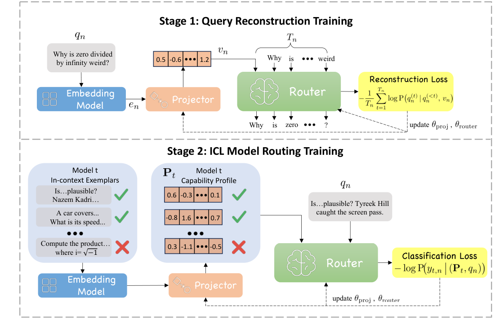
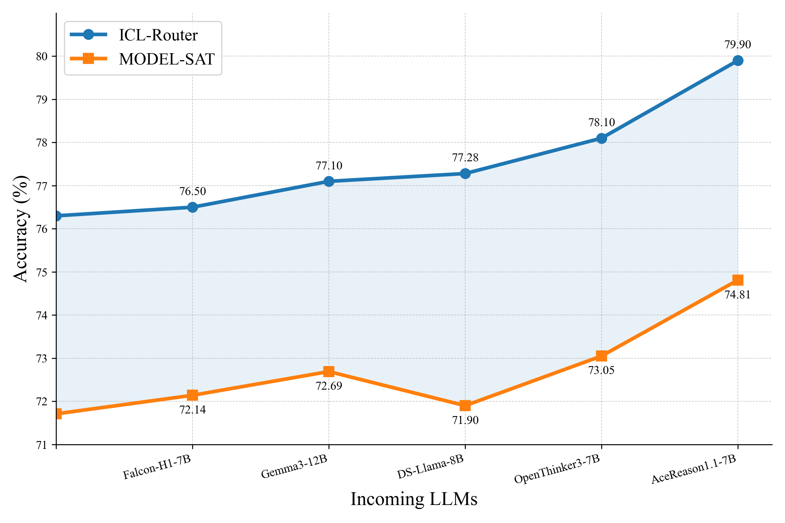
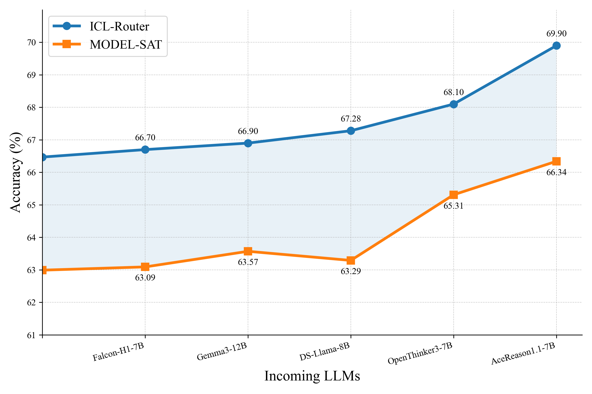
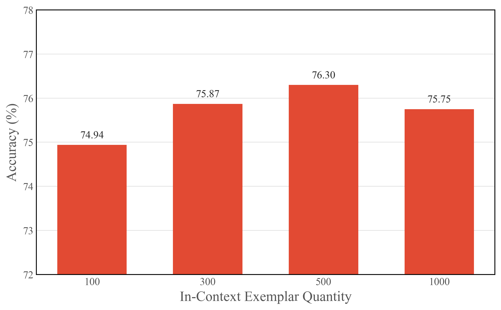
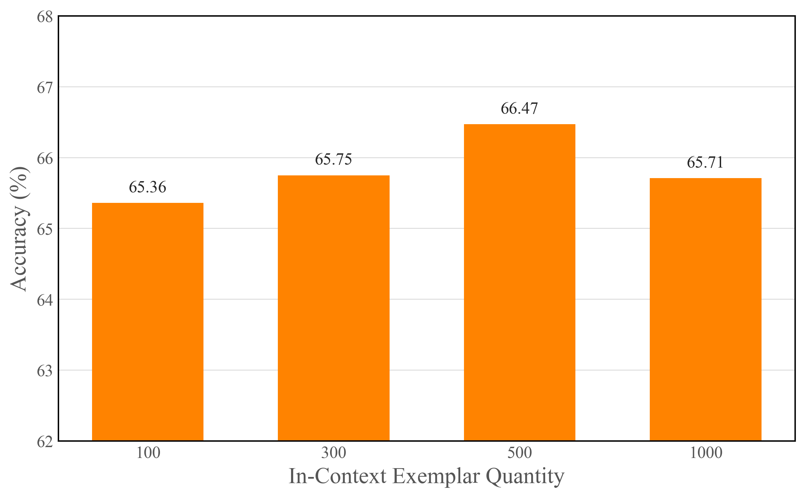

# ICL-Router：面向大语言模型路由的上下文学习模型表示

*ICL-Router: In-Context Learned Model Representations for LLM Routing*

Chenxu Wang1,2,∗†, Hao Li2,3,∗†, Yiqun Zhang2,4,∗, Linyao Chen2,5,∗, Jianhao Chen2,6,∗, Ping Jian7, Peng Ye2, Qiaosheng Zhang2, Shuyue Hu2,‡

1 复旦大学；2 上海人工智能实验室；3 西北工业大学；4 美国东北大学；5 东京大学；6 南京大学；7 北京理工大学

{wangchenxu,zhangqiaosheng,hushuyue}@pjlab.org.cn li.hao@mail.nwpu.edu.cn

arXiv:2510.09719v3 [cs.LG] ｜2025 年 11 月 14 日

∗本工作于上海人工智能实验室实习期间完成。† 这些作者贡献相同。‡ 通讯作者。

**目录**

- [摘要](#abstract)
- [1 引言](#s1)
- [2 相关工作](#s2)
- [3 ICL-Router](#s3)：[概述](#s3-1) · [查询重构训练](#s3-2) · [ICL 模型路由训练](#s3-3) · [推理与模型集成](#s3-4)
- [4 实验](#s4)：[数据集](#s4-1) · [实现设置](#s4-2) · [基线方法](#s4-3) · [主要结果](#s4-4) · [可扩展性](#s4-5) · [分析](#s4-6)
- [5 结论](#s5)
- [参考文献](#references)
- [A 技术附录](#app-a)：[数据集](#app-a-1) · [基线方法](#app-a-2) · [困难查询集合构造](#app-a-3) · [成本评估](#app-a-4) · [局限性](#app-a-5)

## 摘要

大语言模型（LLMs）通常展现出互补优势。模型路由通过在给定候选模型池的情况下，将每个查询动态分配给最合适的模型，来利用这些优势。然而，路由性能依赖于准确的模型表示，且添加新模型通常需要重新训练，从而限制了可扩展性。为解决这些挑战，我们提出一种使用上下文向量表示模型能力的新型路由方法。该方法包含两个阶段。首先，对查询进行嵌入并投影为向量，同时训练投影器和基于 LLM 的路由器重构原始查询，使向量表示与路由器的语义空间对齐。其次，在一个查询集合上对每个候选模型进行能力评估，路由器基于查询及模型表现的上下文向量学习预测各模型能否正确回答新查询。大量实验表明，我们的方法在分布内与分布外任务上均实现了最先进的路由性能。此外，我们的方法允许在无需重新训练路由器的情况下无缝集成新模型。代码见 https://github.com/lalalamdbf/ICL-Router。

**译本说明：**依照上传的论文 v3 逐节翻译；图 1–5 为原论文图像，表 1–4 由原表逐格录入，公式（1）–（6）对照原文排版。参考文献以原文形式保留，技术附录提供中文补译。

## 1 引言（Introduction）

大语言模型（LLMs）已在各种任务中展现卓越能力，包括数学推理（Liu et al. 2024b; Chervonyi et al. 2025）、代码生成（DeepSeek-AI et al. 2024; Wang et al. 2025b）、逻辑理解（Liu et al. 2025a; Wang, Jian, and Yang 2025）以及科学、技术、工程和数学（STEM）问题求解（Wu et al. 2025; Ma et al. 2025b）。尽管如此，没有任何单个模型能够在所有领域始终优于其他模型。相反，由于训练数据、架构与优化过程存在差异，不同模型通常表现出相互补充的优势和劣势。

一条新兴研究路线开始探索模型路由方法。直觉十分直接：如果不同模型擅长不同任务，那么将模型池中最有能力的模型动态分配给每个查询，就可能最大化整体性能（Chen et al. 2024b; Lu et al. 2024; Zhuang et al. 2024a; Zhang, Zhan, and Ye 2025）。然而，在实践中实现这一目标远非易事。一个关键挑战是，有效路由极其依赖对各个模型能力的准确理解。例如，给定两个通用模型，如果不在广泛任务上充分评估，就难以判断 LLaMA（Grattafiori et al. 2024）擅长哪些任务，而 Gemma（Team et al. 2025）在哪些任务上表现更好。

LLM 的快速发展进一步加剧了这一挑战。由于新模型频繁发布，路由方法必须能够以增量方式适应新模型。否则，重复进行大规模评估和重新训练路由器的成本将迅速变得难以承担，最终限制路由方法从模型规模扩展中获益的能力。

尽管近期已有工作开始应对这一挑战，现有方法在可扩展性与评估效率方面仍存在不足。例如，RouterDC（Chen et al. 2024b）利用双重对比学习联合训练查询嵌入与模型嵌入，使每个查询与其最优模型对齐。类似地，EmbedLLM（Zhuang et al. 2024a）采用二元交叉熵损失训练基于嵌入的路由器，以预测查询与模型的兼容性。然而，两者都在固定的 LLM 集合上工作，引入新模型需要重新训练路由器。最近，MODEL-SAT（Zhang, Zhan, and Ye 2025）依据 MMLU 基准测试（Hendrycks et al. 2021）的性能，通过人工设计的“能力指令”表示模型。虽然加入新模型时不再需要重新训练，但面对其他基准测试时仍需要手工设计指令，并预先知道其衡量的能力。

因此，我们提出 ICL-Router，一种利用上下文学习表示（in-context learned representations）刻画模型能力的新方法。我们假设，模型在不同查询上的表现可以作为上下文示例，因为模型对各类查询的响应方式自然反映了其独特的能力画像。然而，直接将数百或数千个查询纳入上下文信息会造成难以管理的超长上下文窗口。受到上下文向量相关研究（Zhuang et al. 2024b; Liu et al. 2024a）的启发，我们将这些示例转换为紧凑的上下文向量，显著减少上下文长度。在推理时，路由器利用这些向量，即模型能力画像的紧凑表示，估计各模型正确回答某个查询的概率。当新的 LLM 加入时，只需在少量查询上快速评估以生成其上下文向量（即能力画像），就可以将其送入路由器并立即纳入候选池，而无须重新训练。

更具体地，ICL-Router 包含三个主要组件：嵌入模型、投影器和基于 LLM 的路由器，并按图 1 所示分两个阶段训练。第一阶段将查询嵌入并投影为向量，联合训练投影器与路由器以对齐二者语义空间，使路由器能够有效解释向量编码的信息。第二阶段在少量查询上评估模型池中的各候选 LLM，将结果与查询向量表示配对，构成模型的能力画像；随后以这些查询-表现配对作为上下文向量，训练路由器预测某个模型能否成功处理新的查询。

**图 1: ICL-Router 的两阶段框架。（1）查询重构训练：训练投影器以对齐嵌入模型与路由器的维度，同时使路由器从投影向量中重构查询，学习其语义。（2）ICL 模型路由训练：将各模型能力编码为上下文向量，并训练路由器预测给定模型能否处理特定查询。图内英文为原图保留。**

我们在 10 个广泛使用的基准测试（AGIEval、AIME、BBH、HumanEval、KORBench、LogicBench、MBPP、MMLU-CF、MMLUPro 和 OlympiadBench）上评估 ICL-Router，覆盖分布内与分布外设置。实验表明，该方法取得最先进的路由性能。具体而言，在分布内任务上，ICL-Router 比候选池中表现最好的单个 LLM（Deepseek-R1-distill-Qwen-7B）高出 7.2 个绝对百分点（表 1）；并分别超过 RouterDC、EmbedLLM 与 MODEL-SAT 3.9、2.2 和 4.6 个百分点。此外，不同于假设固定模型池、需要重新训练的 EmbedLLM 和 RouterDC，ICL-Router 可以从模型池扩展中无缝受益。随着加入的模型增加，其表现显著优于 MODEL-SAT（图 2、3），显示更好的可扩展性和适应性。除了模型池扩展外，适量增加上下文示例也能够提升路由性能（图 4、5）。

本文主要贡献总结如下：

- 我们提出通过查询-表现配对的向量表示刻画模型能力，为模型表示提供新的视角。

- 我们提出新的路由方法 ICL-Router，将模型能力画像构建与路由解耦，从而无需重新训练即可扩展集成新模型。

- 实验结果表明，ICL-Router 在多个领域的分布内及分布外任务上实现了最先进的路由性能。

## 2 相关工作（Related Work）

### 上下文学习（In-Context Learning）

上下文学习（ICL）使 LLM 能够仅凭提示词中提供的演示示例执行新任务。GPT-3（Brown et al. 2020）首次有效展示了这一能力：通过从上下文示例学习，在多样任务上获得强大的少样本甚至零样本性能。随着 LLM 支持更长上下文窗口，上下文学习取得显著进步，尤其是在提供数百或数千个示例时（Li et al. 2023a; Chen et al. 2023; Bertsch et al. 2025）。但这也显著增加了上下文窗口长度与推理成本。

为克服这些限制，近期研究探索使用上下文向量，使 LLM 更高效、灵活地处理上下文信息。例如，Zhuang et al.（2024b）提出 Vector-ICL，将多种模态的连续输入数据投影到模型的嵌入空间，使 LLM 能直接从提示词中的向量化演示示例学习。同时，Liu et al.（2024a）专注于改进上下文选择与示例效率，在多种上下文学习场景中维持高性能的同时进一步降低推理成本。基于这些进展，本文探索将上下文向量作为模型表示用于模型路由。

### 模型路由（Model Routing）

模型路由的目标是在不调用所有可用模型的情况下，将查询高效分配给最优模型。近期研究一般分为两类：一类侧重于在性能与计算成本间权衡（Ong et al. 2024; Feng, Shen, and You 2024; Wang et al. 2025a; Jitkrittum et al. 2025; Zhang, Feng, and You 2025）；另一类优先最大化模型性能（Jiang, Ren, and Lin 2023; Lu et al. 2024; Chen et al. 2024b; Zhuang et al. 2024a; Zhang, Zhan, and Ye 2025; Zhang et al. 2025c）。

对前一类方法，GraphRouter（Feng, Shen, and You 2024）使用基于图的方法将查询分配到不同模型，在维持性能的同时降低计算开销。MixLLM（Wang et al. 2025a）根据输入复杂度与成本效益动态选择模型，进一步优化资源消耗与准确率间的权衡。Router-R1（Zhang, Zhan, and Ye 2025）将路由视作序列决策过程，让路由器自身成为一个 LLM，交替执行“思考”和“路由”步骤，以逐步分解任务、动态调用模型，并联合平衡性能与成本。

对于后一类方法，ZOOTER（Lu et al. 2024）提出奖励引导的查询路由方法，通过基于标签的标注增强提高训练稳定性。RouterDC（Chen et al. 2024b）提出双重对比学习，以更好对齐查询与模型表示。EmbedLLM（Zhuang et al. 2024a）提出编码器-解码器框架，利用紧凑模型嵌入和查询嵌入预测路由准确率。MODEL-SAT（Zhang, Zhan, and Ye 2025）通过基于能力的指令微调刻画模型能力，并将指令动态路由给最适合的 LLM。然而，现有以性能为导向的路由方法存在两项主要挑战：构建的模型表示通常过于简单；添加新模型的效率较低，往往需要大量重新训练与大规模推理。为解决上述问题，ICL-Router 采用两阶段训练来学习语义丰富的模型表示，并只使用少量代表性查询高效集成新模型。

## 3 ICL-Router

### 3.1 概述（Overview）

我们提出 ICL-Router，一个构建上下文学习表示以支持 LLM 路由的框架。它由嵌入模型、投影器和基于 LLM 的路由器三部分组成。考虑一组候选 LLM。在推理时，嵌入模型和投影器首先将查询编码为向量；然后，路由器将该查询向量与各候选模型能力的上下文向量共同作为输入，选择最适合处理该查询的模型。如图 1 所示，本文采用两阶段训练策略：（1）查询重构训练：使投影器对齐嵌入模型与路由器的维度，并使路由器能够解释嵌入模型产生的向量；（2）ICL 模型路由训练：利用上下文中的模型表现向量作为输入，训练路由器为每个查询选择最合适的 LLM。

### 3.2 查询重构训练（Query Reconstruction Training）

这一阶段的核心目标是联合训练投影器与路由器。投影器学习将嵌入模型的向量映射到路由模型的语义空间，同时，路由器学习理解和解释传入的向量表示。

给定查询集合 $Q=\{q_n\mid n=1,\ldots,N\}$，首先，嵌入模型 $f_{\mathrm{emb}}$ 将每个查询 $q_n$ 编码为嵌入向量。对应的 $\mathbf{e}_n$ 定义为：

$$
\mathbf{e}_n=f_{\mathrm{emb}}(q_n)\in\mathbb{R}^{d_{\mathrm{Emb}}}.
\tag{1}
$$

接下来，投影器 $f_{\mathrm{proj}}$ 将嵌入向量 $\mathbf{e}_n$ 投影为 $\mathbf{v}_n$。投影器的训练目标是使嵌入维度与基于 LLM 的路由器输入空间对齐：

$$
\mathbf{v}_n=f_{\mathrm{proj}}(\mathbf{e}_n)\in\mathbb{R}^{d_{\mathrm{Router}}}.
\tag{2}
$$

训练路由器以自回归方式从投影向量 $\mathbf{v}_n$ 重构原始查询 $q_n$。具体来说，在每一步中，给定此前生成的词元 $q_n^{(<t)}$ 与投影向量 $\mathbf{v}_n$，最大化当前词元 $q_n^{(t)}$ 的条件概率。训练目标由最小化以下重构损失定义：

$$
\mathcal{L}_{\mathrm{rec}}(\theta_{\mathrm{proj}},\theta_{\mathrm{router}})=-\frac{1}{NT_n}\sum_{n=1}^{N}\sum_{t=1}^{T_n}\log P\!\left(q_n^{(t)}\mid q_n^{(<t)},\mathbf{v}_n\right).
\tag{3}
$$

其中，$q_n^{(t)}$ 是第 $t$ 个词元，$q_n^{(<t)}$ 表示前面的全部词元，而 $T_n$ 是词元数量。通过联合训练投影器和路由器以最小化重构损失，我们鼓励投影模块生成与路由器语义空间对齐的向量，确保投影查询可被路由器解释并用于下游路由。

**原文公式提示：**公式（3）严格保留原文分母 $NT_n$。由于 $T_n$ 也出现在对 $n$ 的求和上下限中，这一原始记号可能存在归一化歧义；译本未擅自修改数学定义。

### 3.3 ICL 模型路由训练（ICL Model Routing Training）

基于查询重构阶段学到的向量表示，第二阶段训练路由器把每个查询分配给最合适的 LLM。将各模型能力的上下文向量作为输入，路由器学习把查询与最有可能正确作答的模型匹配。

考虑 LLM 集合 $\mathcal{M}=\{\mathcal{M}_t:t=1,\ldots,T\}$ 及查询集合 $\mathcal{Q}=\{q_k\mid k=1,\ldots,K\}$。对于每个模型 $\mathcal{M}_t$，我们通过评估其在 $\mathcal{Q}$ 各查询上的回答构建能力画像 $\mathbf{P}_t$。查询集合 $\mathcal{Q}$ 由困难查询构成，特别是只有少数模型能正确回答的查询。形式化地，能力画像定义为：

$$
\mathbf{P}_t=\left((\mathbf{v}_1,c_1),(\mathbf{v}_2,c_2),\ldots,(\mathbf{v}_K,c_K)\right).
\tag{4}
$$

其中，$\mathbf{v}_k$ 是查询 $q_k\in\mathcal{Q}$ 经过嵌入模型与投影器编码得到的向量表示；$c_k$ 指示模型 $\mathcal{M}_t$ 是否正确回答了查询 $q_k$，使用“Yes”和“No”分别表示正确和错误。

这些能力画像对模型能力提供细致刻画。我们联合训练投影器与路由器，使其根据给定模型的能力画像预测模型能否准确处理查询。形式化地，通过交叉熵损失共同优化投影器和路由器：

$$
\mathcal{L}_{\mathrm{ce}}(\theta_{\mathrm{proj}},\theta_{\mathrm{router}})=-\frac{1}{TN}\sum_{t=1}^{T}\sum_{n=1}^{N}\log P\!\left(y_{t,n}\mid(\mathbf{P}_t,q_n)\right).
\tag{5}
$$

其中，$T$ 为 LLM 数量，$N$ 为查询数量，$y_{t,n}$ 为真实标签，指示模型 $\mathcal{M}_t$ 是否正确回答查询 $q_n$。以这些向量为条件，路由器能够推断各候选模型的相对优势和劣势，无需使用过长的上下文窗口。

### 3.4 推理与可扩展模型集成（Inference and Scalable Model Incorporation）

在推理期间，对新查询 $q'$，路由器将其与各模型能力画像 $\mathbf{P}_t$ 组合，输出模型 $\mathcal{M}_t$ 正确作答的概率。选择预测概率最高的模型：

$$
\mathcal{M}^{*}=\underset{t=1,\ldots,T}{\arg\max}\;p\!\left(\text{‘Yes’}\mid\mathcal{M}_t,q'\right).
\tag{6}
$$

其中，$p(\text{‘Yes’}\mid\mathcal{M}_t,q')$ 为路由器估计模型 $\mathcal{M}_t$ 对该查询给出正确答案的概率。当新模型 $\mathcal{M}_{T+1}$ 被引入时，只需在同一个查询集合 $\mathcal{Q}$ 上评估它，并通过嵌入模型与投影器构建能力画像 $\mathbf{P}_{T+1}$。随后，新模型的能力画像即可被纳入路由过程，而无需任何额外重新训练。因此，所提出的方法允许在动态环境中快速、即插即用地集成新 LLM。

## 4 实验（Experiments）

### 4.1 数据集（Datasets）

我们在 10 个基准测试上评估方法，包括 OlympiadBench（Chervonyi et al. 2025）、AIME、MBPP（Austin et al. 2021）、HumanEval（Zhong et al. 2023）、BBH（Suzgun et al. 2022）、LogicBench（Parmar et al. 2024）、KORBench（Ma et al. 2025a）、MMLUPro（Wang et al. 2024）、AGIEval（Zhong et al. 2023）及 MMLU-CF（Zhao et al. 2024）。为评估 ICL-Router 的泛化性，我们把这些基准划为分布内和分布外（OOD）集合。AIME、HumanEval、KORBench、AGIEval 和 MMLU-CF 被指定为 OOD 数据集，仅用于测试。参照 RouterDC（Chen et al. 2024b）的设定，其余基准为分布内数据集，按 7:3 划分训练集和测试集。更多数据集细节见[附录 A.1](#app-a-1)。

### 4.2 实现设置（Implementation Settings）

框架由嵌入模型、投影器及基于 LLM 的路由器三部分构成。我们采用 Qwen3-Embedding-8B（Zhang et al. 2025d）作为嵌入模型；该模型仅用于生成查询向量，不参加训练。投影器实现为两层多层感知机（MLP），连接嵌入空间与路由器。路由器选择性能良好且通用性较强的 Qwen2.5-7B-Instruct。LLM 候选池考虑八个广泛使用的开源大语言模型。

训练过程有两个阶段。第一阶段先只训练投影器一个 epoch，学习率为 $2\times10^{-5}$；随后进行两个 epoch 的联合训练，此时引入路由器，其学习率为 $5\times10^{-6}$。我们通过采样只有少数 LLM 能正确回答的 500 个困难查询，构造具有代表性的查询集合。随后联合训练投影器和路由器五个 epoch，学习率分别为 $1\times10^{-5}$ 和 $2\times10^{-6}$。使用不同随机种子重复训练三次。两个阶段的 batch size 都设为 32。为了保证评估稳定性，我们对每个被路由到的 LLM 采样 10 次，将 temperature 设为 0.3、top-p 设为 1.0，报告平均准确率。

**表 1: ICL-Router 与基线方法在分布内（ID）任务上的性能比较（原论文表 1）。**

| 方法（Method） | OlympiadBench | BBH | LogicBench | MMLUPro | MBPP | Avg. |
| --- | ---: | ---: | ---: | ---: | ---: | ---: |
| DeepSeek-R1-Distill-Qwen-7B | 66.24 | 72.87 | 78.03 | 58.84 | 69.52 | 69.10 |
| Llama-3.1-8B-Instruct | 16.93 | 59.47 | 69.47 | 49.38 | 60.03 | 51.06 |
| Llama-3.1-Nemotron-Nano-8B-v1 | 74.26 | 53.24 | 65.43 | 50.40 | 79.21 | 64.51 |
| Qwen2.5-7B-Instruct | 38.02 | 71.54 | 71.93 | 57.49 | 71.99 | 62.19 |
| cogito-v1-preview-llama-8B | 16.58 | 75.62 | 68.43 | 58.04 | 60.82 | 55.90 |
| Gemma-2-9B-IT | 13.71 | 62.19 | 68.27 | 55.42 | 60.31 | 51.98 |
| Internlm3-8B-Instruct | 33.12 | 68.64 | 72.83 | 56.49 | 56.88 | 57.59 |
| GLM-4-9B-Chat | 16.88 | 51.14 | 69.53 | 48.58 | 61.10 | 49.65 |
| Random Router | 34.47 | 64.34 | 71.41 | 54.33 | 64.98 | 57.91 |
| LLM Router | 46.03 | 69.54 | 73.19 | 55.87 | 66.55 | 62.36 |
| Max Expert | **74.26** | 75.62 | 78.03 | 58.84 | 79.21 | 73.19 |
| RouterDC | 73.56 | 73.49 | 77.24 | 58.20 | <u>79.11</u> | 72.32 |
| EmbedLLM | 71.45 | <u>79.02</u> | <u>78.92</u> | <u>64.06</u> | 77.34 | <u>74.16</u> |
| MODEL-SAT | 73.02 | 71.14 | 74.80 | 63.61 | 76.00 | 71.71 |
| ICL-Router（本文） | <u>74.16</u> | **80.52** | **79.03** | **67.53** | **80.53** | **76.30** |

说明：最优值按原表以粗体标出，次优值按原表添加下划线。单位：准确率（%）；Avg. 为五个数据集的平均值。

**表 2: ICL-Router 与基线方法在分布外（OOD）任务上的性能比较（原论文表 2）。**

| 方法（Method） | AIME | KORBench | MMLU-CF | AGIEval | HumanEval | Avg. |
| --- | ---: | ---: | ---: | ---: | ---: | ---: |
| DeepSeek-R1-Distill-Qwen-7B | 45.50 | 50.30 | 56.70 | 62.56 | 83.78 | 59.77 |
| Llama-3.1-8B-Instruct | 3.67 | 43.67 | 62.16 | 54.40 | 65.43 | 45.87 |
| Llama-3.1-Nemotron-Nano-8B-v1 | 58.00 | 30.91 | 49.76 | 47.64 | 91.10 | 55.48 |
| Qwen2.5-7B-Instruct | 8.00 | 38.31 | 64.98 | 62.23 | 84.27 | 57.58 |
| cogito-v1-preview-llama-8B | 2.67 | 44.99 | 62.11 | 58.56 | 67.80 | 50.83 |
| Gemma-2-9B-IT | 10.00 | 37.16 | 64.33 | 60.60 | 63.23 | 51.82 |
| Internlm3-8B-Instruct | 5.83 | 38.53 | 64.58 | 64.01 | 67.98 | 52.99 |
| GLM-4-9B-Chat | 1.67 | 35.67 | 60.76 | 59.11 | 67.68 | 50.18 |
| Random Router | 15.79 | 37.80 | 60.67 | 59.02 | 73.91 | 49.44 |
| LLM Router | 30.33 | 40.67 | 60.48 | 58.08 | 75.20 | 52.95 |
| Max Expert | **58.00** | <u>50.30</u> | 64.98 | 64.01 | **91.10** | <u>65.68</u> |
| RouterDC | **58.00** | 46.44 | 59.50 | 61.49 | <u>90.20</u> | 63.13 |
| EmbedLLM | 53.72 | 46.90 | **65.22** | 64.99 | 83.29 | 62.82 |
| MODEL-SAT | <u>56.84</u> | 44.53 | 64.45 | 60.08 | 89.02 | 62.99 |
| ICL-Router（本文） | **58.00** | **53.03** | <u>64.99</u> | **67.29** | 89.04 | **66.47** |

说明：最优值按原表以粗体标出，次优值按原表添加下划线。单位：准确率（%）；Avg. 为五个数据集的平均值。

### 4.3 基线方法（Baselines）

与 ICL-Router 对比的基线如下：

- Random Router：对每个查询，从候选 LLM 池中随机选取模型。

- LLM Router：一种基于提示词的方法，使用 Qwen2.5-7B-Instruct，依据模型表现画像的自然语言描述选择模型。

- Max Expert：针对每个数据集选择性能最好的模型，作为强基线。

- RouterDC（Chen et al. 2024b）：使用双重对比学习训练查询及模型嵌入，使查询靠近适合的模型，并在表示空间中聚集语义相似的查询。

- EmbedLLM（Zhuang et al. 2024a）：编码器-解码器框架，利用紧凑模型及查询嵌入预测模型与查询的兼容性，以二元交叉熵损失训练路由器。

- MODEL-SAT（Zhang, Zhan, and Ye 2025）：通过能力指令微调，将候选模型的性能转换为文本描述，再嵌入并传递给可训练的 LLM，动态预测最合适的模型。

更详细的基线实现见[附录 A.2](#app-a-2)。

### 4.4 主要结果（Main Results）

表 1 给出了五个分布内数据集的比较。ICL-Router 达到了最高平均准确率 76.30%，分别超过 RouterDC、EmbedLLM 和 MODEL-SAT 4.08、2.14 和 4.59 个百分点。值得注意的是，它在五个数据集中的四个上达到最优，体现了其在多种任务中的一致优势。此外，ICL-Router 比按数据集选择最强单一模型的 Max Expert 平均高出 3.11 个百分点。这一提升主要来自 MMLUPro（+8.69）、BBH（+4.9）、LogicBench（+1）和 MBPP（+1.32）个百分点的准确率增益。这说明，ICL-Router 能根据每个查询自身特点与合适模型匹配，而不是只进行领域级或任务级的模型选择。

表 2 展示了五个 OOD 任务的比较。ICL-Router 的平均准确率达到 66.47%，超过 RouterDC、EmbedLLM 和 MODEL-SAT 分别 3.34、3.65 和 3.48 个百分点。这凸显了 ICL-Router 在多种 OOD 场景中的稳健性，验证了其在分布内任务之外的有效性。它还在 KORBench（+2.73）和 AGIEval（+3.28）上明显优于 Max Expert，而在 AIME、MMLU-CF 和 HumanEval 上取得几乎相同的表现。这表明 ICL-Router 既能泛化到 OOD 任务，也能可靠地接近或超过每个基准上的最强单个模型。

总体而言，实验结果显示 ICL-Router 在分布内与 OOD 任务上持续优于所有基线。这表明引入准确且语义丰富的模型表示是有益的：这些表示能够捕捉候选模型能力的细微差异，促进更精确的路由。跨基准的稳健且稳定性能进一步验证了方法的有效性与泛化能力。

### 4.5 接入新模型的可扩展性（Scalability to New Models）

我们选取一组近期发布且富有竞争力的 LLM 评估方法的可扩展性，包括 Falcon-H1-7B-Instruct（Zuo et al. 2025）、Gemma3-12B-IT（Team et al. 2025）、DeepSeek-R1-Llama-8B（Guo et al. 2025）、OpenThinker3-7B（Guha et al. 2025）和 AceReason-Nemotron-1.1-7B（Liu et al. 2025b）。如图 2、3 所示，ICL-Router 在分布内与 OOD 设置下的准确率都持续上升。例如，随着模型接入，分布内准确率由 76.3% 升至 79.9%；OOD 准确率从 66.4% 升至 69.9%。相比之下，MODEL-SAT 的增益较不稳定，随着新模型加入，性能提升并不一致，有时会波动。

更重要的是，即使处于准确率较高、进一步提升通常更困难的阶段，ICL-Router 仍能保持并扩大性能领先优势。这种稳定且可靠的进步表明，本方法能充分利用不断扩张的模型池中的各模型优势。结果显示，即使现实场景中持续集成新模型，该方法仍然稳健可靠。

**图 2: 集成新 LLM 对分布内路由性能的影响（原论文图 2；纵轴为准确率%，横轴为按顺序接入的新模型）。**

**图 3: 集成新 LLM 对分布外（OOD）路由性能的影响（原论文图 3）。**

**图 2、图 3 数值对照（按原图标注整理，非原文独立表格；单位：%）**

| 模型池状态 | ID：ICL-Router | ID：MODEL-SAT | OOD：ICL-Router | OOD：MODEL-SAT |
| --- | ---: | ---: | ---: | ---: |
| 初始模型池 | 76.30 | 71.71 | 66.47 | 62.99 |
| + Falcon-H1-7B | 76.50 | 72.14 | 66.70 | 63.09 |
| + Gemma3-12B | 77.10 | 72.69 | 66.90 | 63.57 |
| + DS-Llama-8B | 77.28 | 71.90 | 67.28 | 63.29 |
| + OpenThinker3-7B | 78.10 | 73.05 | 68.10 | 65.31 |
| + AceReason1.1-7B | 79.90 | 74.81 | 69.90 | 66.34 |

### 4.6 分析（Analysis）

为更好理解 ICL-Router 的有效性，我们分析三个关键因素对性能的影响：嵌入模型、上下文示例数量以及查询重构训练阶段。

#### 嵌入模型（Embedding Model）

嵌入模型的选择对于确定用于下游路由的向量表示质量至关重要。具体来说，我们比较参数量和嵌入维度不同的五种嵌入模型对分布内及 OOD 准确率的影响：mxbai-embed-large-v1（Lee et al. 2024）、bge-m3（Chen et al. 2024a）、stella-en-1.5B-v5（Zhang et al. 2025a）、gte-Qwen2-7B-instruct（Li et al. 2023b）和 Qwen3-8B-Embedding（Zhang et al. 2025d）。

**表 3: 不同嵌入模型的参数规模、嵌入维度以及 ID、OOD 场景表现。**

| 嵌入模型（Embed.） | 参数量/维度（Para./Dim.） | ID | OOD |
| --- | ---: | ---: | ---: |
| mxbai-embed-large-v1 | 0.3B/1024 | 74.45 | 64.55 |
| bge-m3 | 0.6B/1024 | 75.13 | 65.14 |
| stella-en-1.5B-v5 | 1.5B/2048 | 75.51 | 65.45 |
| gte-Qwen2-7B-instruct | 7B/3584 | 76.03 | 66.06 |
| Qwen3-8B-Embedding | 8B/4096 | 76.30 | 66.47 |

如表 3 所示，随着模型规模从 mxbai-embed-large-v1（0.3B/1024）增加到 Qwen3-8B-Embedding（8B/4096），分布内准确率由 74.45% 升至 76.30%，OOD 准确率从 64.55% 升至 66.47%。五种模型均表现出逐步提升的趋势，说明更强的嵌入模型持续提供更稳健、泛化能力更强的向量表示，从而改善下游路由性能。

#### 上下文示例数量的影响（Effects of In-Context Exemplar Quantity）

为了进一步研究上下文示例数量的影响，我们改变构建模型能力画像所用的示例数量进行消融实验，具体评估 100、300、500 和 1000 个上下文示例在分布内及 OOD 场景中的表现。

**图 4: 上下文示例数量对分布内性能的影响（原论文图 4）。**

**图 5: 上下文示例数量对 OOD 性能的影响（原论文图 5）。**

**图 4、图 5 数值对照（按原图标注整理，非原文独立表格；单位：%）**

| 上下文示例数 | ID 准确率 | OOD 准确率 |
| --- | ---: | ---: |
| 100 | 74.94 | 65.36 |
| 300 | 75.87 | 65.75 |
| 500 | 76.30 | 66.47 |
| 1000 | 75.75 | 65.71 |

如图 4、5 所示，随着上下文示例数量增加，分布内与 OOD 路由准确率均提高，直到某一临界点。对于分布内任务，准确率由 100 个示例时的 74.94% 上升到 500 个示例时的峰值 76.30%，继续增加到 1000 个示例时略降至 75.75%。OOD 也有类似趋势：100 个示例时为 65.36%，500 个示例时升至 66.47%，1000 个示例时则持平或小幅下降为 65.71%。

这些结果表明，尽管更多示例通常可丰富模型能力画像并改善路由，但存在收益递减点，可能因为示例集过大时冗余或噪声增多。这与多样本上下文学习的近期研究（Agarwal et al. 2024; Li et al. 2024; Zhang et al. 2025b）一致：上下文示例过多有时不增反降。总体而言，适中的示例数可在信息量与效率间取得最佳平衡，支持稳健且可泛化的路由表现。

#### 查询重构训练的影响（Effects of Query Reconstruction Training）

**表 4: 查询重构训练（QRT）在分布内（ID）与分布外（OOD）场景中的消融实验。**

| 方法（Method） | ID | OOD |
| --- | ---: | ---: |
| w/o QRT | 74.01 | 64.06 |
| ICL-Router | 76.30 | 66.47 |

表 4 表明，移除查询重构训练（QRT）会使分布内及 OOD 准确率明显降低，降幅分别为 2.29 和 2.41 个百分点。这凸显了 QRT 在对齐嵌入空间与路由器空间方面的重要性，使路由器能在下游路由中更加有效地利用查询表示。如果没有这一训练阶段，路由器便更难捕获和区分准确选择模型所需的语义信息。

## 5 结论（Conclusion）

本文通过使用上下文向量刻画模型能力，为 LLM 路由的模型表示提出一种新思路。我们利用紧凑的向量化能力画像，概括每个 LLM 在困难查询上的表现，构建语义丰富的模型表示，以捕获不同 LLM 的多样能力。ICL-Router 将能力画像构建与路由解耦，使新模型可以即插即用地集成，而无须重新训练路由器。在 10 个基准测试上的实验表明，ICL-Router 在分布内和 OOD 设置下均达到最先进性能，验证了上下文学习模型表示用于 LLM 路由的有效性及可扩展性。

## 参考文献（原文英文文献表）

Agarwal, R.; Singh, A.; Zhang, L.; Bohnet, B.; Rosias, L.; Chan, S.; Zhang, B.; Anand, A.; Abbas, Z.; Nova, A.; et al. 2024. Many-shot in-context learning. Advances in Neural Information Processing Systems, 37: 76930–76966.

Austin, J.; Odena, A.; Nye, M.; Bosma, M.; Michalewski, H.; Dohan, D.; Jiang, E.; Cai, C.; Terry, M.; Le, Q.; and Sutton, C. 2021. Program Synthesis with Large Language Models. arXiv:2108.07732.

Bertsch, A.; Ivgi, M.; Xiao, E.; Alon, U.; Berant, J.; Gormley, M. R.; and Neubig, G. 2025. In-Context Learning with Long-Context Models: An In-Depth Exploration. In Proceedings of the 2025 Conference of the Nations of the Americas Chapter of the Association for Computational Linguistics: Human Language Technologies (Volume 1: Long Papers), 12119–12149.

Brown, T.; Mann, B.; Ryder, N.; Subbiah, M.; Kaplan, J. D.; Dhariwal, P.; Neelakantan, A.; Shyam, P.; Sastry, G.; Askell, A.; et al. 2020. Language models are few-shot learners. Advances in neural information processing systems, 33: 1877–1901.

Chen, J.; Chen, L.; Zhu, C.; and Zhou, T. 2023. How Many Demonstrations Do You Need for In-context Learning? In Bouamor, H.; Pino, J.; and Bali, K., eds., Findings of the Association for Computational Linguistics: EMNLP 2023, 11149–11159. Singapore: Association for Computational Linguistics.

Chen, J.; Xiao, S.; Zhang, P.; Luo, K.; Lian, D.; and Liu, Z. 2024a. BGE M3-Embedding: Multi-Lingual, Multi-Functionality, Multi-Granularity Text Embeddings Through Self-Knowledge Distillation. arXiv:2402.03216.

Chen, S.; Jiang, W.; Lin, B.; Kwok, J.; and Zhang, Y. 2024b. Routerdc: Query-based router by dual contrastive learning for assembling large language models. Advances in Neural Information Processing Systems, 37: 66305–66328.

Chervonyi, Y.; Trinh, T. H.; Olšák, M.; Yang, X.; Nguyen, H.; Menegali, M.; Jung, J.; Verma, V.; Le, Q. V.; and Luong, T. 2025. Gold-medalist Performance in Solving Olympiad Geometry with AlphaGeometry2. arXiv:2502.03544.

DeepSeek-AI; Zhu, Q.; Guo, D.; Shao, Z.; Yang, D.; Wang, P.; Xu, R.; Wu, Y.; Li, Y.; Gao, H.; Ma, S.; Zeng, W.; Bi, X.; Gu, Z.; Xu, H.; Dai, D.; Dong, K.; Zhang, L.; Piao, Y.; Gou, Z.; Xie, Z.; Hao, Z.; Wang, B.; Song, J.; Chen, D.; Xie, X.; Guan, K.; You, Y.; Liu, A.; Du, Q.; Gao, W.; Lu, X.; Chen, Q.; Wang, Y.; Deng, C.; Li, J.; Zhao, C.; Ruan, C.; Luo, F.; and Liang, W. 2024. DeepSeek-Coder-V2: Breaking the Barrier of Closed-Source Models in Code Intelligence. arXiv:2406.11931.

Feng, T.; Shen, Y.; and You, J. 2024. Graphrouter: A graph-based router for llm selections. arXiv preprint arXiv:2410.03834.

Grattafiori, A.; Dubey, A.; Jauhri, A.; Pandey, A.; Kadian, A.; Al-Dahle, A.; Letman, A.; Mathur, A.; Schelten, A.; Vaughan, A.; et al. 2024. The llama 3 herd of models. arXiv preprint arXiv:2407.21783.

Guha, E.; Marten, R.; Keh, S.; Raoof, N.; Smyrnis, G.; Bansal, H.; Nezhurina, M.; Mercat, J.; Vu, T.; Sprague, Z.; Suvarna, A.; Feuer, B.; Chen, L.; Khan, Z.; Frankel, E.; Grover, S.; Choi, C.; Muennighoff, N.; Su, S.; Zhao, W.; Yang, J.; Pimpalgaonkar, S.; Sharma, K.; Ji, C. C.-J.; Deng, Y.; Pratt, S.; Ramanujan, V.; Saad-Falcon, J.; Li, J.; Dave, A.; Albalak, A.; Arora, K.; Wulfe, B.; Hegde, C.; Durrett, G.; Oh, S.; Bansal, M.; Gabriel, S.; Grover, A.; Chang, K.-W.; Shankar, V.; Gokaslan, A.; Merrill, M. A.; Hashimoto, T.; Choi, Y.; Jitsev, J.; Heckel, R.; Sathiamoorthy, M.; Dimakis, A. G.; and Schmidt, L. 2025. OpenThoughts: Data Recipes for Reasoning Models. arXiv:2506.04178.

Guo, D.; Yang, D.; Zhang, H.; Song, J.; Zhang, R.; Xu, R.; Zhu, Q.; Ma, S.; Wang, P.; Bi, X.; et al. 2025. Deepseek-r1: Incentivizing reasoning capability in llms via reinforcement learning. arXiv preprint arXiv:2501.12948.

Hendrycks, D.; Burns, C.; Basart, S.; Zou, A.; Mazeika, M.; Song, D.; and Steinhardt, J. 2021. Measuring Massive Multitask Language Understanding. Proceedings of the International Conference on Learning Representations (ICLR).

Jiang, D.; Ren, X.; and Lin, B. Y. 2023. LLM-Blender: Ensembling Large Language Models with Pairwise Comparison and Generative Fusion. In Proceedings of the 61th Annual Meeting of the Association for Computational Linguistics (ACL 2023).

Jitkrittum, W.; Narasimhan, H.; Rawat, A. S.; Juneja, J.; Wang, Z.; Lee, C.-Y.; Shenoy, P.; Panigrahy, R.; Menon, A. K.; and Kumar, S. 2025. Universal model routing for efficient llm inference. arXiv preprint arXiv:2502.08773.

Lee, S.; Shakir, A.; Koenig, D.; and Lipp, J. 2024. Open Source Strikes Bread - New Fluffy Embeddings Model.

Li, M.; Gong, S.; Feng, J.; Xu, Y.; Zhang, J.; Wu, Z.; and Kong, L. 2023a. In-Context Learning with Many Demonstration Examples. arXiv:2302.04931.

Li, T.; Zhang, G.; Do, Q. D.; Yue, X.; and Chen, W. 2024. Long-context llms struggle with long in-context learning. arXiv preprint arXiv:2404.02060.

Li, Z.; Zhang, X.; Zhang, Y.; Long, D.; Xie, P.; and Zhang, M. 2023b. Towards general text embeddings with multi-stage contrastive learning. arXiv preprint arXiv:2308.03281.

Liu, S.; Ye, H.; Xing, L.; and Zou, J. 2024a. In-context vectors: making in context learning more effective and controllable through latent space steering. In Proceedings of the 41st International Conference on Machine Learning, 32287–32307.

Liu, T.; Xu, W.; Huang, W.; Zeng, Y.; Wang, J.; Wang, X.; Yang, H.; and Li, J. 2025a. Logic-of-Thought: Injecting Logic into Contexts for Full Reasoning in Large Language Models. arXiv:2409.17539.

Liu, Z.; Chen, Y.; Shoeybi, M.; Catanzaro, B.; and Ping, W. 2024b. AceMath: Advancing Frontier Math Reasoning with Post-Training and Reward Modeling. arXiv preprint.

Liu, Z.; Yang, Z.; Chen, Y.; Lee, C.; Shoeybi, M.; Catanzaro, B.; and Ping, W. 2025b. AceReason-Nemotron 1.1: Advancing Math and Code Reasoning through SFT and RL Synergy. arXiv preprint arXiv:2506.13284.

Lu, K.; Yuan, H.; Lin, R.; Lin, J.; Yuan, Z.; Zhou, C.; and Zhou, J. 2024. Routing to the Expert: Efficient Reward-guided Ensemble of Large Language Models. In Duh, K.; Gomez, H.; and Bethard, S., eds., Proceedings of the 2024 Conference of the North American Chapter of the Association for Computational Linguistics: Human Language Technologies (Volume 1: Long Papers), 1964–1974. Mexico City, Mexico: Association for Computational Linguistics.

Ma, K.; Du, X.; Wang, Y.; Zhang, H.; Wen, Z.; Qu, X.; Yang, J.; Liu, J.; Liu, M.; Yue, X.; Huang, W.; and Zhang, G. 2025a. KOR-Bench: Benchmarking Language Models on Knowledge-Orthogonal Reasoning Tasks. arXiv:2410.06526.

Ma, X.; Liu, Q.; Jiang, D.; Zhang, G.; Ma, Z.; and Chen, W. 2025b. General-Reasoner: Advancing LLM Reasoning Across All Domains. arXiv:2505.14652.

Ong, I.; Almahairi, A.; Wu, V.; Chiang, W.-L.; Wu, T.; Gonzalez, J. E.; Kadous, M. W.; and Stoica, I. 2024. RouteLLM: Learning to Route LLMs from Preference Data. In The Thirteenth International Conference on Learning Representations.

Parmar, M.; Patel, N.; Varshney, N.; Nakamura, M.; Luo, M.; Mashetty, S.; Mitra, A.; and Baral, C. 2024. LogicBench: Towards Systematic Evaluation of Logical Reasoning Ability of Large Language Models. arXiv:2404.15522.

Suzgun, M.; Scales, N.; Schärli, N.; Gehrmann, S.; Tay, Y.; Chung, H. W.; Chowdhery, A.; Le, Q. V.; Chi, E. H.; Zhou, D.; and Wei, J. 2022. Challenging BIG-Bench Tasks and Whether Chain-of-Thought Can Solve Them. arXiv:2210.09261.

Team, G.; Kamath, A.; Ferret, J.; Pathak, S.; Vieillard, N.; Merhej, R.; Perrin, S.; Matejovicova, T.; Ramé, A.; Rivière, M.; et al. 2025. Gemma 3 technical report. arXiv preprint arXiv:2503.19786.

Wang, C.; Jian, P.; and Yang, Z. 2025. Thought-Path Contrastive Learning via Premise-Oriented Data Augmentation for Logical Reading Comprehension. In Proceedings of the AAAI Conference on Artificial Intelligence, volume 39, 25345–25352.

Wang, X.; Liu, Y.; Cheng, W.; Zhao, X.; Chen, Z.; Yu, W.; Fu, Y.; and Chen, H. 2025a. MixLLM: Dynamic Routing in Mixed Large Language Models. In Proceedings of the 2025 Conference of the Nations of the Americas Chapter of the Association for Computational Linguistics: Human Language Technologies (Volume 1: Long Papers), 10912–10922.

Wang, Y.; Ma, X.; Zhang, G.; Ni, Y.; Chandra, A.; Guo, S.; Ren, W.; Arulraj, A.; He, X.; Jiang, Z.; Li, T.; Ku, M.; Wang, K.; Zhuang, A.; Fan, R.; Yue, X.; and Chen, W. 2024. MMLU-Pro: A More Robust and Challenging Multi-Task Language Understanding Benchmark. arXiv:2406.01574.

Wang, Y.; Yang, L.; Tian, Y.; Shen, K.; and Wang, M. 2025b. Co-Evolving LLM Coder and Unit Tester via Reinforcement Learning. arXiv:2506.03136.

Wu, X. J.; Zhang, Z.; Wen, Z.; Zhang, Z.; Ren, W.; Shi, L.; Chen, C.; Zhao, D.; Wang, Q.; Han, X.; et al. 2025. SHARP: Synthesizing High-quality Aligned Reasoning Problems for Large Reasoning Models Reinforcement Learning. arXiv preprint arXiv:2505.14147.

Zhang, D.; Li, J.; Zeng, Z.; and Wang, F. 2025a. Jasper and Stella: distillation of SOTA embedding models. arXiv:2412.19048.

Zhang, H.; Feng, T.; and You, J. 2025. Router-R1: Teaching LLMs Multi-Round Routing and Aggregation via Reinforcement Learning. arXiv preprint arXiv:2506.09033.

Zhang, X.; Lv, A.; Liu, Y.; Sung, F.; Liu, W.; Luan, J.; Shang, S.; Chen, X.; and Yan, R. 2025b. More is not always better? enhancing many-shot in-context learning with differentiated and reweighting objectives. arXiv preprint arXiv:2501.04070.

Zhang, Y.; Li, H.; Wang, C.; Chen, L.; Zhang, Q.; Ye, P.; Feng, S.; Wang, D.; Wang, Z.; Wang, X.; et al. 2025c. The Avengers: A Simple Recipe for Uniting Smaller Language Models to Challenge Proprietary Giants. arXiv preprint arXiv:2505.19797.

Zhang, Y.; Li, M.; Long, D.; Zhang, X.; Lin, H.; Yang, B.; Xie, P.; Yang, A.; Liu, D.; Lin, J.; Huang, F.; and Zhou, J. 2025d. Qwen3 Embedding: Advancing Text Embedding and Reranking Through Foundation Models. arXiv preprint arXiv:2506.05176.

Zhang, Y.-K.; Zhan, D.-C.; and Ye, H.-J. 2025. Capability instruction tuning: A new paradigm for dynamic llm routing. arXiv preprint arXiv:2502.17282.

Zhao, Q.; Huang, Y.; Lv, T.; Cui, L.; Sun, Q.; Mao, S.; Zhang, X.; Xin, Y.; Yin, Q.; Li, S.; and Wei, F. 2024. MMLU-CF: A Contamination-free Multi-task Language Understanding Benchmark. arXiv:2412.15194.

Zhong, W.; Cui, R.; Guo, Y.; Liang, Y.; Lu, S.; Wang, Y.; Saied, A.; Chen, W.; and Duan, N. 2023. AGIEval: A Human-Centric Benchmark for Evaluating Foundation Models. arXiv:2304.06364.

Zhuang, R.; Wu, T.; Wen, Z.; Li, A.; Jiao, J.; and Ramchandran, K. 2024a. EmbedLLM: Learning Compact Representations of Large Language Models. arXiv preprint arXiv:2410.02223.

Zhuang, Y.; Singh, C.; Liu, L.; Shang, J.; and Gao, J. 2024b. Vector-ICL: In-context Learning with Continuous Vector Representations. arXiv preprint arXiv:2410.05629.

Zuo, J.; Velikanov, M.; Chahed, I.; Belkada, Y.; Rhayem, D. E.; Kunsch, G.; Hacid, H.; Yous, H.; Farhat, B.; Khadraoui, I.; Farooq, M.; Campesan, G.; Cojocaru, R.; Djilali, Y.; Hu, S.; Chaabane, I.; Khanna, P.; Seddik, M. E. A.; Huynh, N. D.; Khac, P. L.; AlQadi, L.; Mokeddem, B.; Chami, M.; Abubaker, A.; Lubinets, M.; Piskorski, K.; and Frikha, S. 2025. Falcon-H1: A Family of Hybrid-Head Language Models Redefining Efficiency and Performance. arXiv preprint arXiv:2507.22448.

## A 技术附录（Technical Appendices）

### A.1 数据集（Datasets）

我们在十个广泛使用的基准测试上评估方法，各数据集详细信息见[附录表 A.1](#table-a-1)。下面逐一介绍数据集。

**表 A.1: 数据集详细信息（源论文技术附录表 1）。**

| 数据集 | 指标与提示设置 | 样本量 |
| --- | ---: | ---: |
| OlympiadBench | Accuracy, 0-shot | 674 |
| BBH | Accuracy, 3-shot | 1,080 |
| LogicBench | Accuracy, 0-shot | 1,000 |
| MMLUPro | Accuracy, 0-shot | 1,500 |
| MBPP | Pass@1, 0-shot | 974 |
| AIME | Accuracy, 0-shot | 60 |
| KORBench | Accuracy, 3-shot | 1,250 |
| MMLU-CF | Accuracy, 0-shot | 1,000 |
| AGIEval | Accuracy, 0-shot | 1,576 |
| HumanEval | Pass@1, 0-shot | 164 |

- OlympiadBench：源自国际数学及物理奥林匹克竞赛的问题，是极具挑战性的基准。在本文设置中，研究只关注 674 道纯文本数学题，排除需要图表或图片的问题。

- BBH：源自 Big-Bench Hard，包含 23 项困难任务，用于评价 LLM 的高级推理能力。本文从原数据集中选取 1,080 个样例，覆盖需要复杂多步推理的多个领域。

- LogicBench：自然语言问答数据集，系统评价 LLM 的逻辑推理能力，涵盖命题逻辑、一阶逻辑及非单调逻辑中的 25 种不同推理规则模式。包含二元（是/否）问答及多选问答，每个问题聚焦单一推理规则，以精确衡量准确率。本文从原数据集中选取 1,000 个样例。

- MMLUPro：大规模学术及专业问答基准，用于考察先进语言模型知识推理的广度与深度。MMLU-Pro 涵盖 14 个学科及 57 个子领域，每道高难问题提供十个选项，以降低猜中概率、提高区分度。所有题目都是多项选择，需要模型在一致条件下进行细致回忆、排除与跨领域推理。本文从完整集合中分层抽样得到 1,500 道题。

- MBPP：用于测试代码生成技能，包含 974 道简单 Python 编程任务。每道任务使用日常语言描述，并提供起始函数与隐藏测试用例。通过是否生成可通过全部测试的代码评价模型，聚焦真正的编程理解，而非记忆。

- AIME：基于 2024 和 2025 年美国数学邀请赛（AIME）的 60 道题构建的奥赛级数学基准，采用数值答案，覆盖代数、组合数学、几何和数论。

- KORBench：一个刻意与已有知识正交的推理基准，在运算、逻辑、密码、谜题和反事实五个领域创造 25 条全新规则，每条规则搭配十个问题，迫使模型推断陌生规律而不是依赖记忆。所有问题采用十选一的多项选择形式，以减少猜测并提升评测区分度。本文使用精心筛选的 1,250 条问答子集。

- MMLU-CF：MMLU 的无污染变体，包含 10,000 道经过仔细过滤、涵盖众多学术及专业主题的四选一问题，用于稳健评估推理能力。问题均以多项选择呈现，要求真实的学科理解与跨领域推理。本文从完整数据集中选取 1,000 道题。

- AGIEval：以人为中心的基准，包含来自高质量标准化考试的 20 项任务，覆盖多个学术及专业领域。它考察理解、推理、知识回忆和计算能力。本文从完整数据集中选取 1,576 个样例。

- HumanEval：由 OpenAI 提出的代码生成基准，包含 164 道人工编写的 Python 编程题，每道题给出函数签名、文档字符串提示和用于自动评价的单元测试。

### A.2 基线方法（Baselines）

LLM Router：本文使用 Qwen2.5-7B-Instruct 充当路由器，将输入查询与模型画像共同处理并选择最合适的模型。整个路由过程无需训练，完全依赖为每个模型构建的自然语言画像。为了自动构建画像，首先在训练数据集上评估所有候选模型，得到其性能指标，再将这些指标与任务描述组合，通过提示 GPT-4.1 自动生成模型画像。在画像生成和路由推理两个阶段，统一使用 temperature = 0.6、top-p = 1.0。

RouterDC：为了公平比较，我们改动官方实现，将编码器替换为 Qwen3-8B-Embedding。采用 DeepSpeed 在八张 NVIDIA A800-80G GPU 上分布式训练，每张 GPU 的 batch size 为 4，其他超参数与原始设定保持一致。

EmbedLLM：遵循官方实现，将查询编码器替换为 Qwen3-8B-Embedding，以便公平比较，并按需调整输入层维度。为增强训练稳定性，将 batch size 提高到 32,768，其余超参数保持原始设定。

MODEL-SAT：由于官方实现不完整，我们重新实现其主要方法、复现代码库并报告结果。使用 Qwen3-8B-Embedding 作为嵌入模型、Qwen2.5-7B-Instruct 作为路由器，二者通过一个两层 MLP 投影器连接。为了高效训练，在八张 NVIDIA A800-80GB GPU 上使用 DeepSpeed 进行分布式多 GPU 训练，每卡 batch size 为 4。嵌入模型、路由器、投影器的学习率分别为 $1\times10^{-6}$、$2\times10^{-6}$ 和 $5\times10^{-5}$。开始时仅微调投影器约 1,000 步，此后继续微调所有模型参数，直到训练结束。使用 0.1 的预热比例以稳定早期训练。

### A.3 困难查询集合构造（Challenging Query Set Construction）

为构造 500 个困难查询，我们分别选择恰好有 1、2、3 或 4 个模型能正确回答的查询各 125 个（候选池包含 8 个模型）。直觉是，全部答对或全部答错的查询无法区分模型能力。需要注意，该集合属于所有被比较基线方法的完整训练集；即本文方法没有额外引入数据。

### A.4 成本评估（Cost Evaluation）

尽管我们使用一个 7B 规模模型作为路由器，其推理时只生成少量词元（例如，八个候选模型只需 8 个词元）。相比之下，被路由的模型通常生成数百甚至数千个词元，因此本文方法的路由额外开销仍处在可接受范围内。

### A.5 局限性（Limitations）

由于计算资源有限，且为更大规模模型收集数据需要大量时间，本文主要研究由小参数规模 LLM 构成的模型池。此外，本文使用的基准测试旨在开展通用评估，并不专门评价 LLM 的聊天或遵循指令能力。上述场景留待未来研究。

校对声明：该文件为非官方中文学习译本。原论文图像、实验数值与公式按照上传的 arXiv v3 PDF 核对；文献作者、引用及实验结论均归原作者。公式（3）的归一化形式遵从源论文而非经译者修订。
